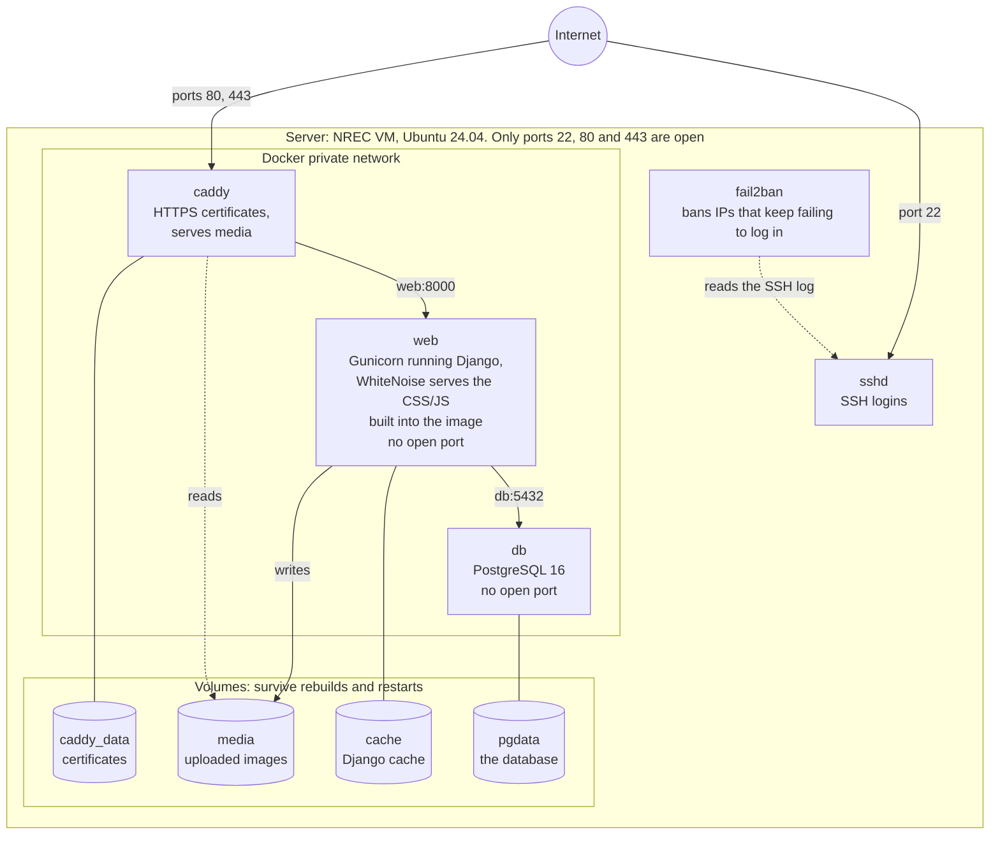
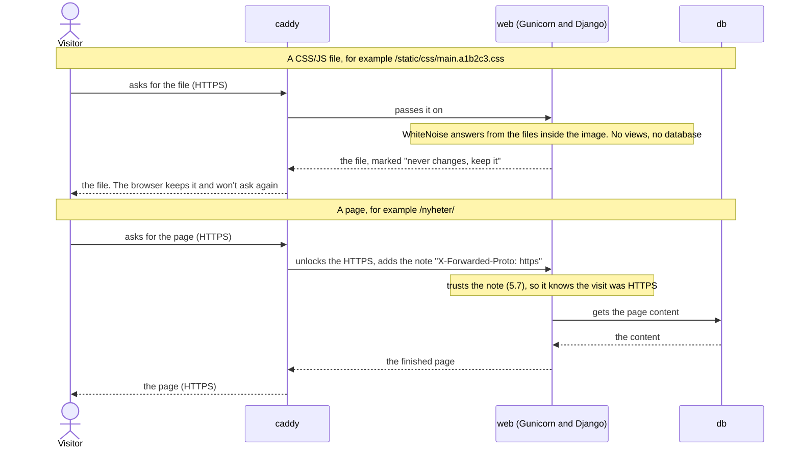
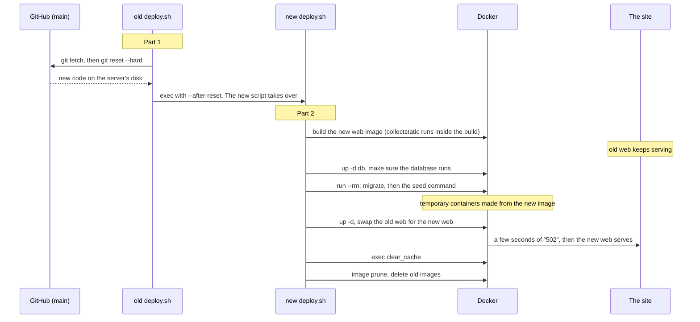

# Docker servers (Claude plan)

Last updated: 2026-10-14

Working plan for running the site with Docker on the servers: the Halloween mock site
first, the real site later. Delete this file when phase 2 is deployed.

---

## 1. Why we are doing this

Today, getting the website onto a new server is a long manual job.
`docs/operations/server_setup.md` has about 12 steps: install Python, install PostgreSQL,
install Nginx, get an HTTPS certificate, copy config files into the right places, and so on.
Every step is a chance to make a mistake, and the next person who looks after the site
has to learn all of it.

**The goal:** set up a new server in about 5 steps:

1. Install Docker.
2. Download the code (`git clone`).
3. Fill in one settings file (`.env`).
4. Point the domain name at the server.
5. Run one script.

We'll use this new setup in two places, in this order:

| When | What | Data |
|---|---|---|
| **Now, before Oct 19** | A **Halloween mock site** for the commit event, on its own new server | Fake data from a mock seed script |
| **After the event** | The **real site** (ifiplattform.no) moves over to the same setup | Real data, restored from a backup |

We do the mock site first because it's safe to experiment on. If something breaks, no real
users are affected. Once it has run well for a while, we trust it enough for the real site.

**This setup is for servers only.** Local development keeps using `docker-compose.yml` +
`Dockerfile.dev` as today. We don't run the server setup on our own computers (see 5.10
for why: HSTS).

---

## 2. Docker basics (just what you need for this plan)

You already use Docker for local development (`docker-compose.yml` + `Dockerfile.dev`),
so some of this will look familiar.

### Image
An **image** is a frozen package that holds everything a program needs to run: the
operating system files, Python, the installed packages and our code. Think of it as a
recipe that has already been cooked and put in the freezer. You build it once, and it's
identical on every computer.

### Dockerfile
A **Dockerfile** is the *recipe* for building an image, a list of steps such as "start from
Python 3.12", "install the packages in requirements.txt", "copy our code in".

### Container
A **container** is a *running copy* of an image, like heating up the frozen meal. You can
stop it, delete it and start a fresh one from the same image at any time. **Anything a
container writes inside itself is lost when the container is deleted.** That's why we need
volumes.

### Volume
A **volume** is a storage folder that Docker keeps *outside* the container, so it survives
when containers are deleted and recreated. We'll put the database files, uploaded images
(`media`) and HTTPS certificates in volumes.

### Docker Compose
Our site is several programs working together: the database, Django and a web server.
**Docker Compose** lets us describe all of them in one file (a `compose` YAML file). Then
one command, `docker compose up`, starts them all and connects them on a private network.
Inside that network, containers can reach each other by name. For example, Django reaches
the database at the address `db`.

### Is Docker heavy?
On a Linux server, no. A container is not a separate computer. It's a normal program
running on the server, fenced off so it only sees its own files and network, so it runs at
basically full speed. The extra cost is the Docker background program (~50–100 MB of
memory) and some disk space for images. Docker *feels* heavy on Windows/Mac because Docker
Desktop runs a hidden Linux virtual machine there. Servers don't need that.

### The `.env` file
A plain text file with settings and secrets (passwords, secret keys) in the form
`NAME=value`. It's never committed to git. Each server has its own. Docker Compose reads it
and passes the values into the containers.

---

## 3. The big picture: what changes on the server

### Today (no Docker)

```
Visitor ──HTTPS──▶ Nginx (installed on server)
                     │  ├─ /static/  → files in a folder
                     │  └─ /media/   → files in a folder
                     ▼
                  Gunicorn (started by systemd) runs Django
                     ▼
                  PostgreSQL (installed on server)

Certbot (installed on server) renews the HTTPS certificate
```

Each of those programs is installed and configured by hand.

### New (Docker)

```
Visitor ──HTTPS──▶ [caddy container]
                     │  └─ /media/   → "media" volume
                     ▼
                  [web container]  Gunicorn runs Django
                     │  └─ /static/  → WhiteNoise, from inside the image
                     ▼
                  [db container]   PostgreSQL → "pgdata" volume
```

The only thing installed on the server is **Docker** (plus fail2ban, see 5.8). Everything
else comes from images and is described in one compose file in the repo.

The three diagrams below are written in **Mermaid**: the picture is drawn from text, so
changing it means editing a few lines, not redrawing boxes. GitHub shows them as pictures.
In VS Code, install the "Markdown Preview Mermaid Support" extension
(`bierner.markdown-mermaid`) and open the Markdown preview. To try changes quickly, paste
a block into <https://mermaid.live>.

### The whole server in one picture



`web` and `db` have no open ports: only containers on the Docker network can reach them,
never the internet. The repo (with `.env` and `compose.prod.yml`) is a normal folder on
the server, made with `git clone`.

### What happens when someone visits a page



### What happens on a deploy (details in 5.6)



### Old part → new part

| Today | New | Notes |
|---|---|---|
| PostgreSQL installed with `apt` | `db` container (official `postgres:16` image) | Same version as today and as local dev |
| Python venv + `pip install` | Built into the `web` image by the `Dockerfile` | |
| Gunicorn started by `gunicorn.service` (systemd) | `web` container runs Gunicorn | Docker restarts it if it crashes or the server reboots |
| Nginx serving the site | `caddy` container | See section 4 |
| Nginx serving `/static/` from a folder | WhiteNoise, inside the `web` container | The CSS/JS is built into the image. See section 4 |
| Certbot for HTTPS certificates | Caddy does it by itself | No setup at all |
| `ifiplatform/.env` | `.env` in the repo root | Same kind of file, a few extra lines |
| `deploy/deploy.sh` | `deploy/docker/deploy.sh` | Same idea, Docker commands instead |

---

## 4. What we decided, and why

- **The mock site gets its own server (VM)**, so it can never slow down or break the real
  site. The real server only has 1 CPU and 4 GB of memory.
- **Caddy instead of Nginx.** Caddy is a web server like Nginx, but it gets and renews
  HTTPS certificates automatically. Nobody has to run Certbot, and its config file is about
  10 lines. That removes the hardest part of today's setup.
- **CSS/JS is built into the image and served by WhiteNoise.** `collectstatic` runs while
  the image is built, and WhiteNoise (a small Django package) serves those files from the
  `web` container. Every version of the site carries exactly its own CSS/JS, so nothing is
  shared between versions and nothing piles up. Uploaded files (`media`) are different:
  they live in a volume and Caddy serves them.
- **The image is built on the server**, not in GitHub Actions. No image registry, no extra
  tokens or logins to hand over.
- **fail2ban: only the SSH rule.** fail2ban blocks IP addresses that misbehave. We keep
  the SSH rule as it is today. We **drop** the "bot searching for /wp-admin" rule: those
  bots look for software we don't run and already get "404 Not found", so banning them
  protects very little. Keeping it would force Caddy onto the server's own network, with
  two Docker traps to understand and a custom filter that could stop working without
  anyone noticing. That's too much weight for the next person. See 5.8.
- **The server setup itself is a script too** (`setup_server.sh`, 5.9). Docker, fail2ban,
  folders and log settings are installed by one command instead of steps copied from a doc.
- **The mock site is public, but hidden from Google.** The data is fake, so there's nothing
  to protect, and event participants can share the link freely. Caddy adds the
  `X-Robots-Tag: noindex` header, which tells search engines not to list it.
- **We start with the mock site** (see section 1).

### Trade-offs: what each choice costs

Every choice gives something up. These are the costs we accept, and why.

| Choice | What we gain | What we give up | Why it's OK |
|---|---|---|---|
| **Docker instead of installing everything by hand** | About 5 setup steps instead of 12. Every server runs the exact same thing. | One more tool to learn. Debugging goes one layer deeper (`docker compose exec web ...` instead of just running `python`). | Contributors already use Docker for local dev, so it's not new to them. |
| **Caddy instead of Nginx** | HTTPS works by itself, and the config is ~10 lines. | Fewer tutorials and forum answers than Nginx. What people know from today's Nginx setup no longer applies. | Caddy's own docs are short and good, and our config is tiny. |
| **Building the image on the server** | No image registry, no extra tokens or accounts to hand over. | A build takes a few minutes and uses the server's CPU and memory while the site is running. Old images are deleted, so you can't instantly switch back to the previous image. | The old site keeps serving during the build. If the build fails, the deploy stops before anything changes. To roll back, revert the commit and deploy again, the same as today. |
| **The deploy script does every step (no entrypoint)** | One file decides the order of everything. | A plain `docker compose up` by hand after a build skips migrating. | The doc says: always deploy with `deploy.sh`. `docker compose restart` is still fine for a restart. |
| **The deploy script restarts itself** | Changes to `deploy.sh` take effect in the same deploy. One command, by hand or from GitHub. | The top of the script looks odd the first time you read it. | A short comment explains it, and today's deploy uses the same trick. |
| **CSS/JS inside the image, served by WhiteNoise** | Every version carries exactly its own files: nothing piles up, and code and CSS can never be out of step. One fewer volume and one fewer deploy step. | CSS/JS goes through Django instead of straight from Caddy. One new package and one line in `settings.py`. | Our own static files are ~0.5 MB (~13 MB with Wagtail's admin) and grow slowly. Browsers cache them. Uploads, the part that grows, stay with Caddy. Easy to reverse if ever needed. |
| **Some settings set in the compose file, not `.env`** | Fewer things to fill in, and values that can't disagree (one password, one domain). | Settings now live in two places, so you have to know where to look. | The `.env.example` and the doc both say which ones are in the compose file. |
| **Only the SSH rule in fail2ban** | No host networking, no Docker traps, no custom filter that can silently break. | Bots scanning for `/wp-admin` and similar aren't slowed down, and the log is noisier. | They get "404" and nothing else. The rule can be added back later. |
| **Everything on one server, database included** | Simple and cheap, the same as today. | If the server dies, the site is down until it's rebuilt. | Same as today. The rebuild becomes much faster: `setup_server.sh` + `deploy.sh` + restore the backup. |
| **A short gap on every deploy** | Simple: no second copy of the site to switch between. | A few seconds of "502" while the new `web` container starts. | Today's `systemctl restart gunicorn` has the same gap. Phase 2 brings back the warning banner. |
| **The Halloween repo gets the files by hand** | No need to share git history between the two repos. | A fix made in one repo doesn't reach the other by itself. | The mock site is short-lived. Fix things here first, then copy them over. |

---

## 5. Phase 1: Add the Docker files to this repo

**Target: done within about 2 days.** This is the main work. Here's every file, what it is
and why we need it.

### 5.1 `requirements.txt` and `settings.py`: Gunicorn and WhiteNoise
**Gunicorn.** Add one line to `requirements.txt`, `gunicorn==<version>`.
Gunicorn is the program that runs Django on a server. Right now it was installed
by hand on the prod server and isn't listed anywhere, so the Docker image wouldn't include
it. We'll use the same version as the prod server (found with `venv/bin/pip show gunicorn`
on the server), so nothing changes for the real site. This also fixes a known issue
already listed in `server_setup.md`.

**WhiteNoise.** Add `whitenoise==<newest version>` to `requirements.txt`, and add
`"whitenoise.middleware.WhiteNoiseMiddleware"` to `MIDDLEWARE` in `settings.py`, right
after `SecurityMiddleware` (where WhiteNoise's docs say it goes). It serves the files in
`STATIC_ROOT` at `/static/`, and tells browsers to keep files with a hash in their name
(like `main.a1b2c3.css`) forever. Our `LenientManifestStaticFilesStorage` stays as it is.
- **Local dev:** keeps working. With `DEBUG=True`, WhiteNoise finds files in the app
  folders directly, like `runserver` does today.
- **The real site before phase 2:** Nginx keeps serving `/static/` itself, so WhiteNoise
  is installed but unused there until the move.
- **This is a Django change**, so run the test suite once after it.

### 5.2 `Dockerfile`: the recipe for the server image
**What:** a new file in the repo root. `Dockerfile.dev`, the one used for local
development, stays as it is.
**Steps in the recipe:**
1. Start from `python:3.12-slim`, a small Linux with Python 3.12 (same as today).
2. Copy `requirements.txt` in and `pip install` it.
3. Copy the `ifiplatform/` folder (our Django code) into `/app` in the image.
4. Create a normal user called `app` and run as that user. Running as the all-powerful
   `root` user is a security risk.
5. Run `collectstatic`, so the CSS/JS ends up in `/app/staticfiles/` *inside the image*.
   `settings.py` refuses to load without a secret key, and with `DEBUG` off it builds
   the cache path from `DB_NAME`, so this one command gets placeholders for both:
   `DJANGO_SECRET_KEY=build-only DB_NAME=build-only python manage.py collectstatic --noinput`.
   `collectstatic` never connects to the database. The placeholders only exist for that
   command. The real key is never in the image.
6. Create empty `media/` and `django_cache/` folders owned by `app`, so Django is allowed
   to write into them.
7. Say what to run when a container starts (`CMD`): Gunicorn with the same settings as
   today (3 workers, 30-minute timeout). Nothing else.

**How it differs from `Dockerfile.dev`:** the dev version *shares* your code folder into
the container, so edits show up live. The server version *copies* the code into the image,
so the server runs exactly the version that was built.

**Why there is no "entrypoint" script that runs `migrate` on start:** a start-up script
would also run on every restart, after every crash, and every time we use
`docker compose run web <command>`. Migrations would then happen at moments nobody chose,
without the backup the real site needs first. Keeping that step in the deploy script
(5.6) means there's one place that decides the order, and one fewer file to understand.

### 5.3 `compose.prod.yml`: the description of the whole stack
**What:** a new compose file in the repo root. It's separate from `docker-compose.yml`,
which stays the local dev setup and isn't touched.

**Image versions are pinned** (`postgres:16`, `caddy:2`), so an update can't sneak in by
itself. **Never change `postgres:16` to a newer major version without a dump and restore.**
PostgreSQL can't read another major version's data files, and the database won't start.

**It describes 3 containers ("services"):**

**`db`**: the database.
- Uses the official `postgres:16` image.
- Gets its database name, user and password from the same `DB_NAME`, `DB_USER` and
  `DB_PASSWORD` values Django uses. The compose file maps them, e.g.
  `POSTGRES_PASSWORD: ${DB_PASSWORD}`, so the password is written in `.env` only once and
  the two can't disagree.
- Stores its data in the `pgdata` volume, so the data survives restarts and rebuilds.
- Has a "healthcheck", so other containers can wait until the database is ready
  (copied from the dev compose file).

**`web`**: Django + Gunicorn.
- Built from our `Dockerfile` (5.2).
- Reads all settings from `.env`. A few are set by the compose file itself instead, so
  nobody has to fill them in: `USE_POSTGRES=True`, `DB_HOST=db`,
  `DJANGO_ALLOWED_HOSTS=${SITE_DOMAIN}`, `CSRF_TRUSTED_ORIGINS=https://${SITE_DOMAIN}`, and
  `FORWARDED_ALLOW_IPS=*` (see 5.7).
- Uses the `media` volume (uploaded files) and the `cache` volume. CSS/JS needs no
  volume: it's inside the image (5.2).
- Has **no published port** (no `ports:` line). It's only reachable from the other
  containers on Docker's private network, so it's **not reachable from the internet**.
  Only Caddy can talk to it.
- Waits for `db` to be healthy before starting.

**`caddy`**: the front door.
- Uses the official `caddy:2` image.
- The only container open to the internet, on ports 80 (HTTP) and 443 (HTTPS).
- On the same private network as the others, so it reaches Django by name: `web:8000`.
- Can *read* (not change) the `media` volume, so it can serve uploaded files quickly
  without bothering Django.
- Stores its HTTPS certificates in the `caddy_data` volume, so it doesn't ask for new
  certificates on every restart (Let's Encrypt limits how often you can ask).

All three get `restart: unless-stopped`, so Docker starts them again after a crash or a
server reboot. That replaces what systemd does for Gunicorn today.

All three also get a **log size limit** (`max-size: 10m`, `max-file: 3`). By default Docker
keeps everything a container prints, forever. On a 20 GB disk that eventually fills up
and takes the site down. The limit keeps the newest ~30 MB per container.

### 5.4 `deploy/docker/Caddyfile`: Caddy's settings
**What it says, in plain words:**
- "Serve the website at the domain in `SITE_DOMAIN`, and get an HTTPS certificate for it."
- "Requests starting with `/media/`: answer with the file from the volume."
- "Everything else, `/static/` included: pass it on to Django (`web:8000`)."
- "Log each request" to Caddy's normal output, so it shows up in
  `docker compose logs caddy`. The Docker log size limit (5.3) throws away old lines.
  Visitor IP addresses count as personal data, so it's good that we don't keep them forever.
- "Allow uploads up to 20 MB." Caddy has no limit by default, so this is a safety cap.
  The known 1 MB upload problem in `server_setup.md` comes from Nginx's default, so it
  goes away when Nginx does.
- "Compress responses" (gzip), so pages load faster.
- "Only HTTP/1 and HTTP/2." HTTP/3 needs UDP port 443, which the security group doesn't
  open. Without this line, browsers would try HTTP/3 first and wait for it to fail.
- "Add the `X-Robots-Tag` header from the `ROBOTS_TAG` setting." The mock site sets it to
  `noindex, nofollow` (hide from Google). The real site leaves it at the default, `all`
  (normal).

### 5.5 `deploy/docker/.env.example`: template for the settings file
**What:** a template you copy to `.env` in the repo root on the server, then fill in.
`.env` is already ignored by git, so secrets never get committed.
**It contains only what a person actually has to decide** (the rest is set in the compose
file, 5.3):
- `DJANGO_SECRET_KEY`, `DEBUG`, `DB_NAME`, `DB_USER`, `DB_PASSWORD`, and the optional
  email, DeepL and Umami settings, same as today's `ifiplatform/.env.example`.
- `COMPOSE_FILE=compose.prod.yml`. This tells Docker Compose to use the server compose
  file, so on the server you can type `docker compose logs` instead of
  `docker compose -f compose.prod.yml logs`.
- `SITE_DOMAIN`: the address the site is served at. Used by Caddy, and by the compose file
  to fill in Django's allowed hosts and CSRF setting.
- `ROBOTS_TAG`: see 5.4.
- `SEED_COMMAND`: the name of a management command the deploy script runs after
  migrating, to fill the site with fake content. Empty on the real site (nothing runs).
  The mock site sets it to its own mock seed script (see 6.1).
- `DEPLOY_BRANCH`: which git branch the server runs (normally `main`).
- A clearly marked block with "values for the mock site": `DEBUG=False`, `SEED_COMMAND`
  set, and email, DeepL and Umami left empty, because the mock site doesn't need them.

**A trap to write next to `DB_PASSWORD`:** PostgreSQL only reads the password the very
first time it creates the database. Changing `DB_PASSWORD` in `.env` later does *not*
change the database's password. Django then can't log in. To change it, change it inside
the database too (`ALTER USER ... PASSWORD ...`).

### 5.6 `deploy/docker/deploy.sh`: the one script you run
Used both for the **first setup** and for **every update afterwards**, by hand or from
GitHub Actions. It's always just `bash deploy/docker/deploy.sh`.

**It runs in two parts, the same trick as today's `deploy/deploy.sh`:**

The script pulls new code, and that new code may include a changed `deploy.sh`. Without
the trick, the script that's already running would carry on with the *old* instructions.
A step added in the same pull request as the code that needs it would be silently skipped
on that deploy. So:

- **Part 1** (old copy of the script): get the newest code, then use `exec` to start the
  freshly downloaded `deploy.sh` with the flag `--after-reset`. `exec` *replaces* the
  running script, so the old copy never runs another line.
- **Part 2** (new copy, started with `--after-reset`): everything else. The flag tells it
  not to pull again, otherwise it would restart itself forever.

The script starts with a short comment explaining this, like today's.

| Part | # | Command (simplified) | What it does |
|---|---|---|---|
| 1 | 1 | `git fetch` + `git reset --hard origin/$DEPLOY_BRANCH` | Gets the newest code |
| 1 | 2 | `exec bash deploy/docker/deploy.sh --after-reset` | Restarts on the new copy of this script |
| 2 | 3 | `docker compose build` | Builds a new `web` image from the new code, CSS/JS included (5.2) |
| 2 | 4 | `docker compose up -d db` | Starts the database (if not already running) |
| 2 | 5 | `docker compose run --rm web python manage.py migrate` | Updates the database tables. `run --rm` means "start a temporary container, run this one command, then delete it" |
| 2 | 6 | *(only if `SEED_COMMAND` is set)* `... python manage.py $SEED_COMMAND` | Fills in fake content. The seed script must skip anything that already exists, so it's safe on every deploy |
| 2 | 7 | `docker compose up -d` | Starts or replaces all containers with the new versions. `-d` means "run in the background" |
| 2 | 8 | `docker compose exec web python manage.py clear_cache` | Clears Django's cache, same as today's deploy. `exec` runs a command inside an already running container |
| 2 | 9 | `docker image prune -f` + `docker builder prune -f --filter until=168h` | Deletes old unused images, and build cache unused for a week, so the disk doesn't fill up |

Two things from today's deploy are left for phase 2 (the real site): the backup before
migrating, and the 10-minute "the site is about to restart" banner for visitors.

### 5.7 One technical trap we must avoid: "too many redirects"

**The problem:** the real site forces HTTPS (`SECURE_SSL_REDIRECT` in `settings.py`).
Django decides "is this request HTTPS?" by trusting a note that the front door adds to
each request (`X-Forwarded-Proto: https`). Gunicorn only trusts that note from addresses
it knows (by default only `127.0.0.1`). Today Nginx talks to Gunicorn through a local
socket file, which Gunicorn always trusts. In Docker, Caddy's requests reach Gunicorn
over Docker's private network, so they arrive from a Docker address Gunicorn doesn't
know, and Gunicorn ignores the note. Django then thinks the request is plain HTTP and
redirects to HTTPS, which comes back as "HTTP" again, and that repeats forever. The
browser shows "too many redirects".

**The fix:** set `FORWARDED_ALLOW_IPS=*` on the `web` container ("trust the note from
anyone"), in the compose file. This is safe because `web` has no published port, so only
Caddy can reach it. No change to `settings.py` is needed.

### 5.8 fail2ban: only the SSH rule

**What it does:** bots try to log in over SSH with guessed passwords. fail2ban reads the
server's SSH log, and when one IP address fails too many times, it blocks that IP for a
while. This works the same as today, because SSH runs on the server itself, not in
Docker.

**The file (in the repo, copied onto the server by `setup_server.sh`):**
`deploy/docker/fail2ban/jail.local`, with:
- `sshd`: same settings as today.
- `ignoreip`: never ban the server itself (`127.0.0.1`, `::1`).

**Dropped from today's setup, and why:**
- `nginx-botsearch` (bans bots looking for `/wp-admin`, `/phpmyadmin` and so on). We
  don't run that software, so those requests already get "404 Not found" and the bot
  gets nothing. To do the same with Docker, Caddy would need to use the server's own
  network so that real visitor IPs show up and bans actually block. It would also need
  a custom log filter, which could quietly stop matching after a Caddy update without
  anyone noticing. That's a lot of setup for little protection. It's easy to add back
  later if it's ever needed.
- `nginx-http-auth`. It watches for wrong passwords on Nginx password-protected pages.
  We have none, so it does nothing today either.

**Not covered, same as today:** someone guessing passwords on the Wagtail login page.
Django answers a wrong password with a normal page (status 200), so a log can't tell it
apart from a normal visit. If we want that protection later, it belongs in Django (for
example the `django-axes` package), not in fail2ban. That would be a separate task.

### 5.9 `deploy/docker/setup_server.sh`: preparing a fresh server
**What:** a script you run once on a brand-new Ubuntu server (with `sudo`). It replaces
most of the manual steps in `server_setup.md`, so the next person can't miss one:
1. Installs Docker (`docker.io`, `docker-compose-v2`) and fail2ban with `apt`.
2. Lets the `ubuntu` user run Docker without `sudo` (adds it to the `docker` group).
3. Copies `jail.local` from 5.8 into `/etc/fail2ban/` and restarts fail2ban.
4. Adds a 2 GB swap file if the server has none: extra emergency memory on disk, so a
   build can't crash the server even if memory runs short.
5. Sets the automatic security-updates time to 04:00, same as today's server
   (`server_setup.md` step 2).

It's safe to run again: each step checks whether it's already done. Running it a second
time on an existing server also brings the fail2ban rule up to date.

### 5.10 Docs for people (in `docs/`, each with a `Last updated:` date)
- **New `docs/operations/docker_server.md`**: the guide for the next person:
  - What the setup is (a short version of sections 2–3 of this plan), and that it's for
    servers only. Local development uses the dev Docker setup.
  - **Setting up a new server**, step by step: create the VM in NREC (open only ports 22,
    80 and 443) → `git clone` → `sudo bash deploy/docker/setup_server.sh` → log out and
    back in (so the Docker group applies) → copy and fill in `.env` → add the DNS record →
    `bash deploy/docker/deploy.sh` → create an admin user with
    `docker compose exec web python manage.py createsuperuser`.
  - **fail2ban:** how to see who is banned (`sudo fail2ban-client status sshd`) and how
    to unban someone (`sudo fail2ban-client set sshd unbanip <ip>`).
  - **Everyday commands:** see logs (`docker compose logs -f web`), open a Django shell,
    restart, check what's running (`docker compose ps`).
  - **Things never to do:** change `postgres:16` to a new major version without a dump
    and restore (5.3). Change `DB_PASSWORD` without also changing it in the database (5.5).
  - **HTTPS and HSTS**, a short section. With `DEBUG=False`, Django tells browsers "use
    only HTTPS for this domain *and all its subdomains*, for a year" (HSTS). Browsers
    remember this, and the server can't take it back. That means:
    - Every `*.ifiplattform.no` subdomain must have HTTPS. Caddy handles that, but a
      quick test server on plain HTTP under our domain won't open for anyone who has
      visited the main site.
    - Don't submit the domain to the browser "preload list" (hstspreload.org). It makes
      the rule permanent and is very slow to undo.
    - If Caddy can't get or renew a certificate (wrong DNS, port 80 blocked, Let's Encrypt
      limits), visitors get an error they *can't click past*. The site is simply down.
      First thing to check: `docker compose logs caddy`.
    - Don't run the server setup on `localhost`. The browser would remember "localhost is
      HTTPS-only" and break the dev setup at `http://localhost:8000`.
- **`docs/architecture/docker_setup.md`**: it currently says "Production doesn't use
  Docker". Change it to point to the new doc, and say the real site is still on the old
  setup until phase 2.
- **`docs/operations/server_setup.md`**: its note "Docker could replace…" now points to the
  new doc.

---

## 6. Phase 1b: Put the Halloween mock site online

**Right after phase 1.** The Halloween repo is a *copy* of this repo with no shared git
history, so we can't "merge" the new files into it. We copy them by hand.

1. **Mock seed script** (separate task, done in the Halloween repo): a management command
   with the mock site's own fake content, alongside other changes to the mock site. It
   must skip anything that already exists, because `deploy.sh` runs it on every deploy.
   Its name goes in `SEED_COMMAND` in the mock server's `.env`.
2. **Copy these files** from this repo into the Halloween repo: `Dockerfile`,
   `compose.prod.yml`, the whole `deploy/docker/` folder (including `setup_server.sh` and
   the `fail2ban/` folder), the new `gunicorn` and `whitenoise` lines in
   `requirements.txt`, the WhiteNoise line in `MIDDLEWARE` in `settings.py`, and
   `.dockerignore`.
3. **Create a new server** in NREC: **`m1.medium`** (1 vCPU, 4 GB RAM, 20 GB disk), the
   same size as the real site's server. It's a rehearsal: in phase 2 the real site runs
   this exact setup on an `m1.medium`, so if the mock site runs well, we know it fits.
   Rough memory use: database (~200 MB) + 3 Django workers (~600 MB) + Caddy (~30 MB),
   plus several hundred MB extra while a new image is being built during a deploy.
   Each build makes a ~1 GB image. The deploy script deletes old ones, but 20 GB of disk
   gives margin.

   *Fallback if the NREC quota is tight:* `m1.small` works for fake data. The swap file
   that `setup_server.sh` adds keeps builds from running out of memory.

   Also use Ubuntu 24.04 like the real server, and the security group with only ports 22,
   80 and 443 open.
4. **Add a DNS record** for a subdomain, e.g. `halloween.ifiplattform.no`, pointing at the
   new server's IP address. Caddy needs this before it can get a certificate.
5. **Follow `docker_server.md`** using the "mock site" values in `.env`.
6. **Create an admin login** with `createsuperuser`. Don't use the dev seed's `admin/admin`:
   that password is public in our repo, and anyone could log in on a public site.
7. **Optional, but great for the event:** a GitHub Actions workflow in the Halloween repo
   that runs `bash deploy/docker/deploy.sh` on the server every time something is merged
   into `main`. Participants then see their fixes go live within minutes. It works like
   today's `.github/workflows/deploy.yml`, but with the Halloween repo's own secrets
   (server IP, SSH key).

---

## 7. Phase 2: Move the real site over (after Oct 19, separate task)

Not part of this task. It's listed so we don't build anything in phase 1 that gets in the
way.

- **Scheduled jobs.** Today systemd timers run DeepL translation (every minute), nightly
  translation cleanup, the Peoply event sync and the daily backup. Leaning: keep the
  existing timer files and change each command to
  `docker compose exec web python manage.py ...`. That's a small change, and the files
  stay familiar. (`run --rm` would start a fresh container every minute, which is too
  heavy on 1 CPU.) The mock site won't run them.
- **Backups.** Rewrite `backup_db.sh` to take the database dump from the `db` container and
  copy the `media` volume to `/mnt/backups`. The deploy script runs it before migrating.
- **Redirect** `ifiplattform.no` → `www.ifiplattform.no` in the Caddyfile.
- **fail2ban needs no work.** The mock server already runs the same setup (5.8).
- **Deploy extras:** the visitor countdown banner and the DeepL glossary sync.
- **Move the diagrams and trade-offs into the human docs.** Copy the three Mermaid
  diagrams from section 3 ("The whole server in one picture", "What happens when someone
  visits a page", "What happens on a deploy"), the short note on how to view them, and
  the trade-offs table from section 4 into `docs/architecture/docker_setup.md`. That doc
  then covers both the local and the server setup. Also add `bierner.markdown-mermaid`
  to `.vscode/extensions.json`, so VS Code suggests it to everyone. Update them to match
  what was actually built (for example the real domain and the `www` redirect). Link to them from `docs/operations/docker_server.md`, update that
  doc's line in `docs/README.md`, and bump `Last updated:`. **This must be done before
  this plan is deleted**, or the diagrams are lost.
- **The move itself:** take a final backup on the old server → load it into the new
  `db` container and copy media into the `media` volume → switch DNS → shut down the old
  server → update `prod_server.md`, `server_setup.md` and `backups_and_recovery.md`.

---

## 8. How we check that it works

We don't run the server setup on our own computers (HSTS, see 5.10), so the checks happen
on the mock server.

**On the mock server, the site itself:**
- The site opens on the subdomain with a real, valid HTTPS certificate (padlock, no
  warning) and no "too many redirects" error, so the trap in 5.7 is fixed.
- Pages have their styling, so WhiteNoise serves `/static/`.
- Browsers are told to keep CSS/JS: `curl -I` on a hashed file from a page's HTML (like
  `/static/css/<name>.<hash>.css`) shows `Cache-Control: max-age=315360000, public, immutable`.
- Images show, so `/media/` works.
- Uploading an image bigger than 1 MB in the Wagtail admin works.
- The `X-Robots-Tag` header is present: `curl -I https://<mock-domain>`.
- Secrets can't be downloaded: `curl -I https://<mock-domain>/.env` gives 404.
- Django can't be reached around Caddy: from your own computer,
  `curl http://<server-ip>:8000` fails to connect.

**On the mock server, the deploy script:**
- Run `deploy.sh` **a second time**. It should finish without errors, and nothing is
  duplicated.
- Self-restart works: commit a harmless change to `deploy.sh` (e.g. a new `echo`), deploy,
  and check that the new line is printed in that same deploy.
- Run `docker compose restart`. Everything comes back, and the data is still there.
- Reboot the server. The site comes back up by itself.
- If the auto-deploy workflow was added: merge a small change into the Halloween repo's
  `main` and watch it appear on the site.

**On the mock server, fail2ban and setup:**
- The SSH rule is active: `sudo fail2ban-client status` lists `sshd`.
- Running `setup_server.sh` a second time finishes without errors and changes nothing.

**Tests:** the WhiteNoise change (5.1) touches `settings.py`, so run the test suite once
after it. CI is unchanged.
