# Commit for Candy: 🍬 candy issues (for review)

The 48 🍬 candy event issues (46 to claim, 2 sets) exactly as they will be posted on GitHub, generated on 2026-10-18. The other sizes are in [event_issues_chocolate.md](event_issues_chocolate.md) and [event_issues_pumpkin.md](event_issues_pumpkin.md). Under each issue is a screenshot of what it looks like when it's done, taken from the site with every issue done. Issues refer to each other by ID (P10a, SET-moon); the creation script turns those into issue numbers. Delete these files and their image folder once the issues are on GitHub.

---

# C1: Make the home page dark
`🍬 candy` · `🎨 restyle` · Feature

**Reward:** 1 🪙 · **Time:** about 6 min  
**Good to know first:** nothing, everything is explained

### What to do
In the Halloween design, the home page has a dark grey background. Make it dark, and make the text that sits right on the background light, so it stays readable.

### Files to change (only these)
- `ifiplatform/static/css/07_halloween/page_background.css` (empty, already loaded on every page)

### Solution to start from
Paste this into the file:
```css
:root:has(#home-shortcuts),
:root:has(#home-shortcuts) body {
    background-color: #2b2b30;
}

:root:has(#home-shortcuts) .newsbar-heading,
:root:has(#home-shortcuts) .home-navbar .link .drop-option {
    color: #f2eff6;
}
```

#### Explanation (optional)
- `:root` is the whole page (the `<html>` element). `:has(#home-shortcuts)` means "only if the page contains the home page shortcuts", so **only the home page** turns dark. Other pages keep their light background.
- Both the page (`:root`) and `body` get the colour. Otherwise the bottom of a long page stays light.
- The second rule makes the "Siste nyheter" heading and the menu links above the shortcuts light grey, because dark text on a dark background is unreadable.

### Make it yours
- Another dark colour: `#1a0d2e` is a midnight purple, `#0f1a12` a swampy green.
- A spooky fade from top to bottom: `background-image: linear-gradient(#2b2b30, #120e16);` in the first rule.
- **Pick your own colour:** in VS Code, every colour code in a `.css` file has a small coloured square in front of it. Click the square to get a colour picker; the code changes as you pick. Or search "color picker" on Google, choose a colour, and copy the **HEX** code (the one that starts with `#`, like `#ff7518`).

### Done when
- The home page is dark grey from top to bottom, and every text on it is still easy to read.
- Other pages, like an article, are still light.

### How to work on it
Set up the project on your own computer first (see **Get started** in the README). Then:

1. **Claim this issue** on the site: https://halloween.ifiplattform.no/commits/issues/
2. In the VS Code terminal:
   ```bash
   ifi fix-issue {number}
   ```
3. Make the change, and check it at http://localhost:8000. Reload with **Ctrl+Shift+R** (Mac: **Cmd+Shift+R**): a normal reload may show the old look, because the browser keeps old copies of CSS files and pictures. Still old? Try a private window.
4. Then:
   ```bash
   ifi test
   git add .
   git commit -m "Short description of what you changed"
   ifi pull-request
   ```

**Only change the files listed above.** Then your pull request can't clash with anyone else's. After the merge it can take a few minutes before it shows on the live site. Stuck? Ask a helper, or type `ifi help`.

#### What it looks like when it's done
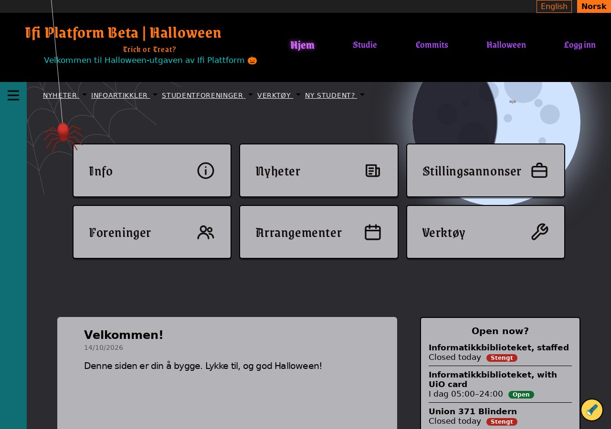

---

# C10: The shortcut cards wiggle on hover
`🍬 candy` · `🦇 silly feature` · Feature

**Reward:** 1 🪙 · **Time:** about 6 min  
**Good to know first:** nothing, everything is explained

### What to do
Make each shortcut card on the home page give a little nervous wiggle when you move the mouse over it.

### Files to change (only these)
- `ifiplatform/static/css/07_halloween/shortcut_hover.css` (empty, already loaded on every page)

### Solution to start from
Paste this into the file:
```css
@keyframes shortcut-wiggle {
    0%,
    100% {
        rotate: 0deg;
    }
    25% {
        rotate: -2deg;
    }
    75% {
        rotate: 2deg;
    }
}

#home-shortcuts .shortcut-card:is(:hover, :has(:focus-visible)) {
    animation: shortcut-wiggle 0.4s ease-in-out;
}

@media (prefers-reduced-motion: reduce) {
    #home-shortcuts .shortcut-card:is(:hover, :has(:focus-visible)) {
        animation: none;
    }
}
```

#### Explanation (optional)
- `@keyframes` describes a movement: straight at the start and end, tilted left at 25%, tilted right at 75%. `deg` means degrees: `-2deg` tilts the card 2 degrees to the left.
- The second rule plays it once, in 0.4 seconds, when the mouse is over a card or you Tab to it.
- Some people turn animations off in their computer's settings, because movement makes them dizzy. `prefers-reduced-motion: reduce` is that setting: then the card doesn't wiggle.

### Make it yours
- A wilder wiggle: bigger angles (`5deg`), or more steps in the keyframes.
- Wiggle for as long as the mouse is there: add `infinite` after `ease-in-out`.

### Done when
- Each card wiggles once when you hover over it, and not at all with animations turned off.

### How to work on it
Set up the project on your own computer first (see **Get started** in the README). Then:

1. **Claim this issue** on the site: https://halloween.ifiplattform.no/commits/issues/
2. In the VS Code terminal:
   ```bash
   ifi fix-issue {number}
   ```
3. Make the change, and check it at http://localhost:8000. Reload with **Ctrl+Shift+R** (Mac: **Cmd+Shift+R**): a normal reload may show the old look, because the browser keeps old copies of CSS files and pictures. Still old? Try a private window.
4. Then:
   ```bash
   ifi test
   git add .
   git commit -m "Short description of what you changed"
   ifi pull-request
   ```

**Only change the files listed above.** Then your pull request can't clash with anyone else's. After the merge it can take a few minutes before it shows on the live site. Stuck? Ask a helper, or type `ifi help`.

#### What it looks like when it's done
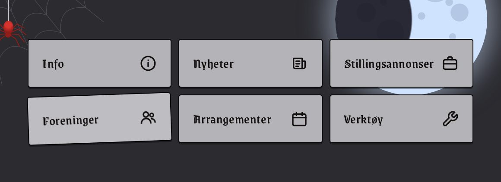

*Caught mid-wiggle: the mouse is over Foreninger.*

---

# C17: A grey message board
`🍬 candy` · `🎨 restyle` · Feature

**Reward:** 1 🪙 · **Time:** about 5 min  
**Good to know first:** nothing, everything is explained

### What to do
The message board on the home page (the box with "Velkommen!") is white. Make it grey, to match the Halloween look.

### Files to change (only these)
- `ifiplatform/static/css/07_halloween/messageboard.css` (empty, already loaded on every page)

### Solution to start from
Paste this into the file:
```css
.messageboard {
    background-color: #b4b4b8;
    border-radius: 6px;
    box-shadow: none;
}
```

#### Explanation (optional)
- `.messageboard` is the whole box.
- `box-shadow: none` removes its soft shadow: a soft shadow is hard to see on a dark page anyway.
- The box has no border, and that's on purpose: leave it without one.

### Make it yours
- Another grey: `#9a9aa0` is darker, `#d0d0d4` lighter. Keep the text easy to read.
- **Pick your own colour:** in VS Code, every colour code in a `.css` file has a small coloured square in front of it. Click the square to get a colour picker; the code changes as you pick. Or search "color picker" on Google, choose a colour, and copy the **HEX** code (the one that starts with `#`, like `#ff7518`).

### Done when
- The message board is grey, without a border, and all its text is still easy to read.

### How to work on it
Set up the project on your own computer first (see **Get started** in the README). Then:

1. **Claim this issue** on the site: https://halloween.ifiplattform.no/commits/issues/
2. In the VS Code terminal:
   ```bash
   ifi fix-issue {number}
   ```
3. Make the change, and check it at http://localhost:8000. Reload with **Ctrl+Shift+R** (Mac: **Cmd+Shift+R**): a normal reload may show the old look, because the browser keeps old copies of CSS files and pictures. Still old? Try a private window.
4. Then:
   ```bash
   ifi test
   git add .
   git commit -m "Short description of what you changed"
   ifi pull-request
   ```

**Only change the files listed above.** Then your pull request can't clash with anyone else's. After the merge it can take a few minutes before it shows on the live site. Stuck? Ask a helper, or type `ifi help`.

#### What it looks like when it's done
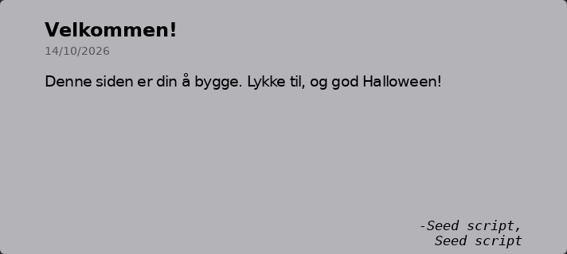

---

# C18: A spooky "Siste nyheter" heading
`🍬 candy` · `🎨 restyle` · Feature

**Reward:** 1 🪙 · **Time:** about 5 min  
**Good to know first:** nothing, everything is explained

### What to do
Make the "Siste nyheter" heading above the news on the home page big, centred and in the spooky font.

### Files to change (only these)
- `ifiplatform/static/css/07_halloween/news_heading.css` (empty, already loaded on every page)

### Solution to start from
Paste this into the file:
```css
.newsbar-heading--news {
    font-family: var(--font-spooky);
    font-size: 2rem;
    font-weight: 500;
    text-align: center;
    letter-spacing: 0.03em;
}
```

#### Explanation (optional)
- `.newsbar-heading--news` is the news heading.
- `var(--font-spooky)` is the spooky font, already loaded on every page.
- Leave the colour as it is: the issue that makes the home page dark already makes this heading light.

### Make it yours
- Bigger or smaller: change `font-size`.
- A faint glow: `text-shadow: 0 0 10px rgba(255, 255, 255, 0.4);`.

### Done when
- "Siste nyheter" is big, centred and spooky, and still fits on one line.

### How to work on it
Set up the project on your own computer first (see **Get started** in the README). Then:

1. **Claim this issue** on the site: https://halloween.ifiplattform.no/commits/issues/
2. In the VS Code terminal:
   ```bash
   ifi fix-issue {number}
   ```
3. Make the change, and check it at http://localhost:8000. Reload with **Ctrl+Shift+R** (Mac: **Cmd+Shift+R**): a normal reload may show the old look, because the browser keeps old copies of CSS files and pictures. Still old? Try a private window.
4. Then:
   ```bash
   ifi test
   git add .
   git commit -m "Short description of what you changed"
   ifi pull-request
   ```

**Only change the files listed above.** Then your pull request can't clash with anyone else's. After the merge it can take a few minutes before it shows on the live site. Stuck? Ask a helper, or type `ifi help`.

#### What it looks like when it's done


---

# C2: The logo goes orange and spooky
`🍬 candy` · `🎨 restyle` · Feature

**Reward:** 1 🪙 · **Time:** about 6 min  
**Good to know first:** nothing, everything is explained

### What to do
Make the site name at the top left, "Ifi Platform Beta | Halloween", pumpkin orange and in a spooky font.

### Files to change (only these)
- `ifiplatform/static/css/07_halloween/logo.css` (empty, already loaded on every page)

### Solution to start from
Paste this into the file:
```css
.ifiplatform-logo {
    color: #ff7518;
    font-family: var(--font-spooky);
    font-size: 2.2rem;
    letter-spacing: 0.02em;
}

.ifiplatform-logo:hover {
    color: #ffb15c;
}
```

#### Explanation (optional)
- `.ifiplatform-logo` is the link with the site name in the header.
- `var(--font-spooky)` is the spooky font, Grenze Gotisch. It's already loaded on every page, so you can just use it.
- `letter-spacing` puts a little more room between the letters, so the curly font is easier to read.
- The `:hover` rule makes it a lighter orange when the mouse is over it.

### Make it yours
- Bigger or smaller: change `font-size`.
- Another colour: `#b44cff` is poison purple, `#8de9a8` slime green.
- A glow: `text-shadow: 0 0 12px rgba(255, 117, 24, 0.7);` in the first rule.
- **Pick your own colour:** in VS Code, every colour code in a `.css` file has a small coloured square in front of it. Click the square to get a colour picker; the code changes as you pick. Or search "color picker" on Google, choose a colour, and copy the **HEX** code (the one that starts with `#`, like `#ff7518`).

### Done when
- The site name is orange and spooky on every page, and still fits on one line.

### How to work on it
Set up the project on your own computer first (see **Get started** in the README). Then:

1. **Claim this issue** on the site: https://halloween.ifiplattform.no/commits/issues/
2. In the VS Code terminal:
   ```bash
   ifi fix-issue {number}
   ```
3. Make the change, and check it at http://localhost:8000. Reload with **Ctrl+Shift+R** (Mac: **Cmd+Shift+R**): a normal reload may show the old look, because the browser keeps old copies of CSS files and pictures. Still old? Try a private window.
4. Then:
   ```bash
   ifi test
   git add .
   git commit -m "Short description of what you changed"
   ifi pull-request
   ```

**Only change the files listed above.** Then your pull request can't clash with anyone else's. After the merge it can take a few minutes before it shows on the live site. Stuck? Ask a helper, or type `ifi help`.

#### What it looks like when it's done


---

# C20: A grey events box with a black border
`🍬 candy` · `🎨 restyle` · Feature

**Reward:** 1 🪙 · **Time:** about 6 min  
**Good to know first:** nothing, everything is explained

### What to do
On the home page, the "Happening at Ifi" box on the right is white with rounded corners. Make it grey with a black border, like the shortcut cards.

### Files to change (only these)
- `ifiplatform/static/css/07_halloween/eventsbox_box.css` (empty, already loaded on every page)

### Solution to start from
Paste this into the file:
```css
.eventsbox_container {
    background-color: #b4b4b8;
    border: 2px solid #000;
    border-radius: 6px;
    box-shadow: none;
}

.eventsbox_container h2 {
    padding: 0 0 0.8rem;
    font-size: 1.3rem;
    text-decoration: none;
}
```

#### Explanation (optional)
- `.eventsbox_container` is the whole box. `border: 2px solid #000` is a black border, 2 pixels thick, all round.
- `.eventsbox_container h2` is its heading: a bit smaller, less space around it, and no underline.

### Make it yours
- Another grey: `#9a9aa0` is darker, `#d0d0d4` lighter. Keep the text easy to read.
- Keep the underline under the heading: leave out `text-decoration: none;`.
- **Pick your own colour:** in VS Code, every colour code in a `.css` file has a small coloured square in front of it. Click the square to get a colour picker; the code changes as you pick. Or search "color picker" on Google, choose a colour, and copy the **HEX** code (the one that starts with `#`, like `#ff7518`).

### Done when
- The events box is grey with a black border, and everything in it is easy to read.

### How to work on it
Set up the project on your own computer first (see **Get started** in the README). Then:

1. **Claim this issue** on the site: https://halloween.ifiplattform.no/commits/issues/
2. In the VS Code terminal:
   ```bash
   ifi fix-issue {number}
   ```
3. Make the change, and check it at http://localhost:8000. Reload with **Ctrl+Shift+R** (Mac: **Cmd+Shift+R**): a normal reload may show the old look, because the browser keeps old copies of CSS files and pictures. Still old? Try a private window.
4. Then:
   ```bash
   ifi test
   git add .
   git commit -m "Short description of what you changed"
   ifi pull-request
   ```

**Only change the files listed above.** Then your pull request can't clash with anyone else's. After the merge it can take a few minutes before it shows on the live site. Stuck? Ask a helper, or type `ifi help`.

#### What it looks like when it's done
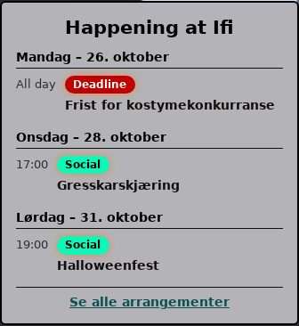

---

# C22: Smaller event rows with bold titles
`🍬 candy` · `🎨 restyle` · Feature

**Reward:** 1 🪙 · **Time:** about 5 min  
**Good to know first:** nothing, everything is explained

### What to do
In the "Happening at Ifi" box on the home page, make the event rows more compact: small text for the days and times, and extra bold event titles.

### Files to change (only these)
- `ifiplatform/static/css/07_halloween/eventsbox_items.css` (empty, already loaded on every page)

### Solution to start from
Paste this into the file:
```css
.home-eventsbox-day-heading {
    font-size: 0.85rem;
}

.home-eventsbox-time {
    font-size: 0.8rem;
}

.home-eventsbox-title {
    font-size: 0.9rem;
    font-weight: 800;
}
```

#### Explanation (optional)
- `.home-eventsbox-day-heading` is the line with the day, like "Mandag – 26. oktober".
- `.home-eventsbox-time` is the time on the left of each event.
- `.home-eventsbox-title` is the event's name. `font-weight: 800` is extra bold (normal bold is 700).

### Make it yours
- Show the day headings in capitals: `text-transform: uppercase;` in the first rule.

### Done when
- The days and times are smaller, the event names are extra bold, and it's all still easy to read.

### How to work on it
Set up the project on your own computer first (see **Get started** in the README). Then:

1. **Claim this issue** on the site: https://halloween.ifiplattform.no/commits/issues/
2. In the VS Code terminal:
   ```bash
   ifi fix-issue {number}
   ```
3. Make the change, and check it at http://localhost:8000. Reload with **Ctrl+Shift+R** (Mac: **Cmd+Shift+R**): a normal reload may show the old look, because the browser keeps old copies of CSS files and pictures. Still old? Try a private window.
4. Then:
   ```bash
   ifi test
   git add .
   git commit -m "Short description of what you changed"
   ifi pull-request
   ```

**Only change the files listed above.** Then your pull request can't clash with anyone else's. After the merge it can take a few minutes before it shows on the live site. Stuck? Ask a helper, or type `ifi help`.

#### What it looks like when it's done


---

# C23: A grey >OUTPUT box with a black border
`🍬 candy` · `🎨 restyle` · Feature

**Reward:** 1 🪙 · **Time:** about 5 min  
**Good to know first:** nothing, everything is explained

### What to do
At the bottom of the right column on the home page there's a box with the cover of >OUTPUT, Ifi's student magazine. Make it grey with a black border, like the other boxes.

### Files to change (only these)
- `ifiplatform/static/css/07_halloween/output_box.css` (empty, already loaded on every page)

### Solution to start from
Paste this into the file:
```css
.output-box {
    background-color: #b4b4b8;
    border: 2px solid #000;
    border-radius: 6px;
    text-align: center;
}

.output-box img {
    border-radius: 3px;
}

.output-caption {
    margin: 0.6rem 0 0;
    font-size: 0.85rem;
}
```

#### Explanation (optional)
- `.output-box` is the whole box: grey, a black border, everything centred.
- `.output-box img` is the cover picture: slightly rounded corners.
- `.output-caption` is the sentence under the cover: a bit smaller, with some space above it.

### Make it yours
- A tilted cover, like a magazine thrown on a table: `rotate: -2deg;` in the `img` rule (`deg` means degrees).
- **Pick your own colour:** in VS Code, every colour code in a `.css` file has a small coloured square in front of it. Click the square to get a colour picker; the code changes as you pick. Or search "color picker" on Google, choose a colour, and copy the **HEX** code (the one that starts with `#`, like `#ff7518`).

### Done when
- The >OUTPUT box is grey with a black border, and the cover and caption are centred.

### How to work on it
Set up the project on your own computer first (see **Get started** in the README). Then:

1. **Claim this issue** on the site: https://halloween.ifiplattform.no/commits/issues/
2. In the VS Code terminal:
   ```bash
   ifi fix-issue {number}
   ```
3. Make the change, and check it at http://localhost:8000. Reload with **Ctrl+Shift+R** (Mac: **Cmd+Shift+R**): a normal reload may show the old look, because the browser keeps old copies of CSS files and pictures. Still old? Try a private window.
4. Then:
   ```bash
   ifi test
   git add .
   git commit -m "Short description of what you changed"
   ifi pull-request
   ```

**Only change the files listed above.** Then your pull request can't clash with anyone else's. After the merge it can take a few minutes before it shows on the live site. Stuck? Ask a helper, or type `ifi help`.

#### What it looks like when it's done


---

# C27: The spider: its thread and body
`🍬 candy` · `🖼️ art` · Feature

**Reward:** 1 🪙 · **Time:** about 6 min · **Part of the set** SET-spider  
**Good to know first:** nothing, everything is explained

### What to do
Give the spider at the top left of every page a thread to hang from and a round red body. It's already on the page, but empty, so you can't see it yet.

### Files to change (only these)
- `ifiplatform/static/css/07_halloween/spider_body.css` (empty, already loaded on every page)

**Only draw the thread and the body.** The legs, the swinging and turning the swing off are other people's issues, in other files.

### Solution to start from
Paste this into the file:
```css
.spider {
    width: 2.4rem;
    height: 19rem;
}

.spider__thread {
    position: absolute;
    top: 0;
    left: 50%;
    width: 1px;
    height: 16.3rem;
    background: #d6d1de;
}

.spider__body {
    position: absolute;
    top: 16.2rem;
    left: 50%;
    z-index: 1;
    width: 1.45rem;
    height: 1.8rem;
    margin-left: -0.725rem;
    border-radius: 50% 50% 45% 45%;
    background: radial-gradient(circle at 50% 35%, #d6342e 0 28%, #8f1d19 72%);
}

.spider__body::before {
    content: "";
    position: absolute;
    bottom: -0.6rem;
    left: 50%;
    width: 0.85rem;
    height: 0.8rem;
    margin-left: -0.425rem;
    border-radius: 50%;
    background: #8f1d19;
}
```

#### Explanation (optional)
- `.spider` is the box the spider lives in. It's already pinned to the top left of the window in `scaffold.css` (don't change that file): this gives it a size.
- `.spider__thread` is a line 1 pixel wide, from the top down to the body.
- `.spider__body` is an oval: `border-radius` rounds the corners, and the `radial-gradient` makes it lighter red in the middle, so it looks round.
- `::before` adds a smaller dark-red circle under the body: the spider's head.
- `margin-left` with minus half the width puts each part exactly in the middle of the thread.

### Make it yours
- Another colour: `#3a3a44` and `#121216` make a black spider, `#8de9a8` and `#2f7a45` a poison green one. Change both colours in the gradient and the head's `background`.
- A longer thread: make `height` bigger in `.spider__thread`, and move the body down with `top`.

### Done when
- A red spider body hangs from a thin thread at the top left of every page, and you can still click everything under it.

### How to work on it
Set up the project on your own computer first (see **Get started** in the README). Then:

1. **Claim this issue** on the site: https://halloween.ifiplattform.no/commits/issues/
2. In the VS Code terminal:
   ```bash
   ifi fix-issue {number}
   ```
3. Make the change, and check it at http://localhost:8000. Reload with **Ctrl+Shift+R** (Mac: **Cmd+Shift+R**): a normal reload may show the old look, because the browser keeps old copies of CSS files and pictures. Still old? Try a private window.
4. Then:
   ```bash
   ifi test
   git add .
   git commit -m "Short description of what you changed"
   ifi pull-request
   ```

**Only change the files listed above.** Then your pull request can't clash with anyone else's. After the merge it can take a few minutes before it shows on the live site. Stuck? Ask a helper, or type `ifi help`.

#### What it looks like when it's done


*Only this step: the thread and the body, without the legs.*

---

# C28: The spider: eight legs
`🍬 candy` · `🖼️ art` · Feature

**Reward:** 1 🪙 · **Time:** about 6 min · **Part of the set** SET-spider  
**Good to know first:** nothing, everything is explained

### What to do
Give the spider at the top left of every page its eight legs.

### Files to change (only these)
- new: `ifiplatform/static/images/halloween/spider_legs.svg`
- `ifiplatform/static/css/07_halloween/spider_legs.css` (empty, already loaded on every page)

**Only draw the legs.** The thread, the body and the swinging are other people's issues, in other files. Until the body issue is done, you'll see legs without a body: that's fine.

### Solution to start from
1. Make the file `ifiplatform/static/images/halloween/spider_legs.svg` with this inside:
   ```html
   <svg xmlns="http://www.w3.org/2000/svg" width="90" height="70" viewBox="0 0 90 70" fill="none" stroke="#8f1d19" stroke-width="2" stroke-linecap="round" stroke-linejoin="round">
     <path d="M42,34 L24,14 L6,24"/>
     <path d="M48,34 L66,14 L84,24"/>
     <path d="M41,36 L19,26 L2,40"/>
     <path d="M49,36 L71,26 L88,40"/>
     <path d="M41,38 L20,40 L6,58"/>
     <path d="M49,38 L70,40 L84,58"/>
     <path d="M42,40 L27,50 L18,68"/>
     <path d="M48,40 L63,50 L72,68"/>
   </svg>
   ```
2. Paste this into `spider_legs.css`:
   ```css
   .spider__legs {
       position: absolute;
       top: 15.8rem;
       left: 50%;
       width: 5.4rem;
       height: 4.2rem;
       margin-left: -2.7rem;
       background: url("../../images/halloween/spider_legs.svg") center / contain no-repeat;
   }
   ```

#### Explanation (optional)
- Each `<path>` is one leg with a knee: `M` is where the pen starts (at the body), then `L` draws a line to the knee and on to the foot.
- `stroke` is the colour of the lines, and `stroke-width` how thick they are.
- In the CSS, the picture is the background of `.spider__legs`. The path `../../images/...` goes from the CSS file up two folders, then down to the picture.

### Make it yours
- Hairy legs: a thicker `stroke-width`, like `3`.
- Another colour: change `stroke="#8f1d19"`. A black spider? `#121216`.
- **Pick your own colour:** search "color picker" on Google, choose a colour, and copy the **HEX** code (the one that starts with `#`, like `#ff7518`). Paste it between the quotes, for example `stroke="#ff7518"`.

### Done when
- Eight legs show at the top left, where the spider's body is (or will be).

### How to work on it
Set up the project on your own computer first (see **Get started** in the README). Then:

1. **Claim this issue** on the site: https://halloween.ifiplattform.no/commits/issues/
2. In the VS Code terminal:
   ```bash
   ifi fix-issue {number}
   ```
3. Make the change, and check it at http://localhost:8000. Reload with **Ctrl+Shift+R** (Mac: **Cmd+Shift+R**): a normal reload may show the old look, because the browser keeps old copies of CSS files and pictures. Still old? Try a private window.
4. Then:
   ```bash
   ifi test
   git add .
   git commit -m "Short description of what you changed"
   ifi pull-request
   ```

**Only change the files listed above.** Then your pull request can't clash with anyone else's. After the merge it can take a few minutes before it shows on the live site. Stuck? Ask a helper, or type `ifi help`.

#### What it looks like when it's done


---

# C29: The spider: make it swing
`🍬 candy` · `🦇 silly feature` · Feature

**Reward:** 1 🪙 · **Time:** about 5 min · **Part of the set** SET-spider  
**Good to know first:** nothing, everything is explained

### What to do
Make the spider at the top left of every page swing slowly from side to side on its thread.

### Files to change (only these)
- `ifiplatform/static/css/07_halloween/spider_swing.css` (empty, already loaded on every page)

**Only add the swing.** The thread, body and legs are other people's issues. If they aren't done yet, you won't see anything move: check the CSS anyway, or ask whether they're merged.

### Solution to start from
Paste this into the file:
```css
@keyframes spider-swing {
    from {
        rotate: -6deg;
    }
    to {
        rotate: 6deg;
    }
}

.spider {
    transform-origin: 50% 0;
    animation: spider-swing 4s ease-in-out infinite alternate;
}
```

#### Explanation (optional)
- `@keyframes` describes the movement: tilted 6 degrees one way, then 6 degrees the other (`deg` means degrees).
- `transform-origin: 50% 0` is the point it turns around: the middle of the top, where the thread is tied. Like a real pendulum.
- `animation`: 4 seconds per swing, slow at both ends (`ease-in-out`), forever (`infinite`), and back and forth (`alternate`) instead of jumping back to the start.

### Make it yours
- A wilder swing: a bigger angle, like `15deg`, or a shorter time.

### Done when
- The spider swings gently from side to side on every page.

### How to work on it
Set up the project on your own computer first (see **Get started** in the README). Then:

1. **Claim this issue** on the site: https://halloween.ifiplattform.no/commits/issues/
2. In the VS Code terminal:
   ```bash
   ifi fix-issue {number}
   ```
3. Make the change, and check it at http://localhost:8000. Reload with **Ctrl+Shift+R** (Mac: **Cmd+Shift+R**): a normal reload may show the old look, because the browser keeps old copies of CSS files and pictures. Still old? Try a private window.
4. Then:
   ```bash
   ifi test
   git add .
   git commit -m "Short description of what you changed"
   ifi pull-request
   ```

**Only change the files listed above.** Then your pull request can't clash with anyone else's. After the merge it can take a few minutes before it shows on the live site. Stuck? Ask a helper, or type `ifi help`.

#### What it looks like when it's done
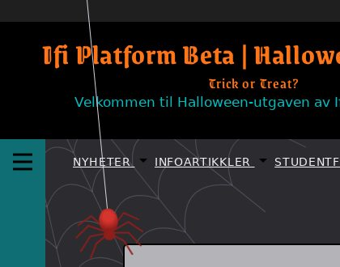

*The swing, paused at one end.*

---

# C3: Style "Trick or Treat?" under the logo
`🍬 candy` · `🎨 restyle` · Feature

**Reward:** 1 🪙 · **Time:** about 6 min  
**Good to know first:** nothing, everything is explained

### What to do
Under the site name in the header it says "Trick or Treat?", but it looks plain. Make it small, orange and spooky.

### Files to change (only these)
- `ifiplatform/static/css/07_halloween/tagline.css` (empty, already loaded on every page)

### Solution to start from
Paste this into the file:
```css
.header-tagline {
    margin-top: 0.3rem;
    color: #ff7518;
    font-family: var(--font-spooky);
    font-size: 1.15rem;
    letter-spacing: 0.06em;
}

.header-tagline:hover {
    color: #ffb15c;
}
```

#### Explanation (optional)
- `.header-tagline` is the "Trick or Treat?" text. It's a button: another issue makes clicking it do something.
- `margin-top` adds a little space between it and the site name.
- `var(--font-spooky)` is the spooky font, already loaded on every page.

### Make it yours
- Another colour: `#b44cff` is poison purple, `#f2eff6` ghost white.
- Tilt it a little: `rotate: -3deg;` in the first rule (`deg` means degrees).
- **Pick your own colour:** in VS Code, every colour code in a `.css` file has a small coloured square in front of it. Click the square to get a colour picker; the code changes as you pick. Or search "color picker" on Google, choose a colour, and copy the **HEX** code (the one that starts with `#`, like `#ff7518`).

### Done when
- "Trick or Treat?" is small, orange and spooky, right under the site name.

### How to work on it
Set up the project on your own computer first (see **Get started** in the README). Then:

1. **Claim this issue** on the site: https://halloween.ifiplattform.no/commits/issues/
2. In the VS Code terminal:
   ```bash
   ifi fix-issue {number}
   ```
3. Make the change, and check it at http://localhost:8000. Reload with **Ctrl+Shift+R** (Mac: **Cmd+Shift+R**): a normal reload may show the old look, because the browser keeps old copies of CSS files and pictures. Still old? Try a private window.
4. Then:
   ```bash
   ifi test
   git add .
   git commit -m "Short description of what you changed"
   ifi pull-request
   ```

**Only change the files listed above.** Then your pull request can't clash with anyone else's. After the merge it can take a few minutes before it shows on the live site. Stuck? Ask a helper, or type `ifi help`.

#### What it looks like when it's done
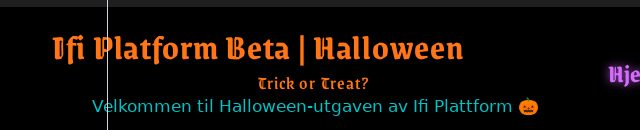

---

# C30: The spider: no swinging for people who turned animations off
`🍬 candy` · `♿ a11y` · Feature

**Reward:** 1 🪙 · **Time:** about 5 min · **Part of the set** SET-spider  
**Good to know first:** nothing, everything is explained

### What to do
Some people get dizzy or distracted from movement on screen, and turn animations off in their computer's settings. Make the spider stop swinging for them.

### Files to change (only these)
- `ifiplatform/static/css/07_halloween/spider_reduced_motion.css` (empty, already loaded on every page, after the swing)

### Solution to start from
Paste this into the file:
```css
@media (prefers-reduced-motion: reduce) {
    .spider {
        animation: none;
    }
}
```

#### Explanation (optional)
- `@media (prefers-reduced-motion: reduce)` means: only when the visitor turned animations off. Everything inside the braces only counts then.
- `animation: none` stops the swing, and the spider just hangs still.
- This file is loaded after the swing's file, so it wins.

### How to test it
In Chrome: DevTools (F12) → the ⋮ menu → More tools → **Rendering** → "Emulate CSS media feature prefers-reduced-motion" → `reduce`. In Firefox: `about:config` → `ui.prefersReducedMotion` = 1. If the swing issue isn't merged yet, there's nothing to stop: check that your rule is right, and test again later.

### Done when
- With animations turned off, the spider hangs still. With them on, it swings.

### How to work on it
Set up the project on your own computer first (see **Get started** in the README). Then:

1. **Claim this issue** on the site: https://halloween.ifiplattform.no/commits/issues/
2. In the VS Code terminal:
   ```bash
   ifi fix-issue {number}
   ```
3. Make the change, and check it at http://localhost:8000. Reload with **Ctrl+Shift+R** (Mac: **Cmd+Shift+R**): a normal reload may show the old look, because the browser keeps old copies of CSS files and pictures. Still old? Try a private window.
4. Then:
   ```bash
   ifi test
   git add .
   git commit -m "Short description of what you changed"
   ifi pull-request
   ```

**Only change the files listed above.** Then your pull request can't clash with anyone else's. After the merge it can take a few minutes before it shows on the live site. Stuck? Ask a helper, or type `ifi help`.

#### What it looks like when it's done
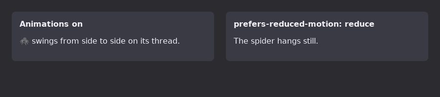

*Mock-up: what changes. A screenshot of something that doesn't move looks like nothing.*

---

# C31: 👻 "Today" and "Tomorrow" are swapped
`🍬 candy` · `👻 haunted bug` · Bug

**Reward:** 1 🪙 · **Time:** about 5 min  
**Good to know first:** nothing, everything is explained

### What's wrong
In the "Happening at Ifi" box on the home page, events happening today are under a heading that says **Tomorrow** ("I morgen"), and tomorrow's events say **Today** ("I dag"). A ghost has swapped them...

### Files to change (only these)
- `ifiplatform/apps/ifi_home_app/templates/home/partials/eventsbox/eventsbox.html`

### Solution to start from
Near the top of the file, find these two lines:
```html


```
and swap the two texts, so they say:
```html


```
Keep the spaces at the start of the lines as they are.

#### Explanation (optional)
- `` shows something only when the condition is true. `day.time_tag` is `"today"` for the events happening today, and `"tomorrow"` for tomorrow's.
- `` shows "Today" in English, and its Norwegian translation ("I dag") on the Norwegian site.
- Days further away show their weekday instead, from the line after these two.

### Done when
- The heading over today's events says "I dag" (English: "Today"), and the one over tomorrow's says "I morgen" ("Tomorrow"). No events today or tomorrow in your database? Then the headings only show weekdays: that's fine, as long as the two lines are right.

### How to work on it
Set up the project on your own computer first (see **Get started** in the README). Then:

1. **Claim this issue** on the site: https://halloween.ifiplattform.no/commits/issues/
2. In the VS Code terminal:
   ```bash
   ifi fix-issue {number}
   ```
3. Make the change, and check it at http://localhost:8000. Reload with **Ctrl+Shift+R** (Mac: **Cmd+Shift+R**): a normal reload may show the old look, because the browser keeps old copies of CSS files and pictures. Still old? Try a private window.
4. Then:
   ```bash
   ifi test
   git add .
   git commit -m "Short description of what you changed"
   ifi pull-request
   ```

**Only change the files listed above.** Then your pull request can't clash with anyone else's. After the merge it can take a few minutes before it shows on the live site. Stuck? Ask a helper, or type `ifi help`.

#### What it looks like when it's done
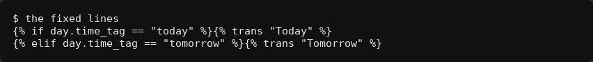

*The fixed lines. The dev database has no events today or tomorrow, so the page itself shows only weekdays.*

---

# C33: Screen readers read every news title twice
`🍬 candy` · `♿ a11y` · Bug

**Reward:** 1 🪙 · **Time:** about 5 min  
**Good to know first:** nothing, everything is explained

### What to do
People who can't see the screen use a **screen reader**: a program that reads the page out loud. For a picture it reads the picture's `alt` text. On the news cards, the picture's `alt` text is the article's title, and the title is written right under it too, so a screen reader says every title twice. Fix the `alt` text.

### Files to change (only these)
- `ifiplatform/apps/ifi_home_app/templates/info_articles/partials/article_card.html`

### Solution to start from
1. Find this line:
   ```html
   
   ```
   and change it to:
   ```html
   
   ```
2. A few lines further down, find:
   ```html
   
   ```
   and change it to:
   ```html
   
   ```

#### Explanation (optional)
- `hero_image_alt` is a description of the picture that editors can write, like "Two students carving a pumpkin". If they wrote one, the card uses it: it tells something the title doesn't.
- `|default:article.title` meant "no description? use the title instead". That's the double title, so it goes.
- The second picture is the same placeholder photo of the Ifi building for every article without a picture. It tells nothing, so `alt=""` (empty, not missing!) tells screen readers to skip it.

### Done when
- The news cards look exactly the same as before.
- Right-click a news picture → **Inspect**: the `` has `alt=""`, or a description that isn't the title.

### How to work on it
Set up the project on your own computer first (see **Get started** in the README). Then:

1. **Claim this issue** on the site: https://halloween.ifiplattform.no/commits/issues/
2. In the VS Code terminal:
   ```bash
   ifi fix-issue {number}
   ```
3. Make the change, and check it at http://localhost:8000. Reload with **Ctrl+Shift+R** (Mac: **Cmd+Shift+R**): a normal reload may show the old look, because the browser keeps old copies of CSS files and pictures. Still old? Try a private window.
4. Then:
   ```bash
   ifi test
   git add .
   git commit -m "Short description of what you changed"
   ifi pull-request
   ```

**Only change the files listed above.** Then your pull request can't clash with anyone else's. After the merge it can take a few minutes before it shows on the live site. Stuck? Ask a helper, or type `ifi help`.

#### What it looks like when it's done


*The fixed lines. The cards look the same; only what screen readers hear changes.*

---

# C34: Pin a warning on the haunted notice board
`🍬 candy` · `✍️ content` · Task

**Reward:** 1 🪙 · **Time:** about 5 min  
**Good to know first:** nothing, everything is explained

### What to do
Warn everyone about something terrifying at Ifi. Pin a warning on the haunted notice board at http://localhost:8000/halloween/board/. One to three sentences is plenty: funny beats long.

### Files to change (only these)
- new: `ifiplatform/apps/halloween_app/board_notes/warning_01.txt`

### Solution to start from
Make the file `ifiplatform/apps/halloween_app/board_notes/warning_01.txt` with this inside, then change it to your own:
```
Do NOT make eye contact with the 3rd-floor printer
It can sense deadlines. It will jam.
```

#### Explanation (optional)
The board turns your file into a note like this:
- **First line** → the heading of the note, in bold at the top.
- **The lines after it** → the text on the note.
- **A last line starting with `--`** → who signed it, at the bottom right. You can leave it out.

### Make it yours
Write your own! Some ideas:
- "Do NOT make eye contact with the printer on the 3rd floor."
- "WARNING: the group room booking system has eaten three groups this week."
- "Never say “it works on my machine” after midnight."

Keep it kind: no real people.

### Done when
- Your note shows up on http://localhost:8000/halloween/board/.

### How to work on it
Set up the project on your own computer first (see **Get started** in the README). Then:

1. **Claim this issue** on the site: https://halloween.ifiplattform.no/commits/issues/
2. In the VS Code terminal:
   ```bash
   ifi fix-issue {number}
   ```
3. Make the change, and check it at http://localhost:8000. Reload with **Ctrl+Shift+R** (Mac: **Cmd+Shift+R**): a normal reload may show the old look, because the browser keeps old copies of CSS files and pictures. Still old? Try a private window.
4. Then:
   ```bash
   ifi test
   git add .
   git commit -m "Short description of what you changed"
   ifi pull-request
   ```

**Only change the files listed above.** Then your pull request can't clash with anyone else's. After the merge it can take a few minutes before it shows on the live site. Stuck? Ask a helper, or type `ifi help`.

#### What it looks like when it's done


---

# C35: Pin a rule on the haunted notice board
`🍬 candy` · `✍️ content` · Task

**Reward:** 1 🪙 · **Time:** about 5 min  
**Good to know first:** nothing, everything is explained

### What to do
Add a rule everyone at Ifi must follow on Halloween night. Pin a rule on the haunted notice board at http://localhost:8000/halloween/board/. One to three sentences is plenty: funny beats long.

### Files to change (only these)
- new: `ifiplatform/apps/halloween_app/board_notes/rule_01.txt`

### Solution to start from
Make the file `ifiplatform/apps/halloween_app/board_notes/rule_01.txt` with this inside, then change it to your own:
```
Rule 13: commit before you leave the room
Things move at night. Uncommitted work is never seen again.
-- The night guard
```

#### Explanation (optional)
The board turns your file into a note like this:
- **First line** → the heading of the note, in bold at the top.
- **The lines after it** → the text on the note.
- **A last line starting with `--`** → who signed it, at the bottom right. You can leave it out.

### Make it yours
Write your own! Some ideas:
- "Rule 13: always commit before you leave the room. Things move at night."
- "Rule 4: if the lights flicker in the lab, push your branch immediately."
- "Rule 99: the last person out must say goodnight to the server."

Keep it kind: no real people.

### Done when
- Your note shows up on http://localhost:8000/halloween/board/.

### How to work on it
Set up the project on your own computer first (see **Get started** in the README). Then:

1. **Claim this issue** on the site: https://halloween.ifiplattform.no/commits/issues/
2. In the VS Code terminal:
   ```bash
   ifi fix-issue {number}
   ```
3. Make the change, and check it at http://localhost:8000. Reload with **Ctrl+Shift+R** (Mac: **Cmd+Shift+R**): a normal reload may show the old look, because the browser keeps old copies of CSS files and pictures. Still old? Try a private window.
4. Then:
   ```bash
   ifi test
   git add .
   git commit -m "Short description of what you changed"
   ifi pull-request
   ```

**Only change the files listed above.** Then your pull request can't clash with anyone else's. After the merge it can take a few minutes before it shows on the live site. Stuck? Ask a helper, or type `ifi help`.

#### What it looks like when it's done
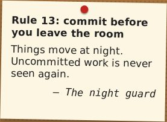

---

# C36: Pin a missing poster on the haunted notice board
`🍬 candy` · `✍️ content` · Task

**Reward:** 1 🪙 · **Time:** about 5 min  
**Good to know first:** nothing, everything is explained

### What to do
Something at Ifi has gone missing. Make the poster. Pin a missing poster on the haunted notice board at http://localhost:8000/halloween/board/. One to three sentences is plenty: funny beats long.

### Files to change (only these)
- new: `ifiplatform/apps/halloween_app/board_notes/missing_01.txt`

### Solution to start from
Make the file `ifiplatform/apps/halloween_app/board_notes/missing_01.txt` with this inside, then change it to your own:
```
MISSING: my motivation
Last seen in week 2 of the semester. Answers to "deadline". Reward: one candy.
```

#### Explanation (optional)
The board turns your file into a note like this:
- **First line** → the heading of the note, in bold at the top.
- **The lines after it** → the text on the note.
- **A last line starting with `--`** → who signed it, at the bottom right. You can leave it out.

### Make it yours
Write your own! Some ideas:
- "MISSING: my motivation. Last seen in week 2."
- "MISSING: the left shoe of the Ifi mascot. Reward: one candy."
- "MISSING: the semicolon from line 42."

Keep it kind: no real people.

### Done when
- Your note shows up on http://localhost:8000/halloween/board/.

### How to work on it
Set up the project on your own computer first (see **Get started** in the README). Then:

1. **Claim this issue** on the site: https://halloween.ifiplattform.no/commits/issues/
2. In the VS Code terminal:
   ```bash
   ifi fix-issue {number}
   ```
3. Make the change, and check it at http://localhost:8000. Reload with **Ctrl+Shift+R** (Mac: **Cmd+Shift+R**): a normal reload may show the old look, because the browser keeps old copies of CSS files and pictures. Still old? Try a private window.
4. Then:
   ```bash
   ifi test
   git add .
   git commit -m "Short description of what you changed"
   ifi pull-request
   ```

**Only change the files listed above.** Then your pull request can't clash with anyone else's. After the merge it can take a few minutes before it shows on the live site. Stuck? Ask a helper, or type `ifi help`.

#### What it looks like when it's done
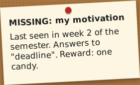

---

# C4: Purple glowing menu links in the header
`🍬 candy` · `🎨 restyle` · Feature

**Reward:** 1 🪙 · **Time:** about 6 min  
**Good to know first:** nothing, everything is explained

### What to do
Make the menu links at the top right (Hjem, Studie, Commits, Halloween, Logg inn) poison purple, in the spooky font, with a glow.

### Files to change (only these)
- `ifiplatform/static/css/07_halloween/nav_links.css` (empty, already loaded on every page)

### Solution to start from
Paste this into the file:
```css
.nav_link {
    color: #b44cff;
    font-family: var(--font-spooky);
    font-size: 1.3rem;
}

.nav_link:hover {
    text-shadow: 0 0 10px rgba(180, 76, 255, 0.9);
}

.nav_link.active {
    color: #d76bff;
    text-shadow: 0 0 10px rgba(215, 107, 255, 0.8);
}
```

#### Explanation (optional)
- `.nav_link` is every menu link in the header.
- `text-shadow` with no offset (`0 0`) and some blur (`10px`) makes a glow around the letters. `rgba(180, 76, 255, 0.9)` is purple, a little see-through.
- `.nav_link.active` is the link to the page you're on: it glows all the time.

### Make it yours
- A stronger glow: a bigger blur, like `20px`.
- Another colour: `#8de9a8` slime green glows nicely too.
- **Pick your own colour:** in VS Code, every colour code in a `.css` file has a small coloured square in front of it. Click the square to get a colour picker; the code changes as you pick. Or search "color picker" on Google, choose a colour, and copy the **HEX** code (the one that starts with `#`, like `#ff7518`).

### Done when
- The header links are purple and spooky, the one for the page you're on glows, and they glow when you hover over them.

### How to work on it
Set up the project on your own computer first (see **Get started** in the README). Then:

1. **Claim this issue** on the site: https://halloween.ifiplattform.no/commits/issues/
2. In the VS Code terminal:
   ```bash
   ifi fix-issue {number}
   ```
3. Make the change, and check it at http://localhost:8000. Reload with **Ctrl+Shift+R** (Mac: **Cmd+Shift+R**): a normal reload may show the old look, because the browser keeps old copies of CSS files and pictures. Still old? Try a private window.
4. Then:
   ```bash
   ifi test
   git add .
   git commit -m "Short description of what you changed"
   ifi pull-request
   ```

**Only change the files listed above.** Then your pull request can't clash with anyone else's. After the merge it can take a few minutes before it shows on the live site. Stuck? Ask a helper, or type `ifi help`.

#### What it looks like when it's done


---

# C49: Write a study joke (1 of 10)
`🍬 candy` · `✍️ content` · Task

**Reward:** 1 🪙 · **Time:** about 5 min  
**Good to know first:** nothing, everything is explained

### What to do
The study page at http://localhost:8000/study/ says "Studie? Ahaha, nei." and shows a random excuse for not studying. Every reload, a new one. Add your own joke or excuse to the pile. One or two sentences: funny beats long.

### Files to change (only these)
- new: `ifiplatform/apps/study_app/joke_files/joke_01.txt`

### Solution to start from
Make the file `ifiplatform/apps/study_app/joke_files/joke_01.txt` with this inside, then change it to your own:
```
My code compiles on the first try. I check it twice: something must be wrong.
```

#### Explanation (optional)
- The page reads every `joke_NN.txt` file in the `joke_files` folder, and picks one at random each time it's opened.
- Just the joke, as plain text. No heading, no quotes around it.
- It shows exactly as you write it, so English or Norwegian are both fine.

### Make it yours
Write your own! Some ideas:
- "Ten minutes of studying deserves a two-hour break. That's just maths."
- "My GitHub streak is longer than my attention span."
- "I put the exam date in my calendar. My calendar is now scared of it too."

Keep it kind: no real people. And keep the exact file name from the list above: another person is writing a joke in each of the other files.

### Done when
- Your joke shows on http://localhost:8000/study/?joke=01 (the `?joke=01` shows your file's joke; without it, the page picks one at random).

### How to work on it
Set up the project on your own computer first (see **Get started** in the README). Then:

1. **Claim this issue** on the site: https://halloween.ifiplattform.no/commits/issues/
2. In the VS Code terminal:
   ```bash
   ifi fix-issue {number}
   ```
3. Make the change, and check it at http://localhost:8000. Reload with **Ctrl+Shift+R** (Mac: **Cmd+Shift+R**): a normal reload may show the old look, because the browser keeps old copies of CSS files and pictures. Still old? Try a private window.
4. Then:
   ```bash
   ifi test
   git add .
   git commit -m "Short description of what you changed"
   ifi pull-request
   ```

**Only change the files listed above.** Then your pull request can't clash with anyone else's. After the merge it can take a few minutes before it shows on the live site. Stuck? Ask a helper, or type `ifi help`.

#### What it looks like when it's done


---

# C5: Orange language buttons
`🍬 candy` · `🎨 restyle` · Feature

**Reward:** 1 🪙 · **Time:** about 5 min  
**Good to know first:** nothing, everything is explained

### What to do
The **English** and **Norsk** buttons at the very top right are turquoise. Make them pumpkin orange.

### Files to change (only these)
- `ifiplatform/static/css/07_halloween/language_buttons.css` (empty, already loaded on every page)

### Solution to start from
Paste this into the file:
```css
.lang-btn {
    color: #ff7518;
    border-color: #ff7518;
}

.lang-btn:hover,
.lang-btn.active {
    background: #ff7518;
    color: #000;
}
```

#### Explanation (optional)
- `.lang-btn` is each language button: orange text and an orange edge.
- `.lang-btn.active` is the language you're using now, and `:hover` is the button under the mouse. Both get filled orange with black text.
- A comma between two selectors means "both of these".

### Make it yours
- Another colour: `#b44cff` is poison purple. Keep the text on the filled button easy to read.
- **Pick your own colour:** in VS Code, every colour code in a `.css` file has a small coloured square in front of it. Click the square to get a colour picker; the code changes as you pick. Or search "color picker" on Google, choose a colour, and copy the **HEX** code (the one that starts with `#`, like `#ff7518`).

### Done when
- Both language buttons are orange, the current language is filled orange, and switching language still works.

### How to work on it
Set up the project on your own computer first (see **Get started** in the README). Then:

1. **Claim this issue** on the site: https://halloween.ifiplattform.no/commits/issues/
2. In the VS Code terminal:
   ```bash
   ifi fix-issue {number}
   ```
3. Make the change, and check it at http://localhost:8000. Reload with **Ctrl+Shift+R** (Mac: **Cmd+Shift+R**): a normal reload may show the old look, because the browser keeps old copies of CSS files and pictures. Still old? Try a private window.
4. Then:
   ```bash
   ifi test
   git add .
   git commit -m "Short description of what you changed"
   ifi pull-request
   ```

**Only change the files listed above.** Then your pull request can't clash with anyone else's. After the merge it can take a few minutes before it shows on the live site. Stuck? Ask a helper, or type `ifi help`.

#### What it looks like when it's done


---

# C50: Write a study joke (2 of 10)
`🍬 candy` · `✍️ content` · Task

**Reward:** 1 🪙 · **Time:** about 5 min  
**Good to know first:** nothing, everything is explained

### What to do
The study page at http://localhost:8000/study/ says "Studie? Ahaha, nei." and shows a random excuse for not studying. Every reload, a new one. Add your own joke or excuse to the pile. One or two sentences: funny beats long.

### Files to change (only these)
- new: `ifiplatform/apps/study_app/joke_files/joke_02.txt`

### Solution to start from
Make the file `ifiplatform/apps/study_app/joke_files/joke_02.txt` with this inside, then change it to your own:
```
I don't need a study group. I need a nap group.
```

#### Explanation (optional)
- The page reads every `joke_NN.txt` file in the `joke_files` folder, and picks one at random each time it's opened.
- Just the joke, as plain text. No heading, no quotes around it.
- It shows exactly as you write it, so English or Norwegian are both fine.

### Make it yours
Write your own! Some ideas:
- "Reading week: the week I read every meme ever made."
- "I color-coded my notes. Now I have very pretty notes I've never read."
- "The lecture is recorded, so I'll definitely watch it. At 2x. Next month."

Keep it kind: no real people. And keep the exact file name from the list above: another person is writing a joke in each of the other files.

### Done when
- Your joke shows on http://localhost:8000/study/?joke=02 (the `?joke=02` shows your file's joke; without it, the page picks one at random).

### How to work on it
Set up the project on your own computer first (see **Get started** in the README). Then:

1. **Claim this issue** on the site: https://halloween.ifiplattform.no/commits/issues/
2. In the VS Code terminal:
   ```bash
   ifi fix-issue {number}
   ```
3. Make the change, and check it at http://localhost:8000. Reload with **Ctrl+Shift+R** (Mac: **Cmd+Shift+R**): a normal reload may show the old look, because the browser keeps old copies of CSS files and pictures. Still old? Try a private window.
4. Then:
   ```bash
   ifi test
   git add .
   git commit -m "Short description of what you changed"
   ifi pull-request
   ```

**Only change the files listed above.** Then your pull request can't clash with anyone else's. After the merge it can take a few minutes before it shows on the live site. Stuck? Ask a helper, or type `ifi help`.

#### What it looks like when it's done
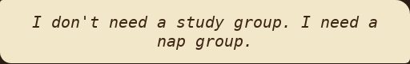

---

# C51: Write a study joke (3 of 10)
`🍬 candy` · `✍️ content` · Task

**Reward:** 1 🪙 · **Time:** about 5 min  
**Good to know first:** nothing, everything is explained

### What to do
The study page at http://localhost:8000/study/ says "Studie? Ahaha, nei." and shows a random excuse for not studying. Every reload, a new one. Add your own joke or excuse to the pile. One or two sentences: funny beats long.

### Files to change (only these)
- new: `ifiplatform/apps/study_app/joke_files/joke_03.txt`

### Solution to start from
Make the file `ifiplatform/apps/study_app/joke_files/joke_03.txt` with this inside, then change it to your own:
```
The deadline is at midnight. Midnight is a social construct.
```

#### Explanation (optional)
- The page reads every `joke_NN.txt` file in the `joke_files` folder, and picks one at random each time it's opened.
- Just the joke, as plain text. No heading, no quotes around it.
- It shows exactly as you write it, so English or Norwegian are both fine.

### Make it yours
Write your own! Some ideas:
- "I'd study, but my rubber duck is on a break."
- "Monday me will handle it. Monday me is a legend."
- "Git blame says it was me. Git is lying."

Keep it kind: no real people. And keep the exact file name from the list above: another person is writing a joke in each of the other files.

### Done when
- Your joke shows on http://localhost:8000/study/?joke=03 (the `?joke=03` shows your file's joke; without it, the page picks one at random).

### How to work on it
Set up the project on your own computer first (see **Get started** in the README). Then:

1. **Claim this issue** on the site: https://halloween.ifiplattform.no/commits/issues/
2. In the VS Code terminal:
   ```bash
   ifi fix-issue {number}
   ```
3. Make the change, and check it at http://localhost:8000. Reload with **Ctrl+Shift+R** (Mac: **Cmd+Shift+R**): a normal reload may show the old look, because the browser keeps old copies of CSS files and pictures. Still old? Try a private window.
4. Then:
   ```bash
   ifi test
   git add .
   git commit -m "Short description of what you changed"
   ifi pull-request
   ```

**Only change the files listed above.** Then your pull request can't clash with anyone else's. After the merge it can take a few minutes before it shows on the live site. Stuck? Ask a helper, or type `ifi help`.

#### What it looks like when it's done


---

# C52: Write a study joke (4 of 10)
`🍬 candy` · `✍️ content` · Task

**Reward:** 1 🪙 · **Time:** about 5 min  
**Good to know first:** nothing, everything is explained

### What to do
The study page at http://localhost:8000/study/ says "Studie? Ahaha, nei." and shows a random excuse for not studying. Every reload, a new one. Add your own joke or excuse to the pile. One or two sentences: funny beats long.

### Files to change (only these)
- new: `ifiplatform/apps/study_app/joke_files/joke_04.txt`

### Solution to start from
Make the file `ifiplatform/apps/study_app/joke_files/joke_04.txt` with this inside, then change it to your own:
```
My study plan has a study plan. Neither of them has started.
```

#### Explanation (optional)
- The page reads every `joke_NN.txt` file in the `joke_files` folder, and picks one at random each time it's opened.
- Just the joke, as plain text. No heading, no quotes around it.
- It shows exactly as you write it, so English or Norwegian are both fine.

### Make it yours
Write your own! Some ideas:
- "I opened the assignment. That counts as 10% done."
- "Stack Overflow is down. So is my will to code."
- "Exam season: when the library is full and the café is fuller."

Keep it kind: no real people. And keep the exact file name from the list above: another person is writing a joke in each of the other files.

### Done when
- Your joke shows on http://localhost:8000/study/?joke=04 (the `?joke=04` shows your file's joke; without it, the page picks one at random).

### How to work on it
Set up the project on your own computer first (see **Get started** in the README). Then:

1. **Claim this issue** on the site: https://halloween.ifiplattform.no/commits/issues/
2. In the VS Code terminal:
   ```bash
   ifi fix-issue {number}
   ```
3. Make the change, and check it at http://localhost:8000. Reload with **Ctrl+Shift+R** (Mac: **Cmd+Shift+R**): a normal reload may show the old look, because the browser keeps old copies of CSS files and pictures. Still old? Try a private window.
4. Then:
   ```bash
   ifi test
   git add .
   git commit -m "Short description of what you changed"
   ifi pull-request
   ```

**Only change the files listed above.** Then your pull request can't clash with anyone else's. After the merge it can take a few minutes before it shows on the live site. Stuck? Ask a helper, or type `ifi help`.

#### What it looks like when it's done
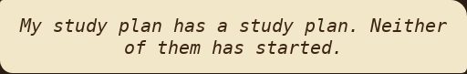

---

# C53: Write a study joke (5 of 10)
`🍬 candy` · `✍️ content` · Task

**Reward:** 1 🪙 · **Time:** about 5 min  
**Good to know first:** nothing, everything is explained

### What to do
The study page at http://localhost:8000/study/ says "Studie? Ahaha, nei." and shows a random excuse for not studying. Every reload, a new one. Add your own joke or excuse to the pile. One or two sentences: funny beats long.

### Files to change (only these)
- new: `ifiplatform/apps/study_app/joke_files/joke_05.txt`

### Solution to start from
Make the file `ifiplatform/apps/study_app/joke_files/joke_05.txt` with this inside, then change it to your own:
```
I'm not behind on the course. I'm on a scenic route.
```

#### Explanation (optional)
- The page reads every `joke_NN.txt` file in the `joke_files` folder, and picks one at random each time it's opened.
- Just the joke, as plain text. No heading, no quotes around it.
- It shows exactly as you write it, so English or Norwegian are both fine.

### Make it yours
Write your own! Some ideas:
- "Every bug I fix creates two new ones. I'm basically a hydra farmer."
- "I asked for an extension. My laptop gave me a blue screen instead."
- "Studying for the exam is like loading a page on eduroam: almost there, forever."

Keep it kind: no real people. And keep the exact file name from the list above: another person is writing a joke in each of the other files.

### Done when
- Your joke shows on http://localhost:8000/study/?joke=05 (the `?joke=05` shows your file's joke; without it, the page picks one at random).

### How to work on it
Set up the project on your own computer first (see **Get started** in the README). Then:

1. **Claim this issue** on the site: https://halloween.ifiplattform.no/commits/issues/
2. In the VS Code terminal:
   ```bash
   ifi fix-issue {number}
   ```
3. Make the change, and check it at http://localhost:8000. Reload with **Ctrl+Shift+R** (Mac: **Cmd+Shift+R**): a normal reload may show the old look, because the browser keeps old copies of CSS files and pictures. Still old? Try a private window.
4. Then:
   ```bash
   ifi test
   git add .
   git commit -m "Short description of what you changed"
   ifi pull-request
   ```

**Only change the files listed above.** Then your pull request can't clash with anyone else's. After the merge it can take a few minutes before it shows on the live site. Stuck? Ask a helper, or type `ifi help`.

#### What it looks like when it's done


---

# C54: Write a study joke (6 of 10)
`🍬 candy` · `✍️ content` · Task

**Reward:** 1 🪙 · **Time:** about 5 min  
**Good to know first:** nothing, everything is explained

### What to do
The study page at http://localhost:8000/study/ says "Studie? Ahaha, nei." and shows a random excuse for not studying. Every reload, a new one. Add your own joke or excuse to the pile. One or two sentences: funny beats long.

### Files to change (only these)
- new: `ifiplatform/apps/study_app/joke_files/joke_06.txt`

### Solution to start from
Make the file `ifiplatform/apps/study_app/joke_files/joke_06.txt` with this inside, then change it to your own:
```
Today's goal: one chapter. Today's result: one very clean room.
```

#### Explanation (optional)
- The page reads every `joke_NN.txt` file in the `joke_files` folder, and picks one at random each time it's opened.
- Just the joke, as plain text. No heading, no quotes around it.
- It shows exactly as you write it, so English or Norwegian are both fine.

### Make it yours
Write your own! Some ideas:
- "My keyboard knows Ctrl+Z better than I know the syllabus."
- "I learn best under pressure. So I wait for maximum pressure."
- "The textbook is 600 pages. My motivation is 6."

Keep it kind: no real people. And keep the exact file name from the list above: another person is writing a joke in each of the other files.

### Done when
- Your joke shows on http://localhost:8000/study/?joke=06 (the `?joke=06` shows your file's joke; without it, the page picks one at random).

### How to work on it
Set up the project on your own computer first (see **Get started** in the README). Then:

1. **Claim this issue** on the site: https://halloween.ifiplattform.no/commits/issues/
2. In the VS Code terminal:
   ```bash
   ifi fix-issue {number}
   ```
3. Make the change, and check it at http://localhost:8000. Reload with **Ctrl+Shift+R** (Mac: **Cmd+Shift+R**): a normal reload may show the old look, because the browser keeps old copies of CSS files and pictures. Still old? Try a private window.
4. Then:
   ```bash
   ifi test
   git add .
   git commit -m "Short description of what you changed"
   ifi pull-request
   ```

**Only change the files listed above.** Then your pull request can't clash with anyone else's. After the merge it can take a few minutes before it shows on the live site. Stuck? Ask a helper, or type `ifi help`.

#### What it looks like when it's done


---

# C55: Write a study joke (7 of 10)
`🍬 candy` · `✍️ content` · Task

**Reward:** 1 🪙 · **Time:** about 5 min  
**Good to know first:** nothing, everything is explained

### What to do
The study page at http://localhost:8000/study/ says "Studie? Ahaha, nei." and shows a random excuse for not studying. Every reload, a new one. Add your own joke or excuse to the pile. One or two sentences: funny beats long.

### Files to change (only these)
- new: `ifiplatform/apps/study_app/joke_files/joke_07.txt`

### Solution to start from
Make the file `ifiplatform/apps/study_app/joke_files/joke_07.txt` with this inside, then change it to your own:
```
I put all my notes in the cloud. Now they're up there, and I'm down here.
```

#### Explanation (optional)
- The page reads every `joke_NN.txt` file in the `joke_files` folder, and picks one at random each time it's opened.
- Just the joke, as plain text. No heading, no quotes around it.
- It shows exactly as you write it, so English or Norwegian are both fine.

### Make it yours
Write your own! Some ideas:
- "The oblig is due tomorrow. Tomorrow-me is so stressed."
- "I tried studying in the library. Woke up in the library."
- "Recursion: see recursion. Studying: see tomorrow."

Keep it kind: no real people. And keep the exact file name from the list above: another person is writing a joke in each of the other files.

### Done when
- Your joke shows on http://localhost:8000/study/?joke=07 (the `?joke=07` shows your file's joke; without it, the page picks one at random).

### How to work on it
Set up the project on your own computer first (see **Get started** in the README). Then:

1. **Claim this issue** on the site: https://halloween.ifiplattform.no/commits/issues/
2. In the VS Code terminal:
   ```bash
   ifi fix-issue {number}
   ```
3. Make the change, and check it at http://localhost:8000. Reload with **Ctrl+Shift+R** (Mac: **Cmd+Shift+R**): a normal reload may show the old look, because the browser keeps old copies of CSS files and pictures. Still old? Try a private window.
4. Then:
   ```bash
   ifi test
   git add .
   git commit -m "Short description of what you changed"
   ifi pull-request
   ```

**Only change the files listed above.** Then your pull request can't clash with anyone else's. After the merge it can take a few minutes before it shows on the live site. Stuck? Ask a helper, or type `ifi help`.

#### What it looks like when it's done


---

# C56: Write a study joke (8 of 10)
`🍬 candy` · `✍️ content` · Task

**Reward:** 1 🪙 · **Time:** about 5 min  
**Good to know first:** nothing, everything is explained

### What to do
The study page at http://localhost:8000/study/ says "Studie? Ahaha, nei." and shows a random excuse for not studying. Every reload, a new one. Add your own joke or excuse to the pile. One or two sentences: funny beats long.

### Files to change (only these)
- new: `ifiplatform/apps/study_app/joke_files/joke_08.txt`

### Solution to start from
Make the file `ifiplatform/apps/study_app/joke_files/joke_08.txt` with this inside, then change it to your own:
```
My brain has too many tabs open, and none of them are the lecture.
```

#### Explanation (optional)
- The page reads every `joke_NN.txt` file in the `joke_files` folder, and picks one at random each time it's opened.
- Just the joke, as plain text. No heading, no quotes around it.
- It shows exactly as you write it, so English or Norwegian are both fine.

### Make it yours
Write your own! Some ideas:
- "I'll start fresh on Monday. Which Monday is still unclear."
- "My code has comments. Mostly apologies."
- "Exam tip: if you don't know the answer, write 'it depends'."

Keep it kind: no real people. And keep the exact file name from the list above: another person is writing a joke in each of the other files.

### Done when
- Your joke shows on http://localhost:8000/study/?joke=08 (the `?joke=08` shows your file's joke; without it, the page picks one at random).

### How to work on it
Set up the project on your own computer first (see **Get started** in the README). Then:

1. **Claim this issue** on the site: https://halloween.ifiplattform.no/commits/issues/
2. In the VS Code terminal:
   ```bash
   ifi fix-issue {number}
   ```
3. Make the change, and check it at http://localhost:8000. Reload with **Ctrl+Shift+R** (Mac: **Cmd+Shift+R**): a normal reload may show the old look, because the browser keeps old copies of CSS files and pictures. Still old? Try a private window.
4. Then:
   ```bash
   ifi test
   git add .
   git commit -m "Short description of what you changed"
   ifi pull-request
   ```

**Only change the files listed above.** Then your pull request can't clash with anyone else's. After the merge it can take a few minutes before it shows on the live site. Stuck? Ask a helper, or type `ifi help`.

#### What it looks like when it's done


---

# C57: Write a study joke (9 of 10)
`🍬 candy` · `✍️ content` · Task

**Reward:** 1 🪙 · **Time:** about 5 min  
**Good to know first:** nothing, everything is explained

### What to do
The study page at http://localhost:8000/study/ says "Studie? Ahaha, nei." and shows a random excuse for not studying. Every reload, a new one. Add your own joke or excuse to the pile. One or two sentences: funny beats long.

### Files to change (only these)
- new: `ifiplatform/apps/study_app/joke_files/joke_09.txt`

### Solution to start from
Make the file `ifiplatform/apps/study_app/joke_files/joke_09.txt` with this inside, then change it to your own:
```
I don't have a study method. I have a study mood, and it's 'later'.
```

#### Explanation (optional)
- The page reads every `joke_NN.txt` file in the `joke_files` folder, and picks one at random each time it's opened.
- Just the joke, as plain text. No heading, no quotes around it.
- It shows exactly as you write it, so English or Norwegian are both fine.

### Make it yours
Write your own! Some ideas:
- "Sleep, study, social life: pick two. I picked sleep twice."
- "My laptop battery lasts longer than my focus."
- "The best time to start was last week. The second best time is after lunch."

Keep it kind: no real people. And keep the exact file name from the list above: another person is writing a joke in each of the other files.

### Done when
- Your joke shows on http://localhost:8000/study/?joke=09 (the `?joke=09` shows your file's joke; without it, the page picks one at random).

### How to work on it
Set up the project on your own computer first (see **Get started** in the README). Then:

1. **Claim this issue** on the site: https://halloween.ifiplattform.no/commits/issues/
2. In the VS Code terminal:
   ```bash
   ifi fix-issue {number}
   ```
3. Make the change, and check it at http://localhost:8000. Reload with **Ctrl+Shift+R** (Mac: **Cmd+Shift+R**): a normal reload may show the old look, because the browser keeps old copies of CSS files and pictures. Still old? Try a private window.
4. Then:
   ```bash
   ifi test
   git add .
   git commit -m "Short description of what you changed"
   ifi pull-request
   ```

**Only change the files listed above.** Then your pull request can't clash with anyone else's. After the merge it can take a few minutes before it shows on the live site. Stuck? Ask a helper, or type `ifi help`.

#### What it looks like when it's done
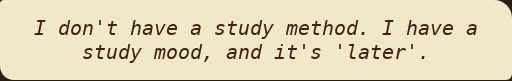

---

# C58: Write a study joke (10 of 10)
`🍬 candy` · `✍️ content` · Task

**Reward:** 1 🪙 · **Time:** about 5 min  
**Good to know first:** nothing, everything is explained

### What to do
The study page at http://localhost:8000/study/ says "Studie? Ahaha, nei." and shows a random excuse for not studying. Every reload, a new one. Add your own joke or excuse to the pile. One or two sentences: funny beats long.

### Files to change (only these)
- new: `ifiplatform/apps/study_app/joke_files/joke_10.txt`

### Solution to start from
Make the file `ifiplatform/apps/study_app/joke_files/joke_10.txt` with this inside, then change it to your own:
```
I'm not procrastinating. I'm giving my brain time to download the syllabus.
```

#### Explanation (optional)
- The page reads every `joke_NN.txt` file in the `joke_files` folder, and picks one at random each time it's opened.
- Just the joke, as plain text. No heading, no quotes around it.
- It shows exactly as you write it, so English or Norwegian are both fine.

### Make it yours
Write your own! Some ideas:
- "There are 10 kinds of students: those who study, and those who read jokes on the study page."
- "I studied so hard I forgot what I studied."
- "My to-do list has a to-do list."

Keep it kind: no real people. And keep the exact file name from the list above: another person is writing a joke in each of the other files.

### Done when
- Your joke shows on http://localhost:8000/study/?joke=10 (the `?joke=10` shows your file's joke; without it, the page picks one at random).

### How to work on it
Set up the project on your own computer first (see **Get started** in the README). Then:

1. **Claim this issue** on the site: https://halloween.ifiplattform.no/commits/issues/
2. In the VS Code terminal:
   ```bash
   ifi fix-issue {number}
   ```
3. Make the change, and check it at http://localhost:8000. Reload with **Ctrl+Shift+R** (Mac: **Cmd+Shift+R**): a normal reload may show the old look, because the browser keeps old copies of CSS files and pictures. Still old? Try a private window.
4. Then:
   ```bash
   ifi test
   git add .
   git commit -m "Short description of what you changed"
   ifi pull-request
   ```

**Only change the files listed above.** Then your pull request can't clash with anyone else's. After the merge it can take a few minutes before it shows on the live site. Stuck? Ask a helper, or type `ifi help`.

#### What it looks like when it's done


---

# C6: Small, underlined menu links on the home page
`🍬 candy` · `🎨 restyle` · Feature

**Reward:** 1 🪙 · **Time:** about 5 min  
**Good to know first:** nothing, everything is explained

### What to do
On the home page, above the big shortcut cards, there's a row of menu links (Nyheter, Infoartikler, Studentforeninger...). Make them small, in capital letters and underlined.

### Files to change (only these)
- `ifiplatform/static/css/07_halloween/subnav.css` (empty, already loaded on every page)

### Solution to start from
Paste this into the file:
```css
.home-navbar .link .drop-option {
    font-size: 0.85rem;
    text-decoration: underline;
    text-transform: uppercase;
    letter-spacing: 0.05em;
}
```

#### Explanation (optional)
- `.home-navbar .link .drop-option` means: the menu titles in the row (`.drop-option` inside a `.link` inside the `.home-navbar`). The links in the menus that drop down when you hover aren't inside a `.link`, so they keep their look.
- `text-transform: uppercase` shows the text in capitals, without changing the text itself.
- `letter-spacing` spreads the capitals out a little, so they're easier to read.

### Make it yours
- Even smaller (`0.75rem`), or a dotted underline: `text-decoration: underline dotted;`.

### Done when
- The menu row on the home page is small, in capitals and underlined, and the menus still drop down when you hover over them.

### How to work on it
Set up the project on your own computer first (see **Get started** in the README). Then:

1. **Claim this issue** on the site: https://halloween.ifiplattform.no/commits/issues/
2. In the VS Code terminal:
   ```bash
   ifi fix-issue {number}
   ```
3. Make the change, and check it at http://localhost:8000. Reload with **Ctrl+Shift+R** (Mac: **Cmd+Shift+R**): a normal reload may show the old look, because the browser keeps old copies of CSS files and pictures. Still old? Try a private window.
4. Then:
   ```bash
   ifi test
   git add .
   git commit -m "Short description of what you changed"
   ifi pull-request
   ```

**Only change the files listed above.** Then your pull request can't clash with anyone else's. After the merge it can take a few minutes before it shows on the live site. Stuck? Ask a helper, or type `ifi help`.

#### What it looks like when it's done


---

# C7: A dark teal side menu
`🍬 candy` · `🎨 restyle` · Feature

**Reward:** 1 🪙 · **Time:** about 5 min  
**Good to know first:** nothing, everything is explained

### What to do
The side menu on the left (the strip with ☰) is bright turquoise. Make it a darker, spookier teal.

### Files to change (only these)
- `ifiplatform/static/css/07_halloween/sidemenu.css` (empty, already loaded on every page)

### Solution to start from
Paste this into the file:
```css
.sidemenu_container,
.sidemenu {
    background-color: #0f6e74;
}
```

#### Explanation (optional)
- `.sidemenu_container` is the strip that runs all the way down the page, and `.sidemenu` is the menu inside it that stays put when you scroll. Both need the colour, or you see two shades.

### Make it yours
- Another colour: `#6b4a8a` is a dusky purple, `#4f7a55` a mossy green. Not so dark that the black ☰ icon disappears.
- **Pick your own colour:** in VS Code, every colour code in a `.css` file has a small coloured square in front of it. Click the square to get a colour picker; the code changes as you pick. Or search "color picker" on Google, choose a colour, and copy the **HEX** code (the one that starts with `#`, like `#ff7518`).

### Done when
- The side menu is dark teal from top to bottom, and it still opens when you hover over it.

### How to work on it
Set up the project on your own computer first (see **Get started** in the README). Then:

1. **Claim this issue** on the site: https://halloween.ifiplattform.no/commits/issues/
2. In the VS Code terminal:
   ```bash
   ifi fix-issue {number}
   ```
3. Make the change, and check it at http://localhost:8000. Reload with **Ctrl+Shift+R** (Mac: **Cmd+Shift+R**): a normal reload may show the old look, because the browser keeps old copies of CSS files and pictures. Still old? Try a private window.
4. Then:
   ```bash
   ifi test
   git add .
   git commit -m "Short description of what you changed"
   ifi pull-request
   ```

**Only change the files listed above.** Then your pull request can't clash with anyone else's. After the merge it can take a few minutes before it shows on the live site. Stuck? Ask a helper, or type `ifi help`.

#### What it looks like when it's done


---

# C8: Grey shortcut cards with a black border
`🍬 candy` · `🎨 restyle` · Feature

**Reward:** 1 🪙 · **Time:** about 6 min  
**Good to know first:** nothing, everything is explained

### What to do
The six big shortcut cards on the home page (Info, Nyheter, Foreninger...) are pale turquoise. Make them grey like old tombstones, with a black border.

### Files to change (only these)
- `ifiplatform/static/css/07_halloween/shortcut_cards.css` (empty, already loaded on every page)

### Solution to start from
Paste this into the file:
```css
#home-shortcuts .shortcut-card {
    background-color: #b4b4b8;
    border: 2px solid #000;
    border-radius: 6px;
    box-shadow: 0 3px 0 rgba(0, 0, 0, 0.35);
}

#home-shortcuts .shortcut-card:is(:hover, :has(:focus-visible)) {
    background-color: #c6c6ca;
}
```

#### Explanation (optional)
- `#home-shortcuts .shortcut-card` is each card inside the shortcuts block.
- `border: 2px solid #000` is a black border, 2 pixels thick, all round.
- `box-shadow: 0 3px 0 ...` is a hard shadow just under the card, so it looks a bit raised.
- The second rule makes a card a lighter grey when the mouse is over it (`:hover`), or when you reach a link in it with the Tab key (`:has(:focus-visible)`). Without it, the card would turn turquoise again on hover.

### Make it yours
- Another grey: `#9a9aa0` is darker, `#d0d0d4` lighter. Keep the black text easy to read.
- Rounder corners: a bigger `border-radius`, like `14px`.
- **Pick your own colour:** in VS Code, every colour code in a `.css` file has a small coloured square in front of it. Click the square to get a colour picker; the code changes as you pick. Or search "color picker" on Google, choose a colour, and copy the **HEX** code (the one that starts with `#`, like `#ff7518`).

### Done when
- All six cards are grey with a black border, a bit lighter on hover, and the text is easy to read.

### How to work on it
Set up the project on your own computer first (see **Get started** in the README). Then:

1. **Claim this issue** on the site: https://halloween.ifiplattform.no/commits/issues/
2. In the VS Code terminal:
   ```bash
   ifi fix-issue {number}
   ```
3. Make the change, and check it at http://localhost:8000. Reload with **Ctrl+Shift+R** (Mac: **Cmd+Shift+R**): a normal reload may show the old look, because the browser keeps old copies of CSS files and pictures. Still old? Try a private window.
4. Then:
   ```bash
   ifi test
   git add .
   git commit -m "Short description of what you changed"
   ifi pull-request
   ```

**Only change the files listed above.** Then your pull request can't clash with anyone else's. After the merge it can take a few minutes before it shows on the live site. Stuck? Ask a helper, or type `ifi help`.

#### What it looks like when it's done


---

# C9: Shortcut titles in the spooky font
`🍬 candy` · `🎨 restyle` · Feature

**Reward:** 1 🪙 · **Time:** about 5 min  
**Good to know first:** nothing, everything is explained

### What to do
Write the titles on the six shortcut cards on the home page (Info, Nyheter, Foreninger...) in the spooky font.

### Files to change (only these)
- `ifiplatform/static/css/07_halloween/shortcut_titles.css` (empty, already loaded on every page)

### Solution to start from
Paste this into the file:
```css
#home-shortcuts .shortcut-title {
    font-family: var(--font-spooky);
    font-weight: 500;
    letter-spacing: 0.02em;
}
```

#### Explanation (optional)
- `.shortcut-title` is the title on each card.
- `var(--font-spooky)` is the spooky font, Grenze Gotisch, already loaded on every page.
- `font-weight: 500` makes it a little less bold than the cards' normal bold text: the spooky font is thick enough already.

### Make it yours
- Fully bold: `font-weight: 700`.
- Make the titles a bit bigger: `font-size: 1.1em;`. On a narrow window a long title like "Stillingsannonser" then switches to its short version sooner.

### Done when
- The six card titles are in the spooky font, on a wide and on a narrow window.

### How to work on it
Set up the project on your own computer first (see **Get started** in the README). Then:

1. **Claim this issue** on the site: https://halloween.ifiplattform.no/commits/issues/
2. In the VS Code terminal:
   ```bash
   ifi fix-issue {number}
   ```
3. Make the change, and check it at http://localhost:8000. Reload with **Ctrl+Shift+R** (Mac: **Cmd+Shift+R**): a normal reload may show the old look, because the browser keeps old copies of CSS files and pictures. Still old? Try a private window.
4. Then:
   ```bash
   ifi test
   git add .
   git commit -m "Short description of what you changed"
   ifi pull-request
   ```

**Only change the files listed above.** Then your pull request can't clash with anyone else's. After the merge it can take a few minutes before it shows on the live site. Stuck? Ask a helper, or type `ifi help`.

#### What it looks like when it's done


---

# P1: Make the header bar black
`🍬 candy` · `🎨 restyle` · Feature

**Reward:** 1 🪙 · **Time:** about 5 min  
**Good to know first:** nothing, everything is explained

### What to do
Give the header bar at the top of every page a black background, like in the Figma.

### Files to change (only these)
- `ifiplatform/static/css/07_halloween/header_bar.css` (it's empty, and already loaded on every page)

### Solution to start from
Paste this into the file:
```css
.header-bar {
    background: #000000;
}
```

#### Explanation (optional)
- `.header-bar` picks the header. Everything inside `{ }` styles it.
- `background` is the colour behind it. `#000000` is black.

### Make it yours
- Try a different dark colour: `#1a0d2e` is a dark purple, `#0b1d0b` a dark green.
- Or a spooky fade: `background: linear-gradient(#000000, #1a0d2e);`
- **Pick your own colour:** in VS Code, every colour code in a `.css` file has a small coloured square in front of it. Click the square to get a colour picker; the code changes as you pick. Or search "color picker" on Google, choose a colour, and copy the **HEX** code (the one that starts with `#`, like `#ff7518`).

### Done when
- The header bar is dark on every page.

### How to work on it
Set up the project on your own computer first (see **Get started** in the README). Then:

1. **Claim this issue** on the site: https://halloween.ifiplattform.no/commits/issues/
2. In the VS Code terminal:
   ```bash
   ifi fix-issue {number}
   ```
3. Make the change, and check it at http://localhost:8000. Reload with **Ctrl+Shift+R** (Mac: **Cmd+Shift+R**): a normal reload may show the old look, because the browser keeps old copies of CSS files and pictures. Still old? Try a private window.
4. Then:
   ```bash
   ifi test
   git add .
   git commit -m "Short description of what you changed"
   ifi pull-request
   ```

**Only change the files listed above.** Then your pull request can't clash with anyone else's. After the merge it can take a few minutes before it shows on the live site. Stuck? Ask a helper, or type `ifi help`.

#### What it looks like when it's done


---

# P10a: The moon: a big pale circle
`🍬 candy` · `🎨 restyle` · Feature

**Reward:** 1 🪙 · **Time:** about 6 min · **Part of the set** SET-moon  
**Good to know first:** nothing, everything is explained

### What to do
Turn the empty `.moon` element into a big pale circle in the top right corner, behind the page content.

### Files to change (only these)
- `ifiplatform/static/css/07_halloween/moon.css` (empty, already loaded)

**Only set the moon's size, colour, shape and position.** The craters and the glow are other people's issues, in other files.

### Solution to start from
```css
.moon {
    position: fixed;
    top: 5rem;
    right: 4rem;
    width: 22rem;
    aspect-ratio: 1;
    border-radius: 50%;
    background: #cfe3ff;
    z-index: -1;
}
```

#### Explanation (optional)
- `position: fixed` with `top` and `right` pins it to the corner of the window, even when you scroll.
- `width` with `aspect-ratio: 1` makes it as tall as it is wide.
- `border-radius: 50%` turns the square into a circle.
- `z-index: -1` puts it behind everything else.

### Make it yours
- A bigger or smaller moon (`width`), or another spot (`top`, `right`).
- Another colour: `#fff5bc` is a yellow harvest moon, `#ffb15c` an orange one.
- **Pick your own colour:** in VS Code, every colour code in a `.css` file has a small coloured square in front of it. Click the square to get a colour picker; the code changes as you pick. Or search "color picker" on Google, choose a colour, and copy the **HEX** code (the one that starts with `#`, like `#ff7518`).

### Done when
- A big pale circle sits in the corner, stays there when you scroll, and never covers anything you can click.

### How to work on it
Set up the project on your own computer first (see **Get started** in the README). Then:

1. **Claim this issue** on the site: https://halloween.ifiplattform.no/commits/issues/
2. In the VS Code terminal:
   ```bash
   ifi fix-issue {number}
   ```
3. Make the change, and check it at http://localhost:8000. Reload with **Ctrl+Shift+R** (Mac: **Cmd+Shift+R**): a normal reload may show the old look, because the browser keeps old copies of CSS files and pictures. Still old? Try a private window.
4. Then:
   ```bash
   ifi test
   git add .
   git commit -m "Short description of what you changed"
   ifi pull-request
   ```

**Only change the files listed above.** Then your pull request can't clash with anyone else's. After the merge it can take a few minutes before it shows on the live site. Stuck? Ask a helper, or type `ifi help`.

#### What it looks like when it's done


*Only this step: the moon without craters or glow.*

---

# P10b: The moon: craters
`🍬 candy` · `🖼️ art` · Feature

**Reward:** 1 🪙 · **Time:** about 7 min · **Part of the set** SET-moon  
**Good to know first:** nothing, everything is explained

### What to do
Cover the moon in craters: lots of round, slightly darker spots.

### Files to change (only these)
- `ifiplatform/static/css/07_halloween/moon_craters.css` (empty, already loaded)

**Only use `.moon::before` and `.moon::after`.** The moon itself (P10a) and its glow (P10c) are other people's issues, in other files.

### Solution to start from
```css
.moon::before,
.moon::after {
    content: "";
    position: absolute;
    border-radius: 50%;
    background: #b4c8e6;
}

.moon::before {
    width: 2rem;
    height: 2rem;
    top: 3rem;
    left: 4rem;
    box-shadow:
        3rem 9rem 0 1rem #b4c8e6,
        10rem 11.5rem 0 0.6rem #b4c8e6,
        5rem 3rem 0 0.3rem #b4c8e6,
        -0.5rem 6rem 0 0.4rem #b4c8e6,
        7rem 14.5rem 0 0.2rem #b4c8e6,
        13rem 6rem 0 0.3rem #b4c8e6,
        2rem 4.5rem 0 -0.5rem #b4c8e6,
        7.5rem 6.5rem 0 -0.45rem #b4c8e6,
        12rem 9.5rem 0 -0.5rem #b4c8e6,
        0.5rem 11.5rem 0 -0.45rem #b4c8e6,
        6rem -1rem 0 -0.5rem #b4c8e6,
        11.5rem 4.5rem 0 -0.45rem #b4c8e6,
        4rem 13rem 0 -0.5rem #b4c8e6;
}

.moon::after {
    width: 5rem;
    height: 5rem;
    top: 3.5rem;
    left: 12rem;
}
```

#### Explanation (optional)
- `::before` and `::after` are two extra, invisible boxes inside the moon. `content: ""` makes them show up, and `border-radius: 50%` makes them round.
- `#b4c8e6` is a solid blue-grey, a bit darker than the moon. It's solid (not see-through), so craters that overlap don't get darker where they meet.
- `::after` is the biggest crater, at the top right.
- **The trick for many craters:** each line in `box-shadow` draws one more copy of the `::before` crater. The four values are: how far right, how far down, blur (`0` keeps it sharp), and how much bigger (`1rem`) or smaller (`-0.5rem`) than the original. That's how you get large, medium and tiny ones from the same crater.

### Make it yours
- Add a crater: copy a `box-shadow` line, change the first two numbers to move it, and the last number to make it bigger or smaller. Every line ends with a comma except the last.
- If P10a's moon got another colour, pick a crater colour a little darker than it, and use it in all the lines.
- **Pick your own colour:** in VS Code, every colour code in a `.css` file has a small coloured square in front of it. Click the square to get a colour picker; the code changes as you pick. Or search "color picker" on Google, choose a colour, and copy the **HEX** code (the one that starts with `#`, like `#ff7518`).

### Testing before P10a is merged
Until the moon itself is merged there's nothing to see. To test, add this at the top of your file, and **delete it again before you commit**:
```css
.moon { position: fixed; top: 5rem; right: 4rem; width: 22rem; aspect-ratio: 1; border-radius: 50%; background: #cfe3ff; z-index: -1; }
```

### Done when
- The moon has tiny, medium and large craters, and none of them stick out past its edge.

### How to work on it
Set up the project on your own computer first (see **Get started** in the README). Then:

1. **Claim this issue** on the site: https://halloween.ifiplattform.no/commits/issues/
2. In the VS Code terminal:
   ```bash
   ifi fix-issue {number}
   ```
3. Make the change, and check it at http://localhost:8000. Reload with **Ctrl+Shift+R** (Mac: **Cmd+Shift+R**): a normal reload may show the old look, because the browser keeps old copies of CSS files and pictures. Still old? Try a private window.
4. Then:
   ```bash
   ifi test
   git add .
   git commit -m "Short description of what you changed"
   ifi pull-request
   ```

**Only change the files listed above.** Then your pull request can't clash with anyone else's. After the merge it can take a few minutes before it shows on the live site. Stuck? Ask a helper, or type `ifi help`.

#### What it looks like when it's done
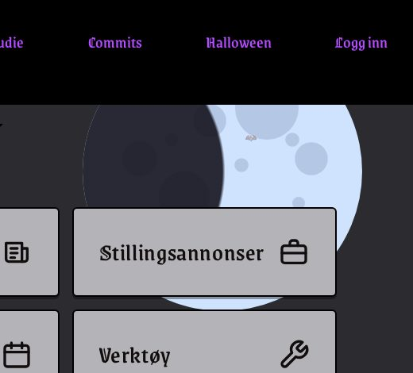

*The moon with craters, without the glow (that's P10c).*

---

# P10c: The moon: glow
`🍬 candy` · `🎨 restyle` · Feature

**Reward:** 1 🪙 · **Time:** about 5 min · **Part of the set** SET-moon  
**Good to know first:** nothing, everything is explained

### What to do
Give the moon a soft glow, as if it lights up the sky.

### Files to change (only these)
- `ifiplatform/static/css/07_halloween/moon_glow.css` (empty, already loaded)

**Only set `box-shadow` on `.moon`.** The moon itself (P10a) and its craters (P10b) are other people's issues, in other files.

### Solution to start from
```css
.moon {
    box-shadow: 0 0 4rem 1rem rgba(207, 227, 255, 0.5);
}
```

#### Explanation (optional)
- `box-shadow` draws a shadow around the moon. The four numbers are: across, down, how blurry, and how far it spreads.
- `rgba(207, 227, 255, 0.5)` is the moon's pale blue at half strength, so the shadow looks like light.

### Make it yours
- More blur (`6rem`) or more spread (`2rem`) for a bigger glow.
- Another colour: a warm `rgba(255, 177, 92, 0.5)` glow for an orange moon.

### Testing before P10a is merged
Same as P10b: add the temporary `.moon { ... }` line from P10b at the top of your file, and **delete it before you commit**.

### Done when
- There's a soft light around the moon.

### How to work on it
Set up the project on your own computer first (see **Get started** in the README). Then:

1. **Claim this issue** on the site: https://halloween.ifiplattform.no/commits/issues/
2. In the VS Code terminal:
   ```bash
   ifi fix-issue {number}
   ```
3. Make the change, and check it at http://localhost:8000. Reload with **Ctrl+Shift+R** (Mac: **Cmd+Shift+R**): a normal reload may show the old look, because the browser keeps old copies of CSS files and pictures. Still old? Try a private window.
4. Then:
   ```bash
   ifi test
   git add .
   git commit -m "Short description of what you changed"
   ifi pull-request
   ```

**Only change the files listed above.** Then your pull request can't clash with anyone else's. After the merge it can take a few minutes before it shows on the live site. Stuck? Ask a helper, or type `ifi help`.

#### What it looks like when it's done


---

# P2: Bat cursor
`🍬 candy` · `🦇 silly feature` · Feature

**Reward:** 1 🪙 · **Time:** about 6 min  
**Good to know first:** nothing, everything is explained

### What to do
Make the mouse pointer a small bat on the whole site.

### Files to change (only these)
- `ifiplatform/static/css/07_halloween/bat_cursor.css` (empty, already loaded)
- new: `ifiplatform/static/images/halloween/bat.svg`

### Solution to start from
1. Make the folder `ifiplatform/static/images/halloween/` and a file `bat.svg` in it, with this inside:
   ```html
   <svg xmlns="http://www.w3.org/2000/svg" viewBox="0 0 32 32">
     <path d="M16 12c-2-3-6-4-9-3 2 1 2 3 1 4-3-1-6 0-8 2 4 0 6 2 7 5 1-2 3-3 5-2 1 2 3 3 4 3s3-1 4-3c2-1 4 0 5 2 1-3 3-5 7-5-2-2-5-3-8-2-1-1-1-3 1-4-3-1-7 0-9 3z" fill="#120e0e"/>
   </svg>
   ```
2. Paste this into `bat_cursor.css`:
   ```css
   body {
       cursor: url("../../images/halloween/bat.svg") 16 16, auto;
   }
   ```

#### Explanation (optional)
- `body` is the whole page.
- `cursor: url(...)` uses your picture as the mouse pointer. The path goes two folders up from the CSS file, then into `images/halloween/`.
- `16 16` is the point in the picture that does the clicking: the middle.
- `auto` is the normal pointer, used if the picture can't load.

### Make it yours
- Change `fill="#120e0e"` to another colour, such as `#aa43ff` for a purple bat.
- Draw your own bat, or find a free bat SVG online (check the licence). Keep it about 32×32.
- **Pick your own colour:** search "color picker" on Google, choose a colour, and copy the **HEX** code (the one that starts with `#`, like `#ff7518`). Paste it between the quotes, for example `fill="#ff7518"`.

### Done when
- The pointer is a bat everywhere on the site, and you can still click everything.

### How to work on it
Set up the project on your own computer first (see **Get started** in the README). Then:

1. **Claim this issue** on the site: https://halloween.ifiplattform.no/commits/issues/
2. In the VS Code terminal:
   ```bash
   ifi fix-issue {number}
   ```
3. Make the change, and check it at http://localhost:8000. Reload with **Ctrl+Shift+R** (Mac: **Cmd+Shift+R**): a normal reload may show the old look, because the browser keeps old copies of CSS files and pictures. Still old? Try a private window.
4. Then:
   ```bash
   ifi test
   git add .
   git commit -m "Short description of what you changed"
   ifi pull-request
   ```

**Only change the files listed above.** Then your pull request can't clash with anyone else's. After the merge it can take a few minutes before it shows on the live site. Stuck? Ask a helper, or type `ifi help`.

#### What it looks like when it's done
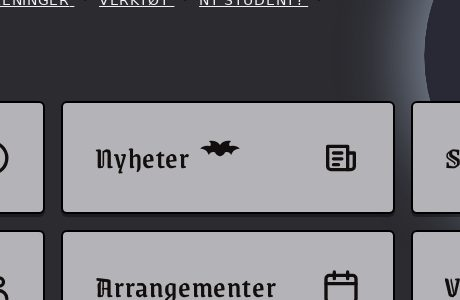

*Mock-up: a screenshot can't show the mouse pointer, so the bat is drawn in where the pointer would be.*

---

# P3: Show 8 news articles on the home page, not 12
`🍬 candy` · `🧪 python` · Feature

**Reward:** 1 🪙 · **Time:** about 5 min  
**Good to know first:** nothing, everything is explained

### What to do
The Figma shows 8 news cards (2 rows of 4) on the home page. Today it shows up to 12. Change the number in the view.

### Files to change (only these)
- `ifiplatform/apps/ifi_home_app/views/home_views.py`

### Solution to start from
Find this line in `main_view`:
```python
        .order_by("-published_date")[:12]
```
and change `12` to `8`:
```python
        .order_by("-published_date")[:8]
```

#### Explanation (optional)
- `.order_by("-published_date")` sorts the newest first. The `-` means "highest first".
- `[:8]` means "only the first 8", like slicing a Python list.

### Make it yours
- Not much to change here. But it's real Python in a real Django view: have a look at the lines above to see where the articles come from.

### Done when
- The home page shows at most 8 news articles.
- `ifi test` passes.

### How to work on it
Set up the project on your own computer first (see **Get started** in the README). Then:

1. **Claim this issue** on the site: https://halloween.ifiplattform.no/commits/issues/
2. In the VS Code terminal:
   ```bash
   ifi fix-issue {number}
   ```
3. Make the change, and check it at http://localhost:8000. Reload with **Ctrl+Shift+R** (Mac: **Cmd+Shift+R**): a normal reload may show the old look, because the browser keeps old copies of CSS files and pictures. Still old? Try a private window.
4. Then:
   ```bash
   ifi test
   git add .
   git commit -m "Short description of what you changed"
   ifi pull-request
   ```

**Only change the files listed above.** Then your pull request can't clash with anyone else's. After the merge it can take a few minutes before it shows on the live site. Stuck? Ask a helper, or type `ifi help`.

#### What it looks like when it's done


*The dev database has only 2 news articles, so the limit of 8 doesn't change anything you can see here.*

---

# P4: Pin an obituary on the haunted notice board
`🍬 candy` · `✍️ content` · Task

**Reward:** 1 🪙 · **Time:** about 5 min  
**Good to know first:** nothing, everything is explained

### What to do
Something at Ifi has died. Write its obituary. Pin an obituary on the haunted notice board at http://localhost:8000/halloween/board/. One to three sentences is plenty: funny beats long.

### Files to change (only these)
- new: `ifiplatform/apps/halloween_app/board_notes/obituary_01.txt`

### Solution to start from
Make the file `ifiplatform/apps/halloween_app/board_notes/obituary_01.txt` with this inside, then change it to your own:
```
Here lies the 2nd-floor coffee machine
It gave everything it had, which was mostly lukewarm water. It will be missed at 8:15 on Mondays.
-- Everyone in IN2010
```

#### Explanation (optional)
The board turns your file into a note like this:
- **First line** → the heading of the note, in bold at the top.
- **The lines after it** → the text on the note.
- **A last line starting with `--`** → who signed it, at the bottom right. You can leave it out.

### Make it yours
Write your own! Some ideas:
- "Here lies the coffee machine on the 2nd floor. It gave everything, mostly lukewarm water."
- "RIP my sleep schedule, 2005–the start of IN1000."
- "In memory of the last free socket in the library."

Keep it kind: no real people.

### Done when
- Your note shows up on http://localhost:8000/halloween/board/.

### How to work on it
Set up the project on your own computer first (see **Get started** in the README). Then:

1. **Claim this issue** on the site: https://halloween.ifiplattform.no/commits/issues/
2. In the VS Code terminal:
   ```bash
   ifi fix-issue {number}
   ```
3. Make the change, and check it at http://localhost:8000. Reload with **Ctrl+Shift+R** (Mac: **Cmd+Shift+R**): a normal reload may show the old look, because the browser keeps old copies of CSS files and pictures. Still old? Try a private window.
4. Then:
   ```bash
   ifi test
   git add .
   git commit -m "Short description of what you changed"
   ifi pull-request
   ```

**Only change the files listed above.** Then your pull request can't clash with anyone else's. After the merge it can take a few minutes before it shows on the live site. Stuck? Ask a helper, or type `ifi help`.

#### What it looks like when it's done


---

# P5: Turn "GitHub opening soon..." into a real link
`🍬 candy` · `🔤 text` · Feature

**Reward:** 1 🪙 · **Time:** about 5 min  
**Good to know first:** nothing, everything is explained

### What to do
The footer still says "GitHub opening soon...", but the repo is open now. Replace that text with a link to the repo.

### Files to change (only these)
- `ifiplatform/templates/partials/footer.html`

### Solution to start from
Find this line:
```html
        <p> </p>
```
and replace it with:
```html
        <a href="https://github.com/Creators-Guild/ifiplattform_halloween"></a>
```

#### Explanation (optional)
- `<a href="...">` is a link. `href` says where it goes.
- `` is Django's way of marking text that can be translated. Keep it around the visible text.

### Make it yours
- Change the link text, for example ``.
- Don't run `makemessages`: the organisers do that after the event.

### Done when
- The footer shows a link to the GitHub repo, and "opening soon..." is gone.

### How to work on it
Set up the project on your own computer first (see **Get started** in the README). Then:

1. **Claim this issue** on the site: https://halloween.ifiplattform.no/commits/issues/
2. In the VS Code terminal:
   ```bash
   ifi fix-issue {number}
   ```
3. Make the change, and check it at http://localhost:8000. Reload with **Ctrl+Shift+R** (Mac: **Cmd+Shift+R**): a normal reload may show the old look, because the browser keeps old copies of CSS files and pictures. Still old? Try a private window.
4. Then:
   ```bash
   ifi test
   git add .
   git commit -m "Short description of what you changed"
   ifi pull-request
   ```

**Only change the files listed above.** Then your pull request can't clash with anyone else's. After the merge it can take a few minutes before it shows on the live site. Stuck? Ask a helper, or type `ifi help`.

#### What it looks like when it's done


---

# P6: Pumpkin favicon
`🍬 candy` · `🖼️ art` · Feature

**Reward:** 1 🪙 · **Time:** about 6 min  
**Good to know first:** nothing, everything is explained

### What to do
Replace the browser-tab icon (the orange "Ifi" text) with a jack-o'-lantern.

### Files to change (only these)
- `ifiplatform/static/images/favicon.svg`

### Solution to start from
Replace everything in the file with:
```html
<svg xmlns="http://www.w3.org/2000/svg" viewBox="0 0 512 512">
  <rect x="240" y="40" width="32" height="90" rx="10" fill="#3b7a2a"/>
  <ellipse cx="256" cy="300" rx="220" ry="180" fill="#ff7518"/>
  <path d="M170 250l40 40h-80zM342 250l40 40h-80z" fill="#1f1f1f"/>
  <path d="M150 360q106 70 212 0l-30 10-20-20-20 20-30-20-30 20-20-20-20 20z" fill="#1f1f1f"/>
</svg>
```

#### Explanation (optional)
- `viewBox="0 0 512 512"` is the drawing area: 512 by 512 dots.
- `<rect>` is the green stem. `<ellipse>` is the orange pumpkin: `cx` and `cy` are its middle, `rx` and `ry` how wide and tall.
- The first `<path>` draws the two triangle eyes, and the second the zigzag mouth.

### Make it yours
- Change the colours (`fill="..."`): a green pumpkin, or purple eyes?
- Change `rx` and `ry` for a rounder or flatter pumpkin.
- **Pick your own colour:** search "color picker" on Google, choose a colour, and copy the **HEX** code (the one that starts with `#`, like `#ff7518`). Paste it between the quotes, for example `fill="#ff7518"`.

### Done when
- The browser tab shows a pumpkin. Browsers keep old icons, so reload with Ctrl+Shift+R (Mac: Cmd+Shift+R).

### How to work on it
Set up the project on your own computer first (see **Get started** in the README). Then:

1. **Claim this issue** on the site: https://halloween.ifiplattform.no/commits/issues/
2. In the VS Code terminal:
   ```bash
   ifi fix-issue {number}
   ```
3. Make the change, and check it at http://localhost:8000. Reload with **Ctrl+Shift+R** (Mac: **Cmd+Shift+R**): a normal reload may show the old look, because the browser keeps old copies of CSS files and pictures. Still old? Try a private window.
4. Then:
   ```bash
   ifi test
   git add .
   git commit -m "Short description of what you changed"
   ifi pull-request
   ```

**Only change the files listed above.** Then your pull request can't clash with anyone else's. After the merge it can take a few minutes before it shows on the live site. Stuck? Ask a helper, or type `ifi help`.

#### What it looks like when it's done


*Mock-up: the new icon in a browser tab, and large.*

---

# P7: Explain the Halloween CSS folder
`🍬 candy` · `📚 docs` · Task

**Reward:** 1 🪙 · **Time:** about 6 min  
**Good to know first:** nothing, everything is explained

### What to do
There's a new folder, `ifiplatform/static/css/07_halloween/`, but the CSS README doesn't mention it yet. Add a short section about it at the end.

### Files to change (only these)
- `ifiplatform/static/css/README.md`

### Solution to start from
Add this at the end of the file:
```markdown
## The Halloween layer (`07_halloween/`)

One CSS file per Commit for Candy issue, linked from
`templates/css_links/halloween.html`. It's loaded after all the other CSS
(see `templates/global_base.html`), so its rules win without `!important`.
Each issue fills in only its own file.
```

#### Explanation (optional)
- `##` makes a heading. Text between backticks (`` ` ``) shows as code.

### Make it yours
- Say it in your own words. Add a sentence on how to add a new file to the folder: make the file, then add a `<link>` line to `halloween.html`.

### Done when
- The README explains what the folder is for, where it's linked, and why its rules win.

### How to work on it
Set up the project on your own computer first (see **Get started** in the README). Then:

1. **Claim this issue** on the site: https://halloween.ifiplattform.no/commits/issues/
2. In the VS Code terminal:
   ```bash
   ifi fix-issue {number}
   ```
3. Make the change, and check it at http://localhost:8000. Reload with **Ctrl+Shift+R** (Mac: **Cmd+Shift+R**): a normal reload may show the old look, because the browser keeps old copies of CSS files and pictures. Still old? Try a private window.
4. Then:
   ```bash
   ifi test
   git add .
   git commit -m "Short description of what you changed"
   ifi pull-request
   ```

**Only change the files listed above.** Then your pull request can't clash with anyone else's. After the merge it can take a few minutes before it shows on the live site. Stuck? Ask a helper, or type `ifi help`.

#### What it looks like when it's done


*The new section of the CSS README.*

---

# P8: 👻 The message board shows the wrong date
`🍬 candy` · `👻 haunted bug` · Bug

**Reward:** 1 🪙 · **Time:** about 5 min  
**Good to know first:** nothing, everything is explained

### What's wrong
The message board on the home page shows dates with the month first (10/31/2026), but in Norway we write the day first (31/10/2026). Something haunted changed it…

### Files to change (only these)
- `ifiplatform/apps/ifi_home_app/templates/home/partials/messageboard/slide.html`

### Solution to start from
Find this line:
```html
    <p class="messageboard-date">{{ msg.date|date:"m/d/Y" }}</p>
```
and swap `m` and `d`:
```html
    <p class="messageboard-date">{{ msg.date|date:"d/m/Y" }}</p>
```

#### Explanation (optional)
- `{{ msg.date }}` shows the message's date. `|date:"..."` says how to write it: `d` is the day, `m` the month, `Y` the year with 4 digits.

### Make it yours
- Try other formats from [Django's date letters](https://docs.djangoproject.com/en/stable/ref/templates/builtins/#date). For example `"j. F Y"` gives "31. October 2026". Keep the day first.

### Done when
- The message board shows the day first.

### How to work on it
Set up the project on your own computer first (see **Get started** in the README). Then:

1. **Claim this issue** on the site: https://halloween.ifiplattform.no/commits/issues/
2. In the VS Code terminal:
   ```bash
   ifi fix-issue {number}
   ```
3. Make the change, and check it at http://localhost:8000. Reload with **Ctrl+Shift+R** (Mac: **Cmd+Shift+R**): a normal reload may show the old look, because the browser keeps old copies of CSS files and pictures. Still old? Try a private window.
4. Then:
   ```bash
   ifi test
   git add .
   git commit -m "Short description of what you changed"
   ifi pull-request
   ```

**Only change the files listed above.** Then your pull request can't clash with anyone else's. After the merge it can take a few minutes before it shows on the live site. Stuck? Ask a helper, or type `ifi help`.

#### What it looks like when it's done
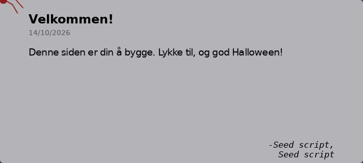

---

# P9: Show where the keyboard is on the shortcuts
`🍬 candy` · `♿ a11y` · Feature

**Reward:** 1 🪙 · **Time:** about 6 min  
**Good to know first:** nothing, everything is explained

### What to do
People who use the keyboard move around the page with Tab. On the home page shortcuts (Info, Nyheter, Jobber, …) it's hard to see which one is selected. Add a clear outline when a shortcut has keyboard focus.

### Files to change (only these)
- `ifiplatform/static/css/07_halloween/shortcut_focus.css` (empty, already loaded)

### Solution to start from
Paste this into the file:
```css
#home-shortcuts a:focus-visible,
#home-shortcuts .shortcut-toggle:focus-visible {
    outline: 3px solid var(--color-accent);
    outline-offset: 3px;
}
```

#### Explanation (optional)
- `#home-shortcuts` is the box with all the shortcuts. `a` is a link inside it, and `.shortcut-toggle` the buttons.
- `:focus-visible` means "selected with the keyboard". Mouse clicks don't trigger it.
- `outline-offset` moves the line a little away from the edge, so it's easier to see.

### Make it yours
- Use another colour, such as `#ff7518` (pumpkin orange).
- Make it thicker, or `dashed`.
- Test it: click in the address bar, then press Tab until you reach the shortcuts.
- **Pick your own colour:** in VS Code, every colour code in a `.css` file has a small coloured square in front of it. Click the square to get a colour picker; the code changes as you pick. Or search "color picker" on Google, choose a colour, and copy the **HEX** code (the one that starts with `#`, like `#ff7518`).

### Done when
- Pressing Tab on the home page shows a clear outline around the shortcut you're on.

### How to work on it
Set up the project on your own computer first (see **Get started** in the README). Then:

1. **Claim this issue** on the site: https://halloween.ifiplattform.no/commits/issues/
2. In the VS Code terminal:
   ```bash
   ifi fix-issue {number}
   ```
3. Make the change, and check it at http://localhost:8000. Reload with **Ctrl+Shift+R** (Mac: **Cmd+Shift+R**): a normal reload may show the old look, because the browser keeps old copies of CSS files and pictures. Still old? Try a private window.
4. Then:
   ```bash
   ifi test
   git add .
   git commit -m "Short description of what you changed"
   ifi pull-request
   ```

**Only change the files listed above.** Then your pull request can't clash with anyone else's. After the merge it can take a few minutes before it shows on the live site. Stuck? Ask a helper, or type `ifi help`.

#### What it looks like when it's done
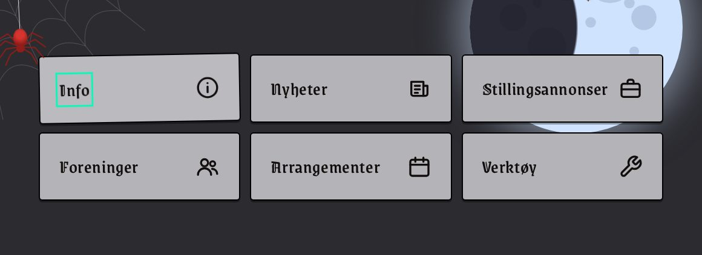

*After pressing Tab: the focused shortcut (Info) has an outline.*

---

# SET-moon: 🌕 Set: the moon
`🍬 candy` · `🖼️ art` · Feature

A big moon in the top right corner of every page, with craters and a glow. The empty `<div class="moon">` is already on every page (`ifiplatform/templates/partials/halloween_decor.html`).

**Claim one of the sub-issues, not this one.** You get coins (and points) for the sub-issue you finish. This issue only groups them, and closes when all of them are done.

- [ ] P10a
- [ ] P10b
- [ ] P10c

---

# SET-spider: 🕷️ Set: the spider
`🍬 candy` · `🖼️ art` · Feature

A red spider hangs from a thread at the top left of every page, and swings. The empty spider is already on every page (`ifiplatform/templates/partials/halloween_decor.html`): a `<div class="spider">` with a thread, legs and a body inside. Each part is its own issue, in its own CSS file, so you can do them in any order.

**Claim one of the sub-issues, not this one.** You get coins for the sub-issue you finish. This issue only groups them, and closes when all of them are done.

- [ ] C27
- [ ] C28
- [ ] C29
- [ ] C30
