# Commit for Candy: 🍫 chocolate issues (for review)

The 33 🍫 chocolate event issues (30 to claim, 3 sets) exactly as they will be posted on GitHub, generated on 2026-10-18. The other sizes are in [event_issues_candy.md](event_issues_candy.md) and [event_issues_pumpkin.md](event_issues_pumpkin.md). Under each issue is a screenshot of what it looks like when it's done, taken from the site with every issue done. Issues refer to each other by ID (P10a, SET-moon); the creation script turns those into issue numbers. Delete these files and their image folder once the issues are on GitHub.

---

# K1: Cobweb in the top-left corner
`🍫 chocolate` · `🖼️ art` · Feature

**Reward:** 2 🪙 + 2 🏆 · **Time:** about 10 min  
**Good to know first:** basic CSS (backgrounds). The SVG is given

### What to do
Hang a cobweb in the top-left corner of every page, behind everything else.

### Files to change (only these)
- new: `ifiplatform/static/images/halloween/cobweb.svg`
- `ifiplatform/static/css/07_halloween/cobweb.css` (empty, already loaded on every page)

### What you get
The web itself. Make the file `ifiplatform/static/images/halloween/cobweb.svg` with this inside:
```html
<svg xmlns="http://www.w3.org/2000/svg" width="420" height="420" viewBox="0 0 420 420" fill="none" stroke="#8a8494" stroke-opacity="0.35" stroke-width="1.2">
  <line x1="0" y1="0" x2="420" y2="0"/>
  <line x1="0" y1="0" x2="409" y2="93"/>
  <line x1="0" y1="0" x2="378" y2="182"/>
  <line x1="0" y1="0" x2="328" y2="262"/>
  <line x1="0" y1="0" x2="262" y2="328"/>
  <line x1="0" y1="0" x2="182" y2="378"/>
  <line x1="0" y1="0" x2="93" y2="409"/>
  <line x1="0" y1="0" x2="0" y2="420"/>
  <path d="M52,0 Q45,5 51,12 Q42,15 47,23 Q38,24 41,33 Q32,32 33,41 Q24,38 23,47 Q15,42 12,51 Q5,45 0,52"/>
  <path d="M105,0 Q89,10 102,23 Q85,30 95,46 Q76,48 82,65 Q63,63 65,82 Q48,76 46,95 Q30,85 23,102 Q10,89 0,105"/>
  <path d="M158,0 Q134,15 154,35 Q127,44 142,68 Q114,72 123,98 Q95,95 98,123 Q72,114 68,142 Q44,127 35,154 Q15,134 0,158"/>
  <path d="M210,0 Q178,20 205,47 Q169,59 189,91 Q152,95 164,131 Q127,127 131,164 Q95,152 91,189 Q59,169 47,205 Q20,178 0,210"/>
  <path d="M262,0 Q223,25 256,58 Q212,74 237,114 Q190,119 205,164 Q159,159 164,205 Q119,190 114,237 Q74,212 58,256 Q25,223 0,262"/>
  <path d="M315,0 Q268,30 307,70 Q254,89 284,137 Q228,143 246,196 Q190,190 196,246 Q143,228 137,284 Q89,254 70,307 Q30,268 0,315"/>
  <path d="M368,0 Q312,35 358,82 Q296,104 331,159 Q266,167 287,229 Q222,222 229,287 Q167,266 159,331 Q104,296 82,358 Q35,312 0,368"/>
</svg>
```

#### Explanation (optional)
It's drawn with lines from the corner (`<line>`) and curved rings (`<path>` with `Q` curves).

### Your part
Put the web on the page with CSS in `cobweb.css`. Use it as a **background image on `body`**:
- `background-image: url(...)`: the path from the CSS file to the picture is `../../images/halloween/cobweb.svg`
- `background-repeat`: only one web, please
- `background-position`: the top-left corner
- leave out `background-attachment: fixed`: then the web hangs at the top of the page and scrolls away with it, like a real web in a corner

### Make it yours
- **Colour:** `stroke="#8a8494"` and `stroke-opacity="0.35"` in the SVG make a faint grey web that shows on both the dark home page and the light pages. Try paler (`#c8c3d2`) or darker.
- **Size:** `background-size: 300px` makes it smaller. Or add more rings to the SVG.
- **Pick your own colour:** search "color picker" on Google, choose a colour, and copy the **HEX** code (the one that starts with `#`, like `#ff7518`). Paste it between the quotes, for example `fill="#ff7518"`.

### Done when
- Every page has one faint web in the top-left corner, behind the text, that doesn't cover anything.

### How to work on it
Set up the project on your own computer first (see **Get started** in the README). Then:

1. **Claim this issue** on the site: https://halloween.ifiplattform.no/commits/issues/
2. In the VS Code terminal:
   ```bash
   ifi fix-issue {number}
   ```
3. Make the change, and check it at http://localhost:8000. Reload with **Ctrl+Shift+R** (Mac: **Cmd+Shift+R**): a normal reload may show the old look, because the browser keeps old copies of CSS files and pictures. Still old? Try a private window.
4. Then:
   ```bash
   ifi test
   git add .
   git commit -m "Short description of what you changed"
   ifi pull-request
   ```

**Only change the files listed above.** Then your pull request can't clash with anyone else's. After the merge it can take a few minutes before it shows on the live site. Stuck? Ask a helper, or type `ifi help`.

#### What it looks like when it's done
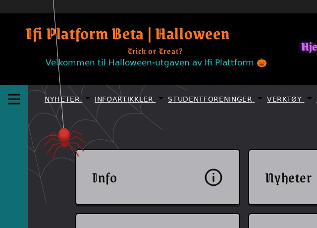

---

# K10: Halloween pictures for the Instagram row
`🍫 chocolate` · `🖼️ art` · Feature

**Reward:** 2 🪙 + 2 🏆 · **Time:** about 12 min · **Part of the set** SET-right  
**Good to know first:** basic HTML, and drawing simple SVG shapes

### What to do
The "Ifi on Instagram" row under the news on the home page shows five grey placeholders that say "Picture 1" to "Picture 5". Replace them with five Halloween pictures, each with a caption.

### Files to change (only these)
- `ifiplatform/apps/ifi_home_app/templates/home/partials/right_column/instagram.html`
- `ifiplatform/static/images/halloween/instagram/tile1.svg`
- `ifiplatform/static/images/halloween/instagram/tile2.svg`
- `ifiplatform/static/images/halloween/instagram/tile3.svg`
- `ifiplatform/static/images/halloween/instagram/tile4.svg`
- `ifiplatform/static/images/halloween/instagram/tile5.svg`

### What you get
Each tile is a 160 × 200 SVG picture. Here is a finished one, a pumpkin, to start `tile1.svg` with:
```html
<svg xmlns="http://www.w3.org/2000/svg" width="160" height="200" viewBox="0 0 160 200">
  <rect width="160" height="200" fill="#1d1830"/>
  <rect x="76" y="58" width="8" height="18" rx="3" fill="#3f7a2a"/>
  <ellipse cx="80" cy="118" rx="54" ry="44" fill="#ff7518"/>
  <path d="M58 104 l10 -14 l10 14 z M92 104 l10 -14 l10 14 z" fill="#ffd34d"/>
  <path d="M54 126 q26 22 52 0 l-8 8 l-6 -6 l-6 8 l-6 -8 l-6 8 l-6 -8 l-6 6 z" fill="#ffd34d"/>
</svg>
```

#### Explanation (optional)
- The first `<rect>` is the dark background, the second the stem. The `<ellipse>` is the pumpkin.
- A `<path>` draws a shape: `M` moves the pen, `l` draws a line *relative* to where the pen is, `q` a curve, and `z` closes the shape. The eyes are two triangles, the mouth a curve with teeth.

### Your part
1. **Draw tiles 2 to 5** in the same way, each with its own background colour. Ideas: a ghost (a rounded `<path>` with two dark eyes), a bat in front of the full moon, a spider in its web, a wrapped candy, a skull, a cauldron. Simple shapes are plenty.
2. **Captions and alt texts** in `instagram.html`: each tile has an `` with an `alt` and a `<span class="insta-cap">` with a caption. Replace "Picture 1" etc.:
   - `alt` says what's **in** the picture, for people who can't see it ("A grinning jack-o-lantern").
   - The caption is the fun Instagram text ("The pumpkin carving won.").
   - Keep `` around both, and don't change the classes or the `` paths.

### Make it yours
- Draw in Inkscape or Figma instead, and export as SVG. Keep each file small (under about 10 KB).

### Done when
- Five different Halloween pictures show in the row, each with a caption and an alt text that describes it.

### How to work on it
Set up the project on your own computer first (see **Get started** in the README). Then:

1. **Claim this issue** on the site: https://halloween.ifiplattform.no/commits/issues/
2. In the VS Code terminal:
   ```bash
   ifi fix-issue {number}
   ```
3. Make the change, and check it at http://localhost:8000. Reload with **Ctrl+Shift+R** (Mac: **Cmd+Shift+R**): a normal reload may show the old look, because the browser keeps old copies of CSS files and pictures. Still old? Try a private window.
4. Then:
   ```bash
   ifi test
   git add .
   git commit -m "Short description of what you changed"
   ifi pull-request
   ```

**Only change the files listed above.** Then your pull request can't clash with anyone else's. After the merge it can take a few minutes before it shows on the live site. Stuck? Ask a helper, or type `ifi help`.

#### What it looks like when it's done
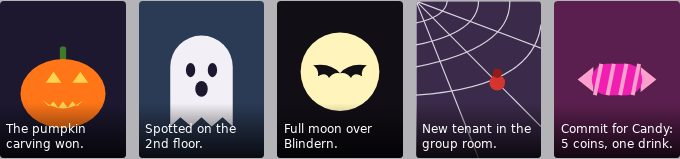

---

# K11: Draw the >OUTPUT Halloween cover
`🍫 chocolate` · `🖼️ art` · Feature

**Reward:** 2 🪙 + 2 🏆 · **Time:** about 12 min · **Part of the set** SET-right  
**Good to know first:** drawing simple SVG shapes, or a drawing program like Inkscape or Figma

### What to do
The >OUTPUT box at the bottom of the home page's right column shows a grey placeholder that says "cover coming soon". Draw a Halloween cover for Ifi's student magazine.

### Files to change (only these)
- `ifiplatform/static/images/halloween/output_cover.svg`

### What you get
The cover is 300 × 400. Replace what's in the file with this start: a dark night, the magazine's name and a subtitle.
```html
<svg xmlns="http://www.w3.org/2000/svg" width="300" height="400" viewBox="0 0 300 400">
  <rect width="300" height="400" fill="#15121c"/>
  <text x="24" y="58" font-family="monospace" font-size="40" font-weight="700" fill="#ff7518">&gt;OUTPUT</text>
  <text x="24" y="84" font-family="monospace" font-size="15" fill="#f2eff6">The Halloween issue</text>
</svg>
```

#### Explanation (optional)
- `<text>` writes text at `x`, `y` (the bottom left of the text). `&gt;` is how you write `>` inside SVG.
- Things later in the file are drawn on top of things earlier in it.

### Your part
Draw the cover's picture under the title. Use at least four shapes (`<circle>`, `<rect>`, `<ellipse>`, `<path>`). Ideas:
- a full moon with craters, and a row of hills or gravestones along the bottom,
- a laptop with a ghost coming out of the screen,
- a pumpkin wearing headphones.

Add a third line of small text at the bottom, like a cover story: "Ghosts in the machine · p. 13".

Keep the title readable: don't draw over it.

### Make it yours
- Draw in Inkscape or Figma, and export as SVG (under about 20 KB).

### Done when
- The >OUTPUT box on the home page shows your Halloween cover, with the title easy to read.

### How to work on it
Set up the project on your own computer first (see **Get started** in the README). Then:

1. **Claim this issue** on the site: https://halloween.ifiplattform.no/commits/issues/
2. In the VS Code terminal:
   ```bash
   ifi fix-issue {number}
   ```
3. Make the change, and check it at http://localhost:8000. Reload with **Ctrl+Shift+R** (Mac: **Cmd+Shift+R**): a normal reload may show the old look, because the browser keeps old copies of CSS files and pictures. Still old? Try a private window.
4. Then:
   ```bash
   ifi test
   git add .
   git commit -m "Short description of what you changed"
   ifi pull-request
   ```

**Only change the files listed above.** Then your pull request can't clash with anyone else's. After the merge it can take a few minutes before it shows on the live site. Stuck? Ask a helper, or type `ifi help`.

#### What it looks like when it's done
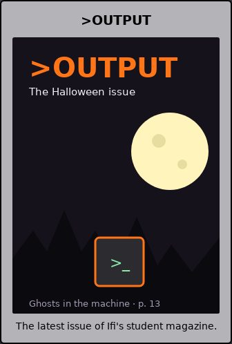

---

# K12: Click "Trick or Treat?" for a trick or a treat
`🍫 chocolate` · `🦇 silly feature` · Feature

**Reward:** 2 🪙 + 2 🏆 · **Time:** about 10 min  
**Good to know first:** JavaScript basics (click events, arrays, Math.random, setTimeout)

### What to do
"Trick or Treat?" under the site name in the header is a button, but clicking it does nothing. Make it answer: a random trick or treat shows in its place for a few seconds, then the question comes back.

### Files to change (only these)
- `ifiplatform/static/js/halloween/trick_or_treat.js` (empty, already loaded on every page)

### What you get
Start the file with this. It finds the button and remembers its text:
```js
// Click "Trick or Treat?" in the header: a random trick or treat shows for
// a few seconds, then the question comes back.
document.addEventListener("DOMContentLoaded", () => {
  const tagline = document.querySelector(".header-tagline");
  if (!tagline) {
    return;
  }
  const question = tagline.textContent.trim();
  const tricks = [
    "Trick! Your next commit message is now in Latin.",
  ];
  const treats = [
    "Treat! 🍬 A bug fixes itself.",
  ];

  // TODO: your part
});
```

#### Explanation (optional)
- `DOMContentLoaded` waits until the page's HTML is there, so the button can be found.
- `querySelector(".header-tagline")` finds the first element with that class.
- `question` keeps the original text ("Trick or Treat?" or the Norwegian version), to put back later.

### Your part
1. Add at least two more tricks and two more treats.
2. When the button is clicked (`addEventListener("click", ...)`): pick tricks or treats at random (`Math.random() < 0.5`), then a random line from that list (`Math.floor(Math.random() * list.length)`), and show it as the button's `textContent`.
3. After 4 seconds (`setTimeout`), put `question` back. A second click while an answer shows should start the 4 seconds over: `clearTimeout`.
4. Screen readers don't notice text that changes by itself. `tagline.setAttribute("aria-live", "polite")` makes them read the new text.

### Make it yours
- A treat that actually does something, like turning the logo green for a moment.
- Never the same answer twice in a row.

### Done when
- Clicking "Trick or Treat?" shows a random trick or treat, and after a few seconds the question is back.

### How to work on it
Set up the project on your own computer first (see **Get started** in the README). Then:

1. **Claim this issue** on the site: https://halloween.ifiplattform.no/commits/issues/
2. In the VS Code terminal:
   ```bash
   ifi fix-issue {number}
   ```
3. Make the change, and check it at http://localhost:8000. Reload with **Ctrl+Shift+R** (Mac: **Cmd+Shift+R**): a normal reload may show the old look, because the browser keeps old copies of CSS files and pictures. Still old? Try a private window.
4. Then:
   ```bash
   ifi test
   git add .
   git commit -m "Short description of what you changed"
   ifi pull-request
   ```

**Only change the files listed above.** Then your pull request can't clash with anyone else's. After the merge it can take a few minutes before it shows on the live site. Stuck? Ask a helper, or type `ifi help`.

#### What it looks like when it's done
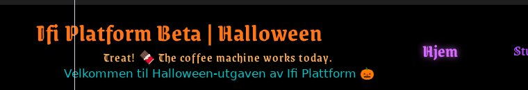

*After a click on "Trick or Treat?".*

---

# K13: A secret word makes the whole page spin
`🍫 chocolate` · `🦇 silly feature` · Feature

**Reward:** 2 🪙 + 2 🏆 · **Time:** about 11 min  
**Good to know first:** JavaScript basics (keyboard events, strings, if)

### What to do
Hide a secret on every page: when someone types **boo** on the keyboard (not in a text field), the whole page spins around once.

### Files to change (only these)
- `ifiplatform/static/js/halloween/spooky_code.js` (empty, already loaded on every page)

### What you get
The spin itself. This line turns the whole page around once in 1.5 seconds:
```js
page.animate([{ rotate: "0deg" }, { rotate: "360deg" }], { duration: 1500, easing: "ease-in-out" });
```
where `page` is `document.querySelector(".page-layout")`, the box around everything on the page.

#### Explanation (optional)
- `element.animate(keyframes, options)` plays an animation straight from JavaScript, without any CSS: from `0deg` to `360deg` (`deg` means degrees), one full turn.

### Your part
Write `spooky_code.js`:
1. Wait for the page: `document.addEventListener("DOMContentLoaded", () => { ... });`.
2. Listen for keys on the whole page: `document.addEventListener("keydown", (event) => { ... })`. `event.key` is the key, like `"b"`.
3. **Ignore typing in fields:** if `event.target.closest("input, textarea, select")` finds something, stop (`return`). Otherwise typing "boo" in a search box would spin the page.
4. **Remember the last three keys** in a string, for example `typed = (typed + event.key.toLowerCase()).slice(-3)`. When `typed` is `"boo"`, spin the page and empty `typed`.
5. **Animations off:** some people turn animations off because movement makes them dizzy. If `window.matchMedia("(prefers-reduced-motion: reduce)").matches` is true, don't spin.

### Make it yours
- Your own secret word (keep it short, and tell a helper so they can test it).
- Spin the other way, or twice: `720deg`.

### Done when
- Typing b, o, o anywhere on a page (not in a field) spins the page once. Typing it in a text field does nothing. With animations turned off, nothing moves.

### How to work on it
Set up the project on your own computer first (see **Get started** in the README). Then:

1. **Claim this issue** on the site: https://halloween.ifiplattform.no/commits/issues/
2. In the VS Code terminal:
   ```bash
   ifi fix-issue {number}
   ```
3. Make the change, and check it at http://localhost:8000. Reload with **Ctrl+Shift+R** (Mac: **Cmd+Shift+R**): a normal reload may show the old look, because the browser keeps old copies of CSS files and pictures. Still old? Try a private window.
4. Then:
   ```bash
   ifi test
   git add .
   git commit -m "Short description of what you changed"
   ifi pull-request
   ```

**Only change the files listed above.** Then your pull request can't clash with anyone else's. After the merge it can take a few minutes before it shows on the live site. Stuck? Ask a helper, or type `ifi help`.

#### What it looks like when it's done
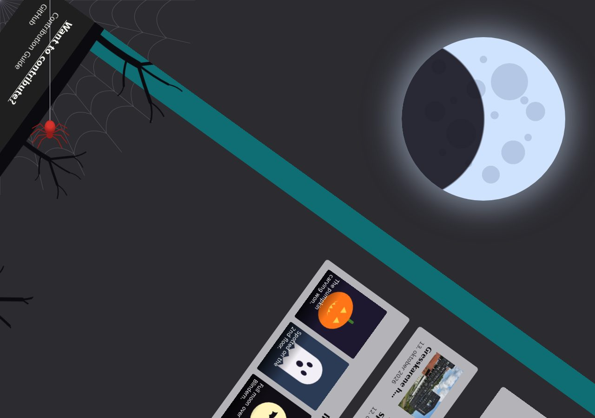

*Halfway through the spin, after typing b o o.*

---

# K14: Pages go Halloween: the article page
`🍫 chocolate` · `🎨 restyle` · Feature

**Reward:** 2 🪙 + 2 🏆 · **Time:** about 10 min · **Part of the set** SET-pages  
**Good to know first:** basic CSS (selectors, colours, borders)

### What to do
Give the article page a Halloween look. Open it at any article, for example from Nyheter on the home page and keep it open while you work.

### Files to change (only these)
- `ifiplatform/static/css/07_halloween/article_page.css` (empty, already loaded on every page)

### What you get
Start with this rule, which only touches this page:
```css
.article-page h1 {
    color: #ff7518;
}
```

### Design to build
The look: **old parchment, with blood-red details**. You don't have to come up with a design: build this one. Rather design your own? Go ahead, see "Make it yours".
- **The article column** (`.article-page`): parchment yellow `#f3e7c9`, with dark brown text `#3b2412`.
- **The title** (`.article-page h1`): pumpkin orange `#ff7518`.
- **Headings in the article** (`.article-page h2`): dark red `#6b1d1d`, with a 2px solid black line under them.
- **Links** (`.article-page a`): blood red `#a3130f`. On hover, a red glow: `text-shadow: 0 0 6px rgba(255, 60, 40, 0.7)`.
- **The date and author line** (`.article-meta-item`): brown `#6b4a2b`, in italics.

### Your part
Build the design above in the file, one rule per selector. The selectors are already in the page's HTML:
- `.article-page`: the whole article column
- `.article-page h1`: the title
- `.article-page h2`: the headings inside the article
- `.article-page a`: links
- `.article-meta-item`: the date and author line

Useful properties: `background`, `color`, `border`, `border-radius`, `box-shadow`, `font-family`, `text-shadow`.

### Make it yours
Your own design instead of the one above, or on top of it. Some ideas:
- A haunted newspaper: black page, white text, the title in a big bold font, headings with a black line above and below.
- Slime: dark green page, light green text, links that look like drips (`text-decoration: underline wavy`).
- A spooky font from Google Fonts for the headings. That needs a font link in another file, so ask a helper first.

### Done when
- The page looks clearly Halloween, and all the text is still easy to read.
- Other pages don't change. Check the home page.

### How to work on it
Set up the project on your own computer first (see **Get started** in the README). Then:

1. **Claim this issue** on the site: https://halloween.ifiplattform.no/commits/issues/
2. In the VS Code terminal:
   ```bash
   ifi fix-issue {number}
   ```
3. Make the change, and check it at http://localhost:8000. Reload with **Ctrl+Shift+R** (Mac: **Cmd+Shift+R**): a normal reload may show the old look, because the browser keeps old copies of CSS files and pictures. Still old? Try a private window.
4. Then:
   ```bash
   ifi test
   git add .
   git commit -m "Short description of what you changed"
   ifi pull-request
   ```

**Only change the files listed above.** Then your pull request can't clash with anyone else's. After the merge it can take a few minutes before it shows on the live site. Stuck? Ask a helper, or type `ifi help`.

#### What it looks like when it's done
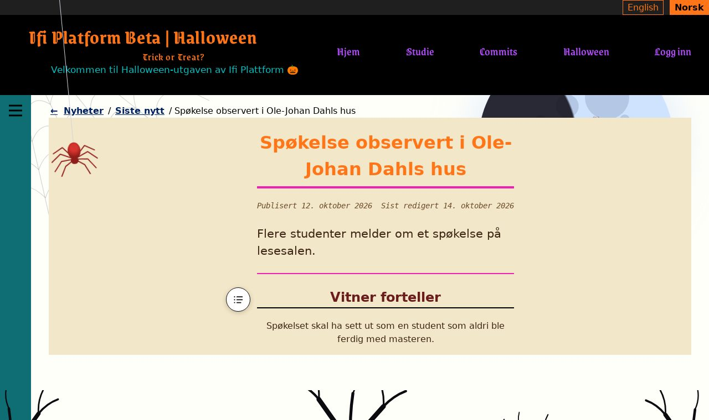

---

# K15: Pages go Halloween: the event page
`🍫 chocolate` · `🎨 restyle` · Feature

**Reward:** 2 🪙 + 2 🏆 · **Time:** about 10 min · **Part of the set** SET-pages  
**Good to know first:** basic CSS (selectors, colours, borders)

### What to do
Give the event page a Halloween look. Open it at any event, for example from "Happening at Ifi" on the home page and keep it open while you work.

### Files to change (only these)
- `ifiplatform/static/css/07_halloween/event_page.css` (empty, already loaded on every page)

### What you get
Start with this rule, which only touches this page:
```css
.event-page h1 {
    color: #ff7518;
}
```

### Design to build
The look: **an event ticket, with a ghost**. You don't have to come up with a design: build this one. Rather design your own? Go ahead, see "Make it yours".
- **The title** (`.event-page h1`): pumpkin orange `#ff7518`, with a 👻 in front of it (`.event-page h1::before { content: "👻 "; }`).
- **The date, time and place** (`.event-meta`): a ticket: a 2px solid black border, corners rounded 6px, a little space inside (`padding: 0.6rem 0.9rem`).
- **The badge above the title** (`.event-type-badge`): an orange glow around it: `box-shadow: 0 0 8px rgba(255, 117, 24, 0.6)`.
- **The sign-up links** (`.event-signup-link`): orange buttons: background `#ff7518`, dark text `#1f1f1f`, corners rounded 6px, `padding: 0.2rem 0.6rem`.

### Your part
Build the design above in the file, one rule per selector. The selectors are already in the page's HTML:
- `.event-page`: the whole event page
- `.event-page h1`: the title
- `.event-meta`: the date, time and place
- `.event-type-badge`: the small badge above the title
- `.event-signup-link`: the sign-up links

Useful properties: `background`, `color`, `border`, `border-radius`, `box-shadow`, `font-family`, `text-shadow`.

### Make it yours
Your own design instead of the one above, or on top of it. Some ideas:
- A wanted poster: a yellowed background, the title in big capitals (`text-transform: uppercase`), the date in a black box.
- A night sky: dark blue page, pale yellow text, the badge glowing like a star.
- The 👻 swapped for 🎃 or 🦇, or one emoji on each side of the title (`::after`).

### Done when
- The page looks clearly Halloween, and all the text is still easy to read.
- Other pages don't change. Check the home page.

### How to work on it
Set up the project on your own computer first (see **Get started** in the README). Then:

1. **Claim this issue** on the site: https://halloween.ifiplattform.no/commits/issues/
2. In the VS Code terminal:
   ```bash
   ifi fix-issue {number}
   ```
3. Make the change, and check it at http://localhost:8000. Reload with **Ctrl+Shift+R** (Mac: **Cmd+Shift+R**): a normal reload may show the old look, because the browser keeps old copies of CSS files and pictures. Still old? Try a private window.
4. Then:
   ```bash
   ifi test
   git add .
   git commit -m "Short description of what you changed"
   ifi pull-request
   ```

**Only change the files listed above.** Then your pull request can't clash with anyone else's. After the merge it can take a few minutes before it shows on the live site. Stuck? Ask a helper, or type `ifi help`.

#### What it looks like when it's done


---

# K16: Pages go Halloween: the log-in and sign-up pages
`🍫 chocolate` · `🎨 restyle` · Feature

**Reward:** 2 🪙 + 2 🏆 · **Time:** about 10 min · **Part of the set** SET-pages  
**Good to know first:** basic CSS (selectors, colours, borders)

### What to do
Give the log-in and sign-up pages a Halloween look. Open it at http://localhost:8000/account/login and http://localhost:8000/account/signin (log out first) and keep it open while you work.

### Files to change (only these)
- `ifiplatform/static/css/07_halloween/auth_pages.css` (empty, already loaded on every page)

### What you get
Start with this rule, which only touches this page:
```css
.auth-card h1 {
    color: #ff7518;
}
```

### Design to build
The look: **a gravestone**. You don't have to come up with a design: build this one. Rather design your own? Go ahead, see "Make it yours".
- **The card** (`.auth-card`): a grey gravestone, `#9a9aa3`, with dark text `#111111`. Round on top, square at the bottom: `border-radius: 50% 50% 8px 8px / 30% 30% 8px 8px`. A 2px solid black border all round, and extra space on top so the title isn't in the curve: `padding-top: 3rem`.
- **The title** (`.auth-card h1`): pumpkin orange `#ff7518`, centred.
- **A text field you click in** (`.auth-card input:focus`): orange, `outline` and `border-color` both `#ff7518`.
- **The button** (`.auth-card .btn`): dark `#1f1f1f`, with orange text `#ff7518` and a 2px solid black border.
- **The links under the form** (`.auth-links a`): dark purple `#3b0a5a`.

### Your part
Build the design above in the file, one rule per selector. The selectors are already in the page's HTML:
- `.auth-card`: the box around the form
- `.auth-card h1`: the title
- `.auth-card input`: the text fields
- `.auth-card .btn`: the button
- `.auth-links`: the links under the form

Two things the site's own CSS already does, which you'll want to override:
- The card has a thick pink line on top. Giving `.auth-card` one `border` replaces it.
- A text field you click in gets a turquoise `border-color`. If you change the `outline` colour, change `border-color` too, or the field gets two colours.

Useful properties: `background`, `color`, `border`, `border-radius`, `box-shadow`, `font-family`, `text-shadow`.

### Make it yours
Your own design instead of the one above, or on top of it. Some ideas:
- A coffin instead of a gravestone: narrow at the top and bottom, wide at the shoulders (`clip-path: polygon(...)`).
- A haunted mirror: an oval card (`border-radius: 50%`) with a silver-grey background.
- Green slime: dark green card, light green fields, the button dripping (a wavy bottom border is hard, so try a box-shadow).

### Done when
- The page looks clearly Halloween, and all the text is still easy to read.
- Other pages don't change. Check the home page.

### How to work on it
Set up the project on your own computer first (see **Get started** in the README). Then:

1. **Claim this issue** on the site: https://halloween.ifiplattform.no/commits/issues/
2. In the VS Code terminal:
   ```bash
   ifi fix-issue {number}
   ```
3. Make the change, and check it at http://localhost:8000. Reload with **Ctrl+Shift+R** (Mac: **Cmd+Shift+R**): a normal reload may show the old look, because the browser keeps old copies of CSS files and pictures. Still old? Try a private window.
4. Then:
   ```bash
   ifi test
   git add .
   git commit -m "Short description of what you changed"
   ifi pull-request
   ```

**Only change the files listed above.** Then your pull request can't clash with anyone else's. After the merge it can take a few minutes before it shows on the live site. Stuck? Ask a helper, or type `ifi help`.

#### What it looks like when it's done
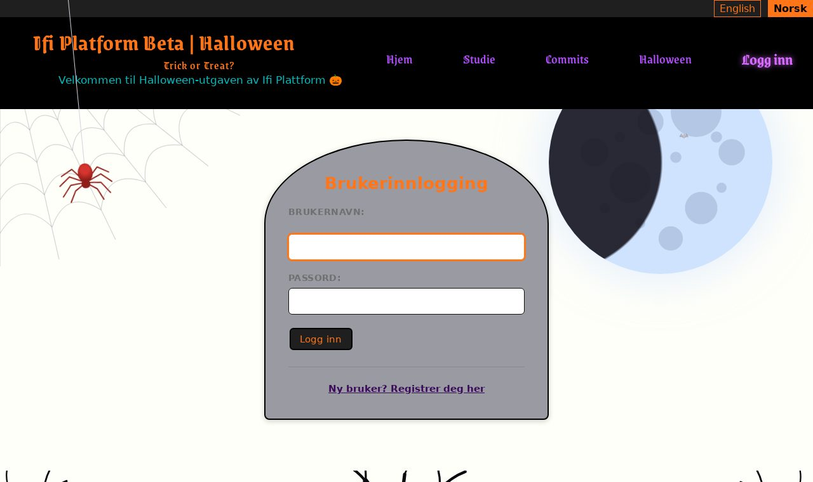

---

# K17: Pages go Halloween: the study page
`🍫 chocolate` · `🎨 restyle` · Feature

**Reward:** 2 🪙 + 2 🏆 · **Time:** about 10 min · **Part of the set** SET-pages  
**Good to know first:** basic CSS (selectors, colours, borders)

### What to do
Give the study page a Halloween look. On this site the study section is "under development", and http://localhost:8000/study/ shows a joke page: "Studie? Ahaha, nei." with a random excuse. Keep it open while you work.

### Files to change (only these)
- `ifiplatform/static/css/07_halloween/study_home.css` (empty, already loaded on every page)

### What you get
Start with this rule, which only touches this page:
```css
.under-development h1 {
    color: #ff7518;
}
```

### Design to build
The look: **a cursed library: dark wood, candlelight and an old scroll**. You don't have to come up with a design: build this one. Rather design your own? Go ahead, see "Make it yours".
- **The box** (`.under-development`): dark wood `#2a1d14`, with candle-yellow text `#ffe9a8`, corners rounded 8px, `padding: 2rem 1.5rem`.
- **The title** (`.under-development h1`): pumpkin orange `#ff7518`.
- **The "under development" line** (`.under-development-status`): old gold `#d9b77a`.
- **The excuse** (`.under-development-joke`): an old scroll: parchment `#f3e7c9`, dark brown text `#3b2412`, uneven corners (`border-radius: 4px 18px 6px 14px`), `padding: 1rem 1.2rem`.
- **The link** (`.under-development a`): lantern orange `#ffb15c`, with a glow on hover: `text-shadow: 0 0 8px rgba(255, 177, 92, 0.9)`.

### Your part
Build the design above in the file, one rule per selector. The selectors are already in the page's HTML:
- `.under-development`: the whole box with the joke
- `.under-development h1`: the title
- `.under-development-status`: the "under development" line
- `.under-development-joke`: the random excuse
- `.under-development a`: the "give me another excuse" link

Useful properties: `background`, `color`, `border`, `border-radius`, `box-shadow`, `font-family`, `text-shadow`.

### Make it yours
Your own design instead of the one above, or on top of it. Some ideas:
- A chalkboard: dark green box, white chalky text, the excuse in a slightly tilted box (`transform: rotate(-1deg)`, where `deg` means degrees).
- A ghost's diary: a white page with faint blue lines (`repeating-linear-gradient`), handwritten-looking italics.
- Candles: an orange glow around the whole box (`box-shadow`), flickering with a slow `@keyframes` (and still with reduced motion).

### Done when
- http://localhost:8000/study/ looks clearly Halloween, and all the text is still easy to read.
- Other pages don't change. Check the home page.

### How to work on it
Set up the project on your own computer first (see **Get started** in the README). Then:

1. **Claim this issue** on the site: https://halloween.ifiplattform.no/commits/issues/
2. In the VS Code terminal:
   ```bash
   ifi fix-issue {number}
   ```
3. Make the change, and check it at http://localhost:8000. Reload with **Ctrl+Shift+R** (Mac: **Cmd+Shift+R**): a normal reload may show the old look, because the browser keeps old copies of CSS files and pictures. Still old? Try a private window.
4. Then:
   ```bash
   ifi test
   git add .
   git commit -m "Short description of what you changed"
   ifi pull-request
   ```

**Only change the files listed above.** Then your pull request can't clash with anyone else's. After the merge it can take a few minutes before it shows on the live site. Stuck? Ask a helper, or type `ifi help`.

#### What it looks like when it's done
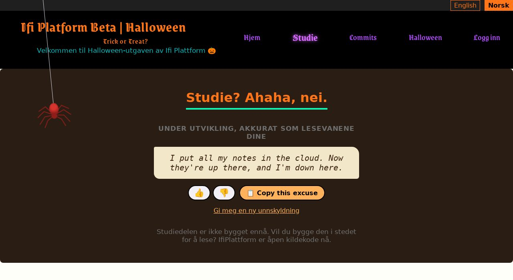

---

# K19: `python manage.py carve_pumpkin`
`🍫 chocolate` · `🧪 python` · Feature

**Reward:** 2 🪙 + 2 🏆 · **Time:** about 10 min  
**Good to know first:** basic Python (loops, strings)

### What to do
Make a new management command that prints a jack-o'-lantern in the terminal:
```
$ python manage.py carve_pumpkin --size 3
```

### Files to change (only these)
- new: `ifiplatform/apps/halloween_app/management/commands/carve_pumpkin.py`

### What you get
Start the file with this. It already works and prints a stem:
```python
"""python manage.py carve_pumpkin [--size N]: prints a jack-o'-lantern."""

from django.core.management.base import BaseCommand


class Command(BaseCommand):
    help = "Prints a jack-o'-lantern in the terminal."

    def add_arguments(self, parser):
        parser.add_argument("--size", type=int, default=3, help="How wide the pumpkin is (1-6).")

    def handle(self, *args, **options):
        size = max(1, min(options["size"], 6))
        width = 6 + size * 4
        self.stdout.write(" " * (width // 2) + "|")
        # TODO: print the pumpkin
```

#### Explanation (optional)
- Django finds the command by its file name: `carve_pumpkin.py` becomes `manage.py carve_pumpkin`.
- `self.stdout.write(...)` prints one line.

### Your part
Replace the TODO with a loop that prints the pumpkin, line by line, `width` characters wide:
- a round top and bottom, for example `/` and `\` at the ends of the first line,
- two eyes (`^ ^` or `▲ ▲`) in the middle of one line,
- a mouth with teeth (`\/\/\/`) a few lines lower.

Tip: `"^ ^".center(width - 2)` puts text in the middle of a line.

### Make it yours
- An extra option, like `--face scary` or `--face happy`, with `parser.add_argument`.
- Colour: `self.style.WARNING(line)` prints a line in yellow-orange.

### Done when
- `python manage.py carve_pumpkin` prints a pumpkin, and `--size 1` and `--size 6` give a small and a big one.

### How to work on it
Set up the project on your own computer first (see **Get started** in the README). Then:

1. **Claim this issue** on the site: https://halloween.ifiplattform.no/commits/issues/
2. In the VS Code terminal:
   ```bash
   ifi fix-issue {number}
   ```
3. Make the change, and check it at http://localhost:8000. Reload with **Ctrl+Shift+R** (Mac: **Cmd+Shift+R**): a normal reload may show the old look, because the browser keeps old copies of CSS files and pictures. Still old? Try a private window.
4. Then:
   ```bash
   ifi test
   git add .
   git commit -m "Short description of what you changed"
   ifi pull-request
   ```

**Only change the files listed above.** Then your pull request can't clash with anyone else's. After the merge it can take a few minutes before it shows on the live site. Stuck? Ask a helper, or type `ifi help`.

#### What it looks like when it's done


*Terminal output.*

---

# K2: Scary trees above the footer
`🍫 chocolate` · `🖼️ art` · Feature

**Reward:** 2 🪙 + 2 🏆 · **Time:** about 11 min  
**Good to know first:** basic CSS (backgrounds). Some SVG is given

### What to do
Scroll to the bottom of any page: right above the footer there's an empty strip (`<div class="treeline">`). Fill it with a row of black, bare, scary trees.

### Files to change (only these)
- new: `ifiplatform/static/images/halloween/trees.svg`
- `ifiplatform/static/css/07_halloween/treeline.css` (empty, already loaded on every page)

### What you get
One tree, and the ground. Start the file `ifiplatform/static/images/halloween/trees.svg` with this:
```html
<svg xmlns="http://www.w3.org/2000/svg" width="1600" height="260" viewBox="0 0 1600 260" preserveAspectRatio="xMidYMax slice">
  <defs>
    <g id="tree" fill="none" stroke="#0b0a0f" stroke-linecap="round">
      <path d="M0,260 Q5,200 -2,140" stroke-width="16"/>
      <path d="M-2,140 Q-30,110 -58,78" stroke-width="8"/>
      <path d="M-58,78 Q-75,60 -96,52" stroke-width="4"/>
      <path d="M-58,78 Q-60,52 -48,30" stroke-width="3"/>
      <path d="M-2,140 Q26,104 52,66" stroke-width="8"/>
      <path d="M52,66 Q68,46 90,38" stroke-width="4"/>
      <path d="M52,66 Q50,40 62,18" stroke-width="3"/>
      <path d="M-2,140 Q0,96 -6,56" stroke-width="5"/>
      <path d="M-6,56 Q-16,34 -10,12" stroke-width="2.5"/>
      <path d="M1,170 Q32,160 58,138" stroke-width="5"/>
      <path d="M58,138 Q72,132 84,136" stroke-width="2.5"/>
    </g>
  </defs>
  <path d="M0,260 L0,238 Q400,218 800,234 T1600,230 L1600,260 Z" fill="#0b0a0f"/>
  <use href="#tree" transform="translate(130 -20)"/>
</svg>
```

#### Explanation (optional)
- Inside `<defs>`, the tree is defined once, as a group (`<g id="tree">`) of branches. Each branch is a curved line (`Q`), thinner the higher it goes. Things in `<defs>` don't show by themselves.
- The `<path ... fill="#0b0a0f"/>` after it is the dark ground along the bottom.
- `<use href="#tree">` draws a copy of the tree. `translate(130 -20)` moves it: 130 to the right, and 20 up so its foot stands on the ground.
- `preserveAspectRatio="xMidYMax slice"` keeps the trees standing on the bottom edge, however wide the window is.

### Your part
1. **A forest:** add at least 3 more `<use>` lines, spread over the 1600 wide picture. Make them different:
   - `scale(0.7)` makes a smaller tree. A smaller tree needs a bigger second number in `translate` to reach the ground: with scale `s`, use `translate(x, 240 - 260 * s)`.
   - `scale(-1 1)` flips a tree left to right.
2. **The CSS** in `treeline.css`: give `.treeline` a height (about `15rem`), a little space above it, and the trees as its background: `url(...)` with the path `../../images/halloween/trees.svg`, `center bottom`, `cover` and `no-repeat`.

### Make it yours
- More branches: copy a `<path>` in the tree and change its numbers.
- A full moon or a few bats behind the trees: a `<circle>` or 🦇 text before the first `<use>`.

### Done when
- At the bottom of every page, a row of at least four black trees stands above the footer, and nothing is cut off on a wide or a narrow window.

### How to work on it
Set up the project on your own computer first (see **Get started** in the README). Then:

1. **Claim this issue** on the site: https://halloween.ifiplattform.no/commits/issues/
2. In the VS Code terminal:
   ```bash
   ifi fix-issue {number}
   ```
3. Make the change, and check it at http://localhost:8000. Reload with **Ctrl+Shift+R** (Mac: **Cmd+Shift+R**): a normal reload may show the old look, because the browser keeps old copies of CSS files and pictures. Still old? Try a private window.
4. Then:
   ```bash
   ifi test
   git add .
   git commit -m "Short description of what you changed"
   ifi pull-request
   ```

**Only change the files listed above.** Then your pull request can't clash with anyone else's. After the merge it can take a few minutes before it shows on the live site. Stuck? Ask a helper, or type `ifi help`.

#### What it looks like when it's done


---

# K20: A template filter that makes text spooky
`🍫 chocolate` · `🧪 python` · Feature

**Reward:** 2 🪙 + 2 🏆 · **Time:** about 11 min  
**Good to know first:** basic Python (loops, strings). Template filters are explained

### What to do
Make a Django **template filter** called `spooky` that turns text into haunted text, and show it on the Halloween corner's front page (http://localhost:8000/halloween/):

`{{ "Welcome to the Halloween corner"|spooky }}` → **WeLcOmE tO tHe HaLlOwEeN cOrNeR... 👻**

### Files to change (only these)
- new: `ifiplatform/apps/halloween_app/templatetags/spooky.py`
- `ifiplatform/apps/halloween_app/templates/halloween/partials/spooky_demo.html` (empty, already shown on the front page)

### What you get
Start `spooky.py` with this. It already works, but doesn't change the text yet:
```python
"""{{ text|spooky }}: makes text look haunted."""

from django import template

register = template.Library()


@register.filter
def spooky(text):
    """ "Welcome to the corner" -> "WeLcOmE tO tHe CoRnEr... 👻": every other
    letter a capital, then a ghost."""
    # TODO
    return str(text)
```
And put this in `spooky_demo.html`:
```html


<p class="hc-spooky-demo">{{ welcome|spooky }}</p>
```

#### Explanation (optional)
- A filter is a Python function that a template can use with `|`. `@register.filter` makes it one, and `` loads it, by the file's name.
- Django finds the file because it's in the app's `templatetags` folder.
- `` puts the (translated) text in a variable first, so the filter can work on it.

### Your part
Replace the TODO:
1. Go through the text letter by letter. Every other **letter** becomes a capital (`.upper()`), the others small (`.lower()`), starting with a capital. Spaces and punctuation don't count, so they don't break the pattern: `letter.isalpha()` tells you whether it's a letter.
2. Put `... 👻` at the end.

Restart the server if Django says the filter doesn't exist: new `templatetags` files are only found when it starts.

### Make it yours
- Your own spooky style: `o` → `0`, a random 👻 between words, or dripping letters with combining characters.
- An argument: `{{ text|spooky:"🦇" }}` picks the emoji at the end (`def spooky(text, emoji="👻")`).

### Done when
- The Halloween corner's front page shows "WeLcOmE tO tHe HaLlOwEeN cOrNeR... 👻" (on the Norwegian site, the Norwegian text in the same style).

### How to work on it
Set up the project on your own computer first (see **Get started** in the README). Then:

1. **Claim this issue** on the site: https://halloween.ifiplattform.no/commits/issues/
2. In the VS Code terminal:
   ```bash
   ifi fix-issue {number}
   ```
3. Make the change, and check it at http://localhost:8000. Reload with **Ctrl+Shift+R** (Mac: **Cmd+Shift+R**): a normal reload may show the old look, because the browser keeps old copies of CSS files and pictures. Still old? Try a private window.
4. Then:
   ```bash
   ifi test
   git add .
   git commit -m "Short description of what you changed"
   ifi pull-request
   ```

**Only change the files listed above.** Then your pull request can't clash with anyone else's. After the merge it can take a few minutes before it shows on the live site. Stuck? Ask a helper, or type `ifi help`.

#### What it looks like when it's done


---

# K21: "X days to Halloween" on the events page
`🍫 chocolate` · `🧪 python` · Feature

**Reward:** 2 🪙 + 2 🏆 · **Time:** about 10 min  
**Good to know first:** basic Python (dates, if). Template tags are explained

### What to do
On the events page (Arrangementer, http://localhost:8000/nb/arrangementer/), show how many days are left until Halloween, right under the heading: "🎃 12 days to Halloween". On Halloween itself: "🎃 It's Halloween!".

### Files to change (only these)
- new: `ifiplatform/apps/halloween_app/templatetags/countdown_tags.py`
- `ifiplatform/apps/ifi_home_app/templates/events/partials/halloween_countdown.html` (empty, already shown on the events page)

### What you get
Start `countdown_tags.py` with:
```python
""": how many days until the next 31 October."""

from datetime import date, datetime
from zoneinfo import ZoneInfo

from django import template

register = template.Library()


@register.simple_tag
def days_to_halloween():
    """0 on Halloween itself, otherwise the days until the next one."""
    today = datetime.now(ZoneInfo("Europe/Oslo")).date()
    # TODO
    return 0
```
And put this in `halloween_countdown.html`:
```html


<p class="halloween-countdown">
    
        🎃 
    
        🎃 {{ days }} day to Halloween{{ days }} days to Halloween
    
</p>
```

#### Explanation (optional)
- `@register.simple_tag` turns the function into a template tag, and `` loads it by the file's name. `` puts its answer in `days`.
- `ZoneInfo("Europe/Oslo")` makes "today" Norwegian today: the server's clock runs on UTC.
- `` picks "1 day" or "2 days" by the number.

### Your part
Replace the TODO:
1. Make this year's Halloween: `date(today.year, 10, 31)`.
2. If it's already over (before today), use next year's instead.
3. Return how many days are between them. Subtracting two dates gives a `timedelta`, and `.days` is its number of days.

Restart the server if Django says the tag doesn't exist: new `templatetags` files are only found when it starts.

### Make it yours
- Different text for the last week: "Only 3 days left! 😱".
- Count down to something else too, like the next Friday the 13th.

### Done when
- The events page shows the right number of days to Halloween, and "1 day" without an s the day before.

### How to work on it
Set up the project on your own computer first (see **Get started** in the README). Then:

1. **Claim this issue** on the site: https://halloween.ifiplattform.no/commits/issues/
2. In the VS Code terminal:
   ```bash
   ifi fix-issue {number}
   ```
3. Make the change, and check it at http://localhost:8000. Reload with **Ctrl+Shift+R** (Mac: **Cmd+Shift+R**): a normal reload may show the old look, because the browser keeps old copies of CSS files and pictures. Still old? Try a private window.
4. Then:
   ```bash
   ifi test
   git add .
   git commit -m "Short description of what you changed"
   ifi pull-request
   ```

**Only change the files listed above.** Then your pull request can't clash with anyone else's. After the merge it can take a few minutes before it shows on the live site. Stuck? Ask a helper, or type `ifi help`.

#### What it looks like when it's done
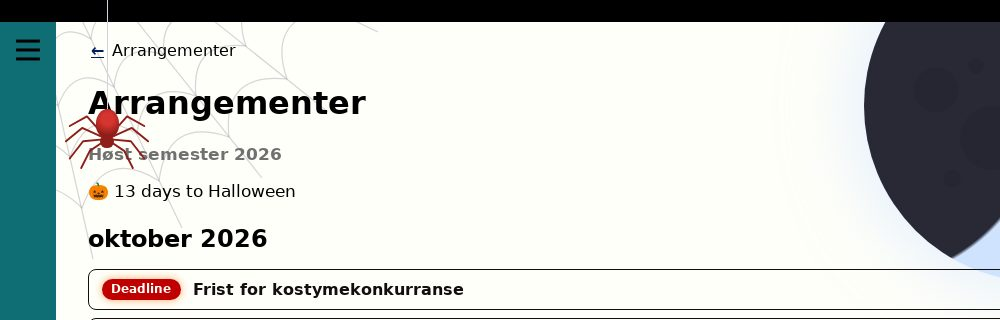

---

# K22: The costume generator
`🍫 chocolate` · `🦇 silly feature` · Feature

**Reward:** 2 🪙 + 2 🏆 · **Time:** about 11 min  
**Good to know first:** basic Python (lists, random), Django templates basics (``)

### What to do
The costume generator at http://localhost:8000/halloween/costume/ has a **Give me a costume** button, but nothing happens when you press it. Make it give a random costume, like "A tiny haunted printer on roller skates".

### Files to change (only these)
- `ifiplatform/apps/halloween_app/views/costume.py`
- `ifiplatform/apps/halloween_app/templates/halloween/costume.html`
- `ifiplatform/apps/halloween_app/static/css/halloween_pages/costume.css` (empty, already loaded on the page)

### What's already there
- `views/costume.py` has three lists, `LOOKS`, `CREATURES` and `EXTRAS`, with one word each, and a function `make_costume()` that returns `None`, with two `TODO`s. The view already calls it when the button is pressed, and passes the result to the template as `costume`.
- `costume.html` has the heading and the button, and a `TODO` where the costume should show.

### Design to build
The look: **a card in a dark wardrobe**. You don't have to come up with a design: build this one. Rather design your own? Go ahead, see "Make it yours".
- **The button** (`.costume-form button`): a pumpkin-orange pill: background `#ff7518`, black text, bold, a black border `2px solid #000`, `border-radius: 999px`, padding `0.7rem 1.4rem`. A lighter orange `#ffb15c` on hover.
- **The costume card** (`.costume-result`): at most `30rem` wide, dark purple `#2b1f3a` with light text `#f2eff6`, a black border `2px solid #000`, rounded corners `6px`, padding `1.5rem`, centred text, space above and below.
- **The line above the costume** (`.costume-result__label`): light purple `#cbaaff`, italic.
- **The costume** (`.costume-result__text`): big (`1.5rem`) and bold.

### Your part
1. **TODO 1:** add at least 4 more words to each list.
2. **TODO 2:** in `make_costume()`, pick one word from each list with `random.choice(...)` and return a sentence: `f"A {look} {creature} {extra}"`.
3. **The template:** replace the TODO in `costume.html` with the card, only when there is a costume:
   ```html
   
       <div class="costume-result">
           <p class="costume-result__label"></p>
           <p class="costume-result__text">{{ costume }}</p>
       </div>
   
   ```
   After the first costume, the button could say **Roll again**: the template gets `rolled` (True after a press) to check.
4. **Style:** build the design above in `costume.css`.

### Make it yours
- An emoji for every creature.
- "A" or "An": "An ugly mummy" sounds better than "A ugly mummy".

### Done when
- Every press gives a random costume in a styled card, made of one word from each list.

### How to work on it
Set up the project on your own computer first (see **Get started** in the README). Then:

1. **Claim this issue** on the site: https://halloween.ifiplattform.no/commits/issues/
2. In the VS Code terminal:
   ```bash
   ifi fix-issue {number}
   ```
3. Make the change, and check it at http://localhost:8000. Reload with **Ctrl+Shift+R** (Mac: **Cmd+Shift+R**): a normal reload may show the old look, because the browser keeps old copies of CSS files and pictures. Still old? Try a private window.
4. Then:
   ```bash
   ifi test
   git add .
   git commit -m "Short description of what you changed"
   ifi pull-request
   ```

**Only change the files listed above.** Then your pull request can't clash with anyone else's. After the merge it can take a few minutes before it shows on the live site. Stuck? Ask a helper, or type `ifi help`.

#### What it looks like when it's done
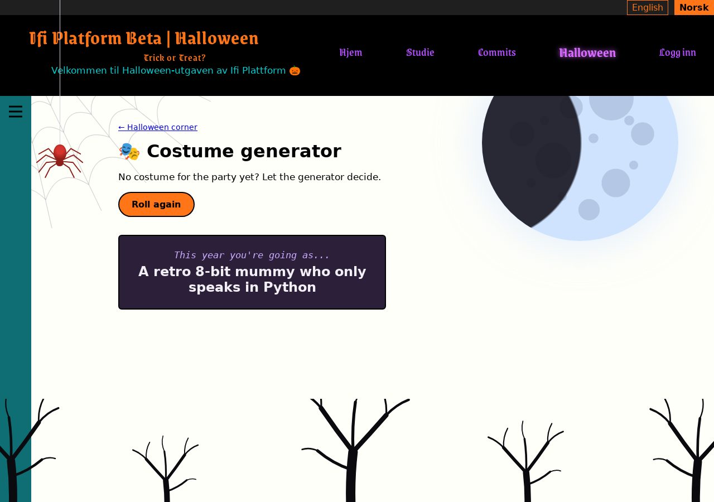

---

# K27: Grey text on the grey boxes is hard to read
`🍫 chocolate` · `♿ a11y` · Bug

**Reward:** 2 🪙 + 2 🏆 · **Time:** about 10 min  
**Good to know first:** basic CSS (selectors, colours). Contrast checking is explained

### What's wrong
The boxes on the home page turned grey for Halloween, but some small texts in them were made for a white background: they're grey too. The news dates, the date on the message board, and the times in the events box are grey on grey, and the "See all events" link is turquoise on grey. People with poor eyesight, or anyone on a sunny day, can't read them.

### Files to change (only these)
- `ifiplatform/static/css/07_halloween/contrast.css` (empty, already loaded on every page, after the other Halloween files)

### How to measure it
Text needs enough **contrast**: how different its colour is from the background. The rule of thumb (WCAG) is at least **4.5 : 1** for normal text. You can measure it:
- In Chrome: right-click the text → **Inspect**. In the Styles panel, click the small coloured square next to `color`: the colour picker shows "Contrast ratio" with ✓ or ✗.
- Or type both colours into https://webaim.org/resources/contrastchecker/.

The grey boxes are `#b4b4b8`. The grey text is `#707070`: about 2.4 : 1.

### Your part
Find the low-contrast texts and give them darker colours in `contrast.css`. Right-click each one → **Inspect** to find its class. At least these:
- the date and author under each news title,
- the date on the message board,
- the times on the left in the events box, and the "sub-events" text under an event,
- the "See all events" link at the bottom of the events box.

Check each new colour: at least 4.5 : 1 on `#b4b4b8`. Very dark grey (around `#2e2e33`) works for the plain texts, and a dark teal for the link keeps it looking like a link.

Not sure the other boxes are merged yet? Your colours must also work on white, the box colour before. Dark colours work on both.

### Done when
- Every small text in the boxes on the home page measures at least 4.5 : 1, on grey and on white.

### How to work on it
Set up the project on your own computer first (see **Get started** in the README). Then:

1. **Claim this issue** on the site: https://halloween.ifiplattform.no/commits/issues/
2. In the VS Code terminal:
   ```bash
   ifi fix-issue {number}
   ```
3. Make the change, and check it at http://localhost:8000. Reload with **Ctrl+Shift+R** (Mac: **Cmd+Shift+R**): a normal reload may show the old look, because the browser keeps old copies of CSS files and pictures. Still old? Try a private window.
4. Then:
   ```bash
   ifi test
   git add .
   git commit -m "Short description of what you changed"
   ifi pull-request
   ```

**Only change the files listed above.** Then your pull request can't clash with anyone else's. After the merge it can take a few minutes before it shows on the live site. Stuck? Ask a helper, or type `ifi help`.

#### What it looks like when it's done


*The times, dates and "Se alle arrangementer" now readable on grey.*

---

# K28: No floating ghost for people who turned animations off
`🍫 chocolate` · `♿ a11y` · Feature

**Reward:** 2 🪙 + 2 🏆 · **Time:** about 9 min  
**Good to know first:** basic CSS. Media queries are explained

### What to do
Some people get dizzy or distracted from movement on screen, and turn animations off in their computer's settings. Websites can see that setting with `prefers-reduced-motion`. Make the Halloween decorations respect it.

### Files to change (only these)
- `ifiplatform/static/css/07_halloween/reduced_motion.css` (empty, already loaded on every page, after the other decoration files)

### What you get
```css
@media (prefers-reduced-motion: reduce) {
}
```
Everything inside these braces only applies when the visitor turned animations off.

### Your part
- Inside it, stop the floating ghost: `.ghost` gets `animation: none;`. A ghost that never moves just stays outside the window, so that's enough.
- Check the other decorations in `ifiplatform/static/css/07_halloween/` for anything else that moves (`animation` or `transition`), and switch that off too.
- **Test it.** In Chrome: DevTools (F12) → the ⋮ menu → More tools → **Rendering** → "Emulate CSS media feature prefers-reduced-motion" → `reduce`. In Firefox: `about:config` → `ui.prefersReducedMotion` = 1.

### Done when
- With reduced motion on, nothing on the page moves. With it off, the ghost floats again.

### How to work on it
Set up the project on your own computer first (see **Get started** in the README). Then:

1. **Claim this issue** on the site: https://halloween.ifiplattform.no/commits/issues/
2. In the VS Code terminal:
   ```bash
   ifi fix-issue {number}
   ```
3. Make the change, and check it at http://localhost:8000. Reload with **Ctrl+Shift+R** (Mac: **Cmd+Shift+R**): a normal reload may show the old look, because the browser keeps old copies of CSS files and pictures. Still old? Try a private window.
4. Then:
   ```bash
   ifi test
   git add .
   git commit -m "Short description of what you changed"
   ifi pull-request
   ```

**Only change the files listed above.** Then your pull request can't clash with anyone else's. After the merge it can take a few minutes before it shows on the live site. Stuck? Ask a helper, or type `ifi help`.

#### What it looks like when it's done


*Mock-up: what changes. A screenshot of something that doesn't move looks like nothing.*

---

# K29: 👻 The event page shows the wrong weekday
`🍫 chocolate` · `👻 haunted bug` · Bug

**Reward:** 2 🪙 + 2 🏆 · **Time:** about 8 min  
**Good to know first:** Django templates basics (variables, filters), and reading a template

### What's wrong
Open any event, for example **Halloweenfest** from "Happening at Ifi" on the home page. Under the title it says when it is, like "**mandag** 31. oktober 2026". But 31 October 2026 is a Saturday! Open another event: it shows the same wrong weekday. Come back tomorrow, and every event has moved to the next weekday. A ghost has been in the calendar...

### Files to change (only these)
- `ifiplatform/apps/ifi_home_app/templates/events/event_page.html`

### Your part
Find the bug and fix it. Hints, if you need them:
1. Look for the line in `<div class="event-meta">` that shows the date. Where does the weekday come from?
2. `` shows the **current** date and time, in the format between the quotes. What's `"l"`?
3. The event's own date is `page.event_date`. Django's `date` filter formats a date: `{{ some_date|date:"l" }}`. Look up the letters on https://docs.djangoproject.com/en/6.0/ref/templates/builtins/#date.

### Done when
- Halloweenfest says Saturday ("lørdag"), and every event shows its own weekday, whatever day it is today.

### How to work on it
Set up the project on your own computer first (see **Get started** in the README). Then:

1. **Claim this issue** on the site: https://halloween.ifiplattform.no/commits/issues/
2. In the VS Code terminal:
   ```bash
   ifi fix-issue {number}
   ```
3. Make the change, and check it at http://localhost:8000. Reload with **Ctrl+Shift+R** (Mac: **Cmd+Shift+R**): a normal reload may show the old look, because the browser keeps old copies of CSS files and pictures. Still old? Try a private window.
4. Then:
   ```bash
   ifi test
   git add .
   git commit -m "Short description of what you changed"
   ifi pull-request
   ```

**Only change the files listed above.** Then your pull request can't clash with anyone else's. After the merge it can take a few minutes before it shows on the live site. Stuck? Ask a helper, or type `ifi help`.

#### What it looks like when it's done


---

# K3: A ghost floats across the page
`🍫 chocolate` · `🦇 silly feature` · Feature

**Reward:** 2 🪙 + 2 🏆 · **Time:** about 10 min  
**Good to know first:** basic CSS. The animation is explained

### What to do
Every page has a ghost (`<div class="ghost">👻</div>`), but it's parked just outside the window on the left. Make it float slowly across the page now and then.

### Files to change (only these)
- `ifiplatform/static/css/07_halloween/ghost.css` (empty, already loaded on every page)

### What you get
The ghost is already `position: fixed`, `left: -6rem` (just outside the window) and `top: 55%`, in `ifiplatform/static/css/07_halloween/scaffold.css`. Don't change that file. Start `ghost.css` with:
```css
@keyframes ghost-float {
    0% {
        transform: translate(0, 0);
    }
    70% {
        transform: translate(calc(100vw + 8rem), -8rem);
    }
    100% {
        transform: translate(calc(100vw + 8rem), -8rem);
    }
}
```

#### Explanation (optional)
- `@keyframes` describes a movement: where the ghost is at 0%, 70% and 100% of the time.
- `translate(x, y)` moves it: `100vw` is the width of the window, so it crosses all the way. `-8rem` makes it rise while it flies.
- It stays outside the window from 70% to 100%: that's the pause before it comes again.

### Your part
Add a `.ghost` rule that plays the animation: `animation: <name> <how long> <timing> infinite;`. Choose:
- **How long:** 20 seconds is calm, 5 seconds is a panic.
- **Timing:** `linear` (steady) or `ease-in-out` (speeds up and slows down).
- **Opacity:** a ghost should be a bit see-through.

### Make it yours
- Add a wobble: more steps in the keyframes (say at 35%), going up and down.
- Make it bigger with `font-size`.

### Done when
- Every 20 seconds or so a ghost floats across the page and disappears on the right.
- It never blocks clicks (it already has `pointer-events: none`).

### How to work on it
Set up the project on your own computer first (see **Get started** in the README). Then:

1. **Claim this issue** on the site: https://halloween.ifiplattform.no/commits/issues/
2. In the VS Code terminal:
   ```bash
   ifi fix-issue {number}
   ```
3. Make the change, and check it at http://localhost:8000. Reload with **Ctrl+Shift+R** (Mac: **Cmd+Shift+R**): a normal reload may show the old look, because the browser keeps old copies of CSS files and pictures. Still old? Try a private window.
4. Then:
   ```bash
   ifi test
   git add .
   git commit -m "Short description of what you changed"
   ifi pull-request
   ```

**Only change the files listed above.** Then your pull request can't clash with anyone else's. After the merge it can take a few minutes before it shows on the live site. Stuck? Ask a helper, or type `ifi help`.

#### What it looks like when it's done
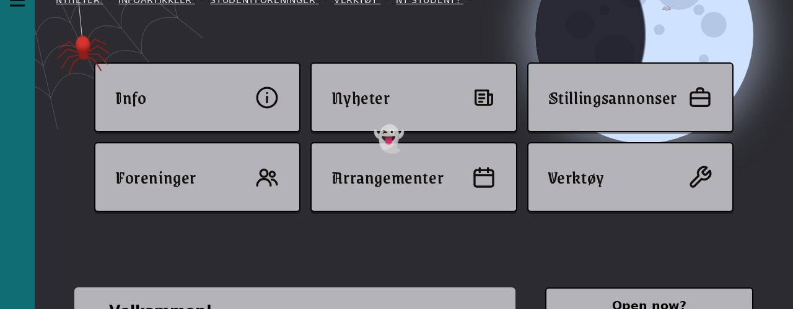

*The ghost, caught halfway across the page.*

---

# K30: 👻 The English button sends you to the home page
`🍫 chocolate` · `👻 haunted bug` · Bug

**Reward:** 2 🪙 + 2 🏆 · **Time:** about 8 min  
**Good to know first:** basic HTML (forms), and reading a template

### What's wrong
Open any page that isn't the home page, for example an article, and press **English** at the top right. You land on the **home page** instead of the same page in English. **Norsk** works fine. A ghost has been in the language buttons...

### Files to change (only these)
- `ifiplatform/templates/partials/select_language.html`

### Your part
Find the bug and fix it. Hints, if you need them:
1. Each language button is a small `<form>`. The hidden `<input name="next">` says where to go after switching.
2. Compare the English form with the Norsk form: what's different?
3. At the top of the file, `` works out the right address for each language.

### Done when
- On an article, pressing **English** shows the same article in English, and **Norsk** still works.

### How to work on it
Set up the project on your own computer first (see **Get started** in the README). Then:

1. **Claim this issue** on the site: https://halloween.ifiplattform.no/commits/issues/
2. In the VS Code terminal:
   ```bash
   ifi fix-issue {number}
   ```
3. Make the change, and check it at http://localhost:8000. Reload with **Ctrl+Shift+R** (Mac: **Cmd+Shift+R**): a normal reload may show the old look, because the browser keeps old copies of CSS files and pictures. Still old? Try a private window.
4. Then:
   ```bash
   ifi test
   git add .
   git commit -m "Short description of what you changed"
   ifi pull-request
   ```

**Only change the files listed above.** Then your pull request can't clash with anyone else's. After the merge it can take a few minutes before it shows on the live site. Stuck? Ask a helper, or type `ifi help`.

#### What it looks like when it's done
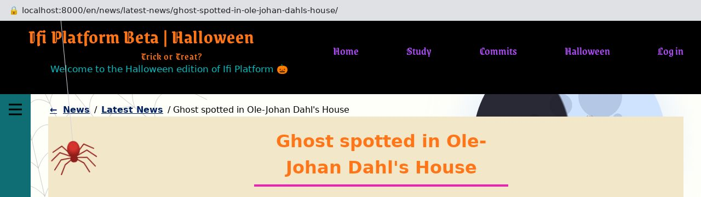

*After pressing English on a Norwegian article: the same article, in English. The bar on top shows the address.*

---

# K31: 👻 The Halloween corner lists its pages in a strange order
`🍫 chocolate` · `👻 haunted bug` · Bug

**Reward:** 2 🪙 + 2 🏆 · **Time:** about 9 min  
**Good to know first:** basic Python (lists, sorted, lambda), and reading code

### What's wrong
The Halloween corner's front page (http://localhost:8000/halloween/) should list the haunted notice board first, and then every other page from A to Z by its title: Bat snake, Costume generator, Countdown, Fortune teller... But the order looks random. A ghost has been sorting the cards...

### Files to change (only these)
- `ifiplatform/apps/halloween_app/hub.py`

### Your part
Find the bug and fix it. Hints, if you need them:
1. `hub_pages()` in `hub.py` decides the order. It reads the pages from `PAGES` in `ifiplatform/apps/halloween_app/pages.py` (only read that file, don't change it).
2. Every page in `PAGES` is a tuple of four things. Which four, and in which order?
3. `sorted(..., key=lambda page: ...)` sorts by whatever the `key` gives back for each page. What does it give back now?

### Done when
- The front page shows the notice board first, then the other pages from A to Z by their titles, and `ifi test` passes.

### How to work on it
Set up the project on your own computer first (see **Get started** in the README). Then:

1. **Claim this issue** on the site: https://halloween.ifiplattform.no/commits/issues/
2. In the VS Code terminal:
   ```bash
   ifi fix-issue {number}
   ```
3. Make the change, and check it at http://localhost:8000. Reload with **Ctrl+Shift+R** (Mac: **Cmd+Shift+R**): a normal reload may show the old look, because the browser keeps old copies of CSS files and pictures. Still old? Try a private window.
4. Then:
   ```bash
   ifi test
   git add .
   git commit -m "Short description of what you changed"
   ifi pull-request
   ```

**Only change the files listed above.** Then your pull request can't clash with anyone else's. After the merge it can take a few minutes before it shows on the live site. Stuck? Ask a helper, or type `ifi help`.

#### What it looks like when it's done
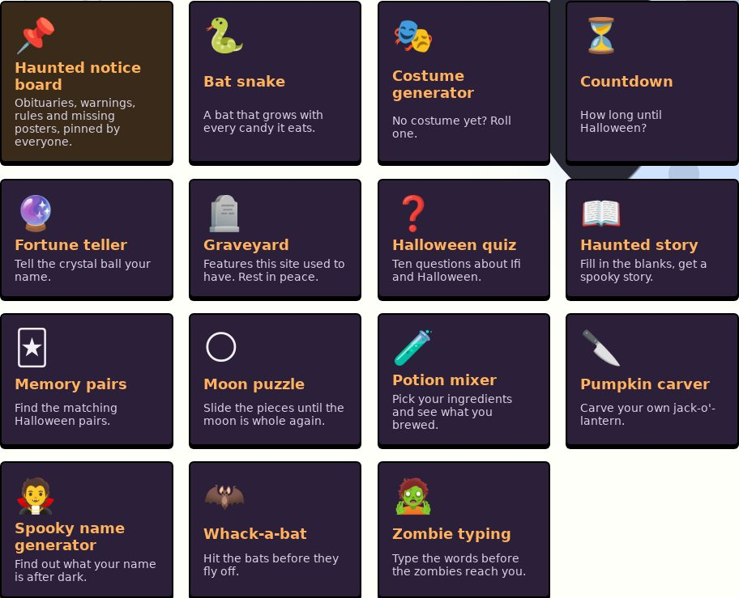

---

# K34: Bats fly out of the moon
`🍫 chocolate` · `🦇 silly feature` · Feature

**Reward:** 2 🪙 + 2 🏆 · **Time:** about 11 min  
**Good to know first:** basic CSS. Animations are explained

### What to do
Near the moon at the top right of every page, three bats are hiding (`<div class="bat-flock">` with three `<span>🦇</span>`), but they're see-through and don't move. Make them fly out of the moon, one after the other, again and again.

### Files to change (only these)
- `ifiplatform/static/css/07_halloween/bat_flock.css` (empty, already loaded on every page)

### What you get
The bats already sit in one spot near the moon, with `opacity: 0` (invisible), in `ifiplatform/static/css/07_halloween/scaffold.css`. Don't change that file. Start `bat_flock.css` with the flight:
```css
@keyframes bat-fly {
    0% {
        opacity: 0;
        transform: translate(0, 0) scale(0.3);
    }
    15% {
        opacity: 1;
    }
    100% {
        opacity: 0;
        transform: translate(var(--fly-x), var(--fly-y)) scale(1.3);
    }
}
```

#### Explanation (optional)
- At the start a bat is tiny (`scale(0.3)`) and invisible. It appears early on (15%), and flies to `--fly-x`, `--fly-y` while it grows, fading out at the end.
- `--fly-x` and `--fly-y` are **custom properties**: your own variables. The keyframes are the same for every bat, and each bat gets its own values, so each flies its own way.

### Your part
1. **Play it:** a rule for `.bat-flock span` with `animation: bat-fly <time> ease-in infinite;`. About 7 seconds looks calm. Make the bats bigger too (`font-size: 2.4rem`), and give them a faint moonlight glow, so the black bats show on the dark page: `filter: drop-shadow(0 0 6px rgba(207, 227, 255, 0.8))`.
2. **Give each bat a direction:** `.bat-flock span:nth-child(1)`, `(2)` and `(3)` each get their own `--fly-x` and `--fly-y`. Negative `--fly-x` flies left, towards the page; negative `--fly-y` flies up. Try values between `-30rem` and `10rem`.
3. **One after the other:** give the 2nd and 3rd bat an `animation-delay`, so they don't all leave at once.
4. **Animations off:** some people turn animations off because movement makes them dizzy. Inside `@media (prefers-reduced-motion: reduce) { }`, stop the animation. The bats then stay invisible.

### Make it yours
- A wobbly flight: more steps in the keyframes, going up and down.
- A fourth bat? There are only three spans, but `.bat-flock::before` with `content: "🦇"` can be a fourth.

### Done when
- Every few seconds a bat appears at the moon and flies off across the page, three different ways.
- With animations turned off, nothing moves.

### How to work on it
Set up the project on your own computer first (see **Get started** in the README). Then:

1. **Claim this issue** on the site: https://halloween.ifiplattform.no/commits/issues/
2. In the VS Code terminal:
   ```bash
   ifi fix-issue {number}
   ```
3. Make the change, and check it at http://localhost:8000. Reload with **Ctrl+Shift+R** (Mac: **Cmd+Shift+R**): a normal reload may show the old look, because the browser keeps old copies of CSS files and pictures. Still old? Try a private window.
4. Then:
   ```bash
   ifi test
   git add .
   git commit -m "Short description of what you changed"
   ifi pull-request
   ```

**Only change the files listed above.** Then your pull request can't clash with anyone else's. After the merge it can take a few minutes before it shows on the live site. Stuck? Ask a helper, or type `ifi help`.

#### What it looks like when it's done


*Three bats on their way out of the moon, paused mid-flight.*

---

# K36: Rate the study excuses 👍 or 👎
`🍫 chocolate` · `🦇 silly feature` · Feature

**Reward:** 2 🪙 + 2 🏆 · **Time:** about 11 min · **Part of the set** SET-study  
**Good to know first:** JavaScript basics (the page's HTML from JS, click events, objects), localStorage and JSON are explained

### What to do
Under the excuse on the study page (http://localhost:8000/study/), add a 👍 and a 👎 button. Your vote is remembered in your own browser: when the same excuse comes up again, your vote still shows.

### Files to change (only these)
- `ifiplatform/apps/study_app/static/js/study_rate.js` (empty, already loaded on the study page)
- `ifiplatform/apps/study_app/static/css/06_components/study_rate.css` (empty, already loaded on the study page)

### What's already there
The joke is `<blockquote id="study-joke">`, and right under it is an empty `<div class="joke-tools" id="study-joke-tools">` for buttons like yours. Another issue adds a "Copy" button to the same div.

### What you get
Saving and loading the votes, safely. `localStorage` keeps text in the browser, even after a reload. It can fail (in a private window, for example), so both are wrapped in `try`/`catch`:
```js
const KEY = "study-joke-votes";

function loadVotes() {
  try {
    return JSON.parse(localStorage.getItem(KEY)) || {};
  } catch (error) {
    return {};
  }
}

function saveVotes(votes) {
  try {
    localStorage.setItem(KEY, JSON.stringify(votes));
  } catch (error) {
    // Private window or storage full: the vote just isn't remembered.
  }
}
```
`votes` is an object from the joke's text to `"up"` or `"down"`, like `{ "Coffee isn't a drink, it's a study method.": "up" }`. `JSON.stringify` turns it into text to store, and `JSON.parse` back again.

### Design to build
- **The buttons** (`.joke-rating__button`): round pills (`border-radius: 999px`), a black border `2px solid #000`, pale `#f2eff6`, the emoji at `1.3rem`, some padding, side by side with a small gap.
- **Voted:** 👍 turns green `#8de9a8` and 👎 red `#ff9f9f` while they're pressed (`[aria-pressed="true"]`).
- **The tools row** (`.joke-tools`): its buttons centred in a row that wraps (`display: flex; flex-wrap: wrap; justify-content: center; gap: 0.6rem`).

### Your part
1. **Wait for the page,** then find `#study-joke` and `#study-joke-tools`. Stop if either is missing.
2. **Make the two buttons** in JavaScript (`document.createElement("button")`) inside a `<div class="joke-rating">`, and add it to the tools div. Each button: `type="button"`, the emoji as text, an `aria-label` ("Good excuse", "Bad excuse": a screen reader can't read the meaning of 👍 reliably), and `aria-pressed="false"`.
3. **Clicking a button:** load the votes, read the joke's text **at that moment** (`joke.textContent.trim()`: another issue can swap the joke without reloading), store the vote under that text, and save. Clicking the same button again takes the vote back (`delete votes[text]`).
4. **Show the vote:** a function that sets `aria-pressed` to `"true"` on the button matching the stored vote for the current joke, and `"false"` on the other. Call it on load and after every click.
5. **Style:** build the design above in `study_rate.css`.

### Make it yours
- Keep the buttons up to date when the joke changes without a reload: a `MutationObserver` on the joke calls your show function.
- Show how many excuses you've rated so far.

### Done when
- 👍 and 👎 show under the excuse, the pressed one is coloured, and after a reload (keep reloading until the same excuse comes back, or open `?joke=` with a number) your vote is still there.
- In a private window the buttons still work, they just forget.

### How to work on it
Set up the project on your own computer first (see **Get started** in the README). Then:

1. **Claim this issue** on the site: https://halloween.ifiplattform.no/commits/issues/
2. In the VS Code terminal:
   ```bash
   ifi fix-issue {number}
   ```
3. Make the change, and check it at http://localhost:8000. Reload with **Ctrl+Shift+R** (Mac: **Cmd+Shift+R**): a normal reload may show the old look, because the browser keeps old copies of CSS files and pictures. Still old? Try a private window.
4. Then:
   ```bash
   ifi test
   git add .
   git commit -m "Short description of what you changed"
   ifi pull-request
   ```

**Only change the files listed above.** Then your pull request can't clash with anyone else's. After the merge it can take a few minutes before it shows on the live site. Stuck? Ask a helper, or type `ifi help`.

#### What it looks like when it's done


*After pressing 👍 on this excuse.*

---

# K37: A "Copy this excuse" button on the study page
`🍫 chocolate` · `🦇 silly feature` · Feature

**Reward:** 2 🪙 + 2 🏆 · **Time:** about 10 min · **Part of the set** SET-study  
**Good to know first:** JavaScript basics (the page's HTML from JS, click events), async/await is explained

### What to do
Found the perfect excuse on the study page (http://localhost:8000/study/)? Add a **📋 Copy this excuse** button under it, which puts the excuse on the clipboard, ready to paste in the group chat.

### Files to change (only these)
- `ifiplatform/apps/study_app/static/js/study_copy.js` (empty, already loaded on the study page)
- `ifiplatform/apps/study_app/static/css/06_components/study_copy.css` (empty, already loaded on the study page)

### What's already there
The joke is `<blockquote id="study-joke">`, and right under it is an empty `<div class="joke-tools" id="study-joke-tools">` for buttons like yours. Another issue adds 👍/👎 buttons to the same div.

### What you get
Copying text to the clipboard is one line, but it's **asynchronous**: the browser takes a moment, and it can say no. `await` waits for it, and `try`/`catch` catches the "no":
```js
button.addEventListener("click", async () => {
  try {
    await navigator.clipboard.writeText("the text to copy");
    // it worked
  } catch (error) {
    // the browser said no
  }
});
```
A function that uses `await` must be marked `async`, like the arrow function above.

### Design to build
- **The button** (`.joke-copy`): a lantern-orange pill: background `#ffb15c`, black text, bold, a black border `2px solid #000`, `border-radius: 999px`, padding `0.4rem 1rem`, `font: inherit`. A darker orange `#ff9a4d` on hover, and a black outline for keyboard focus (`:focus-visible`).

### Your part
1. **Wait for the page,** then find `#study-joke` and `#study-joke-tools`. Stop if either is missing.
2. **Make the button** in JavaScript: `type="button"`, the class `joke-copy`, the text "📋 Copy this excuse", and add it to the tools div.
3. **On click,** copy the joke's text **at that moment** (`joke.textContent.trim()`: another issue can swap the joke without reloading).
4. **Tell the user:** change the button's text to "✅ Copied!" for 2 seconds (`setTimeout`), then back. If copying failed, say so instead ("Couldn't copy: select the text instead"). Two quick clicks shouldn't mix up the texts: `clearTimeout`.
5. **Style:** build the design above in `study_copy.css`.

### Make it yours
- On phones, offer to share instead: `navigator.share({ text })` opens the phone's share menu, where it exists (`if (navigator.share)`).
- Copy the page's address with the excuse: `${text} (${location.href})`.

### Done when
- Clicking the button copies the excuse (paste it somewhere to check), the button says "Copied!" for a moment, and then goes back.

### How to work on it
Set up the project on your own computer first (see **Get started** in the README). Then:

1. **Claim this issue** on the site: https://halloween.ifiplattform.no/commits/issues/
2. In the VS Code terminal:
   ```bash
   ifi fix-issue {number}
   ```
3. Make the change, and check it at http://localhost:8000. Reload with **Ctrl+Shift+R** (Mac: **Cmd+Shift+R**): a normal reload may show the old look, because the browser keeps old copies of CSS files and pictures. Still old? Try a private window.
4. Then:
   ```bash
   ifi test
   git add .
   git commit -m "Short description of what you changed"
   ifi pull-request
   ```

**Only change the files listed above.** Then your pull request can't clash with anyone else's. After the merge it can take a few minutes before it shows on the live site. Stuck? Ask a helper, or type `ifi help`.

#### What it looks like when it's done
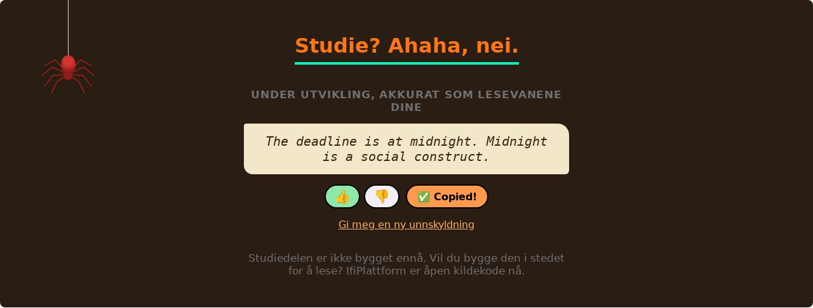

*Right after pressing Copy.*

---

# K38: Tests that keep the study jokes tidy
`🍫 chocolate` · `🧪 python` · Feature

**Reward:** 2 🪙 + 2 🏆 · **Time:** about 11 min · **Part of the set** SET-study  
**Good to know first:** basic Python (files, loops, strings), tests are explained

### What to do
Today, lots of people add a joke to the study page, each in their own file in `ifiplatform/apps/study_app/joke_files/`. Write tests that check every joke file follows the rules, so a broken or overlong joke fails the tests before it's merged.

### Files to change (only these)
- new: `ifiplatform/apps/study_app/test_joke_files.py`

### The rules
From `ifiplatform/apps/study_app/joke_files/README.md` (only read it):
- Every file in the folder, except `README.md`, is named `joke_` + two digits + `.txt`, like `joke_07.txt`.
- Each holds one joke, as text in UTF-8, and isn't empty.
- One or two sentences: at most 200 characters, and no blank lines in it.
- No joke is there twice, not even one that's already in `STUDY_JOKES` in `ifiplatform/apps/study_app/jokes.py`.

### What you get
Start the file with this. It already finds the files and checks the names:
```python
"""Keeps the study page's joke files tidy: every file in joke_files/ that
isn't the README is a joke_NN.txt with one short joke, in UTF-8, and no
joke is there twice."""

# pylint: disable=C0115,C0116
import re

from django.test import SimpleTestCase

from study_app.jokes import JOKE_FILES_DIR, STUDY_JOKES

MAX_LENGTH = 200


def joke_files():
    return sorted(path for path in JOKE_FILES_DIR.iterdir() if path.name != "README.md")


class JokeFileTests(SimpleTestCase):
    def test_file_names(self):
        for path in joke_files():
            self.assertRegex(path.name, r"^joke_\d{2}\.txt$")
```

#### Explanation (optional)
- `JOKE_FILES_DIR` is the folder, as a `Path`. `path.read_text(encoding="utf-8")` reads a file, and crashes if it isn't UTF-8: in a test, that counts as a failure, which is what we want.
- `with self.subTest(path.name):` inside a loop makes a failure say **which** file broke.
- `SimpleTestCase` is a test without a database: these tests only read files.

### Your part
Add a test for each of the other rules:
1. **UTF-8 and not empty:** `.strip()` the text and check something is left (`assertTrue`).
2. **Short:** at most `MAX_LENGTH` characters (`assertLessEqual`).
3. **One paragraph:** no blank line in the middle (`assertNotRegex(text, r"\n\s*\n")`).
4. **No joke twice:** make a list of every joke, lowercased with the spaces tidied (`re.sub(r"\s+", " ", ...)`), add `str(joke).lower()` for each of `STUDY_JOKES`, and check the list has no duplicates (compare `len(list)` with `len(set(list))`).

Run them with `ifi test`. Then **check that they catch problems:** make a test file like `joke_99.txt` that breaks a rule, see the right test fail, and delete the file again before you commit.

### Done when
- `ifi test` passes, and each rule makes a test fail when a joke file breaks it.

### How to work on it
Set up the project on your own computer first (see **Get started** in the README). Then:

1. **Claim this issue** on the site: https://halloween.ifiplattform.no/commits/issues/
2. In the VS Code terminal:
   ```bash
   ifi fix-issue {number}
   ```
3. Make the change, and check it at http://localhost:8000. Reload with **Ctrl+Shift+R** (Mac: **Cmd+Shift+R**): a normal reload may show the old look, because the browser keeps old copies of CSS files and pictures. Still old? Try a private window.
4. Then:
   ```bash
   ifi test
   git add .
   git commit -m "Short description of what you changed"
   ifi pull-request
   ```

**Only change the files listed above.** Then your pull request can't clash with anyone else's. After the merge it can take a few minutes before it shows on the live site. Stuck? Ask a helper, or type `ifi help`.

#### What it looks like when it's done


*The new tests, run against the ten joke files.*

---

# K4: Click the spider and it climbs away
`🍫 chocolate` · `🦇 silly feature` · Feature

**Reward:** 2 🪙 + 2 🏆 · **Time:** about 10 min  
**Good to know first:** JavaScript basics (click events, classes, setTimeout). The CSS is given

### What to do
Clicking the spider at the top left should startle it: it scurries up its thread, waits a moment, and comes back down.

### Files to change (only these)
- `ifiplatform/static/js/halloween/spider_click.js` (empty, already loaded on every page)
- `ifiplatform/static/css/07_halloween/spider_startled.css` (empty, already loaded on every page)

The spider itself (thread, body, legs) is drawn by the spider set's issues. If they aren't merged yet, ask a helper whether they are, or test with the spider you can see on the live site.

### What you get
The movement, in CSS. Paste this into `spider_startled.css`:
```css
.spider__body,
.spider__legs {
    pointer-events: auto;
    cursor: pointer;
}

.spider {
    transition: translate 0.35s cubic-bezier(0.3, 1.4, 0.6, 1);
}

.spider--startled {
    translate: 0 -15.5rem;
    transition-duration: 0.25s;
}

@keyframes spider-scramble {
    from {
        scale: 1 1;
    }
    to {
        scale: 0.75 1;
    }
}

.spider--startled .spider__legs {
    animation: spider-scramble 0.12s linear infinite alternate;
}

@media (prefers-reduced-motion: reduce) {
    .spider {
        transition: none;
    }

    .spider--startled .spider__legs {
        animation: none;
    }
}
```

#### Explanation (optional)
- The spider doesn't catch clicks (`pointer-events: none`, so it never blocks the page). The first rule turns clicks back on for just its body and legs.
- When the spider has the class `spider--startled`, it moves 15.5rem up (`translate`), into the dark strip above the logo, and its legs scramble. Take the class away, and the `transition` slides it back down with a little bounce.
- `translate` is a separate property from the swing's `rotate`, so climbing and swinging work at the same time.

### Your part
Write `spider_click.js`:
1. Wait until the page has loaded: `document.addEventListener("DOMContentLoaded", () => { ... });`.
2. Find the spider: `document.querySelector(".spider")`. On pages without it, stop (`return`).
3. When it's clicked (`addEventListener("click", ...)`), add the class `spider--startled` (`classList.add`).
4. After 1.5 seconds (`setTimeout`), remove the class again. If someone clicks again while it's up, it should still come down 1.5 seconds after the **last** click: `clearTimeout` helps.

### Make it yours
- A spider that hides longer each time you click it.
- Climb higher: a bigger number in `translate`.

### Done when
- Clicking the spider sends it up its thread, and it comes back down by itself. With animations turned off, it jumps instead of sliding.

### How to work on it
Set up the project on your own computer first (see **Get started** in the README). Then:

1. **Claim this issue** on the site: https://halloween.ifiplattform.no/commits/issues/
2. In the VS Code terminal:
   ```bash
   ifi fix-issue {number}
   ```
3. Make the change, and check it at http://localhost:8000. Reload with **Ctrl+Shift+R** (Mac: **Cmd+Shift+R**): a normal reload may show the old look, because the browser keeps old copies of CSS files and pictures. Still old? Try a private window.
4. Then:
   ```bash
   ifi test
   git add .
   git commit -m "Short description of what you changed"
   ifi pull-request
   ```

**Only change the files listed above.** Then your pull request can't clash with anyone else's. After the merge it can take a few minutes before it shows on the live site. Stuck? Ask a helper, or type `ifi help`.

#### What it looks like when it's done
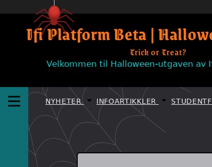

*Right after a click: the spider has climbed up its thread.*

---

# K5: Account icon becomes a skull
`🍫 chocolate` · `🖼️ art` · Feature

**Reward:** 2 🪙 + 2 🏆 · **Time:** about 10 min  
**Good to know first:** basic HTML. The SVG shapes are explained

### What to do
Logged in, the header shows a little person icon that opens your account menu. Turn it into a skull.

### Files to change (only these)
- `ifiplatform/templates/partials/icons/account_icon.html`

### What you get
The file holds the icon as SVG: a circle (head) and a path (shoulders) in a 24×24 box. Keep the first line, `<svg class="profile-icon" viewBox="0 0 24 24" ...>`, as it is: the header CSS sizes the icon by that class. Start the skull like this, replacing the circle and the path:
```html
    <path d="M12 2a8 8 0 0 0-8 8c0 3 1.5 5 3 6v3h10v-3c1.5-1 3-3 3-6a8 8 0 0 0-8-8z" fill="currentColor"/>
```
That's the skull's outline: round on top, with a jaw at the bottom. `fill="currentColor"` gives it the same colour as the header text.

### Your part
Give the skull a face. Add, after the path:
- **Two eye sockets:** `<circle>` elements. To cut holes, give them the header's background colour (black, `fill="#000"`).
- **A nose:** a small triangle (`<path d="M... L... L... z"/>`).
- **Teeth:** two or three thin rectangles (`<rect>`) across the jaw.

The box is 24×24: the eyes go at about `y="10"`, the teeth at about `y="17"`.

### Make it yours
- Cracks in the skull, a bow on top, or glowing eyes (`fill="#ff7518"`).
- **Pick your own colour:** search "color picker" on Google, choose a colour, and copy the **HEX** code (the one that starts with `#`, like `#ff7518`). Paste it between the quotes, for example `fill="#ff7518"`.

### Done when
- Logged in, the header shows a skull, and clicking it still opens the account menu.

### How to work on it
Set up the project on your own computer first (see **Get started** in the README). Then:

1. **Claim this issue** on the site: https://halloween.ifiplattform.no/commits/issues/
2. In the VS Code terminal:
   ```bash
   ifi fix-issue {number}
   ```
3. Make the change, and check it at http://localhost:8000. Reload with **Ctrl+Shift+R** (Mac: **Cmd+Shift+R**): a normal reload may show the old look, because the browser keeps old copies of CSS files and pictures. Still old? Try a private window.
4. Then:
   ```bash
   ifi test
   git add .
   git commit -m "Short description of what you changed"
   ifi pull-request
   ```

**Only change the files listed above.** Then your pull request can't clash with anyone else's. After the merge it can take a few minutes before it shows on the live site. Stuck? Ask a helper, or type `ifi help`.

#### What it looks like when it's done


*Logged in: the account button in the header.*

---

# K6: News in a grey box, four in a row
`🍫 chocolate` · `🎨 restyle` · Feature

**Reward:** 2 🪙 + 2 🏆 · **Time:** about 10 min  
**Good to know first:** basic CSS (colours, CSS grid)

### What to do
Under "Siste nyheter" on the home page, the news cards sit in a big white box. Make the box grey like the message board, and show the cards four in a row, so more news fits.

### Files to change (only these)
- `ifiplatform/static/css/07_halloween/news_cards.css` (empty, already loaded on every page)

### What you get
The box around the cards is `.newsbar-layout`, inside `.suggestions-row`. The site's own CSS already lays out the cards with CSS grid. To win over it, your selectors need to be at least as specific, so start from this one:
```css
.home-layout .maincontent .suggestions-row .newsbar-layout {
}
```
Each card inside is an `.articlecard`, with its title in an `h3`.

### Design to build
The look: **the same grey as the message board, no frames**. You don't have to come up with a design: build this one. Rather design your own? Go ahead, see "Make it yours".
- **The box** (`.newsbar-layout`): grey `#b4b4b8`, corners rounded `6px`, and no shadow (`box-shadow: none`). No border: the news box stays without one.
- **The cards:** exactly four columns of the same width: `grid-template-columns: repeat(4, minmax(0, 1fr))`. The cards themselves get no border.
- **The titles** (`.articlecard h3`, with the same start as above): a bit smaller, `0.95rem`.
- **On a phone** (`@media (max-width: 45rem)`): two columns instead of four.

### Your part
Build the design above in `news_cards.css`. Check it at full width, and with the window made narrow.

The dev database may have only two news articles. Then two cards fill the first two of the four columns: that's right.

### Make it yours
- Three in a row instead of four.
- A spooky hover: tilt a card a little with `rotate: -1deg` on `.articlecard:hover` (`deg` means degrees).

### Done when
- The news sits in a grey box without a frame, four cards in a row on a wide window and two on a narrow one, and the titles are easy to read.

### How to work on it
Set up the project on your own computer first (see **Get started** in the README). Then:

1. **Claim this issue** on the site: https://halloween.ifiplattform.no/commits/issues/
2. In the VS Code terminal:
   ```bash
   ifi fix-issue {number}
   ```
3. Make the change, and check it at http://localhost:8000. Reload with **Ctrl+Shift+R** (Mac: **Cmd+Shift+R**): a normal reload may show the old look, because the browser keeps old copies of CSS files and pictures. Still old? Try a private window.
4. Then:
   ```bash
   ifi test
   git add .
   git commit -m "Short description of what you changed"
   ifi pull-request
   ```

**Only change the files listed above.** Then your pull request can't clash with anyone else's. After the merge it can take a few minutes before it shows on the live site. Stuck? Ask a helper, or type `ifi help`.

#### What it looks like when it's done


---

# K7: Style the "Open now?" box and its badges
`🍫 chocolate` · `🎨 restyle` · Feature

**Reward:** 2 🪙 + 2 🏆 · **Time:** about 10 min  
**Good to know first:** basic CSS (selectors, colours, borders)

### What to do
At the top of the right column on the home page, the "Open now?" box lists a few places at Ifi with today's opening hours and an **Open** or **Closed** badge. Right now it's plain. Give it the Halloween look.

### Files to change (only these)
- `ifiplatform/static/css/07_halloween/opening_hours.css` (empty, already loaded on every page)

### What you get
The HTML of the box (you don't need to change it), so you know the classes:
```html
<section class="side-box hours-box">
    <h2>Open now?</h2>
    <div class="hours-place">
        <p class="hours-name">Informatikkbiblioteket</p>
        <p class="hours-today">
            Today 10:00–14:00
            <span class="hours-status hours-status--open">Open</span>
        </p>
    </div>
    ...one .hours-place per place...
</section>
```
A closed place has `hours-status--closed` instead of `hours-status--open`.

### Design to build
The look: **a grey tombstone list with traffic-light badges**. You don't have to come up with a design: build this one. Rather design your own? Go ahead, see "Make it yours".
- **The box** (`.hours-box`): grey `#b4b4b8`, a black border `2px solid #000`, corners rounded `6px`.
- **Each place** (`.hours-place`): a thin black line above it (`border-top: 1px solid #000`), a little space above and below, text a bit smaller (`0.85rem`). The first place has no line and no space above it (`.hours-place:first-of-type`).
- **The paragraphs** (`.hours-place p`): no margin.
- **The place's name** (`.hours-name`): bold.
- **The badges** (`.hours-status`): a small pill. `display: inline-block`, rounded all the way (`border-radius: 999px`), white bold text at `0.75rem`, some padding, and a little space to the left.
- **Open** (`.hours-status--open`): dark green `#0f6b30`. **Closed** (`.hours-status--closed`): dark red `#b3261e`.

### Your part
Build the design above in `opening_hours.css`.

### Make it yours
- Glowing badges: `box-shadow: 0 0 8px` in the badge's colour.
- An emoji in front of the name with `.hours-name::before { content: "🕯️ "; }`.
- Keep the white text on the badges readable: a light green or red background with white text is hard to read.

### Done when
- The box is grey with a black border, the places are separated by lines, and the Open and Closed badges are green and red pills that are easy to read.

### How to work on it
Set up the project on your own computer first (see **Get started** in the README). Then:

1. **Claim this issue** on the site: https://halloween.ifiplattform.no/commits/issues/
2. In the VS Code terminal:
   ```bash
   ifi fix-issue {number}
   ```
3. Make the change, and check it at http://localhost:8000. Reload with **Ctrl+Shift+R** (Mac: **Cmd+Shift+R**): a normal reload may show the old look, because the browser keeps old copies of CSS files and pictures. Still old? Try a private window.
4. Then:
   ```bash
   ifi test
   git add .
   git commit -m "Short description of what you changed"
   ifi pull-request
   ```

**Only change the files listed above.** Then your pull request can't clash with anyone else's. After the merge it can take a few minutes before it shows on the live site. Stuck? Ask a helper, or type `ifi help`.

#### What it looks like when it's done


---

# K8: Fill in the real opening hours
`🍫 chocolate` · `🧪 python` · Task

**Reward:** 2 🪙 + 2 🏆 · **Time:** about 11 min  
**Good to know first:** basic Python (lists, tuples, dictionaries)

### What to do
The "Open now?" box at the top of the right column on the home page shows opening hours, but they're made up. Find the real ones and put them in.

### Files to change (only these)
- `ifiplatform/apps/ifi_home_app/opening_hours_data.py`

### What you get
The file has a list `PLACES`, with one dictionary per place:
```python
{
    "name": "Kantina, Ole-Johan Dahls hus",
    "hours": [("10:00", "15:00")] * 5 + [None, None],
},
```
- `"name"` is what the box shows.
- `"hours"` has seven entries, **Monday first**. Each is a pair `("opens", "closes")`, or `None` for closed all day.
- `[("10:00", "15:00")] * 5` is Python for "the same pair five times" (Monday to Friday), and `+ [None, None]` adds Saturday and Sunday, closed.

### Your part
1. **Find the real hours** for at least 3 places Ifi students use. Good places to look:
   - The informatics library: https://www.ub.uio.no/bibliotekene/index.html (find "Informatikk"). It has staffed hours, and longer hours with your UiO card.
   - SiO's cafés and canteens at Blindern: https://sio.no/mat-og-drikke
   - Any other place you know: a student union's room, the reading room, a café.
2. **Replace the made-up places** in `PLACES` with your places and their real hours. Keep exactly seven entries in every `"hours"` list. Days with different hours? Write all seven out: `[("08:00", "16:00"), ("08:00", "16:00"), ...]`.
3. **Say where the hours come from:** in the text at the top of the file, write the date you checked and the web pages, so the next person can check again.

### Done when
- The box on the home page shows at least 3 real places with their real hours for today.
- The top of the file says where the hours come from, and when you checked.

### How to work on it
Set up the project on your own computer first (see **Get started** in the README). Then:

1. **Claim this issue** on the site: https://halloween.ifiplattform.no/commits/issues/
2. In the VS Code terminal:
   ```bash
   ifi fix-issue {number}
   ```
3. Make the change, and check it at http://localhost:8000. Reload with **Ctrl+Shift+R** (Mac: **Cmd+Shift+R**): a normal reload may show the old look, because the browser keeps old copies of CSS files and pictures. Still old? Try a private window.
4. Then:
   ```bash
   ifi test
   git add .
   git commit -m "Short description of what you changed"
   ifi pull-request
   ```

**Only change the files listed above.** Then your pull request can't clash with anyone else's. After the merge it can take a few minutes before it shows on the live site. Stuck? Ask a helper, or type `ifi help`.

#### What it looks like when it's done


*Real hours, checked on 18 October 2026. Sunday, so two places are closed today.*

---

# K9: Style the Instagram row
`🍫 chocolate` · `🎨 restyle` · Feature

**Reward:** 2 🪙 + 2 🏆 · **Time:** about 11 min · **Part of the set** SET-right  
**Good to know first:** basic CSS (selectors, CSS grid, position)

### What to do
Under the news on the home page there's an "Ifi on Instagram" row with five pictures. Make it look like a real Instagram strip: five pictures side by side in a grey box, with the caption on top of each picture.

### Files to change (only these)
- `ifiplatform/static/css/07_halloween/instagram.css` (empty, already loaded on every page)

### What you get
The HTML (another issue changes the pictures and captions, not the classes):
```html
<section class="insta-box">
    <h2 class="insta-heading">Ifi on Instagram</h2>
    <div class="insta-row">
        <a class="insta-tile" href="...">
            
            <span class="insta-cap">The caption</span>
        </a>
        ...five tiles...
    </div>
</section>
```
`.insta-row` is already a CSS grid.

### Design to build
The look: **a grey strip of photos with captions on a dark fade**. You don't have to come up with a design: build this one. Rather design your own? Go ahead, see "Make it yours".
- **The box** (`.insta-box`): grey `#b4b4b8`, corners rounded `6px`, some padding (`0.8rem 1rem 1rem`). No border.
- **The heading** (`.insta-heading`): centred, `1.2rem`, no margin except `0.8rem` below.
- **The row** (`.insta-row`): exactly five columns, `repeat(5, minmax(0, 1fr))`. Three on a phone (`@media (max-width: 45rem)`).
- **A tile** (`.insta-tile`): `position: relative` (so the caption can sit on it), `display: block`, `overflow: hidden`, rounded corners `4px`, white text, no underline.
- **The picture** (`.insta-tile img`): taller than wide, `aspect-ratio: 4 / 5`, and `object-fit: cover` so it fills the shape without stretching.
- **The caption** (`.insta-cap`): `position: absolute` along the bottom of the tile (`right: 0; bottom: 0; left: 0`), small (`0.72rem`), on a fade from see-through to dark: `background: linear-gradient(transparent, rgba(0, 0, 0, 0.8))`, with more padding at the top than at the bottom.
- **Hover:** the picture zooms in a little (`scale: 1.06` on `.insta-tile:hover img`), smoothly (`transition: scale 0.2s ease` on the picture).

### Your part
Build the design above in `instagram.css`.

### Make it yours
- Polaroids: a white frame around each picture, a little tilted, the caption under the picture instead of on it.
- Square pictures (`aspect-ratio: 1`), like the old Instagram.

### Done when
- Five pictures side by side in a grey box, each with its caption on a dark fade at the bottom, zooming a little on hover.

### How to work on it
Set up the project on your own computer first (see **Get started** in the README). Then:

1. **Claim this issue** on the site: https://halloween.ifiplattform.no/commits/issues/
2. In the VS Code terminal:
   ```bash
   ifi fix-issue {number}
   ```
3. Make the change, and check it at http://localhost:8000. Reload with **Ctrl+Shift+R** (Mac: **Cmd+Shift+R**): a normal reload may show the old look, because the browser keeps old copies of CSS files and pictures. Still old? Try a private window.
4. Then:
   ```bash
   ifi test
   git add .
   git commit -m "Short description of what you changed"
   ifi pull-request
   ```

**Only change the files listed above.** Then your pull request can't clash with anyone else's. After the merge it can take a few minutes before it shows on the live site. Stuck? Ask a helper, or type `ifi help`.

#### What it looks like when it's done


---

# SET-pages: 🕸️ Set: pages go Halloween
`🍫 chocolate` · `🎨 restyle` · Feature

Four pages get a Halloween look: articles, events, log in and sign up, and the study page. Each page is its own issue and its own CSS file, so you can do them in any order.

**Claim one of the sub-issues, not this one.** You get coins (and points) for the sub-issue you finish. This issue only groups them, and closes when all of them are done.

- [ ] K14
- [ ] K15
- [ ] K16
- [ ] K17

---

# SET-right: 📸 Set: Instagram and >OUTPUT on the home page
`🍫 chocolate` · `🖼️ art` · Feature

The home page has two new boxes waiting for their Halloween look: a row of Instagram pictures under the news, and the cover of >OUTPUT, Ifi's student magazine, at the bottom of the right column. For now they show grey placeholder pictures. Each issue is its own files, so you can do them in any order.

**Claim one of the sub-issues, not this one.** You get coins (and points) for the sub-issue you finish. This issue only groups them, and closes when all of them are done.

- [ ] K9
- [ ] K10
- [ ] K11

---

# SET-study: 📚 Set: the study page
`🍫 chocolate` · `🦇 silly feature` · Feature

The study page (http://localhost:8000/study/) shows a random excuse for not studying. These issues make it better: rate an excuse, copy it to send to a friend, and tests that keep the joke files tidy. Each issue is its own files, so you can do them in any order.

**Claim one of the sub-issues, not this one.** You get coins (and points) for the sub-issue you finish. This issue only groups them, and closes when all of them are done.

- [ ] K36
- [ ] K37
- [ ] K38
