# Commit for Candy: event issues (for review)

The 113 event issues (106 to claim, 7 sets) exactly as they will be posted on GitHub, generated on 2026-10-18. Under each issue is a screenshot of what it looks like when it's done, taken from the site with every issue done. Issues refer to each other by ID (P10a, SET-moon); the creation script turns those into issue numbers. Delete this file and its image folder once the issues are on GitHub.

---

# C1: Make the home page dark
`🍬 candy` · `🎨 restyle` · Feature

**Reward:** 1 🪙 · **Time:** about 6 min  
**Good to know first:** nothing, everything is explained

### What to do
In the Halloween design, the home page has a dark grey background. Make it dark, and make the text that sits right on the background light, so it stays readable.

### Files to change (only these)
- `ifiplatform/static/css/07_halloween/page_background.css` (empty, already loaded on every page)

### Solution to start from
Paste this into the file:
```css
:root:has(#home-shortcuts),
:root:has(#home-shortcuts) body {
    background-color: #2b2b30;
}

:root:has(#home-shortcuts) .newsbar-heading,
:root:has(#home-shortcuts) .home-navbar .link .drop-option {
    color: #f2eff6;
}
```

#### Explanation (optional)
- `:root` is the whole page (the `<html>` element). `:has(#home-shortcuts)` means "only if the page contains the home page shortcuts", so **only the home page** turns dark. Other pages keep their light background.
- Both the page (`:root`) and `body` get the colour. Otherwise the bottom of a long page stays light.
- The second rule makes the "Siste nyheter" heading and the menu links above the shortcuts light grey, because dark text on a dark background is unreadable.

### Make it yours
- Another dark colour: `#1a0d2e` is a midnight purple, `#0f1a12` a swampy green.
- A spooky fade from top to bottom: `background-image: linear-gradient(#2b2b30, #120e16);` in the first rule.
- **Pick your own colour:** in VS Code, every colour code in a `.css` file has a small coloured square in front of it. Click the square to get a colour picker; the code changes as you pick. Or search "color picker" on Google, choose a colour, and copy the **HEX** code (the one that starts with `#`, like `#ff7518`).

### Done when
- The home page is dark grey from top to bottom, and every text on it is still easy to read.
- Other pages, like an article, are still light.

### How to work on it
Set up the project on your own computer first (see **Get started** in the README). Then:

1. **Claim this issue** on the site: https://halloween.ifiplattform.no/commits/issues/
2. In the VS Code terminal:
   ```bash
   ifi fix-issue {number}
   ```
3. Make the change, and check it at http://localhost:8000. Reload with **Ctrl+Shift+R** (Mac: **Cmd+Shift+R**): a normal reload may show the old look, because the browser keeps old copies of CSS files and pictures. Still old? Try a private window.
4. Then:
   ```bash
   ifi test
   git add .
   git commit -m "Short description of what you changed"
   ifi pull-request
   ```

**Only change the files listed above.** Then your pull request can't clash with anyone else's. After the merge it can take a few minutes before it shows on the live site. Stuck? Ask a helper, or type `ifi help`.

#### What it looks like when it's done


---

# C10: The shortcut cards wiggle on hover
`🍬 candy` · `🦇 silly feature` · Feature

**Reward:** 1 🪙 · **Time:** about 6 min  
**Good to know first:** nothing, everything is explained

### What to do
Make each shortcut card on the home page give a little nervous wiggle when you move the mouse over it.

### Files to change (only these)
- `ifiplatform/static/css/07_halloween/shortcut_hover.css` (empty, already loaded on every page)

### Solution to start from
Paste this into the file:
```css
@keyframes shortcut-wiggle {
    0%,
    100% {
        rotate: 0deg;
    }
    25% {
        rotate: -2deg;
    }
    75% {
        rotate: 2deg;
    }
}

#home-shortcuts .shortcut-card:is(:hover, :has(:focus-visible)) {
    animation: shortcut-wiggle 0.4s ease-in-out;
}

@media (prefers-reduced-motion: reduce) {
    #home-shortcuts .shortcut-card:is(:hover, :has(:focus-visible)) {
        animation: none;
    }
}
```

#### Explanation (optional)
- `@keyframes` describes a movement: straight at the start and end, tilted left at 25%, tilted right at 75%.
- The second rule plays it once, in 0.4 seconds, when the mouse is over a card or you Tab to it.
- Some people turn animations off in their computer's settings, because movement makes them dizzy. `prefers-reduced-motion: reduce` is that setting: then the card doesn't wiggle.

### Make it yours
- A wilder wiggle: bigger angles (`5deg`), or more steps in the keyframes.
- Wiggle for as long as the mouse is there: add `infinite` after `ease-in-out`.

### Done when
- Each card wiggles once when you hover over it, and not at all with animations turned off.

### How to work on it
Set up the project on your own computer first (see **Get started** in the README). Then:

1. **Claim this issue** on the site: https://halloween.ifiplattform.no/commits/issues/
2. In the VS Code terminal:
   ```bash
   ifi fix-issue {number}
   ```
3. Make the change, and check it at http://localhost:8000. Reload with **Ctrl+Shift+R** (Mac: **Cmd+Shift+R**): a normal reload may show the old look, because the browser keeps old copies of CSS files and pictures. Still old? Try a private window.
4. Then:
   ```bash
   ifi test
   git add .
   git commit -m "Short description of what you changed"
   ifi pull-request
   ```

**Only change the files listed above.** Then your pull request can't clash with anyone else's. After the merge it can take a few minutes before it shows on the live site. Stuck? Ask a helper, or type `ifi help`.

#### What it looks like when it's done


*Caught mid-wiggle: the mouse is over Foreninger.*

---

# C17: A grey message board
`🍬 candy` · `🎨 restyle` · Feature

**Reward:** 1 🪙 · **Time:** about 5 min  
**Good to know first:** nothing, everything is explained

### What to do
The message board on the home page (the box with "Velkommen!") is white. Make it grey, to match the Halloween look.

### Files to change (only these)
- `ifiplatform/static/css/07_halloween/messageboard.css` (empty, already loaded on every page)

### Solution to start from
Paste this into the file:
```css
.messageboard {
    background-color: #b4b4b8;
    border-radius: 6px;
    box-shadow: none;
}
```

#### Explanation (optional)
- `.messageboard` is the whole box.
- `box-shadow: none` removes its soft shadow: a soft shadow is hard to see on a dark page anyway.
- The box has no border, and that's on purpose: leave it without one.

### Make it yours
- Another grey: `#9a9aa0` is darker, `#d0d0d4` lighter. Keep the text easy to read.
- **Pick your own colour:** in VS Code, every colour code in a `.css` file has a small coloured square in front of it. Click the square to get a colour picker; the code changes as you pick. Or search "color picker" on Google, choose a colour, and copy the **HEX** code (the one that starts with `#`, like `#ff7518`).

### Done when
- The message board is grey, without a border, and all its text is still easy to read.

### How to work on it
Set up the project on your own computer first (see **Get started** in the README). Then:

1. **Claim this issue** on the site: https://halloween.ifiplattform.no/commits/issues/
2. In the VS Code terminal:
   ```bash
   ifi fix-issue {number}
   ```
3. Make the change, and check it at http://localhost:8000. Reload with **Ctrl+Shift+R** (Mac: **Cmd+Shift+R**): a normal reload may show the old look, because the browser keeps old copies of CSS files and pictures. Still old? Try a private window.
4. Then:
   ```bash
   ifi test
   git add .
   git commit -m "Short description of what you changed"
   ifi pull-request
   ```

**Only change the files listed above.** Then your pull request can't clash with anyone else's. After the merge it can take a few minutes before it shows on the live site. Stuck? Ask a helper, or type `ifi help`.

#### What it looks like when it's done


---

# C18: A spooky "Siste nyheter" heading
`🍬 candy` · `🎨 restyle` · Feature

**Reward:** 1 🪙 · **Time:** about 5 min  
**Good to know first:** nothing, everything is explained

### What to do
Make the "Siste nyheter" heading above the news on the home page big, centred and in the spooky font.

### Files to change (only these)
- `ifiplatform/static/css/07_halloween/news_heading.css` (empty, already loaded on every page)

### Solution to start from
Paste this into the file:
```css
.newsbar-heading--news {
    font-family: var(--font-spooky);
    font-size: 2rem;
    font-weight: 500;
    text-align: center;
    letter-spacing: 0.03em;
}
```

#### Explanation (optional)
- `.newsbar-heading--news` is the news heading.
- `var(--font-spooky)` is the spooky font, already loaded on every page.
- Leave the colour as it is: the issue that makes the home page dark already makes this heading light.

### Make it yours
- Bigger or smaller: change `font-size`.
- A faint glow: `text-shadow: 0 0 10px rgba(255, 255, 255, 0.4);`.

### Done when
- "Siste nyheter" is big, centred and spooky, and still fits on one line.

### How to work on it
Set up the project on your own computer first (see **Get started** in the README). Then:

1. **Claim this issue** on the site: https://halloween.ifiplattform.no/commits/issues/
2. In the VS Code terminal:
   ```bash
   ifi fix-issue {number}
   ```
3. Make the change, and check it at http://localhost:8000. Reload with **Ctrl+Shift+R** (Mac: **Cmd+Shift+R**): a normal reload may show the old look, because the browser keeps old copies of CSS files and pictures. Still old? Try a private window.
4. Then:
   ```bash
   ifi test
   git add .
   git commit -m "Short description of what you changed"
   ifi pull-request
   ```

**Only change the files listed above.** Then your pull request can't clash with anyone else's. After the merge it can take a few minutes before it shows on the live site. Stuck? Ask a helper, or type `ifi help`.

#### What it looks like when it's done
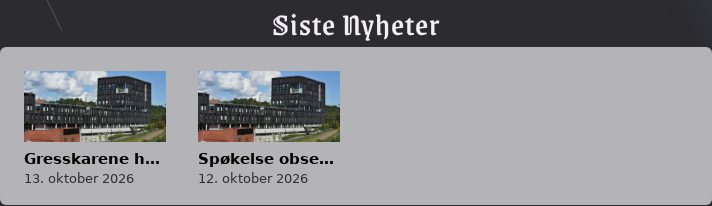

---

# C2: The logo goes orange and spooky
`🍬 candy` · `🎨 restyle` · Feature

**Reward:** 1 🪙 · **Time:** about 6 min  
**Good to know first:** nothing, everything is explained

### What to do
Make the site name at the top left, "Ifi Platform Beta | Halloween", pumpkin orange and in a spooky font.

### Files to change (only these)
- `ifiplatform/static/css/07_halloween/logo.css` (empty, already loaded on every page)

### Solution to start from
Paste this into the file:
```css
.ifiplatform-logo {
    color: #ff7518;
    font-family: var(--font-spooky);
    font-size: 2.2rem;
    letter-spacing: 0.02em;
}

.ifiplatform-logo:hover {
    color: #ffb15c;
}
```

#### Explanation (optional)
- `.ifiplatform-logo` is the link with the site name in the header.
- `var(--font-spooky)` is the spooky font, Grenze Gotisch. It's already loaded on every page, so you can just use it.
- `letter-spacing` puts a little more room between the letters, so the curly font is easier to read.
- The `:hover` rule makes it a lighter orange when the mouse is over it.

### Make it yours
- Bigger or smaller: change `font-size`.
- Another colour: `#b44cff` is poison purple, `#8de9a8` slime green.
- A glow: `text-shadow: 0 0 12px rgba(255, 117, 24, 0.7);` in the first rule.
- **Pick your own colour:** in VS Code, every colour code in a `.css` file has a small coloured square in front of it. Click the square to get a colour picker; the code changes as you pick. Or search "color picker" on Google, choose a colour, and copy the **HEX** code (the one that starts with `#`, like `#ff7518`).

### Done when
- The site name is orange and spooky on every page, and still fits on one line.

### How to work on it
Set up the project on your own computer first (see **Get started** in the README). Then:

1. **Claim this issue** on the site: https://halloween.ifiplattform.no/commits/issues/
2. In the VS Code terminal:
   ```bash
   ifi fix-issue {number}
   ```
3. Make the change, and check it at http://localhost:8000. Reload with **Ctrl+Shift+R** (Mac: **Cmd+Shift+R**): a normal reload may show the old look, because the browser keeps old copies of CSS files and pictures. Still old? Try a private window.
4. Then:
   ```bash
   ifi test
   git add .
   git commit -m "Short description of what you changed"
   ifi pull-request
   ```

**Only change the files listed above.** Then your pull request can't clash with anyone else's. After the merge it can take a few minutes before it shows on the live site. Stuck? Ask a helper, or type `ifi help`.

#### What it looks like when it's done
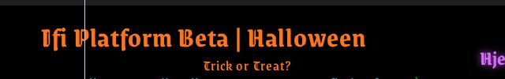

---

# C20: A grey events box with a black border
`🍬 candy` · `🎨 restyle` · Feature

**Reward:** 1 🪙 · **Time:** about 6 min  
**Good to know first:** nothing, everything is explained

### What to do
On the home page, the "Happening at Ifi" box on the right is white with rounded corners. Make it grey with a black border, like the shortcut cards.

### Files to change (only these)
- `ifiplatform/static/css/07_halloween/eventsbox_box.css` (empty, already loaded on every page)

### Solution to start from
Paste this into the file:
```css
.eventsbox_container {
    background-color: #b4b4b8;
    border: 2px solid #000;
    border-radius: 6px;
    box-shadow: none;
}

.eventsbox_container h2 {
    padding: 0 0 0.8rem;
    font-size: 1.3rem;
    text-decoration: none;
}
```

#### Explanation (optional)
- `.eventsbox_container` is the whole box. `border: 2px solid #000` is a black border, 2 pixels thick, all round.
- `.eventsbox_container h2` is its heading: a bit smaller, less space around it, and no underline.

### Make it yours
- Another grey: `#9a9aa0` is darker, `#d0d0d4` lighter. Keep the text easy to read.
- Keep the underline under the heading: leave out `text-decoration: none;`.
- **Pick your own colour:** in VS Code, every colour code in a `.css` file has a small coloured square in front of it. Click the square to get a colour picker; the code changes as you pick. Or search "color picker" on Google, choose a colour, and copy the **HEX** code (the one that starts with `#`, like `#ff7518`).

### Done when
- The events box is grey with a black border, and everything in it is easy to read.

### How to work on it
Set up the project on your own computer first (see **Get started** in the README). Then:

1. **Claim this issue** on the site: https://halloween.ifiplattform.no/commits/issues/
2. In the VS Code terminal:
   ```bash
   ifi fix-issue {number}
   ```
3. Make the change, and check it at http://localhost:8000. Reload with **Ctrl+Shift+R** (Mac: **Cmd+Shift+R**): a normal reload may show the old look, because the browser keeps old copies of CSS files and pictures. Still old? Try a private window.
4. Then:
   ```bash
   ifi test
   git add .
   git commit -m "Short description of what you changed"
   ifi pull-request
   ```

**Only change the files listed above.** Then your pull request can't clash with anyone else's. After the merge it can take a few minutes before it shows on the live site. Stuck? Ask a helper, or type `ifi help`.

#### What it looks like when it's done


---

# C22: Smaller event rows with bold titles
`🍬 candy` · `🎨 restyle` · Feature

**Reward:** 1 🪙 · **Time:** about 5 min  
**Good to know first:** nothing, everything is explained

### What to do
In the "Happening at Ifi" box on the home page, make the event rows more compact: small text for the days and times, and extra bold event titles.

### Files to change (only these)
- `ifiplatform/static/css/07_halloween/eventsbox_items.css` (empty, already loaded on every page)

### Solution to start from
Paste this into the file:
```css
.home-eventsbox-day-heading {
    font-size: 0.85rem;
}

.home-eventsbox-time {
    font-size: 0.8rem;
}

.home-eventsbox-title {
    font-size: 0.9rem;
    font-weight: 800;
}
```

#### Explanation (optional)
- `.home-eventsbox-day-heading` is the line with the day, like "Mandag – 26. oktober".
- `.home-eventsbox-time` is the time on the left of each event.
- `.home-eventsbox-title` is the event's name. `font-weight: 800` is extra bold (normal bold is 700).

### Make it yours
- Show the day headings in capitals: `text-transform: uppercase;` in the first rule.

### Done when
- The days and times are smaller, the event names are extra bold, and it's all still easy to read.

### How to work on it
Set up the project on your own computer first (see **Get started** in the README). Then:

1. **Claim this issue** on the site: https://halloween.ifiplattform.no/commits/issues/
2. In the VS Code terminal:
   ```bash
   ifi fix-issue {number}
   ```
3. Make the change, and check it at http://localhost:8000. Reload with **Ctrl+Shift+R** (Mac: **Cmd+Shift+R**): a normal reload may show the old look, because the browser keeps old copies of CSS files and pictures. Still old? Try a private window.
4. Then:
   ```bash
   ifi test
   git add .
   git commit -m "Short description of what you changed"
   ifi pull-request
   ```

**Only change the files listed above.** Then your pull request can't clash with anyone else's. After the merge it can take a few minutes before it shows on the live site. Stuck? Ask a helper, or type `ifi help`.

#### What it looks like when it's done


---

# C23: A grey >OUTPUT box with a black border
`🍬 candy` · `🎨 restyle` · Feature

**Reward:** 1 🪙 · **Time:** about 5 min  
**Good to know first:** nothing, everything is explained

### What to do
At the bottom of the right column on the home page there's a box with the cover of >OUTPUT, Ifi's student magazine. Make it grey with a black border, like the other boxes.

### Files to change (only these)
- `ifiplatform/static/css/07_halloween/output_box.css` (empty, already loaded on every page)

### Solution to start from
Paste this into the file:
```css
.output-box {
    background-color: #b4b4b8;
    border: 2px solid #000;
    border-radius: 6px;
    text-align: center;
}

.output-box img {
    border-radius: 3px;
}

.output-caption {
    margin: 0.6rem 0 0;
    font-size: 0.85rem;
}
```

#### Explanation (optional)
- `.output-box` is the whole box: grey, a black border, everything centred.
- `.output-box img` is the cover picture: slightly rounded corners.
- `.output-caption` is the sentence under the cover: a bit smaller, with some space above it.

### Make it yours
- A tilted cover, like a magazine thrown on a table: `rotate: -2deg;` in the `img` rule.
- **Pick your own colour:** in VS Code, every colour code in a `.css` file has a small coloured square in front of it. Click the square to get a colour picker; the code changes as you pick. Or search "color picker" on Google, choose a colour, and copy the **HEX** code (the one that starts with `#`, like `#ff7518`).

### Done when
- The >OUTPUT box is grey with a black border, and the cover and caption are centred.

### How to work on it
Set up the project on your own computer first (see **Get started** in the README). Then:

1. **Claim this issue** on the site: https://halloween.ifiplattform.no/commits/issues/
2. In the VS Code terminal:
   ```bash
   ifi fix-issue {number}
   ```
3. Make the change, and check it at http://localhost:8000. Reload with **Ctrl+Shift+R** (Mac: **Cmd+Shift+R**): a normal reload may show the old look, because the browser keeps old copies of CSS files and pictures. Still old? Try a private window.
4. Then:
   ```bash
   ifi test
   git add .
   git commit -m "Short description of what you changed"
   ifi pull-request
   ```

**Only change the files listed above.** Then your pull request can't clash with anyone else's. After the merge it can take a few minutes before it shows on the live site. Stuck? Ask a helper, or type `ifi help`.

#### What it looks like when it's done


---

# C27: The spider: its thread and body
`🍬 candy` · `🖼️ art` · Feature

**Reward:** 1 🪙 · **Time:** about 6 min · **Part of the set** SET-spider  
**Good to know first:** nothing, everything is explained

### What to do
Give the spider at the top left of every page a thread to hang from and a round red body. It's already on the page, but empty, so you can't see it yet.

### Files to change (only these)
- `ifiplatform/static/css/07_halloween/spider_body.css` (empty, already loaded on every page)

**Only draw the thread and the body.** The legs, the swinging and turning the swing off are other people's issues, in other files.

### Solution to start from
Paste this into the file:
```css
.spider {
    width: 2.4rem;
    height: 19rem;
}

.spider__thread {
    position: absolute;
    top: 0;
    left: 50%;
    width: 1px;
    height: 16.3rem;
    background: #d6d1de;
}

.spider__body {
    position: absolute;
    top: 16.2rem;
    left: 50%;
    z-index: 1;
    width: 1.45rem;
    height: 1.8rem;
    margin-left: -0.725rem;
    border-radius: 50% 50% 45% 45%;
    background: radial-gradient(circle at 50% 35%, #d6342e 0 28%, #8f1d19 72%);
}

.spider__body::before {
    content: "";
    position: absolute;
    bottom: -0.6rem;
    left: 50%;
    width: 0.85rem;
    height: 0.8rem;
    margin-left: -0.425rem;
    border-radius: 50%;
    background: #8f1d19;
}
```

#### Explanation (optional)
- `.spider` is the box the spider lives in. It's already pinned to the top left of the window in `scaffold.css` (don't change that file): this gives it a size.
- `.spider__thread` is a line 1 pixel wide, from the top down to the body.
- `.spider__body` is an oval: `border-radius` rounds the corners, and the `radial-gradient` makes it lighter red in the middle, so it looks round.
- `::before` adds a smaller dark-red circle under the body: the spider's head.
- `margin-left` with minus half the width puts each part exactly in the middle of the thread.

### Make it yours
- Another colour: `#3a3a44` and `#121216` make a black spider, `#8de9a8` and `#2f7a45` a poison green one. Change both colours in the gradient and the head's `background`.
- A longer thread: make `height` bigger in `.spider__thread`, and move the body down with `top`.

### Done when
- A red spider body hangs from a thin thread at the top left of every page, and you can still click everything under it.

### How to work on it
Set up the project on your own computer first (see **Get started** in the README). Then:

1. **Claim this issue** on the site: https://halloween.ifiplattform.no/commits/issues/
2. In the VS Code terminal:
   ```bash
   ifi fix-issue {number}
   ```
3. Make the change, and check it at http://localhost:8000. Reload with **Ctrl+Shift+R** (Mac: **Cmd+Shift+R**): a normal reload may show the old look, because the browser keeps old copies of CSS files and pictures. Still old? Try a private window.
4. Then:
   ```bash
   ifi test
   git add .
   git commit -m "Short description of what you changed"
   ifi pull-request
   ```

**Only change the files listed above.** Then your pull request can't clash with anyone else's. After the merge it can take a few minutes before it shows on the live site. Stuck? Ask a helper, or type `ifi help`.

#### What it looks like when it's done
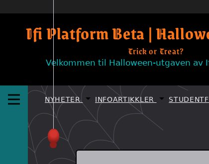

*Only this step: the thread and the body, without the legs.*

---

# C28: The spider: eight legs
`🍬 candy` · `🖼️ art` · Feature

**Reward:** 1 🪙 · **Time:** about 6 min · **Part of the set** SET-spider  
**Good to know first:** nothing, everything is explained

### What to do
Give the spider at the top left of every page its eight legs.

### Files to change (only these)
- new: `ifiplatform/static/images/halloween/spider_legs.svg`
- `ifiplatform/static/css/07_halloween/spider_legs.css` (empty, already loaded on every page)

**Only draw the legs.** The thread, the body and the swinging are other people's issues, in other files. Until the body issue is done, you'll see legs without a body: that's fine.

### Solution to start from
1. Make the file `ifiplatform/static/images/halloween/spider_legs.svg` with this inside:
   ```html
   <svg xmlns="http://www.w3.org/2000/svg" width="90" height="70" viewBox="0 0 90 70" fill="none" stroke="#8f1d19" stroke-width="2" stroke-linecap="round" stroke-linejoin="round">
     <path d="M42,34 L24,14 L6,24"/>
     <path d="M48,34 L66,14 L84,24"/>
     <path d="M41,36 L19,26 L2,40"/>
     <path d="M49,36 L71,26 L88,40"/>
     <path d="M41,38 L20,40 L6,58"/>
     <path d="M49,38 L70,40 L84,58"/>
     <path d="M42,40 L27,50 L18,68"/>
     <path d="M48,40 L63,50 L72,68"/>
   </svg>
   ```
2. Paste this into `spider_legs.css`:
   ```css
   .spider__legs {
       position: absolute;
       top: 15.8rem;
       left: 50%;
       width: 5.4rem;
       height: 4.2rem;
       margin-left: -2.7rem;
       background: url("../../images/halloween/spider_legs.svg") center / contain no-repeat;
   }
   ```

#### Explanation (optional)
- Each `<path>` is one leg with a knee: `M` is where the pen starts (at the body), then `L` draws a line to the knee and on to the foot.
- `stroke` is the colour of the lines, and `stroke-width` how thick they are.
- In the CSS, the picture is the background of `.spider__legs`. The path `../../images/...` goes from the CSS file up two folders, then down to the picture.

### Make it yours
- Hairy legs: a thicker `stroke-width`, like `3`.
- Another colour: change `stroke="#8f1d19"`. A black spider? `#121216`.
- **Pick your own colour:** search "color picker" on Google, choose a colour, and copy the **HEX** code (the one that starts with `#`, like `#ff7518`). Paste it between the quotes, for example `stroke="#ff7518"`.

### Done when
- Eight legs show at the top left, where the spider's body is (or will be).

### How to work on it
Set up the project on your own computer first (see **Get started** in the README). Then:

1. **Claim this issue** on the site: https://halloween.ifiplattform.no/commits/issues/
2. In the VS Code terminal:
   ```bash
   ifi fix-issue {number}
   ```
3. Make the change, and check it at http://localhost:8000. Reload with **Ctrl+Shift+R** (Mac: **Cmd+Shift+R**): a normal reload may show the old look, because the browser keeps old copies of CSS files and pictures. Still old? Try a private window.
4. Then:
   ```bash
   ifi test
   git add .
   git commit -m "Short description of what you changed"
   ifi pull-request
   ```

**Only change the files listed above.** Then your pull request can't clash with anyone else's. After the merge it can take a few minutes before it shows on the live site. Stuck? Ask a helper, or type `ifi help`.

#### What it looks like when it's done
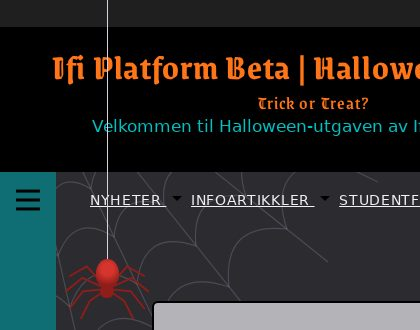

---

# C29: The spider: make it swing
`🍬 candy` · `🦇 silly feature` · Feature

**Reward:** 1 🪙 · **Time:** about 5 min · **Part of the set** SET-spider  
**Good to know first:** nothing, everything is explained

### What to do
Make the spider at the top left of every page swing slowly from side to side on its thread.

### Files to change (only these)
- `ifiplatform/static/css/07_halloween/spider_swing.css` (empty, already loaded on every page)

**Only add the swing.** The thread, body and legs are other people's issues. If they aren't done yet, you won't see anything move: check the CSS anyway, or ask whether they're merged.

### Solution to start from
Paste this into the file:
```css
@keyframes spider-swing {
    from {
        rotate: -6deg;
    }
    to {
        rotate: 6deg;
    }
}

.spider {
    transform-origin: 50% 0;
    animation: spider-swing 4s ease-in-out infinite alternate;
}
```

#### Explanation (optional)
- `@keyframes` describes the movement: tilted 6 degrees one way, then 6 degrees the other.
- `transform-origin: 50% 0` is the point it turns around: the middle of the top, where the thread is tied. Like a real pendulum.
- `animation`: 4 seconds per swing, slow at both ends (`ease-in-out`), forever (`infinite`), and back and forth (`alternate`) instead of jumping back to the start.

### Make it yours
- A wilder swing: a bigger angle, like `15deg`, or a shorter time.

### Done when
- The spider swings gently from side to side on every page.

### How to work on it
Set up the project on your own computer first (see **Get started** in the README). Then:

1. **Claim this issue** on the site: https://halloween.ifiplattform.no/commits/issues/
2. In the VS Code terminal:
   ```bash
   ifi fix-issue {number}
   ```
3. Make the change, and check it at http://localhost:8000. Reload with **Ctrl+Shift+R** (Mac: **Cmd+Shift+R**): a normal reload may show the old look, because the browser keeps old copies of CSS files and pictures. Still old? Try a private window.
4. Then:
   ```bash
   ifi test
   git add .
   git commit -m "Short description of what you changed"
   ifi pull-request
   ```

**Only change the files listed above.** Then your pull request can't clash with anyone else's. After the merge it can take a few minutes before it shows on the live site. Stuck? Ask a helper, or type `ifi help`.

#### What it looks like when it's done


*The swing, paused at one end.*

---

# C3: Style "Trick or Treat?" under the logo
`🍬 candy` · `🎨 restyle` · Feature

**Reward:** 1 🪙 · **Time:** about 6 min  
**Good to know first:** nothing, everything is explained

### What to do
Under the site name in the header it says "Trick or Treat?", but it looks plain. Make it small, orange and spooky.

### Files to change (only these)
- `ifiplatform/static/css/07_halloween/tagline.css` (empty, already loaded on every page)

### Solution to start from
Paste this into the file:
```css
.header-tagline {
    margin-top: 0.3rem;
    color: #ff7518;
    font-family: var(--font-spooky);
    font-size: 1.15rem;
    letter-spacing: 0.06em;
}

.header-tagline:hover {
    color: #ffb15c;
}
```

#### Explanation (optional)
- `.header-tagline` is the "Trick or Treat?" text. It's a button: another issue makes clicking it do something.
- `margin-top` adds a little space between it and the site name.
- `var(--font-spooky)` is the spooky font, already loaded on every page.

### Make it yours
- Another colour: `#b44cff` is poison purple, `#f2eff6` ghost white.
- Tilt it a little: `rotate: -3deg;` in the first rule.
- **Pick your own colour:** in VS Code, every colour code in a `.css` file has a small coloured square in front of it. Click the square to get a colour picker; the code changes as you pick. Or search "color picker" on Google, choose a colour, and copy the **HEX** code (the one that starts with `#`, like `#ff7518`).

### Done when
- "Trick or Treat?" is small, orange and spooky, right under the site name.

### How to work on it
Set up the project on your own computer first (see **Get started** in the README). Then:

1. **Claim this issue** on the site: https://halloween.ifiplattform.no/commits/issues/
2. In the VS Code terminal:
   ```bash
   ifi fix-issue {number}
   ```
3. Make the change, and check it at http://localhost:8000. Reload with **Ctrl+Shift+R** (Mac: **Cmd+Shift+R**): a normal reload may show the old look, because the browser keeps old copies of CSS files and pictures. Still old? Try a private window.
4. Then:
   ```bash
   ifi test
   git add .
   git commit -m "Short description of what you changed"
   ifi pull-request
   ```

**Only change the files listed above.** Then your pull request can't clash with anyone else's. After the merge it can take a few minutes before it shows on the live site. Stuck? Ask a helper, or type `ifi help`.

#### What it looks like when it's done


---

# C30: The spider: no swinging for people who turned animations off
`🍬 candy` · `♿ a11y` · Feature

**Reward:** 1 🪙 · **Time:** about 5 min · **Part of the set** SET-spider  
**Good to know first:** nothing, everything is explained

### What to do
Some people get dizzy or distracted from movement on screen, and turn animations off in their computer's settings. Make the spider stop swinging for them.

### Files to change (only these)
- `ifiplatform/static/css/07_halloween/spider_reduced_motion.css` (empty, already loaded on every page, after the swing)

### Solution to start from
Paste this into the file:
```css
@media (prefers-reduced-motion: reduce) {
    .spider {
        animation: none;
    }
}
```

#### Explanation (optional)
- `@media (prefers-reduced-motion: reduce)` means: only when the visitor turned animations off. Everything inside the braces only counts then.
- `animation: none` stops the swing, and the spider just hangs still.
- This file is loaded after the swing's file, so it wins.

### How to test it
In Chrome: DevTools (F12) → the ⋮ menu → More tools → **Rendering** → "Emulate CSS media feature prefers-reduced-motion" → `reduce`. In Firefox: `about:config` → `ui.prefersReducedMotion` = 1. If the swing issue isn't merged yet, there's nothing to stop: check that your rule is right, and test again later.

### Done when
- With animations turned off, the spider hangs still. With them on, it swings.

### How to work on it
Set up the project on your own computer first (see **Get started** in the README). Then:

1. **Claim this issue** on the site: https://halloween.ifiplattform.no/commits/issues/
2. In the VS Code terminal:
   ```bash
   ifi fix-issue {number}
   ```
3. Make the change, and check it at http://localhost:8000. Reload with **Ctrl+Shift+R** (Mac: **Cmd+Shift+R**): a normal reload may show the old look, because the browser keeps old copies of CSS files and pictures. Still old? Try a private window.
4. Then:
   ```bash
   ifi test
   git add .
   git commit -m "Short description of what you changed"
   ifi pull-request
   ```

**Only change the files listed above.** Then your pull request can't clash with anyone else's. After the merge it can take a few minutes before it shows on the live site. Stuck? Ask a helper, or type `ifi help`.

#### What it looks like when it's done


*Mock-up: what changes. A screenshot of something that doesn't move looks like nothing.*

---

# C31: 👻 "Today" and "Tomorrow" are swapped
`🍬 candy` · `👻 haunted bug` · Bug

**Reward:** 1 🪙 · **Time:** about 5 min  
**Good to know first:** nothing, everything is explained

### What's wrong
In the "Happening at Ifi" box on the home page, events happening today are under a heading that says **Tomorrow** ("I morgen"), and tomorrow's events say **Today** ("I dag"). A ghost has swapped them...

### Files to change (only these)
- `ifiplatform/apps/ifi_home_app/templates/home/partials/eventsbox/eventsbox.html`

### Solution to start from
Near the top of the file, find these two lines:
```html


```
and swap the two texts, so they say:
```html


```
Keep the spaces at the start of the lines as they are.

#### Explanation (optional)
- `` shows something only when the condition is true. `day.time_tag` is `"today"` for the events happening today, and `"tomorrow"` for tomorrow's.
- `` shows "Today" in English, and its Norwegian translation ("I dag") on the Norwegian site.
- Days further away show their weekday instead, from the line after these two.

### Done when
- The heading over today's events says "I dag" (English: "Today"), and the one over tomorrow's says "I morgen" ("Tomorrow"). No events today or tomorrow in your database? Then the headings only show weekdays: that's fine, as long as the two lines are right.

### How to work on it
Set up the project on your own computer first (see **Get started** in the README). Then:

1. **Claim this issue** on the site: https://halloween.ifiplattform.no/commits/issues/
2. In the VS Code terminal:
   ```bash
   ifi fix-issue {number}
   ```
3. Make the change, and check it at http://localhost:8000. Reload with **Ctrl+Shift+R** (Mac: **Cmd+Shift+R**): a normal reload may show the old look, because the browser keeps old copies of CSS files and pictures. Still old? Try a private window.
4. Then:
   ```bash
   ifi test
   git add .
   git commit -m "Short description of what you changed"
   ifi pull-request
   ```

**Only change the files listed above.** Then your pull request can't clash with anyone else's. After the merge it can take a few minutes before it shows on the live site. Stuck? Ask a helper, or type `ifi help`.

#### What it looks like when it's done


*The fixed lines. The dev database has no events today or tomorrow, so the page itself shows only weekdays.*

---

# C33: Screen readers read every news title twice
`🍬 candy` · `♿ a11y` · Bug

**Reward:** 1 🪙 · **Time:** about 5 min  
**Good to know first:** nothing, everything is explained

### What to do
People who can't see the screen use a **screen reader**: a program that reads the page out loud. For a picture it reads the picture's `alt` text. On the news cards, the picture's `alt` text is the article's title, and the title is written right under it too, so a screen reader says every title twice. Fix the `alt` text.

### Files to change (only these)
- `ifiplatform/apps/ifi_home_app/templates/info_articles/partials/article_card.html`

### Solution to start from
1. Find this line:
   ```html
   
   ```
   and change it to:
   ```html
   
   ```
2. A few lines further down, find:
   ```html
   
   ```
   and change it to:
   ```html
   
   ```

#### Explanation (optional)
- `hero_image_alt` is a description of the picture that editors can write, like "Two students carving a pumpkin". If they wrote one, the card uses it: it tells something the title doesn't.
- `|default:article.title` meant "no description? use the title instead". That's the double title, so it goes.
- The second picture is the same placeholder photo of the Ifi building for every article without a picture. It tells nothing, so `alt=""` (empty, not missing!) tells screen readers to skip it.

### Done when
- The news cards look exactly the same as before.
- Right-click a news picture → **Inspect**: the `` has `alt=""`, or a description that isn't the title.

### How to work on it
Set up the project on your own computer first (see **Get started** in the README). Then:

1. **Claim this issue** on the site: https://halloween.ifiplattform.no/commits/issues/
2. In the VS Code terminal:
   ```bash
   ifi fix-issue {number}
   ```
3. Make the change, and check it at http://localhost:8000. Reload with **Ctrl+Shift+R** (Mac: **Cmd+Shift+R**): a normal reload may show the old look, because the browser keeps old copies of CSS files and pictures. Still old? Try a private window.
4. Then:
   ```bash
   ifi test
   git add .
   git commit -m "Short description of what you changed"
   ifi pull-request
   ```

**Only change the files listed above.** Then your pull request can't clash with anyone else's. After the merge it can take a few minutes before it shows on the live site. Stuck? Ask a helper, or type `ifi help`.

#### What it looks like when it's done
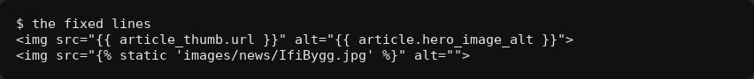

*The fixed lines. The cards look the same; only what screen readers hear changes.*

---

# C34: Pin a warning on the haunted notice board
`🍬 candy` · `✍️ content` · Task

**Reward:** 1 🪙 · **Time:** about 5 min  
**Good to know first:** nothing, everything is explained

### What to do
Warn everyone about something terrifying at Ifi. Pin a warning on the haunted notice board at http://localhost:8000/halloween/board/. One to three sentences is plenty: funny beats long.

### Files to change (only these)
- new: `ifiplatform/apps/halloween_app/board_notes/warning_01.txt`

### Solution to start from
Make the file `ifiplatform/apps/halloween_app/board_notes/warning_01.txt` with this inside, then change it to your own:
```
Do NOT make eye contact with the 3rd-floor printer
It can sense deadlines. It will jam.
```

#### Explanation (optional)
The board turns your file into a note like this:
- **First line** → the heading of the note, in bold at the top.
- **The lines after it** → the text on the note.
- **A last line starting with `--`** → who signed it, at the bottom right. You can leave it out.

### Make it yours
Write your own! Some ideas:
- "Do NOT make eye contact with the printer on the 3rd floor."
- "WARNING: the group room booking system has eaten three groups this week."
- "Never say “it works on my machine” after midnight."

Keep it kind: no real people.

### Done when
- Your note shows up on http://localhost:8000/halloween/board/.

### How to work on it
Set up the project on your own computer first (see **Get started** in the README). Then:

1. **Claim this issue** on the site: https://halloween.ifiplattform.no/commits/issues/
2. In the VS Code terminal:
   ```bash
   ifi fix-issue {number}
   ```
3. Make the change, and check it at http://localhost:8000. Reload with **Ctrl+Shift+R** (Mac: **Cmd+Shift+R**): a normal reload may show the old look, because the browser keeps old copies of CSS files and pictures. Still old? Try a private window.
4. Then:
   ```bash
   ifi test
   git add .
   git commit -m "Short description of what you changed"
   ifi pull-request
   ```

**Only change the files listed above.** Then your pull request can't clash with anyone else's. After the merge it can take a few minutes before it shows on the live site. Stuck? Ask a helper, or type `ifi help`.

#### What it looks like when it's done
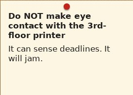

---

# C35: Pin a rule on the haunted notice board
`🍬 candy` · `✍️ content` · Task

**Reward:** 1 🪙 · **Time:** about 5 min  
**Good to know first:** nothing, everything is explained

### What to do
Add a rule everyone at Ifi must follow on Halloween night. Pin a rule on the haunted notice board at http://localhost:8000/halloween/board/. One to three sentences is plenty: funny beats long.

### Files to change (only these)
- new: `ifiplatform/apps/halloween_app/board_notes/rule_01.txt`

### Solution to start from
Make the file `ifiplatform/apps/halloween_app/board_notes/rule_01.txt` with this inside, then change it to your own:
```
Rule 13: commit before you leave the room
Things move at night. Uncommitted work is never seen again.
-- The night guard
```

#### Explanation (optional)
The board turns your file into a note like this:
- **First line** → the heading of the note, in bold at the top.
- **The lines after it** → the text on the note.
- **A last line starting with `--`** → who signed it, at the bottom right. You can leave it out.

### Make it yours
Write your own! Some ideas:
- "Rule 13: always commit before you leave the room. Things move at night."
- "Rule 4: if the lights flicker in the lab, push your branch immediately."
- "Rule 99: the last person out must say goodnight to the server."

Keep it kind: no real people.

### Done when
- Your note shows up on http://localhost:8000/halloween/board/.

### How to work on it
Set up the project on your own computer first (see **Get started** in the README). Then:

1. **Claim this issue** on the site: https://halloween.ifiplattform.no/commits/issues/
2. In the VS Code terminal:
   ```bash
   ifi fix-issue {number}
   ```
3. Make the change, and check it at http://localhost:8000. Reload with **Ctrl+Shift+R** (Mac: **Cmd+Shift+R**): a normal reload may show the old look, because the browser keeps old copies of CSS files and pictures. Still old? Try a private window.
4. Then:
   ```bash
   ifi test
   git add .
   git commit -m "Short description of what you changed"
   ifi pull-request
   ```

**Only change the files listed above.** Then your pull request can't clash with anyone else's. After the merge it can take a few minutes before it shows on the live site. Stuck? Ask a helper, or type `ifi help`.

#### What it looks like when it's done


---

# C36: Pin a missing poster on the haunted notice board
`🍬 candy` · `✍️ content` · Task

**Reward:** 1 🪙 · **Time:** about 5 min  
**Good to know first:** nothing, everything is explained

### What to do
Something at Ifi has gone missing. Make the poster. Pin a missing poster on the haunted notice board at http://localhost:8000/halloween/board/. One to three sentences is plenty: funny beats long.

### Files to change (only these)
- new: `ifiplatform/apps/halloween_app/board_notes/missing_01.txt`

### Solution to start from
Make the file `ifiplatform/apps/halloween_app/board_notes/missing_01.txt` with this inside, then change it to your own:
```
MISSING: my motivation
Last seen in week 2 of the semester. Answers to "deadline". Reward: one candy.
```

#### Explanation (optional)
The board turns your file into a note like this:
- **First line** → the heading of the note, in bold at the top.
- **The lines after it** → the text on the note.
- **A last line starting with `--`** → who signed it, at the bottom right. You can leave it out.

### Make it yours
Write your own! Some ideas:
- "MISSING: my motivation. Last seen in week 2."
- "MISSING: the left shoe of the Ifi mascot. Reward: one candy."
- "MISSING: the semicolon from line 42."

Keep it kind: no real people.

### Done when
- Your note shows up on http://localhost:8000/halloween/board/.

### How to work on it
Set up the project on your own computer first (see **Get started** in the README). Then:

1. **Claim this issue** on the site: https://halloween.ifiplattform.no/commits/issues/
2. In the VS Code terminal:
   ```bash
   ifi fix-issue {number}
   ```
3. Make the change, and check it at http://localhost:8000. Reload with **Ctrl+Shift+R** (Mac: **Cmd+Shift+R**): a normal reload may show the old look, because the browser keeps old copies of CSS files and pictures. Still old? Try a private window.
4. Then:
   ```bash
   ifi test
   git add .
   git commit -m "Short description of what you changed"
   ifi pull-request
   ```

**Only change the files listed above.** Then your pull request can't clash with anyone else's. After the merge it can take a few minutes before it shows on the live site. Stuck? Ask a helper, or type `ifi help`.

#### What it looks like when it's done


---

# C4: Purple glowing menu links in the header
`🍬 candy` · `🎨 restyle` · Feature

**Reward:** 1 🪙 · **Time:** about 6 min  
**Good to know first:** nothing, everything is explained

### What to do
Make the menu links at the top right (Hjem, Studie, Commits, Halloween, Logg inn) poison purple, in the spooky font, with a glow.

### Files to change (only these)
- `ifiplatform/static/css/07_halloween/nav_links.css` (empty, already loaded on every page)

### Solution to start from
Paste this into the file:
```css
.nav_link {
    color: #b44cff;
    font-family: var(--font-spooky);
    font-size: 1.3rem;
}

.nav_link:hover {
    text-shadow: 0 0 10px rgba(180, 76, 255, 0.9);
}

.nav_link.active {
    color: #d76bff;
    text-shadow: 0 0 10px rgba(215, 107, 255, 0.8);
}
```

#### Explanation (optional)
- `.nav_link` is every menu link in the header.
- `text-shadow` with no offset (`0 0`) and some blur (`10px`) makes a glow around the letters. `rgba(180, 76, 255, 0.9)` is purple, a little see-through.
- `.nav_link.active` is the link to the page you're on: it glows all the time.

### Make it yours
- A stronger glow: a bigger blur, like `20px`.
- Another colour: `#8de9a8` slime green glows nicely too.
- **Pick your own colour:** in VS Code, every colour code in a `.css` file has a small coloured square in front of it. Click the square to get a colour picker; the code changes as you pick. Or search "color picker" on Google, choose a colour, and copy the **HEX** code (the one that starts with `#`, like `#ff7518`).

### Done when
- The header links are purple and spooky, the one for the page you're on glows, and they glow when you hover over them.

### How to work on it
Set up the project on your own computer first (see **Get started** in the README). Then:

1. **Claim this issue** on the site: https://halloween.ifiplattform.no/commits/issues/
2. In the VS Code terminal:
   ```bash
   ifi fix-issue {number}
   ```
3. Make the change, and check it at http://localhost:8000. Reload with **Ctrl+Shift+R** (Mac: **Cmd+Shift+R**): a normal reload may show the old look, because the browser keeps old copies of CSS files and pictures. Still old? Try a private window.
4. Then:
   ```bash
   ifi test
   git add .
   git commit -m "Short description of what you changed"
   ifi pull-request
   ```

**Only change the files listed above.** Then your pull request can't clash with anyone else's. After the merge it can take a few minutes before it shows on the live site. Stuck? Ask a helper, or type `ifi help`.

#### What it looks like when it's done


---

# C49: Write a study joke (1 of 10)
`🍬 candy` · `✍️ content` · Task

**Reward:** 1 🪙 · **Time:** about 5 min  
**Good to know first:** nothing, everything is explained

### What to do
The study page at http://localhost:8000/study/ says "Studie? Ahaha, nei." and shows a random excuse for not studying. Every reload, a new one. Add your own joke or excuse to the pile. One or two sentences: funny beats long.

### Files to change (only these)
- new: `ifiplatform/apps/study_app/joke_files/joke_01.txt`

### Solution to start from
Make the file `ifiplatform/apps/study_app/joke_files/joke_01.txt` with this inside, then change it to your own:
```
My code compiles on the first try. I check it twice: something must be wrong.
```

#### Explanation (optional)
- The page reads every `joke_NN.txt` file in the `joke_files` folder, and picks one at random each time it's opened.
- Just the joke, as plain text. No heading, no quotes around it.
- It shows exactly as you write it, so English or Norwegian are both fine.

### Make it yours
Write your own! Some ideas:
- "Ten minutes of studying deserves a two-hour break. That's just maths."
- "My GitHub streak is longer than my attention span."
- "I put the exam date in my calendar. My calendar is now scared of it too."

Keep it kind: no real people. And keep the exact file name from the list above: another person is writing a joke in each of the other files.

### Done when
- Your joke shows on http://localhost:8000/study/?joke=01 (the `?joke=01` shows your file's joke; without it, the page picks one at random).

### How to work on it
Set up the project on your own computer first (see **Get started** in the README). Then:

1. **Claim this issue** on the site: https://halloween.ifiplattform.no/commits/issues/
2. In the VS Code terminal:
   ```bash
   ifi fix-issue {number}
   ```
3. Make the change, and check it at http://localhost:8000. Reload with **Ctrl+Shift+R** (Mac: **Cmd+Shift+R**): a normal reload may show the old look, because the browser keeps old copies of CSS files and pictures. Still old? Try a private window.
4. Then:
   ```bash
   ifi test
   git add .
   git commit -m "Short description of what you changed"
   ifi pull-request
   ```

**Only change the files listed above.** Then your pull request can't clash with anyone else's. After the merge it can take a few minutes before it shows on the live site. Stuck? Ask a helper, or type `ifi help`.

#### What it looks like when it's done
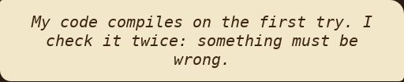

---

# C5: Orange language buttons
`🍬 candy` · `🎨 restyle` · Feature

**Reward:** 1 🪙 · **Time:** about 5 min  
**Good to know first:** nothing, everything is explained

### What to do
The **English** and **Norsk** buttons at the very top right are turquoise. Make them pumpkin orange.

### Files to change (only these)
- `ifiplatform/static/css/07_halloween/language_buttons.css` (empty, already loaded on every page)

### Solution to start from
Paste this into the file:
```css
.lang-btn {
    color: #ff7518;
    border-color: #ff7518;
}

.lang-btn:hover,
.lang-btn.active {
    background: #ff7518;
    color: #000;
}
```

#### Explanation (optional)
- `.lang-btn` is each language button: orange text and an orange edge.
- `.lang-btn.active` is the language you're using now, and `:hover` is the button under the mouse. Both get filled orange with black text.
- A comma between two selectors means "both of these".

### Make it yours
- Another colour: `#b44cff` is poison purple. Keep the text on the filled button easy to read.
- **Pick your own colour:** in VS Code, every colour code in a `.css` file has a small coloured square in front of it. Click the square to get a colour picker; the code changes as you pick. Or search "color picker" on Google, choose a colour, and copy the **HEX** code (the one that starts with `#`, like `#ff7518`).

### Done when
- Both language buttons are orange, the current language is filled orange, and switching language still works.

### How to work on it
Set up the project on your own computer first (see **Get started** in the README). Then:

1. **Claim this issue** on the site: https://halloween.ifiplattform.no/commits/issues/
2. In the VS Code terminal:
   ```bash
   ifi fix-issue {number}
   ```
3. Make the change, and check it at http://localhost:8000. Reload with **Ctrl+Shift+R** (Mac: **Cmd+Shift+R**): a normal reload may show the old look, because the browser keeps old copies of CSS files and pictures. Still old? Try a private window.
4. Then:
   ```bash
   ifi test
   git add .
   git commit -m "Short description of what you changed"
   ifi pull-request
   ```

**Only change the files listed above.** Then your pull request can't clash with anyone else's. After the merge it can take a few minutes before it shows on the live site. Stuck? Ask a helper, or type `ifi help`.

#### What it looks like when it's done


---

# C50: Write a study joke (2 of 10)
`🍬 candy` · `✍️ content` · Task

**Reward:** 1 🪙 · **Time:** about 5 min  
**Good to know first:** nothing, everything is explained

### What to do
The study page at http://localhost:8000/study/ says "Studie? Ahaha, nei." and shows a random excuse for not studying. Every reload, a new one. Add your own joke or excuse to the pile. One or two sentences: funny beats long.

### Files to change (only these)
- new: `ifiplatform/apps/study_app/joke_files/joke_02.txt`

### Solution to start from
Make the file `ifiplatform/apps/study_app/joke_files/joke_02.txt` with this inside, then change it to your own:
```
I don't need a study group. I need a nap group.
```

#### Explanation (optional)
- The page reads every `joke_NN.txt` file in the `joke_files` folder, and picks one at random each time it's opened.
- Just the joke, as plain text. No heading, no quotes around it.
- It shows exactly as you write it, so English or Norwegian are both fine.

### Make it yours
Write your own! Some ideas:
- "Reading week: the week I read every meme ever made."
- "I color-coded my notes. Now I have very pretty notes I've never read."
- "The lecture is recorded, so I'll definitely watch it. At 2x. Next month."

Keep it kind: no real people. And keep the exact file name from the list above: another person is writing a joke in each of the other files.

### Done when
- Your joke shows on http://localhost:8000/study/?joke=02 (the `?joke=02` shows your file's joke; without it, the page picks one at random).

### How to work on it
Set up the project on your own computer first (see **Get started** in the README). Then:

1. **Claim this issue** on the site: https://halloween.ifiplattform.no/commits/issues/
2. In the VS Code terminal:
   ```bash
   ifi fix-issue {number}
   ```
3. Make the change, and check it at http://localhost:8000. Reload with **Ctrl+Shift+R** (Mac: **Cmd+Shift+R**): a normal reload may show the old look, because the browser keeps old copies of CSS files and pictures. Still old? Try a private window.
4. Then:
   ```bash
   ifi test
   git add .
   git commit -m "Short description of what you changed"
   ifi pull-request
   ```

**Only change the files listed above.** Then your pull request can't clash with anyone else's. After the merge it can take a few minutes before it shows on the live site. Stuck? Ask a helper, or type `ifi help`.

#### What it looks like when it's done


---

# C51: Write a study joke (3 of 10)
`🍬 candy` · `✍️ content` · Task

**Reward:** 1 🪙 · **Time:** about 5 min  
**Good to know first:** nothing, everything is explained

### What to do
The study page at http://localhost:8000/study/ says "Studie? Ahaha, nei." and shows a random excuse for not studying. Every reload, a new one. Add your own joke or excuse to the pile. One or two sentences: funny beats long.

### Files to change (only these)
- new: `ifiplatform/apps/study_app/joke_files/joke_03.txt`

### Solution to start from
Make the file `ifiplatform/apps/study_app/joke_files/joke_03.txt` with this inside, then change it to your own:
```
The deadline is at midnight. Midnight is a social construct.
```

#### Explanation (optional)
- The page reads every `joke_NN.txt` file in the `joke_files` folder, and picks one at random each time it's opened.
- Just the joke, as plain text. No heading, no quotes around it.
- It shows exactly as you write it, so English or Norwegian are both fine.

### Make it yours
Write your own! Some ideas:
- "I'd study, but my rubber duck is on a break."
- "Monday me will handle it. Monday me is a legend."
- "Git blame says it was me. Git is lying."

Keep it kind: no real people. And keep the exact file name from the list above: another person is writing a joke in each of the other files.

### Done when
- Your joke shows on http://localhost:8000/study/?joke=03 (the `?joke=03` shows your file's joke; without it, the page picks one at random).

### How to work on it
Set up the project on your own computer first (see **Get started** in the README). Then:

1. **Claim this issue** on the site: https://halloween.ifiplattform.no/commits/issues/
2. In the VS Code terminal:
   ```bash
   ifi fix-issue {number}
   ```
3. Make the change, and check it at http://localhost:8000. Reload with **Ctrl+Shift+R** (Mac: **Cmd+Shift+R**): a normal reload may show the old look, because the browser keeps old copies of CSS files and pictures. Still old? Try a private window.
4. Then:
   ```bash
   ifi test
   git add .
   git commit -m "Short description of what you changed"
   ifi pull-request
   ```

**Only change the files listed above.** Then your pull request can't clash with anyone else's. After the merge it can take a few minutes before it shows on the live site. Stuck? Ask a helper, or type `ifi help`.

#### What it looks like when it's done
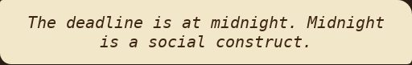

---

# C52: Write a study joke (4 of 10)
`🍬 candy` · `✍️ content` · Task

**Reward:** 1 🪙 · **Time:** about 5 min  
**Good to know first:** nothing, everything is explained

### What to do
The study page at http://localhost:8000/study/ says "Studie? Ahaha, nei." and shows a random excuse for not studying. Every reload, a new one. Add your own joke or excuse to the pile. One or two sentences: funny beats long.

### Files to change (only these)
- new: `ifiplatform/apps/study_app/joke_files/joke_04.txt`

### Solution to start from
Make the file `ifiplatform/apps/study_app/joke_files/joke_04.txt` with this inside, then change it to your own:
```
My study plan has a study plan. Neither of them has started.
```

#### Explanation (optional)
- The page reads every `joke_NN.txt` file in the `joke_files` folder, and picks one at random each time it's opened.
- Just the joke, as plain text. No heading, no quotes around it.
- It shows exactly as you write it, so English or Norwegian are both fine.

### Make it yours
Write your own! Some ideas:
- "I opened the assignment. That counts as 10% done."
- "Stack Overflow is down. So is my will to code."
- "Exam season: when the library is full and the café is fuller."

Keep it kind: no real people. And keep the exact file name from the list above: another person is writing a joke in each of the other files.

### Done when
- Your joke shows on http://localhost:8000/study/?joke=04 (the `?joke=04` shows your file's joke; without it, the page picks one at random).

### How to work on it
Set up the project on your own computer first (see **Get started** in the README). Then:

1. **Claim this issue** on the site: https://halloween.ifiplattform.no/commits/issues/
2. In the VS Code terminal:
   ```bash
   ifi fix-issue {number}
   ```
3. Make the change, and check it at http://localhost:8000. Reload with **Ctrl+Shift+R** (Mac: **Cmd+Shift+R**): a normal reload may show the old look, because the browser keeps old copies of CSS files and pictures. Still old? Try a private window.
4. Then:
   ```bash
   ifi test
   git add .
   git commit -m "Short description of what you changed"
   ifi pull-request
   ```

**Only change the files listed above.** Then your pull request can't clash with anyone else's. After the merge it can take a few minutes before it shows on the live site. Stuck? Ask a helper, or type `ifi help`.

#### What it looks like when it's done


---

# C53: Write a study joke (5 of 10)
`🍬 candy` · `✍️ content` · Task

**Reward:** 1 🪙 · **Time:** about 5 min  
**Good to know first:** nothing, everything is explained

### What to do
The study page at http://localhost:8000/study/ says "Studie? Ahaha, nei." and shows a random excuse for not studying. Every reload, a new one. Add your own joke or excuse to the pile. One or two sentences: funny beats long.

### Files to change (only these)
- new: `ifiplatform/apps/study_app/joke_files/joke_05.txt`

### Solution to start from
Make the file `ifiplatform/apps/study_app/joke_files/joke_05.txt` with this inside, then change it to your own:
```
I'm not behind on the course. I'm on a scenic route.
```

#### Explanation (optional)
- The page reads every `joke_NN.txt` file in the `joke_files` folder, and picks one at random each time it's opened.
- Just the joke, as plain text. No heading, no quotes around it.
- It shows exactly as you write it, so English or Norwegian are both fine.

### Make it yours
Write your own! Some ideas:
- "Every bug I fix creates two new ones. I'm basically a hydra farmer."
- "I asked for an extension. My laptop gave me a blue screen instead."
- "Studying for the exam is like loading a page on eduroam: almost there, forever."

Keep it kind: no real people. And keep the exact file name from the list above: another person is writing a joke in each of the other files.

### Done when
- Your joke shows on http://localhost:8000/study/?joke=05 (the `?joke=05` shows your file's joke; without it, the page picks one at random).

### How to work on it
Set up the project on your own computer first (see **Get started** in the README). Then:

1. **Claim this issue** on the site: https://halloween.ifiplattform.no/commits/issues/
2. In the VS Code terminal:
   ```bash
   ifi fix-issue {number}
   ```
3. Make the change, and check it at http://localhost:8000. Reload with **Ctrl+Shift+R** (Mac: **Cmd+Shift+R**): a normal reload may show the old look, because the browser keeps old copies of CSS files and pictures. Still old? Try a private window.
4. Then:
   ```bash
   ifi test
   git add .
   git commit -m "Short description of what you changed"
   ifi pull-request
   ```

**Only change the files listed above.** Then your pull request can't clash with anyone else's. After the merge it can take a few minutes before it shows on the live site. Stuck? Ask a helper, or type `ifi help`.

#### What it looks like when it's done
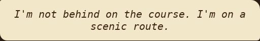

---

# C54: Write a study joke (6 of 10)
`🍬 candy` · `✍️ content` · Task

**Reward:** 1 🪙 · **Time:** about 5 min  
**Good to know first:** nothing, everything is explained

### What to do
The study page at http://localhost:8000/study/ says "Studie? Ahaha, nei." and shows a random excuse for not studying. Every reload, a new one. Add your own joke or excuse to the pile. One or two sentences: funny beats long.

### Files to change (only these)
- new: `ifiplatform/apps/study_app/joke_files/joke_06.txt`

### Solution to start from
Make the file `ifiplatform/apps/study_app/joke_files/joke_06.txt` with this inside, then change it to your own:
```
Today's goal: one chapter. Today's result: one very clean room.
```

#### Explanation (optional)
- The page reads every `joke_NN.txt` file in the `joke_files` folder, and picks one at random each time it's opened.
- Just the joke, as plain text. No heading, no quotes around it.
- It shows exactly as you write it, so English or Norwegian are both fine.

### Make it yours
Write your own! Some ideas:
- "My keyboard knows Ctrl+Z better than I know the syllabus."
- "I learn best under pressure. So I wait for maximum pressure."
- "The textbook is 600 pages. My motivation is 6."

Keep it kind: no real people. And keep the exact file name from the list above: another person is writing a joke in each of the other files.

### Done when
- Your joke shows on http://localhost:8000/study/?joke=06 (the `?joke=06` shows your file's joke; without it, the page picks one at random).

### How to work on it
Set up the project on your own computer first (see **Get started** in the README). Then:

1. **Claim this issue** on the site: https://halloween.ifiplattform.no/commits/issues/
2. In the VS Code terminal:
   ```bash
   ifi fix-issue {number}
   ```
3. Make the change, and check it at http://localhost:8000. Reload with **Ctrl+Shift+R** (Mac: **Cmd+Shift+R**): a normal reload may show the old look, because the browser keeps old copies of CSS files and pictures. Still old? Try a private window.
4. Then:
   ```bash
   ifi test
   git add .
   git commit -m "Short description of what you changed"
   ifi pull-request
   ```

**Only change the files listed above.** Then your pull request can't clash with anyone else's. After the merge it can take a few minutes before it shows on the live site. Stuck? Ask a helper, or type `ifi help`.

#### What it looks like when it's done
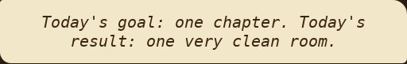

---

# C55: Write a study joke (7 of 10)
`🍬 candy` · `✍️ content` · Task

**Reward:** 1 🪙 · **Time:** about 5 min  
**Good to know first:** nothing, everything is explained

### What to do
The study page at http://localhost:8000/study/ says "Studie? Ahaha, nei." and shows a random excuse for not studying. Every reload, a new one. Add your own joke or excuse to the pile. One or two sentences: funny beats long.

### Files to change (only these)
- new: `ifiplatform/apps/study_app/joke_files/joke_07.txt`

### Solution to start from
Make the file `ifiplatform/apps/study_app/joke_files/joke_07.txt` with this inside, then change it to your own:
```
I put all my notes in the cloud. Now they're up there, and I'm down here.
```

#### Explanation (optional)
- The page reads every `joke_NN.txt` file in the `joke_files` folder, and picks one at random each time it's opened.
- Just the joke, as plain text. No heading, no quotes around it.
- It shows exactly as you write it, so English or Norwegian are both fine.

### Make it yours
Write your own! Some ideas:
- "The oblig is due tomorrow. Tomorrow-me is so stressed."
- "I tried studying in the library. Woke up in the library."
- "Recursion: see recursion. Studying: see tomorrow."

Keep it kind: no real people. And keep the exact file name from the list above: another person is writing a joke in each of the other files.

### Done when
- Your joke shows on http://localhost:8000/study/?joke=07 (the `?joke=07` shows your file's joke; without it, the page picks one at random).

### How to work on it
Set up the project on your own computer first (see **Get started** in the README). Then:

1. **Claim this issue** on the site: https://halloween.ifiplattform.no/commits/issues/
2. In the VS Code terminal:
   ```bash
   ifi fix-issue {number}
   ```
3. Make the change, and check it at http://localhost:8000. Reload with **Ctrl+Shift+R** (Mac: **Cmd+Shift+R**): a normal reload may show the old look, because the browser keeps old copies of CSS files and pictures. Still old? Try a private window.
4. Then:
   ```bash
   ifi test
   git add .
   git commit -m "Short description of what you changed"
   ifi pull-request
   ```

**Only change the files listed above.** Then your pull request can't clash with anyone else's. After the merge it can take a few minutes before it shows on the live site. Stuck? Ask a helper, or type `ifi help`.

#### What it looks like when it's done


---

# C56: Write a study joke (8 of 10)
`🍬 candy` · `✍️ content` · Task

**Reward:** 1 🪙 · **Time:** about 5 min  
**Good to know first:** nothing, everything is explained

### What to do
The study page at http://localhost:8000/study/ says "Studie? Ahaha, nei." and shows a random excuse for not studying. Every reload, a new one. Add your own joke or excuse to the pile. One or two sentences: funny beats long.

### Files to change (only these)
- new: `ifiplatform/apps/study_app/joke_files/joke_08.txt`

### Solution to start from
Make the file `ifiplatform/apps/study_app/joke_files/joke_08.txt` with this inside, then change it to your own:
```
My brain has too many tabs open, and none of them are the lecture.
```

#### Explanation (optional)
- The page reads every `joke_NN.txt` file in the `joke_files` folder, and picks one at random each time it's opened.
- Just the joke, as plain text. No heading, no quotes around it.
- It shows exactly as you write it, so English or Norwegian are both fine.

### Make it yours
Write your own! Some ideas:
- "I'll start fresh on Monday. Which Monday is still unclear."
- "My code has comments. Mostly apologies."
- "Exam tip: if you don't know the answer, write 'it depends'."

Keep it kind: no real people. And keep the exact file name from the list above: another person is writing a joke in each of the other files.

### Done when
- Your joke shows on http://localhost:8000/study/?joke=08 (the `?joke=08` shows your file's joke; without it, the page picks one at random).

### How to work on it
Set up the project on your own computer first (see **Get started** in the README). Then:

1. **Claim this issue** on the site: https://halloween.ifiplattform.no/commits/issues/
2. In the VS Code terminal:
   ```bash
   ifi fix-issue {number}
   ```
3. Make the change, and check it at http://localhost:8000. Reload with **Ctrl+Shift+R** (Mac: **Cmd+Shift+R**): a normal reload may show the old look, because the browser keeps old copies of CSS files and pictures. Still old? Try a private window.
4. Then:
   ```bash
   ifi test
   git add .
   git commit -m "Short description of what you changed"
   ifi pull-request
   ```

**Only change the files listed above.** Then your pull request can't clash with anyone else's. After the merge it can take a few minutes before it shows on the live site. Stuck? Ask a helper, or type `ifi help`.

#### What it looks like when it's done


---

# C57: Write a study joke (9 of 10)
`🍬 candy` · `✍️ content` · Task

**Reward:** 1 🪙 · **Time:** about 5 min  
**Good to know first:** nothing, everything is explained

### What to do
The study page at http://localhost:8000/study/ says "Studie? Ahaha, nei." and shows a random excuse for not studying. Every reload, a new one. Add your own joke or excuse to the pile. One or two sentences: funny beats long.

### Files to change (only these)
- new: `ifiplatform/apps/study_app/joke_files/joke_09.txt`

### Solution to start from
Make the file `ifiplatform/apps/study_app/joke_files/joke_09.txt` with this inside, then change it to your own:
```
I don't have a study method. I have a study mood, and it's 'later'.
```

#### Explanation (optional)
- The page reads every `joke_NN.txt` file in the `joke_files` folder, and picks one at random each time it's opened.
- Just the joke, as plain text. No heading, no quotes around it.
- It shows exactly as you write it, so English or Norwegian are both fine.

### Make it yours
Write your own! Some ideas:
- "Sleep, study, social life: pick two. I picked sleep twice."
- "My laptop battery lasts longer than my focus."
- "The best time to start was last week. The second best time is after lunch."

Keep it kind: no real people. And keep the exact file name from the list above: another person is writing a joke in each of the other files.

### Done when
- Your joke shows on http://localhost:8000/study/?joke=09 (the `?joke=09` shows your file's joke; without it, the page picks one at random).

### How to work on it
Set up the project on your own computer first (see **Get started** in the README). Then:

1. **Claim this issue** on the site: https://halloween.ifiplattform.no/commits/issues/
2. In the VS Code terminal:
   ```bash
   ifi fix-issue {number}
   ```
3. Make the change, and check it at http://localhost:8000. Reload with **Ctrl+Shift+R** (Mac: **Cmd+Shift+R**): a normal reload may show the old look, because the browser keeps old copies of CSS files and pictures. Still old? Try a private window.
4. Then:
   ```bash
   ifi test
   git add .
   git commit -m "Short description of what you changed"
   ifi pull-request
   ```

**Only change the files listed above.** Then your pull request can't clash with anyone else's. After the merge it can take a few minutes before it shows on the live site. Stuck? Ask a helper, or type `ifi help`.

#### What it looks like when it's done


---

# C58: Write a study joke (10 of 10)
`🍬 candy` · `✍️ content` · Task

**Reward:** 1 🪙 · **Time:** about 5 min  
**Good to know first:** nothing, everything is explained

### What to do
The study page at http://localhost:8000/study/ says "Studie? Ahaha, nei." and shows a random excuse for not studying. Every reload, a new one. Add your own joke or excuse to the pile. One or two sentences: funny beats long.

### Files to change (only these)
- new: `ifiplatform/apps/study_app/joke_files/joke_10.txt`

### Solution to start from
Make the file `ifiplatform/apps/study_app/joke_files/joke_10.txt` with this inside, then change it to your own:
```
I'm not procrastinating. I'm giving my brain time to download the syllabus.
```

#### Explanation (optional)
- The page reads every `joke_NN.txt` file in the `joke_files` folder, and picks one at random each time it's opened.
- Just the joke, as plain text. No heading, no quotes around it.
- It shows exactly as you write it, so English or Norwegian are both fine.

### Make it yours
Write your own! Some ideas:
- "There are 10 kinds of students: those who study, and those who read jokes on the study page."
- "I studied so hard I forgot what I studied."
- "My to-do list has a to-do list."

Keep it kind: no real people. And keep the exact file name from the list above: another person is writing a joke in each of the other files.

### Done when
- Your joke shows on http://localhost:8000/study/?joke=10 (the `?joke=10` shows your file's joke; without it, the page picks one at random).

### How to work on it
Set up the project on your own computer first (see **Get started** in the README). Then:

1. **Claim this issue** on the site: https://halloween.ifiplattform.no/commits/issues/
2. In the VS Code terminal:
   ```bash
   ifi fix-issue {number}
   ```
3. Make the change, and check it at http://localhost:8000. Reload with **Ctrl+Shift+R** (Mac: **Cmd+Shift+R**): a normal reload may show the old look, because the browser keeps old copies of CSS files and pictures. Still old? Try a private window.
4. Then:
   ```bash
   ifi test
   git add .
   git commit -m "Short description of what you changed"
   ifi pull-request
   ```

**Only change the files listed above.** Then your pull request can't clash with anyone else's. After the merge it can take a few minutes before it shows on the live site. Stuck? Ask a helper, or type `ifi help`.

#### What it looks like when it's done
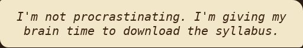

---

# C6: Small, underlined menu links on the home page
`🍬 candy` · `🎨 restyle` · Feature

**Reward:** 1 🪙 · **Time:** about 5 min  
**Good to know first:** nothing, everything is explained

### What to do
On the home page, above the big shortcut cards, there's a row of menu links (Nyheter, Infoartikler, Studentforeninger...). Make them small, in capital letters and underlined.

### Files to change (only these)
- `ifiplatform/static/css/07_halloween/subnav.css` (empty, already loaded on every page)

### Solution to start from
Paste this into the file:
```css
.home-navbar .link .drop-option {
    font-size: 0.85rem;
    text-decoration: underline;
    text-transform: uppercase;
    letter-spacing: 0.05em;
}
```

#### Explanation (optional)
- `.home-navbar .link .drop-option` means: the menu titles in the row (`.drop-option` inside a `.link` inside the `.home-navbar`). The links in the menus that drop down when you hover aren't inside a `.link`, so they keep their look.
- `text-transform: uppercase` shows the text in capitals, without changing the text itself.
- `letter-spacing` spreads the capitals out a little, so they're easier to read.

### Make it yours
- Even smaller (`0.75rem`), or a dotted underline: `text-decoration: underline dotted;`.

### Done when
- The menu row on the home page is small, in capitals and underlined, and the menus still drop down when you hover over them.

### How to work on it
Set up the project on your own computer first (see **Get started** in the README). Then:

1. **Claim this issue** on the site: https://halloween.ifiplattform.no/commits/issues/
2. In the VS Code terminal:
   ```bash
   ifi fix-issue {number}
   ```
3. Make the change, and check it at http://localhost:8000. Reload with **Ctrl+Shift+R** (Mac: **Cmd+Shift+R**): a normal reload may show the old look, because the browser keeps old copies of CSS files and pictures. Still old? Try a private window.
4. Then:
   ```bash
   ifi test
   git add .
   git commit -m "Short description of what you changed"
   ifi pull-request
   ```

**Only change the files listed above.** Then your pull request can't clash with anyone else's. After the merge it can take a few minutes before it shows on the live site. Stuck? Ask a helper, or type `ifi help`.

#### What it looks like when it's done


---

# C7: A dark teal side menu
`🍬 candy` · `🎨 restyle` · Feature

**Reward:** 1 🪙 · **Time:** about 5 min  
**Good to know first:** nothing, everything is explained

### What to do
The side menu on the left (the strip with ☰) is bright turquoise. Make it a darker, spookier teal.

### Files to change (only these)
- `ifiplatform/static/css/07_halloween/sidemenu.css` (empty, already loaded on every page)

### Solution to start from
Paste this into the file:
```css
.sidemenu_container,
.sidemenu {
    background-color: #0f6e74;
}
```

#### Explanation (optional)
- `.sidemenu_container` is the strip that runs all the way down the page, and `.sidemenu` is the menu inside it that stays put when you scroll. Both need the colour, or you see two shades.

### Make it yours
- Another colour: `#6b4a8a` is a dusky purple, `#4f7a55` a mossy green. Not so dark that the black ☰ icon disappears.
- **Pick your own colour:** in VS Code, every colour code in a `.css` file has a small coloured square in front of it. Click the square to get a colour picker; the code changes as you pick. Or search "color picker" on Google, choose a colour, and copy the **HEX** code (the one that starts with `#`, like `#ff7518`).

### Done when
- The side menu is dark teal from top to bottom, and it still opens when you hover over it.

### How to work on it
Set up the project on your own computer first (see **Get started** in the README). Then:

1. **Claim this issue** on the site: https://halloween.ifiplattform.no/commits/issues/
2. In the VS Code terminal:
   ```bash
   ifi fix-issue {number}
   ```
3. Make the change, and check it at http://localhost:8000. Reload with **Ctrl+Shift+R** (Mac: **Cmd+Shift+R**): a normal reload may show the old look, because the browser keeps old copies of CSS files and pictures. Still old? Try a private window.
4. Then:
   ```bash
   ifi test
   git add .
   git commit -m "Short description of what you changed"
   ifi pull-request
   ```

**Only change the files listed above.** Then your pull request can't clash with anyone else's. After the merge it can take a few minutes before it shows on the live site. Stuck? Ask a helper, or type `ifi help`.

#### What it looks like when it's done
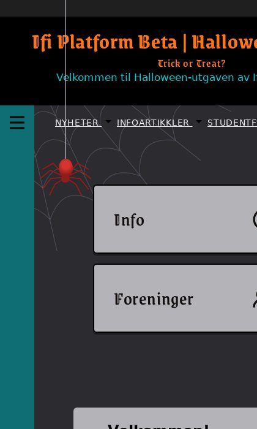

---

# C8: Grey shortcut cards with a black border
`🍬 candy` · `🎨 restyle` · Feature

**Reward:** 1 🪙 · **Time:** about 6 min  
**Good to know first:** nothing, everything is explained

### What to do
The six big shortcut cards on the home page (Info, Nyheter, Foreninger...) are pale turquoise. Make them grey like old tombstones, with a black border.

### Files to change (only these)
- `ifiplatform/static/css/07_halloween/shortcut_cards.css` (empty, already loaded on every page)

### Solution to start from
Paste this into the file:
```css
#home-shortcuts .shortcut-card {
    background-color: #b4b4b8;
    border: 2px solid #000;
    border-radius: 6px;
    box-shadow: 0 3px 0 rgba(0, 0, 0, 0.35);
}

#home-shortcuts .shortcut-card:is(:hover, :has(:focus-visible)) {
    background-color: #c6c6ca;
}
```

#### Explanation (optional)
- `#home-shortcuts .shortcut-card` is each card inside the shortcuts block.
- `border: 2px solid #000` is a black border, 2 pixels thick, all round.
- `box-shadow: 0 3px 0 ...` is a hard shadow just under the card, so it looks a bit raised.
- The second rule makes a card a lighter grey when the mouse is over it (`:hover`), or when you reach a link in it with the Tab key (`:has(:focus-visible)`). Without it, the card would turn turquoise again on hover.

### Make it yours
- Another grey: `#9a9aa0` is darker, `#d0d0d4` lighter. Keep the black text easy to read.
- Rounder corners: a bigger `border-radius`, like `14px`.
- **Pick your own colour:** in VS Code, every colour code in a `.css` file has a small coloured square in front of it. Click the square to get a colour picker; the code changes as you pick. Or search "color picker" on Google, choose a colour, and copy the **HEX** code (the one that starts with `#`, like `#ff7518`).

### Done when
- All six cards are grey with a black border, a bit lighter on hover, and the text is easy to read.

### How to work on it
Set up the project on your own computer first (see **Get started** in the README). Then:

1. **Claim this issue** on the site: https://halloween.ifiplattform.no/commits/issues/
2. In the VS Code terminal:
   ```bash
   ifi fix-issue {number}
   ```
3. Make the change, and check it at http://localhost:8000. Reload with **Ctrl+Shift+R** (Mac: **Cmd+Shift+R**): a normal reload may show the old look, because the browser keeps old copies of CSS files and pictures. Still old? Try a private window.
4. Then:
   ```bash
   ifi test
   git add .
   git commit -m "Short description of what you changed"
   ifi pull-request
   ```

**Only change the files listed above.** Then your pull request can't clash with anyone else's. After the merge it can take a few minutes before it shows on the live site. Stuck? Ask a helper, or type `ifi help`.

#### What it looks like when it's done


---

# C9: Shortcut titles in the spooky font
`🍬 candy` · `🎨 restyle` · Feature

**Reward:** 1 🪙 · **Time:** about 5 min  
**Good to know first:** nothing, everything is explained

### What to do
Write the titles on the six shortcut cards on the home page (Info, Nyheter, Foreninger...) in the spooky font.

### Files to change (only these)
- `ifiplatform/static/css/07_halloween/shortcut_titles.css` (empty, already loaded on every page)

### Solution to start from
Paste this into the file:
```css
#home-shortcuts .shortcut-title {
    font-family: var(--font-spooky);
    font-weight: 500;
    letter-spacing: 0.02em;
}
```

#### Explanation (optional)
- `.shortcut-title` is the title on each card.
- `var(--font-spooky)` is the spooky font, Grenze Gotisch, already loaded on every page.
- `font-weight: 500` makes it a little less bold than the cards' normal bold text: the spooky font is thick enough already.

### Make it yours
- Fully bold: `font-weight: 700`.
- Make the titles a bit bigger: `font-size: 1.1em;`. On a narrow window a long title like "Stillingsannonser" then switches to its short version sooner.

### Done when
- The six card titles are in the spooky font, on a wide and on a narrow window.

### How to work on it
Set up the project on your own computer first (see **Get started** in the README). Then:

1. **Claim this issue** on the site: https://halloween.ifiplattform.no/commits/issues/
2. In the VS Code terminal:
   ```bash
   ifi fix-issue {number}
   ```
3. Make the change, and check it at http://localhost:8000. Reload with **Ctrl+Shift+R** (Mac: **Cmd+Shift+R**): a normal reload may show the old look, because the browser keeps old copies of CSS files and pictures. Still old? Try a private window.
4. Then:
   ```bash
   ifi test
   git add .
   git commit -m "Short description of what you changed"
   ifi pull-request
   ```

**Only change the files listed above.** Then your pull request can't clash with anyone else's. After the merge it can take a few minutes before it shows on the live site. Stuck? Ask a helper, or type `ifi help`.

#### What it looks like when it's done
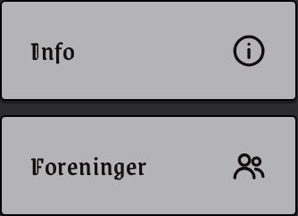

---

# K1: Cobweb in the top-left corner
`🍫 chocolate` · `🖼️ art` · Feature

**Reward:** 2 🪙 + 2 🏆 · **Time:** about 10 min  
**Good to know first:** basic CSS (backgrounds). The SVG is given

### What to do
Hang a cobweb in the top-left corner of every page, behind everything else.

### Files to change (only these)
- new: `ifiplatform/static/images/halloween/cobweb.svg`
- `ifiplatform/static/css/07_halloween/cobweb.css` (empty, already loaded on every page)

### What you get
The web itself. Make the file `ifiplatform/static/images/halloween/cobweb.svg` with this inside:
```html
<svg xmlns="http://www.w3.org/2000/svg" width="420" height="420" viewBox="0 0 420 420" fill="none" stroke="#8a8494" stroke-opacity="0.35" stroke-width="1.2">
  <line x1="0" y1="0" x2="420" y2="0"/>
  <line x1="0" y1="0" x2="409" y2="93"/>
  <line x1="0" y1="0" x2="378" y2="182"/>
  <line x1="0" y1="0" x2="328" y2="262"/>
  <line x1="0" y1="0" x2="262" y2="328"/>
  <line x1="0" y1="0" x2="182" y2="378"/>
  <line x1="0" y1="0" x2="93" y2="409"/>
  <line x1="0" y1="0" x2="0" y2="420"/>
  <path d="M52,0 Q45,5 51,12 Q42,15 47,23 Q38,24 41,33 Q32,32 33,41 Q24,38 23,47 Q15,42 12,51 Q5,45 0,52"/>
  <path d="M105,0 Q89,10 102,23 Q85,30 95,46 Q76,48 82,65 Q63,63 65,82 Q48,76 46,95 Q30,85 23,102 Q10,89 0,105"/>
  <path d="M158,0 Q134,15 154,35 Q127,44 142,68 Q114,72 123,98 Q95,95 98,123 Q72,114 68,142 Q44,127 35,154 Q15,134 0,158"/>
  <path d="M210,0 Q178,20 205,47 Q169,59 189,91 Q152,95 164,131 Q127,127 131,164 Q95,152 91,189 Q59,169 47,205 Q20,178 0,210"/>
  <path d="M262,0 Q223,25 256,58 Q212,74 237,114 Q190,119 205,164 Q159,159 164,205 Q119,190 114,237 Q74,212 58,256 Q25,223 0,262"/>
  <path d="M315,0 Q268,30 307,70 Q254,89 284,137 Q228,143 246,196 Q190,190 196,246 Q143,228 137,284 Q89,254 70,307 Q30,268 0,315"/>
  <path d="M368,0 Q312,35 358,82 Q296,104 331,159 Q266,167 287,229 Q222,222 229,287 Q167,266 159,331 Q104,296 82,358 Q35,312 0,368"/>
</svg>
```

#### Explanation (optional)
It's drawn with lines from the corner (`<line>`) and curved rings (`<path>` with `Q` curves).

### Your part
Put the web on the page with CSS in `cobweb.css`. Use it as a **background image on `body`**:
- `background-image: url(...)`: the path from the CSS file to the picture is `../../images/halloween/cobweb.svg`
- `background-repeat`: only one web, please
- `background-position`: the top-left corner
- leave out `background-attachment: fixed`: then the web hangs at the top of the page and scrolls away with it, like a real web in a corner

### Make it yours
- **Colour:** `stroke="#8a8494"` and `stroke-opacity="0.35"` in the SVG make a faint grey web that shows on both the dark home page and the light pages. Try paler (`#c8c3d2`) or darker.
- **Size:** `background-size: 300px` makes it smaller. Or add more rings to the SVG.
- **Pick your own colour:** search "color picker" on Google, choose a colour, and copy the **HEX** code (the one that starts with `#`, like `#ff7518`). Paste it between the quotes, for example `fill="#ff7518"`.

### Done when
- Every page has one faint web in the top-left corner, behind the text, that doesn't cover anything.

### How to work on it
Set up the project on your own computer first (see **Get started** in the README). Then:

1. **Claim this issue** on the site: https://halloween.ifiplattform.no/commits/issues/
2. In the VS Code terminal:
   ```bash
   ifi fix-issue {number}
   ```
3. Make the change, and check it at http://localhost:8000. Reload with **Ctrl+Shift+R** (Mac: **Cmd+Shift+R**): a normal reload may show the old look, because the browser keeps old copies of CSS files and pictures. Still old? Try a private window.
4. Then:
   ```bash
   ifi test
   git add .
   git commit -m "Short description of what you changed"
   ifi pull-request
   ```

**Only change the files listed above.** Then your pull request can't clash with anyone else's. After the merge it can take a few minutes before it shows on the live site. Stuck? Ask a helper, or type `ifi help`.

#### What it looks like when it's done


---

# K10: Halloween pictures for the Instagram row
`🍫 chocolate` · `🖼️ art` · Feature

**Reward:** 2 🪙 + 2 🏆 · **Time:** about 12 min · **Part of the set** SET-right  
**Good to know first:** basic HTML, and drawing simple SVG shapes

### What to do
The "Ifi on Instagram" row under the news on the home page shows five grey placeholders that say "Picture 1" to "Picture 5". Replace them with five Halloween pictures, each with a caption.

### Files to change (only these)
- `ifiplatform/apps/ifi_home_app/templates/home/partials/right_column/instagram.html`
- `ifiplatform/static/images/halloween/instagram/tile1.svg`
- `ifiplatform/static/images/halloween/instagram/tile2.svg`
- `ifiplatform/static/images/halloween/instagram/tile3.svg`
- `ifiplatform/static/images/halloween/instagram/tile4.svg`
- `ifiplatform/static/images/halloween/instagram/tile5.svg`

### What you get
Each tile is a 160 × 200 SVG picture. Here is a finished one, a pumpkin, to start `tile1.svg` with:
```html
<svg xmlns="http://www.w3.org/2000/svg" width="160" height="200" viewBox="0 0 160 200">
  <rect width="160" height="200" fill="#1d1830"/>
  <rect x="76" y="58" width="8" height="18" rx="3" fill="#3f7a2a"/>
  <ellipse cx="80" cy="118" rx="54" ry="44" fill="#ff7518"/>
  <path d="M58 104 l10 -14 l10 14 z M92 104 l10 -14 l10 14 z" fill="#ffd34d"/>
  <path d="M54 126 q26 22 52 0 l-8 8 l-6 -6 l-6 8 l-6 -8 l-6 8 l-6 -8 l-6 6 z" fill="#ffd34d"/>
</svg>
```

#### Explanation (optional)
- The first `<rect>` is the dark background, the second the stem. The `<ellipse>` is the pumpkin.
- A `<path>` draws a shape: `M` moves the pen, `l` draws a line *relative* to where the pen is, `q` a curve, and `z` closes the shape. The eyes are two triangles, the mouth a curve with teeth.

### Your part
1. **Draw tiles 2 to 5** in the same way, each with its own background colour. Ideas: a ghost (a rounded `<path>` with two dark eyes), a bat in front of the full moon, a spider in its web, a wrapped candy, a skull, a cauldron. Simple shapes are plenty.
2. **Captions and alt texts** in `instagram.html`: each tile has an `` with an `alt` and a `<span class="insta-cap">` with a caption. Replace "Picture 1" etc.:
   - `alt` says what's **in** the picture, for people who can't see it ("A grinning jack-o-lantern").
   - The caption is the fun Instagram text ("The pumpkin carving won.").
   - Keep `` around both, and don't change the classes or the `` paths.

### Make it yours
- Draw in Inkscape or Figma instead, and export as SVG. Keep each file small (under about 10 KB).

### Done when
- Five different Halloween pictures show in the row, each with a caption and an alt text that describes it.

### How to work on it
Set up the project on your own computer first (see **Get started** in the README). Then:

1. **Claim this issue** on the site: https://halloween.ifiplattform.no/commits/issues/
2. In the VS Code terminal:
   ```bash
   ifi fix-issue {number}
   ```
3. Make the change, and check it at http://localhost:8000. Reload with **Ctrl+Shift+R** (Mac: **Cmd+Shift+R**): a normal reload may show the old look, because the browser keeps old copies of CSS files and pictures. Still old? Try a private window.
4. Then:
   ```bash
   ifi test
   git add .
   git commit -m "Short description of what you changed"
   ifi pull-request
   ```

**Only change the files listed above.** Then your pull request can't clash with anyone else's. After the merge it can take a few minutes before it shows on the live site. Stuck? Ask a helper, or type `ifi help`.

#### What it looks like when it's done


---

# K11: Draw the >OUTPUT Halloween cover
`🍫 chocolate` · `🖼️ art` · Feature

**Reward:** 2 🪙 + 2 🏆 · **Time:** about 12 min · **Part of the set** SET-right  
**Good to know first:** drawing simple SVG shapes, or a drawing program like Inkscape or Figma

### What to do
The >OUTPUT box at the bottom of the home page's right column shows a grey placeholder that says "cover coming soon". Draw a Halloween cover for Ifi's student magazine.

### Files to change (only these)
- `ifiplatform/static/images/halloween/output_cover.svg`

### What you get
The cover is 300 × 400. Replace what's in the file with this start: a dark night, the magazine's name and a subtitle.
```html
<svg xmlns="http://www.w3.org/2000/svg" width="300" height="400" viewBox="0 0 300 400">
  <rect width="300" height="400" fill="#15121c"/>
  <text x="24" y="58" font-family="monospace" font-size="40" font-weight="700" fill="#ff7518">&gt;OUTPUT</text>
  <text x="24" y="84" font-family="monospace" font-size="15" fill="#f2eff6">The Halloween issue</text>
</svg>
```

#### Explanation (optional)
- `<text>` writes text at `x`, `y` (the bottom left of the text). `&gt;` is how you write `>` inside SVG.
- Things later in the file are drawn on top of things earlier in it.

### Your part
Draw the cover's picture under the title. Use at least four shapes (`<circle>`, `<rect>`, `<ellipse>`, `<path>`). Ideas:
- a full moon with craters, and a row of hills or gravestones along the bottom,
- a laptop with a ghost coming out of the screen,
- a pumpkin wearing headphones.

Add a third line of small text at the bottom, like a cover story: "Ghosts in the machine · p. 13".

Keep the title readable: don't draw over it.

### Make it yours
- Draw in Inkscape or Figma, and export as SVG (under about 20 KB).

### Done when
- The >OUTPUT box on the home page shows your Halloween cover, with the title easy to read.

### How to work on it
Set up the project on your own computer first (see **Get started** in the README). Then:

1. **Claim this issue** on the site: https://halloween.ifiplattform.no/commits/issues/
2. In the VS Code terminal:
   ```bash
   ifi fix-issue {number}
   ```
3. Make the change, and check it at http://localhost:8000. Reload with **Ctrl+Shift+R** (Mac: **Cmd+Shift+R**): a normal reload may show the old look, because the browser keeps old copies of CSS files and pictures. Still old? Try a private window.
4. Then:
   ```bash
   ifi test
   git add .
   git commit -m "Short description of what you changed"
   ifi pull-request
   ```

**Only change the files listed above.** Then your pull request can't clash with anyone else's. After the merge it can take a few minutes before it shows on the live site. Stuck? Ask a helper, or type `ifi help`.

#### What it looks like when it's done


---

# K12: Click "Trick or Treat?" for a trick or a treat
`🍫 chocolate` · `🦇 silly feature` · Feature

**Reward:** 2 🪙 + 2 🏆 · **Time:** about 10 min  
**Good to know first:** JavaScript basics (click events, arrays, Math.random, setTimeout)

### What to do
"Trick or Treat?" under the site name in the header is a button, but clicking it does nothing. Make it answer: a random trick or treat shows in its place for a few seconds, then the question comes back.

### Files to change (only these)
- `ifiplatform/static/js/halloween/trick_or_treat.js` (empty, already loaded on every page)

### What you get
Start the file with this. It finds the button and remembers its text:
```js
// Click "Trick or Treat?" in the header: a random trick or treat shows for
// a few seconds, then the question comes back.
document.addEventListener("DOMContentLoaded", () => {
  const tagline = document.querySelector(".header-tagline");
  if (!tagline) {
    return;
  }
  const question = tagline.textContent.trim();
  const tricks = [
    "Trick! Your next commit message is now in Latin.",
  ];
  const treats = [
    "Treat! 🍬 A bug fixes itself.",
  ];

  // TODO: your part
});
```

#### Explanation (optional)
- `DOMContentLoaded` waits until the page's HTML is there, so the button can be found.
- `querySelector(".header-tagline")` finds the first element with that class.
- `question` keeps the original text ("Trick or Treat?" or the Norwegian version), to put back later.

### Your part
1. Add at least two more tricks and two more treats.
2. When the button is clicked (`addEventListener("click", ...)`): pick tricks or treats at random (`Math.random() < 0.5`), then a random line from that list (`Math.floor(Math.random() * list.length)`), and show it as the button's `textContent`.
3. After 4 seconds (`setTimeout`), put `question` back. A second click while an answer shows should start the 4 seconds over: `clearTimeout`.
4. Screen readers don't notice text that changes by itself. `tagline.setAttribute("aria-live", "polite")` makes them read the new text.

### Make it yours
- A treat that actually does something, like turning the logo green for a moment.
- Never the same answer twice in a row.

### Done when
- Clicking "Trick or Treat?" shows a random trick or treat, and after a few seconds the question is back.

### How to work on it
Set up the project on your own computer first (see **Get started** in the README). Then:

1. **Claim this issue** on the site: https://halloween.ifiplattform.no/commits/issues/
2. In the VS Code terminal:
   ```bash
   ifi fix-issue {number}
   ```
3. Make the change, and check it at http://localhost:8000. Reload with **Ctrl+Shift+R** (Mac: **Cmd+Shift+R**): a normal reload may show the old look, because the browser keeps old copies of CSS files and pictures. Still old? Try a private window.
4. Then:
   ```bash
   ifi test
   git add .
   git commit -m "Short description of what you changed"
   ifi pull-request
   ```

**Only change the files listed above.** Then your pull request can't clash with anyone else's. After the merge it can take a few minutes before it shows on the live site. Stuck? Ask a helper, or type `ifi help`.

#### What it looks like when it's done


*After a click on "Trick or Treat?".*

---

# K13: A secret word makes the whole page spin
`🍫 chocolate` · `🦇 silly feature` · Feature

**Reward:** 2 🪙 + 2 🏆 · **Time:** about 11 min  
**Good to know first:** JavaScript basics (keyboard events, strings, if)

### What to do
Hide a secret on every page: when someone types **boo** on the keyboard (not in a text field), the whole page spins around once.

### Files to change (only these)
- `ifiplatform/static/js/halloween/spooky_code.js` (empty, already loaded on every page)

### What you get
The spin itself. This line turns the whole page around once in 1.5 seconds:
```js
page.animate([{ rotate: "0deg" }, { rotate: "360deg" }], { duration: 1500, easing: "ease-in-out" });
```
where `page` is `document.querySelector(".page-layout")`, the box around everything on the page.

#### Explanation (optional)
- `element.animate(keyframes, options)` plays an animation straight from JavaScript, without any CSS: from `0deg` to `360deg`, one full turn.

### Your part
Write `spooky_code.js`:
1. Wait for the page: `document.addEventListener("DOMContentLoaded", () => { ... });`.
2. Listen for keys on the whole page: `document.addEventListener("keydown", (event) => { ... })`. `event.key` is the key, like `"b"`.
3. **Ignore typing in fields:** if `event.target.closest("input, textarea, select")` finds something, stop (`return`). Otherwise typing "boo" in a search box would spin the page.
4. **Remember the last three keys** in a string, for example `typed = (typed + event.key.toLowerCase()).slice(-3)`. When `typed` is `"boo"`, spin the page and empty `typed`.
5. **Animations off:** some people turn animations off because movement makes them dizzy. If `window.matchMedia("(prefers-reduced-motion: reduce)").matches` is true, don't spin.

### Make it yours
- Your own secret word (keep it short, and tell a helper so they can test it).
- Spin the other way, or twice: `720deg`.

### Done when
- Typing b, o, o anywhere on a page (not in a field) spins the page once. Typing it in a text field does nothing. With animations turned off, nothing moves.

### How to work on it
Set up the project on your own computer first (see **Get started** in the README). Then:

1. **Claim this issue** on the site: https://halloween.ifiplattform.no/commits/issues/
2. In the VS Code terminal:
   ```bash
   ifi fix-issue {number}
   ```
3. Make the change, and check it at http://localhost:8000. Reload with **Ctrl+Shift+R** (Mac: **Cmd+Shift+R**): a normal reload may show the old look, because the browser keeps old copies of CSS files and pictures. Still old? Try a private window.
4. Then:
   ```bash
   ifi test
   git add .
   git commit -m "Short description of what you changed"
   ifi pull-request
   ```

**Only change the files listed above.** Then your pull request can't clash with anyone else's. After the merge it can take a few minutes before it shows on the live site. Stuck? Ask a helper, or type `ifi help`.

#### What it looks like when it's done


*Halfway through the spin, after typing b o o.*

---

# K14: Pages go Halloween: the article page
`🍫 chocolate` · `🎨 restyle` · Feature

**Reward:** 2 🪙 + 2 🏆 · **Time:** about 10 min · **Part of the set** SET-pages  
**Good to know first:** basic CSS (selectors, colours, borders)

### What to do
Give the article page a Halloween look. Open it at any article, for example from Nyheter on the home page and keep it open while you work.

### Files to change (only these)
- `ifiplatform/static/css/07_halloween/article_page.css` (empty, already loaded on every page)

### What you get
Start with this rule, which only touches this page:
```css
.article-page h1 {
    color: #ff7518;
}
```

### Design to build
The look: **old parchment, with blood-red details**. You don't have to come up with a design: build this one. Rather design your own? Go ahead, see "Make it yours".
- **The article column** (`.article-page`): parchment yellow `#f3e7c9`, with dark brown text `#3b2412`.
- **The title** (`.article-page h1`): pumpkin orange `#ff7518`.
- **Headings in the article** (`.article-page h2`): dark red `#6b1d1d`, with a 2px solid black line under them.
- **Links** (`.article-page a`): blood red `#a3130f`. On hover, a red glow: `text-shadow: 0 0 6px rgba(255, 60, 40, 0.7)`.
- **The date and author line** (`.article-meta-item`): brown `#6b4a2b`, in italics.

### Your part
Build the design above in the file, one rule per selector. The selectors are already in the page's HTML:
- `.article-page`: the whole article column
- `.article-page h1`: the title
- `.article-page h2`: the headings inside the article
- `.article-page a`: links
- `.article-meta-item`: the date and author line

Useful properties: `background`, `color`, `border`, `border-radius`, `box-shadow`, `font-family`, `text-shadow`.

### Make it yours
Your own design instead of the one above, or on top of it. Some ideas:
- A haunted newspaper: black page, white text, the title in a big bold font, headings with a black line above and below.
- Slime: dark green page, light green text, links that look like drips (`text-decoration: underline wavy`).
- A spooky font from Google Fonts for the headings. That needs a font link in another file, so ask a helper first.

### Done when
- The page looks clearly Halloween, and all the text is still easy to read.
- Other pages don't change. Check the home page.

### How to work on it
Set up the project on your own computer first (see **Get started** in the README). Then:

1. **Claim this issue** on the site: https://halloween.ifiplattform.no/commits/issues/
2. In the VS Code terminal:
   ```bash
   ifi fix-issue {number}
   ```
3. Make the change, and check it at http://localhost:8000. Reload with **Ctrl+Shift+R** (Mac: **Cmd+Shift+R**): a normal reload may show the old look, because the browser keeps old copies of CSS files and pictures. Still old? Try a private window.
4. Then:
   ```bash
   ifi test
   git add .
   git commit -m "Short description of what you changed"
   ifi pull-request
   ```

**Only change the files listed above.** Then your pull request can't clash with anyone else's. After the merge it can take a few minutes before it shows on the live site. Stuck? Ask a helper, or type `ifi help`.

#### What it looks like when it's done


---

# K15: Pages go Halloween: the event page
`🍫 chocolate` · `🎨 restyle` · Feature

**Reward:** 2 🪙 + 2 🏆 · **Time:** about 10 min · **Part of the set** SET-pages  
**Good to know first:** basic CSS (selectors, colours, borders)

### What to do
Give the event page a Halloween look. Open it at any event, for example from "Happening at Ifi" on the home page and keep it open while you work.

### Files to change (only these)
- `ifiplatform/static/css/07_halloween/event_page.css` (empty, already loaded on every page)

### What you get
Start with this rule, which only touches this page:
```css
.event-page h1 {
    color: #ff7518;
}
```

### Design to build
The look: **an event ticket, with a ghost**. You don't have to come up with a design: build this one. Rather design your own? Go ahead, see "Make it yours".
- **The title** (`.event-page h1`): pumpkin orange `#ff7518`, with a 👻 in front of it (`.event-page h1::before { content: "👻 "; }`).
- **The date, time and place** (`.event-meta`): a ticket: a 2px solid black border, corners rounded 6px, a little space inside (`padding: 0.6rem 0.9rem`).
- **The badge above the title** (`.event-type-badge`): an orange glow around it: `box-shadow: 0 0 8px rgba(255, 117, 24, 0.6)`.
- **The sign-up links** (`.event-signup-link`): orange buttons: background `#ff7518`, dark text `#1f1f1f`, corners rounded 6px, `padding: 0.2rem 0.6rem`.

### Your part
Build the design above in the file, one rule per selector. The selectors are already in the page's HTML:
- `.event-page`: the whole event page
- `.event-page h1`: the title
- `.event-meta`: the date, time and place
- `.event-type-badge`: the small badge above the title
- `.event-signup-link`: the sign-up links

Useful properties: `background`, `color`, `border`, `border-radius`, `box-shadow`, `font-family`, `text-shadow`.

### Make it yours
Your own design instead of the one above, or on top of it. Some ideas:
- A wanted poster: a yellowed background, the title in big capitals (`text-transform: uppercase`), the date in a black box.
- A night sky: dark blue page, pale yellow text, the badge glowing like a star.
- The 👻 swapped for 🎃 or 🦇, or one emoji on each side of the title (`::after`).

### Done when
- The page looks clearly Halloween, and all the text is still easy to read.
- Other pages don't change. Check the home page.

### How to work on it
Set up the project on your own computer first (see **Get started** in the README). Then:

1. **Claim this issue** on the site: https://halloween.ifiplattform.no/commits/issues/
2. In the VS Code terminal:
   ```bash
   ifi fix-issue {number}
   ```
3. Make the change, and check it at http://localhost:8000. Reload with **Ctrl+Shift+R** (Mac: **Cmd+Shift+R**): a normal reload may show the old look, because the browser keeps old copies of CSS files and pictures. Still old? Try a private window.
4. Then:
   ```bash
   ifi test
   git add .
   git commit -m "Short description of what you changed"
   ifi pull-request
   ```

**Only change the files listed above.** Then your pull request can't clash with anyone else's. After the merge it can take a few minutes before it shows on the live site. Stuck? Ask a helper, or type `ifi help`.

#### What it looks like when it's done
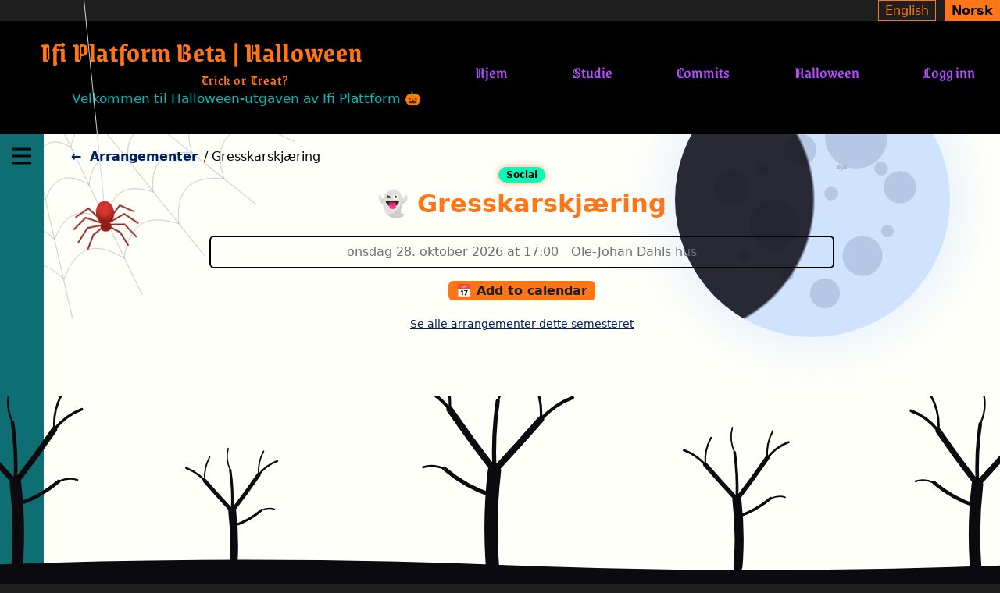

---

# K16: Pages go Halloween: the log-in and sign-up pages
`🍫 chocolate` · `🎨 restyle` · Feature

**Reward:** 2 🪙 + 2 🏆 · **Time:** about 10 min · **Part of the set** SET-pages  
**Good to know first:** basic CSS (selectors, colours, borders)

### What to do
Give the log-in and sign-up pages a Halloween look. Open it at http://localhost:8000/account/login and http://localhost:8000/account/signin (log out first) and keep it open while you work.

### Files to change (only these)
- `ifiplatform/static/css/07_halloween/auth_pages.css` (empty, already loaded on every page)

### What you get
Start with this rule, which only touches this page:
```css
.auth-card h1 {
    color: #ff7518;
}
```

### Design to build
The look: **a gravestone**. You don't have to come up with a design: build this one. Rather design your own? Go ahead, see "Make it yours".
- **The card** (`.auth-card`): a grey gravestone, `#9a9aa3`, with dark text `#111111`. Round on top, square at the bottom: `border-radius: 50% 50% 8px 8px / 30% 30% 8px 8px`. A 2px solid black border all round, and extra space on top so the title isn't in the curve: `padding-top: 3rem`.
- **The title** (`.auth-card h1`): pumpkin orange `#ff7518`, centred.
- **A text field you click in** (`.auth-card input:focus`): orange, `outline` and `border-color` both `#ff7518`.
- **The button** (`.auth-card .btn`): dark `#1f1f1f`, with orange text `#ff7518` and a 2px solid black border.
- **The links under the form** (`.auth-links a`): dark purple `#3b0a5a`.

### Your part
Build the design above in the file, one rule per selector. The selectors are already in the page's HTML:
- `.auth-card`: the box around the form
- `.auth-card h1`: the title
- `.auth-card input`: the text fields
- `.auth-card .btn`: the button
- `.auth-links`: the links under the form

Two things the site's own CSS already does, which you'll want to override:
- The card has a thick pink line on top. Giving `.auth-card` one `border` replaces it.
- A text field you click in gets a turquoise `border-color`. If you change the `outline` colour, change `border-color` too, or the field gets two colours.

Useful properties: `background`, `color`, `border`, `border-radius`, `box-shadow`, `font-family`, `text-shadow`.

### Make it yours
Your own design instead of the one above, or on top of it. Some ideas:
- A coffin instead of a gravestone: narrow at the top and bottom, wide at the shoulders (`clip-path: polygon(...)`).
- A haunted mirror: an oval card (`border-radius: 50%`) with a silver-grey background.
- Green slime: dark green card, light green fields, the button dripping (a wavy bottom border is hard, so try a box-shadow).

### Done when
- The page looks clearly Halloween, and all the text is still easy to read.
- Other pages don't change. Check the home page.

### How to work on it
Set up the project on your own computer first (see **Get started** in the README). Then:

1. **Claim this issue** on the site: https://halloween.ifiplattform.no/commits/issues/
2. In the VS Code terminal:
   ```bash
   ifi fix-issue {number}
   ```
3. Make the change, and check it at http://localhost:8000. Reload with **Ctrl+Shift+R** (Mac: **Cmd+Shift+R**): a normal reload may show the old look, because the browser keeps old copies of CSS files and pictures. Still old? Try a private window.
4. Then:
   ```bash
   ifi test
   git add .
   git commit -m "Short description of what you changed"
   ifi pull-request
   ```

**Only change the files listed above.** Then your pull request can't clash with anyone else's. After the merge it can take a few minutes before it shows on the live site. Stuck? Ask a helper, or type `ifi help`.

#### What it looks like when it's done


---

# K17: Pages go Halloween: the study page
`🍫 chocolate` · `🎨 restyle` · Feature

**Reward:** 2 🪙 + 2 🏆 · **Time:** about 10 min · **Part of the set** SET-pages  
**Good to know first:** basic CSS (selectors, colours, borders)

### What to do
Give the study page a Halloween look. On this site the study section is "under development", and http://localhost:8000/study/ shows a joke page: "Studie? Ahaha, nei." with a random excuse. Keep it open while you work.

### Files to change (only these)
- `ifiplatform/static/css/07_halloween/study_home.css` (empty, already loaded on every page)

### What you get
Start with this rule, which only touches this page:
```css
.under-development h1 {
    color: #ff7518;
}
```

### Design to build
The look: **a cursed library: dark wood, candlelight and an old scroll**. You don't have to come up with a design: build this one. Rather design your own? Go ahead, see "Make it yours".
- **The box** (`.under-development`): dark wood `#2a1d14`, with candle-yellow text `#ffe9a8`, corners rounded 8px, `padding: 2rem 1.5rem`.
- **The title** (`.under-development h1`): pumpkin orange `#ff7518`.
- **The "under development" line** (`.under-development-status`): old gold `#d9b77a`.
- **The excuse** (`.under-development-joke`): an old scroll: parchment `#f3e7c9`, dark brown text `#3b2412`, uneven corners (`border-radius: 4px 18px 6px 14px`), `padding: 1rem 1.2rem`.
- **The link** (`.under-development a`): lantern orange `#ffb15c`, with a glow on hover: `text-shadow: 0 0 8px rgba(255, 177, 92, 0.9)`.

### Your part
Build the design above in the file, one rule per selector. The selectors are already in the page's HTML:
- `.under-development`: the whole box with the joke
- `.under-development h1`: the title
- `.under-development-status`: the "under development" line
- `.under-development-joke`: the random excuse
- `.under-development a`: the "give me another excuse" link

Useful properties: `background`, `color`, `border`, `border-radius`, `box-shadow`, `font-family`, `text-shadow`.

### Make it yours
Your own design instead of the one above, or on top of it. Some ideas:
- A chalkboard: dark green box, white chalky text, the excuse in a slightly tilted box (`transform: rotate(-1deg)`).
- A ghost's diary: a white page with faint blue lines (`repeating-linear-gradient`), handwritten-looking italics.
- Candles: an orange glow around the whole box (`box-shadow`), flickering with a slow `@keyframes` (and still with reduced motion).

### Done when
- http://localhost:8000/study/ looks clearly Halloween, and all the text is still easy to read.
- Other pages don't change. Check the home page.

### How to work on it
Set up the project on your own computer first (see **Get started** in the README). Then:

1. **Claim this issue** on the site: https://halloween.ifiplattform.no/commits/issues/
2. In the VS Code terminal:
   ```bash
   ifi fix-issue {number}
   ```
3. Make the change, and check it at http://localhost:8000. Reload with **Ctrl+Shift+R** (Mac: **Cmd+Shift+R**): a normal reload may show the old look, because the browser keeps old copies of CSS files and pictures. Still old? Try a private window.
4. Then:
   ```bash
   ifi test
   git add .
   git commit -m "Short description of what you changed"
   ifi pull-request
   ```

**Only change the files listed above.** Then your pull request can't clash with anyone else's. After the merge it can take a few minutes before it shows on the live site. Stuck? Ask a helper, or type `ifi help`.

#### What it looks like when it's done


---

# K19: `python manage.py carve_pumpkin`
`🍫 chocolate` · `🧪 python` · Feature

**Reward:** 2 🪙 + 2 🏆 · **Time:** about 10 min  
**Good to know first:** basic Python (loops, strings)

### What to do
Make a new management command that prints a jack-o'-lantern in the terminal:
```
$ python manage.py carve_pumpkin --size 3
```

### Files to change (only these)
- new: `ifiplatform/apps/halloween_app/management/commands/carve_pumpkin.py`

### What you get
Start the file with this. It already works and prints a stem:
```python
"""python manage.py carve_pumpkin [--size N]: prints a jack-o'-lantern."""

from django.core.management.base import BaseCommand


class Command(BaseCommand):
    help = "Prints a jack-o'-lantern in the terminal."

    def add_arguments(self, parser):
        parser.add_argument("--size", type=int, default=3, help="How wide the pumpkin is (1-6).")

    def handle(self, *args, **options):
        size = max(1, min(options["size"], 6))
        width = 6 + size * 4
        self.stdout.write(" " * (width // 2) + "|")
        # TODO: print the pumpkin
```

#### Explanation (optional)
- Django finds the command by its file name: `carve_pumpkin.py` becomes `manage.py carve_pumpkin`.
- `self.stdout.write(...)` prints one line.

### Your part
Replace the TODO with a loop that prints the pumpkin, line by line, `width` characters wide:
- a round top and bottom, for example `/` and `\` at the ends of the first line,
- two eyes (`^ ^` or `▲ ▲`) in the middle of one line,
- a mouth with teeth (`\/\/\/`) a few lines lower.

Tip: `"^ ^".center(width - 2)` puts text in the middle of a line.

### Make it yours
- An extra option, like `--face scary` or `--face happy`, with `parser.add_argument`.
- Colour: `self.style.WARNING(line)` prints a line in yellow-orange.

### Done when
- `python manage.py carve_pumpkin` prints a pumpkin, and `--size 1` and `--size 6` give a small and a big one.

### How to work on it
Set up the project on your own computer first (see **Get started** in the README). Then:

1. **Claim this issue** on the site: https://halloween.ifiplattform.no/commits/issues/
2. In the VS Code terminal:
   ```bash
   ifi fix-issue {number}
   ```
3. Make the change, and check it at http://localhost:8000. Reload with **Ctrl+Shift+R** (Mac: **Cmd+Shift+R**): a normal reload may show the old look, because the browser keeps old copies of CSS files and pictures. Still old? Try a private window.
4. Then:
   ```bash
   ifi test
   git add .
   git commit -m "Short description of what you changed"
   ifi pull-request
   ```

**Only change the files listed above.** Then your pull request can't clash with anyone else's. After the merge it can take a few minutes before it shows on the live site. Stuck? Ask a helper, or type `ifi help`.

#### What it looks like when it's done
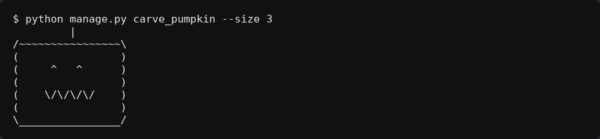

*Terminal output.*

---

# K2: Scary trees above the footer
`🍫 chocolate` · `🖼️ art` · Feature

**Reward:** 2 🪙 + 2 🏆 · **Time:** about 11 min  
**Good to know first:** basic CSS (backgrounds). Some SVG is given

### What to do
Scroll to the bottom of any page: right above the footer there's an empty strip (`<div class="treeline">`). Fill it with a row of black, bare, scary trees.

### Files to change (only these)
- new: `ifiplatform/static/images/halloween/trees.svg`
- `ifiplatform/static/css/07_halloween/treeline.css` (empty, already loaded on every page)

### What you get
One tree, and the ground. Start the file `ifiplatform/static/images/halloween/trees.svg` with this:
```html
<svg xmlns="http://www.w3.org/2000/svg" width="1600" height="260" viewBox="0 0 1600 260" preserveAspectRatio="xMidYMax slice">
  <defs>
    <g id="tree" fill="none" stroke="#0b0a0f" stroke-linecap="round">
      <path d="M0,260 Q5,200 -2,140" stroke-width="16"/>
      <path d="M-2,140 Q-30,110 -58,78" stroke-width="8"/>
      <path d="M-58,78 Q-75,60 -96,52" stroke-width="4"/>
      <path d="M-58,78 Q-60,52 -48,30" stroke-width="3"/>
      <path d="M-2,140 Q26,104 52,66" stroke-width="8"/>
      <path d="M52,66 Q68,46 90,38" stroke-width="4"/>
      <path d="M52,66 Q50,40 62,18" stroke-width="3"/>
      <path d="M-2,140 Q0,96 -6,56" stroke-width="5"/>
      <path d="M-6,56 Q-16,34 -10,12" stroke-width="2.5"/>
      <path d="M1,170 Q32,160 58,138" stroke-width="5"/>
      <path d="M58,138 Q72,132 84,136" stroke-width="2.5"/>
    </g>
  </defs>
  <path d="M0,260 L0,238 Q400,218 800,234 T1600,230 L1600,260 Z" fill="#0b0a0f"/>
  <use href="#tree" transform="translate(130 -20)"/>
</svg>
```

#### Explanation (optional)
- Inside `<defs>`, the tree is defined once, as a group (`<g id="tree">`) of branches. Each branch is a curved line (`Q`), thinner the higher it goes. Things in `<defs>` don't show by themselves.
- The `<path ... fill="#0b0a0f"/>` after it is the dark ground along the bottom.
- `<use href="#tree">` draws a copy of the tree. `translate(130 -20)` moves it: 130 to the right, and 20 up so its foot stands on the ground.
- `preserveAspectRatio="xMidYMax slice"` keeps the trees standing on the bottom edge, however wide the window is.

### Your part
1. **A forest:** add at least 3 more `<use>` lines, spread over the 1600 wide picture. Make them different:
   - `scale(0.7)` makes a smaller tree. A smaller tree needs a bigger second number in `translate` to reach the ground: with scale `s`, use `translate(x, 240 - 260 * s)`.
   - `scale(-1 1)` flips a tree left to right.
2. **The CSS** in `treeline.css`: give `.treeline` a height (about `15rem`), a little space above it, and the trees as its background: `url(...)` with the path `../../images/halloween/trees.svg`, `center bottom`, `cover` and `no-repeat`.

### Make it yours
- More branches: copy a `<path>` in the tree and change its numbers.
- A full moon or a few bats behind the trees: a `<circle>` or 🦇 text before the first `<use>`.

### Done when
- At the bottom of every page, a row of at least four black trees stands above the footer, and nothing is cut off on a wide or a narrow window.

### How to work on it
Set up the project on your own computer first (see **Get started** in the README). Then:

1. **Claim this issue** on the site: https://halloween.ifiplattform.no/commits/issues/
2. In the VS Code terminal:
   ```bash
   ifi fix-issue {number}
   ```
3. Make the change, and check it at http://localhost:8000. Reload with **Ctrl+Shift+R** (Mac: **Cmd+Shift+R**): a normal reload may show the old look, because the browser keeps old copies of CSS files and pictures. Still old? Try a private window.
4. Then:
   ```bash
   ifi test
   git add .
   git commit -m "Short description of what you changed"
   ifi pull-request
   ```

**Only change the files listed above.** Then your pull request can't clash with anyone else's. After the merge it can take a few minutes before it shows on the live site. Stuck? Ask a helper, or type `ifi help`.

#### What it looks like when it's done
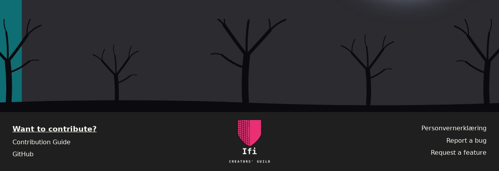

---

# K20: A template filter that makes text spooky
`🍫 chocolate` · `🧪 python` · Feature

**Reward:** 2 🪙 + 2 🏆 · **Time:** about 11 min  
**Good to know first:** basic Python (loops, strings). Template filters are explained

### What to do
Make a Django **template filter** called `spooky` that turns text into haunted text, and show it on the Halloween corner's front page (http://localhost:8000/halloween/):

`{{ "Welcome to the Halloween corner"|spooky }}` → **WeLcOmE tO tHe HaLlOwEeN cOrNeR... 👻**

### Files to change (only these)
- new: `ifiplatform/apps/halloween_app/templatetags/spooky.py`
- `ifiplatform/apps/halloween_app/templates/halloween/partials/spooky_demo.html` (empty, already shown on the front page)

### What you get
Start `spooky.py` with this. It already works, but doesn't change the text yet:
```python
"""{{ text|spooky }}: makes text look haunted."""

from django import template

register = template.Library()


@register.filter
def spooky(text):
    """ "Welcome to the corner" -> "WeLcOmE tO tHe CoRnEr... 👻": every other
    letter a capital, then a ghost."""
    # TODO
    return str(text)
```
And put this in `spooky_demo.html`:
```html


<p class="hc-spooky-demo">{{ welcome|spooky }}</p>
```

#### Explanation (optional)
- A filter is a Python function that a template can use with `|`. `@register.filter` makes it one, and `` loads it, by the file's name.
- Django finds the file because it's in the app's `templatetags` folder.
- `` puts the (translated) text in a variable first, so the filter can work on it.

### Your part
Replace the TODO:
1. Go through the text letter by letter. Every other **letter** becomes a capital (`.upper()`), the others small (`.lower()`), starting with a capital. Spaces and punctuation don't count, so they don't break the pattern: `letter.isalpha()` tells you whether it's a letter.
2. Put `... 👻` at the end.

Restart the server if Django says the filter doesn't exist: new `templatetags` files are only found when it starts.

### Make it yours
- Your own spooky style: `o` → `0`, a random 👻 between words, or dripping letters with combining characters.
- An argument: `{{ text|spooky:"🦇" }}` picks the emoji at the end (`def spooky(text, emoji="👻")`).

### Done when
- The Halloween corner's front page shows "WeLcOmE tO tHe HaLlOwEeN cOrNeR... 👻" (on the Norwegian site, the Norwegian text in the same style).

### How to work on it
Set up the project on your own computer first (see **Get started** in the README). Then:

1. **Claim this issue** on the site: https://halloween.ifiplattform.no/commits/issues/
2. In the VS Code terminal:
   ```bash
   ifi fix-issue {number}
   ```
3. Make the change, and check it at http://localhost:8000. Reload with **Ctrl+Shift+R** (Mac: **Cmd+Shift+R**): a normal reload may show the old look, because the browser keeps old copies of CSS files and pictures. Still old? Try a private window.
4. Then:
   ```bash
   ifi test
   git add .
   git commit -m "Short description of what you changed"
   ifi pull-request
   ```

**Only change the files listed above.** Then your pull request can't clash with anyone else's. After the merge it can take a few minutes before it shows on the live site. Stuck? Ask a helper, or type `ifi help`.

#### What it looks like when it's done


---

# K21: "X days to Halloween" on the events page
`🍫 chocolate` · `🧪 python` · Feature

**Reward:** 2 🪙 + 2 🏆 · **Time:** about 10 min  
**Good to know first:** basic Python (dates, if). Template tags are explained

### What to do
On the events page (Arrangementer, http://localhost:8000/nb/arrangementer/), show how many days are left until Halloween, right under the heading: "🎃 12 days to Halloween". On Halloween itself: "🎃 It's Halloween!".

### Files to change (only these)
- new: `ifiplatform/apps/halloween_app/templatetags/countdown_tags.py`
- `ifiplatform/apps/ifi_home_app/templates/events/partials/halloween_countdown.html` (empty, already shown on the events page)

### What you get
Start `countdown_tags.py` with:
```python
""": how many days until the next 31 October."""

from datetime import date, datetime
from zoneinfo import ZoneInfo

from django import template

register = template.Library()


@register.simple_tag
def days_to_halloween():
    """0 on Halloween itself, otherwise the days until the next one."""
    today = datetime.now(ZoneInfo("Europe/Oslo")).date()
    # TODO
    return 0
```
And put this in `halloween_countdown.html`:
```html


<p class="halloween-countdown">
    
        🎃 
    
        🎃 {{ days }} day to Halloween{{ days }} days to Halloween
    
</p>
```

#### Explanation (optional)
- `@register.simple_tag` turns the function into a template tag, and `` loads it by the file's name. `` puts its answer in `days`.
- `ZoneInfo("Europe/Oslo")` makes "today" Norwegian today: the server's clock runs on UTC.
- `` picks "1 day" or "2 days" by the number.

### Your part
Replace the TODO:
1. Make this year's Halloween: `date(today.year, 10, 31)`.
2. If it's already over (before today), use next year's instead.
3. Return how many days are between them. Subtracting two dates gives a `timedelta`, and `.days` is its number of days.

Restart the server if Django says the tag doesn't exist: new `templatetags` files are only found when it starts.

### Make it yours
- Different text for the last week: "Only 3 days left! 😱".
- Count down to something else too, like the next Friday the 13th.

### Done when
- The events page shows the right number of days to Halloween, and "1 day" without an s the day before.

### How to work on it
Set up the project on your own computer first (see **Get started** in the README). Then:

1. **Claim this issue** on the site: https://halloween.ifiplattform.no/commits/issues/
2. In the VS Code terminal:
   ```bash
   ifi fix-issue {number}
   ```
3. Make the change, and check it at http://localhost:8000. Reload with **Ctrl+Shift+R** (Mac: **Cmd+Shift+R**): a normal reload may show the old look, because the browser keeps old copies of CSS files and pictures. Still old? Try a private window.
4. Then:
   ```bash
   ifi test
   git add .
   git commit -m "Short description of what you changed"
   ifi pull-request
   ```

**Only change the files listed above.** Then your pull request can't clash with anyone else's. After the merge it can take a few minutes before it shows on the live site. Stuck? Ask a helper, or type `ifi help`.

#### What it looks like when it's done


---

# K22: The costume generator
`🍫 chocolate` · `🦇 silly feature` · Feature

**Reward:** 2 🪙 + 2 🏆 · **Time:** about 11 min  
**Good to know first:** basic Python (lists, random), Django templates basics (``)

### What to do
The costume generator at http://localhost:8000/halloween/costume/ has a **Give me a costume** button, but nothing happens when you press it. Make it give a random costume, like "A tiny haunted printer on roller skates".

### Files to change (only these)
- `ifiplatform/apps/halloween_app/views/costume.py`
- `ifiplatform/apps/halloween_app/templates/halloween/costume.html`
- `ifiplatform/apps/halloween_app/static/css/halloween_pages/costume.css` (empty, already loaded on the page)

### What's already there
- `views/costume.py` has three lists, `LOOKS`, `CREATURES` and `EXTRAS`, with one word each, and a function `make_costume()` that returns `None`, with two `TODO`s. The view already calls it when the button is pressed, and passes the result to the template as `costume`.
- `costume.html` has the heading and the button, and a `TODO` where the costume should show.

### Design to build
The look: **a card in a dark wardrobe**. You don't have to come up with a design: build this one. Rather design your own? Go ahead, see "Make it yours".
- **The button** (`.costume-form button`): a pumpkin-orange pill: background `#ff7518`, black text, bold, a black border `2px solid #000`, `border-radius: 999px`, padding `0.7rem 1.4rem`. A lighter orange `#ffb15c` on hover.
- **The costume card** (`.costume-result`): at most `30rem` wide, dark purple `#2b1f3a` with light text `#f2eff6`, a black border `2px solid #000`, rounded corners `6px`, padding `1.5rem`, centred text, space above and below.
- **The line above the costume** (`.costume-result__label`): light purple `#cbaaff`, italic.
- **The costume** (`.costume-result__text`): big (`1.5rem`) and bold.

### Your part
1. **TODO 1:** add at least 4 more words to each list.
2. **TODO 2:** in `make_costume()`, pick one word from each list with `random.choice(...)` and return a sentence: `f"A {look} {creature} {extra}"`.
3. **The template:** replace the TODO in `costume.html` with the card, only when there is a costume:
   ```html
   
       <div class="costume-result">
           <p class="costume-result__label"></p>
           <p class="costume-result__text">{{ costume }}</p>
       </div>
   
   ```
   After the first costume, the button could say **Roll again**: the template gets `rolled` (True after a press) to check.
4. **Style:** build the design above in `costume.css`.

### Make it yours
- An emoji for every creature.
- "A" or "An": "An ugly mummy" sounds better than "A ugly mummy".

### Done when
- Every press gives a random costume in a styled card, made of one word from each list.

### How to work on it
Set up the project on your own computer first (see **Get started** in the README). Then:

1. **Claim this issue** on the site: https://halloween.ifiplattform.no/commits/issues/
2. In the VS Code terminal:
   ```bash
   ifi fix-issue {number}
   ```
3. Make the change, and check it at http://localhost:8000. Reload with **Ctrl+Shift+R** (Mac: **Cmd+Shift+R**): a normal reload may show the old look, because the browser keeps old copies of CSS files and pictures. Still old? Try a private window.
4. Then:
   ```bash
   ifi test
   git add .
   git commit -m "Short description of what you changed"
   ifi pull-request
   ```

**Only change the files listed above.** Then your pull request can't clash with anyone else's. After the merge it can take a few minutes before it shows on the live site. Stuck? Ask a helper, or type `ifi help`.

#### What it looks like when it's done


---

# K27: Grey text on the grey boxes is hard to read
`🍫 chocolate` · `♿ a11y` · Bug

**Reward:** 2 🪙 + 2 🏆 · **Time:** about 10 min  
**Good to know first:** basic CSS (selectors, colours). Contrast checking is explained

### What's wrong
The boxes on the home page turned grey for Halloween, but some small texts in them were made for a white background: they're grey too. The news dates, the date on the message board, and the times in the events box are grey on grey, and the "See all events" link is turquoise on grey. People with poor eyesight, or anyone on a sunny day, can't read them.

### Files to change (only these)
- `ifiplatform/static/css/07_halloween/contrast.css` (empty, already loaded on every page, after the other Halloween files)

### How to measure it
Text needs enough **contrast**: how different its colour is from the background. The rule of thumb (WCAG) is at least **4.5 : 1** for normal text. You can measure it:
- In Chrome: right-click the text → **Inspect**. In the Styles panel, click the small coloured square next to `color`: the colour picker shows "Contrast ratio" with ✓ or ✗.
- Or type both colours into https://webaim.org/resources/contrastchecker/.

The grey boxes are `#b4b4b8`. The grey text is `#707070`: about 2.4 : 1.

### Your part
Find the low-contrast texts and give them darker colours in `contrast.css`. Right-click each one → **Inspect** to find its class. At least these:
- the date and author under each news title,
- the date on the message board,
- the times on the left in the events box, and the "sub-events" text under an event,
- the "See all events" link at the bottom of the events box.

Check each new colour: at least 4.5 : 1 on `#b4b4b8`. Very dark grey (around `#2e2e33`) works for the plain texts, and a dark teal for the link keeps it looking like a link.

Not sure the other boxes are merged yet? Your colours must also work on white, the box colour before. Dark colours work on both.

### Done when
- Every small text in the boxes on the home page measures at least 4.5 : 1, on grey and on white.

### How to work on it
Set up the project on your own computer first (see **Get started** in the README). Then:

1. **Claim this issue** on the site: https://halloween.ifiplattform.no/commits/issues/
2. In the VS Code terminal:
   ```bash
   ifi fix-issue {number}
   ```
3. Make the change, and check it at http://localhost:8000. Reload with **Ctrl+Shift+R** (Mac: **Cmd+Shift+R**): a normal reload may show the old look, because the browser keeps old copies of CSS files and pictures. Still old? Try a private window.
4. Then:
   ```bash
   ifi test
   git add .
   git commit -m "Short description of what you changed"
   ifi pull-request
   ```

**Only change the files listed above.** Then your pull request can't clash with anyone else's. After the merge it can take a few minutes before it shows on the live site. Stuck? Ask a helper, or type `ifi help`.

#### What it looks like when it's done
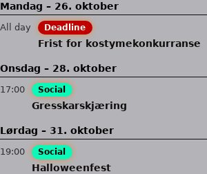

*The times, dates and "Se alle arrangementer" now readable on grey.*

---

# K28: No floating ghost for people who turned animations off
`🍫 chocolate` · `♿ a11y` · Feature

**Reward:** 2 🪙 + 2 🏆 · **Time:** about 9 min  
**Good to know first:** basic CSS. Media queries are explained

### What to do
Some people get dizzy or distracted from movement on screen, and turn animations off in their computer's settings. Websites can see that setting with `prefers-reduced-motion`. Make the Halloween decorations respect it.

### Files to change (only these)
- `ifiplatform/static/css/07_halloween/reduced_motion.css` (empty, already loaded on every page, after the other decoration files)

### What you get
```css
@media (prefers-reduced-motion: reduce) {
}
```
Everything inside these braces only applies when the visitor turned animations off.

### Your part
- Inside it, stop the floating ghost: `.ghost` gets `animation: none;`. A ghost that never moves just stays outside the window, so that's enough.
- Check the other decorations in `ifiplatform/static/css/07_halloween/` for anything else that moves (`animation` or `transition`), and switch that off too.
- **Test it.** In Chrome: DevTools (F12) → the ⋮ menu → More tools → **Rendering** → "Emulate CSS media feature prefers-reduced-motion" → `reduce`. In Firefox: `about:config` → `ui.prefersReducedMotion` = 1.

### Done when
- With reduced motion on, nothing on the page moves. With it off, the ghost floats again.

### How to work on it
Set up the project on your own computer first (see **Get started** in the README). Then:

1. **Claim this issue** on the site: https://halloween.ifiplattform.no/commits/issues/
2. In the VS Code terminal:
   ```bash
   ifi fix-issue {number}
   ```
3. Make the change, and check it at http://localhost:8000. Reload with **Ctrl+Shift+R** (Mac: **Cmd+Shift+R**): a normal reload may show the old look, because the browser keeps old copies of CSS files and pictures. Still old? Try a private window.
4. Then:
   ```bash
   ifi test
   git add .
   git commit -m "Short description of what you changed"
   ifi pull-request
   ```

**Only change the files listed above.** Then your pull request can't clash with anyone else's. After the merge it can take a few minutes before it shows on the live site. Stuck? Ask a helper, or type `ifi help`.

#### What it looks like when it's done
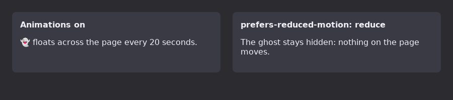

*Mock-up: what changes. A screenshot of something that doesn't move looks like nothing.*

---

# K29: 👻 The event page shows the wrong weekday
`🍫 chocolate` · `👻 haunted bug` · Bug

**Reward:** 2 🪙 + 2 🏆 · **Time:** about 8 min  
**Good to know first:** Django templates basics (variables, filters), and reading a template

### What's wrong
Open any event, for example **Halloweenfest** from "Happening at Ifi" on the home page. Under the title it says when it is, like "**mandag** 31. oktober 2026". But 31 October 2026 is a Saturday! Open another event: it shows the same wrong weekday. Come back tomorrow, and every event has moved to the next weekday. A ghost has been in the calendar...

### Files to change (only these)
- `ifiplatform/apps/ifi_home_app/templates/events/event_page.html`

### Your part
Find the bug and fix it. Hints, if you need them:
1. Look for the line in `<div class="event-meta">` that shows the date. Where does the weekday come from?
2. `` shows the **current** date and time, in the format between the quotes. What's `"l"`?
3. The event's own date is `page.event_date`. Django's `date` filter formats a date: `{{ some_date|date:"l" }}`. Look up the letters on https://docs.djangoproject.com/en/6.0/ref/templates/builtins/#date.

### Done when
- Halloweenfest says Saturday ("lørdag"), and every event shows its own weekday, whatever day it is today.

### How to work on it
Set up the project on your own computer first (see **Get started** in the README). Then:

1. **Claim this issue** on the site: https://halloween.ifiplattform.no/commits/issues/
2. In the VS Code terminal:
   ```bash
   ifi fix-issue {number}
   ```
3. Make the change, and check it at http://localhost:8000. Reload with **Ctrl+Shift+R** (Mac: **Cmd+Shift+R**): a normal reload may show the old look, because the browser keeps old copies of CSS files and pictures. Still old? Try a private window.
4. Then:
   ```bash
   ifi test
   git add .
   git commit -m "Short description of what you changed"
   ifi pull-request
   ```

**Only change the files listed above.** Then your pull request can't clash with anyone else's. After the merge it can take a few minutes before it shows on the live site. Stuck? Ask a helper, or type `ifi help`.

#### What it looks like when it's done
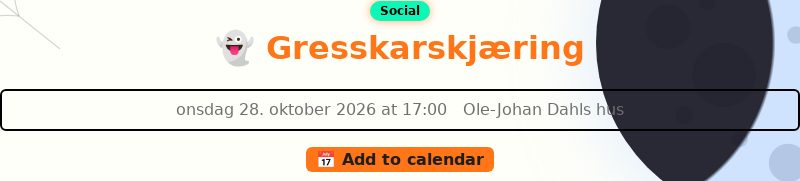

---

# K3: A ghost floats across the page
`🍫 chocolate` · `🦇 silly feature` · Feature

**Reward:** 2 🪙 + 2 🏆 · **Time:** about 10 min  
**Good to know first:** basic CSS. The animation is explained

### What to do
Every page has a ghost (`<div class="ghost">👻</div>`), but it's parked just outside the window on the left. Make it float slowly across the page now and then.

### Files to change (only these)
- `ifiplatform/static/css/07_halloween/ghost.css` (empty, already loaded on every page)

### What you get
The ghost is already `position: fixed`, `left: -6rem` (just outside the window) and `top: 55%`, in `ifiplatform/static/css/07_halloween/scaffold.css`. Don't change that file. Start `ghost.css` with:
```css
@keyframes ghost-float {
    0% {
        transform: translate(0, 0);
    }
    70% {
        transform: translate(calc(100vw + 8rem), -8rem);
    }
    100% {
        transform: translate(calc(100vw + 8rem), -8rem);
    }
}
```

#### Explanation (optional)
- `@keyframes` describes a movement: where the ghost is at 0%, 70% and 100% of the time.
- `translate(x, y)` moves it: `100vw` is the width of the window, so it crosses all the way. `-8rem` makes it rise while it flies.
- It stays outside the window from 70% to 100%: that's the pause before it comes again.

### Your part
Add a `.ghost` rule that plays the animation: `animation: <name> <how long> <timing> infinite;`. Choose:
- **How long:** 20 seconds is calm, 5 seconds is a panic.
- **Timing:** `linear` (steady) or `ease-in-out` (speeds up and slows down).
- **Opacity:** a ghost should be a bit see-through.

### Make it yours
- Add a wobble: more steps in the keyframes (say at 35%), going up and down.
- Make it bigger with `font-size`.

### Done when
- Every 20 seconds or so a ghost floats across the page and disappears on the right.
- It never blocks clicks (it already has `pointer-events: none`).

### How to work on it
Set up the project on your own computer first (see **Get started** in the README). Then:

1. **Claim this issue** on the site: https://halloween.ifiplattform.no/commits/issues/
2. In the VS Code terminal:
   ```bash
   ifi fix-issue {number}
   ```
3. Make the change, and check it at http://localhost:8000. Reload with **Ctrl+Shift+R** (Mac: **Cmd+Shift+R**): a normal reload may show the old look, because the browser keeps old copies of CSS files and pictures. Still old? Try a private window.
4. Then:
   ```bash
   ifi test
   git add .
   git commit -m "Short description of what you changed"
   ifi pull-request
   ```

**Only change the files listed above.** Then your pull request can't clash with anyone else's. After the merge it can take a few minutes before it shows on the live site. Stuck? Ask a helper, or type `ifi help`.

#### What it looks like when it's done


*The ghost, caught halfway across the page.*

---

# K30: 👻 The English button sends you to the home page
`🍫 chocolate` · `👻 haunted bug` · Bug

**Reward:** 2 🪙 + 2 🏆 · **Time:** about 8 min  
**Good to know first:** basic HTML (forms), and reading a template

### What's wrong
Open any page that isn't the home page, for example an article, and press **English** at the top right. You land on the **home page** instead of the same page in English. **Norsk** works fine. A ghost has been in the language buttons...

### Files to change (only these)
- `ifiplatform/templates/partials/select_language.html`

### Your part
Find the bug and fix it. Hints, if you need them:
1. Each language button is a small `<form>`. The hidden `<input name="next">` says where to go after switching.
2. Compare the English form with the Norsk form: what's different?
3. At the top of the file, `` works out the right address for each language.

### Done when
- On an article, pressing **English** shows the same article in English, and **Norsk** still works.

### How to work on it
Set up the project on your own computer first (see **Get started** in the README). Then:

1. **Claim this issue** on the site: https://halloween.ifiplattform.no/commits/issues/
2. In the VS Code terminal:
   ```bash
   ifi fix-issue {number}
   ```
3. Make the change, and check it at http://localhost:8000. Reload with **Ctrl+Shift+R** (Mac: **Cmd+Shift+R**): a normal reload may show the old look, because the browser keeps old copies of CSS files and pictures. Still old? Try a private window.
4. Then:
   ```bash
   ifi test
   git add .
   git commit -m "Short description of what you changed"
   ifi pull-request
   ```

**Only change the files listed above.** Then your pull request can't clash with anyone else's. After the merge it can take a few minutes before it shows on the live site. Stuck? Ask a helper, or type `ifi help`.

#### What it looks like when it's done


*After pressing English on a Norwegian article: the same article, in English. The bar on top shows the address.*

---

# K31: 👻 The Halloween corner lists its pages in a strange order
`🍫 chocolate` · `👻 haunted bug` · Bug

**Reward:** 2 🪙 + 2 🏆 · **Time:** about 9 min  
**Good to know first:** basic Python (lists, sorted, lambda), and reading code

### What's wrong
The Halloween corner's front page (http://localhost:8000/halloween/) should list the haunted notice board first, and then every other page from A to Z by its title: Bat snake, Costume generator, Countdown, Fortune teller... But the order looks random. A ghost has been sorting the cards...

### Files to change (only these)
- `ifiplatform/apps/halloween_app/hub.py`

### Your part
Find the bug and fix it. Hints, if you need them:
1. `hub_pages()` in `hub.py` decides the order. It reads the pages from `PAGES` in `ifiplatform/apps/halloween_app/pages.py` (only read that file, don't change it).
2. Every page in `PAGES` is a tuple of four things. Which four, and in which order?
3. `sorted(..., key=lambda page: ...)` sorts by whatever the `key` gives back for each page. What does it give back now?

### Done when
- The front page shows the notice board first, then the other pages from A to Z by their titles, and `ifi test` passes.

### How to work on it
Set up the project on your own computer first (see **Get started** in the README). Then:

1. **Claim this issue** on the site: https://halloween.ifiplattform.no/commits/issues/
2. In the VS Code terminal:
   ```bash
   ifi fix-issue {number}
   ```
3. Make the change, and check it at http://localhost:8000. Reload with **Ctrl+Shift+R** (Mac: **Cmd+Shift+R**): a normal reload may show the old look, because the browser keeps old copies of CSS files and pictures. Still old? Try a private window.
4. Then:
   ```bash
   ifi test
   git add .
   git commit -m "Short description of what you changed"
   ifi pull-request
   ```

**Only change the files listed above.** Then your pull request can't clash with anyone else's. After the merge it can take a few minutes before it shows on the live site. Stuck? Ask a helper, or type `ifi help`.

#### What it looks like when it's done


---

# K34: Bats fly out of the moon
`🍫 chocolate` · `🦇 silly feature` · Feature

**Reward:** 2 🪙 + 2 🏆 · **Time:** about 11 min  
**Good to know first:** basic CSS. Animations are explained

### What to do
Near the moon at the top right of every page, three bats are hiding (`<div class="bat-flock">` with three `<span>🦇</span>`), but they're see-through and don't move. Make them fly out of the moon, one after the other, again and again.

### Files to change (only these)
- `ifiplatform/static/css/07_halloween/bat_flock.css` (empty, already loaded on every page)

### What you get
The bats already sit in one spot near the moon, with `opacity: 0` (invisible), in `ifiplatform/static/css/07_halloween/scaffold.css`. Don't change that file. Start `bat_flock.css` with the flight:
```css
@keyframes bat-fly {
    0% {
        opacity: 0;
        transform: translate(0, 0) scale(0.3);
    }
    15% {
        opacity: 1;
    }
    100% {
        opacity: 0;
        transform: translate(var(--fly-x), var(--fly-y)) scale(1.3);
    }
}
```

#### Explanation (optional)
- At the start a bat is tiny (`scale(0.3)`) and invisible. It appears early on (15%), and flies to `--fly-x`, `--fly-y` while it grows, fading out at the end.
- `--fly-x` and `--fly-y` are **custom properties**: your own variables. The keyframes are the same for every bat, and each bat gets its own values, so each flies its own way.

### Your part
1. **Play it:** a rule for `.bat-flock span` with `animation: bat-fly <time> ease-in infinite;`. About 7 seconds looks calm. Make the bats bigger too (`font-size: 2.4rem`), and give them a faint moonlight glow, so the black bats show on the dark page: `filter: drop-shadow(0 0 6px rgba(207, 227, 255, 0.8))`.
2. **Give each bat a direction:** `.bat-flock span:nth-child(1)`, `(2)` and `(3)` each get their own `--fly-x` and `--fly-y`. Negative `--fly-x` flies left, towards the page; negative `--fly-y` flies up. Try values between `-30rem` and `10rem`.
3. **One after the other:** give the 2nd and 3rd bat an `animation-delay`, so they don't all leave at once.
4. **Animations off:** some people turn animations off because movement makes them dizzy. Inside `@media (prefers-reduced-motion: reduce) { }`, stop the animation. The bats then stay invisible.

### Make it yours
- A wobbly flight: more steps in the keyframes, going up and down.
- A fourth bat? There are only three spans, but `.bat-flock::before` with `content: "🦇"` can be a fourth.

### Done when
- Every few seconds a bat appears at the moon and flies off across the page, three different ways.
- With animations turned off, nothing moves.

### How to work on it
Set up the project on your own computer first (see **Get started** in the README). Then:

1. **Claim this issue** on the site: https://halloween.ifiplattform.no/commits/issues/
2. In the VS Code terminal:
   ```bash
   ifi fix-issue {number}
   ```
3. Make the change, and check it at http://localhost:8000. Reload with **Ctrl+Shift+R** (Mac: **Cmd+Shift+R**): a normal reload may show the old look, because the browser keeps old copies of CSS files and pictures. Still old? Try a private window.
4. Then:
   ```bash
   ifi test
   git add .
   git commit -m "Short description of what you changed"
   ifi pull-request
   ```

**Only change the files listed above.** Then your pull request can't clash with anyone else's. After the merge it can take a few minutes before it shows on the live site. Stuck? Ask a helper, or type `ifi help`.

#### What it looks like when it's done
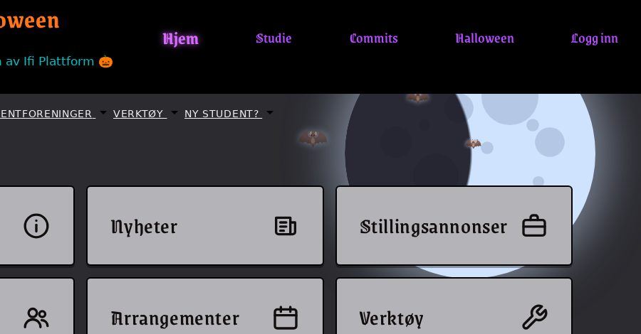

*Three bats on their way out of the moon, paused mid-flight.*

---

# K36: Rate the study excuses 👍 or 👎
`🍫 chocolate` · `🦇 silly feature` · Feature

**Reward:** 2 🪙 + 2 🏆 · **Time:** about 11 min · **Part of the set** SET-study  
**Good to know first:** JavaScript basics (the page's HTML from JS, click events, objects), localStorage and JSON are explained

### What to do
Under the excuse on the study page (http://localhost:8000/study/), add a 👍 and a 👎 button. Your vote is remembered in your own browser: when the same excuse comes up again, your vote still shows.

### Files to change (only these)
- `ifiplatform/apps/study_app/static/js/study_rate.js` (empty, already loaded on the study page)
- `ifiplatform/apps/study_app/static/css/06_components/study_rate.css` (empty, already loaded on the study page)

### What's already there
The joke is `<blockquote id="study-joke">`, and right under it is an empty `<div class="joke-tools" id="study-joke-tools">` for buttons like yours. Another issue adds a "Copy" button to the same div.

### What you get
Saving and loading the votes, safely. `localStorage` keeps text in the browser, even after a reload. It can fail (in a private window, for example), so both are wrapped in `try`/`catch`:
```js
const KEY = "study-joke-votes";

function loadVotes() {
  try {
    return JSON.parse(localStorage.getItem(KEY)) || {};
  } catch (error) {
    return {};
  }
}

function saveVotes(votes) {
  try {
    localStorage.setItem(KEY, JSON.stringify(votes));
  } catch (error) {
    // Private window or storage full: the vote just isn't remembered.
  }
}
```
`votes` is an object from the joke's text to `"up"` or `"down"`, like `{ "Coffee isn't a drink, it's a study method.": "up" }`. `JSON.stringify` turns it into text to store, and `JSON.parse` back again.

### Design to build
- **The buttons** (`.joke-rating__button`): round pills (`border-radius: 999px`), a black border `2px solid #000`, pale `#f2eff6`, the emoji at `1.3rem`, some padding, side by side with a small gap.
- **Voted:** 👍 turns green `#8de9a8` and 👎 red `#ff9f9f` while they're pressed (`[aria-pressed="true"]`).
- **The tools row** (`.joke-tools`): its buttons centred in a row that wraps (`display: flex; flex-wrap: wrap; justify-content: center; gap: 0.6rem`).

### Your part
1. **Wait for the page,** then find `#study-joke` and `#study-joke-tools`. Stop if either is missing.
2. **Make the two buttons** in JavaScript (`document.createElement("button")`) inside a `<div class="joke-rating">`, and add it to the tools div. Each button: `type="button"`, the emoji as text, an `aria-label` ("Good excuse", "Bad excuse": a screen reader can't read the meaning of 👍 reliably), and `aria-pressed="false"`.
3. **Clicking a button:** load the votes, read the joke's text **at that moment** (`joke.textContent.trim()`: another issue can swap the joke without reloading), store the vote under that text, and save. Clicking the same button again takes the vote back (`delete votes[text]`).
4. **Show the vote:** a function that sets `aria-pressed` to `"true"` on the button matching the stored vote for the current joke, and `"false"` on the other. Call it on load and after every click.
5. **Style:** build the design above in `study_rate.css`.

### Make it yours
- Keep the buttons up to date when the joke changes without a reload: a `MutationObserver` on the joke calls your show function.
- Show how many excuses you've rated so far.

### Done when
- 👍 and 👎 show under the excuse, the pressed one is coloured, and after a reload (keep reloading until the same excuse comes back, or open `?joke=` with a number) your vote is still there.
- In a private window the buttons still work, they just forget.

### How to work on it
Set up the project on your own computer first (see **Get started** in the README). Then:

1. **Claim this issue** on the site: https://halloween.ifiplattform.no/commits/issues/
2. In the VS Code terminal:
   ```bash
   ifi fix-issue {number}
   ```
3. Make the change, and check it at http://localhost:8000. Reload with **Ctrl+Shift+R** (Mac: **Cmd+Shift+R**): a normal reload may show the old look, because the browser keeps old copies of CSS files and pictures. Still old? Try a private window.
4. Then:
   ```bash
   ifi test
   git add .
   git commit -m "Short description of what you changed"
   ifi pull-request
   ```

**Only change the files listed above.** Then your pull request can't clash with anyone else's. After the merge it can take a few minutes before it shows on the live site. Stuck? Ask a helper, or type `ifi help`.

#### What it looks like when it's done
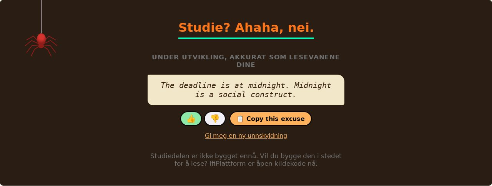

*After pressing 👍 on this excuse.*

---

# K37: A "Copy this excuse" button on the study page
`🍫 chocolate` · `🦇 silly feature` · Feature

**Reward:** 2 🪙 + 2 🏆 · **Time:** about 10 min · **Part of the set** SET-study  
**Good to know first:** JavaScript basics (the page's HTML from JS, click events), async/await is explained

### What to do
Found the perfect excuse on the study page (http://localhost:8000/study/)? Add a **📋 Copy this excuse** button under it, which puts the excuse on the clipboard, ready to paste in the group chat.

### Files to change (only these)
- `ifiplatform/apps/study_app/static/js/study_copy.js` (empty, already loaded on the study page)
- `ifiplatform/apps/study_app/static/css/06_components/study_copy.css` (empty, already loaded on the study page)

### What's already there
The joke is `<blockquote id="study-joke">`, and right under it is an empty `<div class="joke-tools" id="study-joke-tools">` for buttons like yours. Another issue adds 👍/👎 buttons to the same div.

### What you get
Copying text to the clipboard is one line, but it's **asynchronous**: the browser takes a moment, and it can say no. `await` waits for it, and `try`/`catch` catches the "no":
```js
button.addEventListener("click", async () => {
  try {
    await navigator.clipboard.writeText("the text to copy");
    // it worked
  } catch (error) {
    // the browser said no
  }
});
```
A function that uses `await` must be marked `async`, like the arrow function above.

### Design to build
- **The button** (`.joke-copy`): a lantern-orange pill: background `#ffb15c`, black text, bold, a black border `2px solid #000`, `border-radius: 999px`, padding `0.4rem 1rem`, `font: inherit`. A darker orange `#ff9a4d` on hover, and a black outline for keyboard focus (`:focus-visible`).

### Your part
1. **Wait for the page,** then find `#study-joke` and `#study-joke-tools`. Stop if either is missing.
2. **Make the button** in JavaScript: `type="button"`, the class `joke-copy`, the text "📋 Copy this excuse", and add it to the tools div.
3. **On click,** copy the joke's text **at that moment** (`joke.textContent.trim()`: another issue can swap the joke without reloading).
4. **Tell the user:** change the button's text to "✅ Copied!" for 2 seconds (`setTimeout`), then back. If copying failed, say so instead ("Couldn't copy: select the text instead"). Two quick clicks shouldn't mix up the texts: `clearTimeout`.
5. **Style:** build the design above in `study_copy.css`.

### Make it yours
- On phones, offer to share instead: `navigator.share({ text })` opens the phone's share menu, where it exists (`if (navigator.share)`).
- Copy the page's address with the excuse: `${text} (${location.href})`.

### Done when
- Clicking the button copies the excuse (paste it somewhere to check), the button says "Copied!" for a moment, and then goes back.

### How to work on it
Set up the project on your own computer first (see **Get started** in the README). Then:

1. **Claim this issue** on the site: https://halloween.ifiplattform.no/commits/issues/
2. In the VS Code terminal:
   ```bash
   ifi fix-issue {number}
   ```
3. Make the change, and check it at http://localhost:8000. Reload with **Ctrl+Shift+R** (Mac: **Cmd+Shift+R**): a normal reload may show the old look, because the browser keeps old copies of CSS files and pictures. Still old? Try a private window.
4. Then:
   ```bash
   ifi test
   git add .
   git commit -m "Short description of what you changed"
   ifi pull-request
   ```

**Only change the files listed above.** Then your pull request can't clash with anyone else's. After the merge it can take a few minutes before it shows on the live site. Stuck? Ask a helper, or type `ifi help`.

#### What it looks like when it's done


*Right after pressing Copy.*

---

# K38: Tests that keep the study jokes tidy
`🍫 chocolate` · `🧪 python` · Feature

**Reward:** 2 🪙 + 2 🏆 · **Time:** about 11 min · **Part of the set** SET-study  
**Good to know first:** basic Python (files, loops, strings), tests are explained

### What to do
Today, lots of people add a joke to the study page, each in their own file in `ifiplatform/apps/study_app/joke_files/`. Write tests that check every joke file follows the rules, so a broken or overlong joke fails the tests before it's merged.

### Files to change (only these)
- new: `ifiplatform/apps/study_app/test_joke_files.py`

### The rules
From `ifiplatform/apps/study_app/joke_files/README.md` (only read it):
- Every file in the folder, except `README.md`, is named `joke_` + two digits + `.txt`, like `joke_07.txt`.
- Each holds one joke, as text in UTF-8, and isn't empty.
- One or two sentences: at most 200 characters, and no blank lines in it.
- No joke is there twice, not even one that's already in `STUDY_JOKES` in `ifiplatform/apps/study_app/jokes.py`.

### What you get
Start the file with this. It already finds the files and checks the names:
```python
"""Keeps the study page's joke files tidy: every file in joke_files/ that
isn't the README is a joke_NN.txt with one short joke, in UTF-8, and no
joke is there twice."""

# pylint: disable=C0115,C0116
import re

from django.test import SimpleTestCase

from study_app.jokes import JOKE_FILES_DIR, STUDY_JOKES

MAX_LENGTH = 200


def joke_files():
    return sorted(path for path in JOKE_FILES_DIR.iterdir() if path.name != "README.md")


class JokeFileTests(SimpleTestCase):
    def test_file_names(self):
        for path in joke_files():
            self.assertRegex(path.name, r"^joke_\d{2}\.txt$")
```

#### Explanation (optional)
- `JOKE_FILES_DIR` is the folder, as a `Path`. `path.read_text(encoding="utf-8")` reads a file, and crashes if it isn't UTF-8: in a test, that counts as a failure, which is what we want.
- `with self.subTest(path.name):` inside a loop makes a failure say **which** file broke.
- `SimpleTestCase` is a test without a database: these tests only read files.

### Your part
Add a test for each of the other rules:
1. **UTF-8 and not empty:** `.strip()` the text and check something is left (`assertTrue`).
2. **Short:** at most `MAX_LENGTH` characters (`assertLessEqual`).
3. **One paragraph:** no blank line in the middle (`assertNotRegex(text, r"\n\s*\n")`).
4. **No joke twice:** make a list of every joke, lowercased with the spaces tidied (`re.sub(r"\s+", " ", ...)`), add `str(joke).lower()` for each of `STUDY_JOKES`, and check the list has no duplicates (compare `len(list)` with `len(set(list))`).

Run them with `ifi test`. Then **check that they catch problems:** make a test file like `joke_99.txt` that breaks a rule, see the right test fail, and delete the file again before you commit.

### Done when
- `ifi test` passes, and each rule makes a test fail when a joke file breaks it.

### How to work on it
Set up the project on your own computer first (see **Get started** in the README). Then:

1. **Claim this issue** on the site: https://halloween.ifiplattform.no/commits/issues/
2. In the VS Code terminal:
   ```bash
   ifi fix-issue {number}
   ```
3. Make the change, and check it at http://localhost:8000. Reload with **Ctrl+Shift+R** (Mac: **Cmd+Shift+R**): a normal reload may show the old look, because the browser keeps old copies of CSS files and pictures. Still old? Try a private window.
4. Then:
   ```bash
   ifi test
   git add .
   git commit -m "Short description of what you changed"
   ifi pull-request
   ```

**Only change the files listed above.** Then your pull request can't clash with anyone else's. After the merge it can take a few minutes before it shows on the live site. Stuck? Ask a helper, or type `ifi help`.

#### What it looks like when it's done
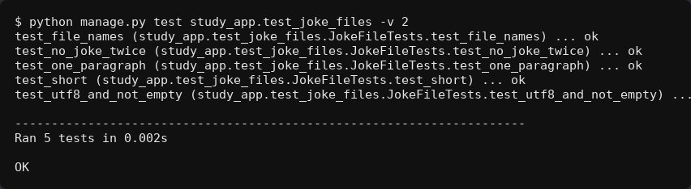

*The new tests, run against the ten joke files.*

---

# K4: Click the spider and it climbs away
`🍫 chocolate` · `🦇 silly feature` · Feature

**Reward:** 2 🪙 + 2 🏆 · **Time:** about 10 min  
**Good to know first:** JavaScript basics (click events, classes, setTimeout). The CSS is given

### What to do
Clicking the spider at the top left should startle it: it scurries up its thread, waits a moment, and comes back down.

### Files to change (only these)
- `ifiplatform/static/js/halloween/spider_click.js` (empty, already loaded on every page)
- `ifiplatform/static/css/07_halloween/spider_startled.css` (empty, already loaded on every page)

The spider itself (thread, body, legs) is drawn by the spider set's issues. If they aren't merged yet, ask a helper whether they are, or test with the spider you can see on the live site.

### What you get
The movement, in CSS. Paste this into `spider_startled.css`:
```css
.spider__body,
.spider__legs {
    pointer-events: auto;
    cursor: pointer;
}

.spider {
    transition: translate 0.35s cubic-bezier(0.3, 1.4, 0.6, 1);
}

.spider--startled {
    translate: 0 -15.5rem;
    transition-duration: 0.25s;
}

@keyframes spider-scramble {
    from {
        scale: 1 1;
    }
    to {
        scale: 0.75 1;
    }
}

.spider--startled .spider__legs {
    animation: spider-scramble 0.12s linear infinite alternate;
}

@media (prefers-reduced-motion: reduce) {
    .spider {
        transition: none;
    }

    .spider--startled .spider__legs {
        animation: none;
    }
}
```

#### Explanation (optional)
- The spider doesn't catch clicks (`pointer-events: none`, so it never blocks the page). The first rule turns clicks back on for just its body and legs.
- When the spider has the class `spider--startled`, it moves 15.5rem up (`translate`), into the dark strip above the logo, and its legs scramble. Take the class away, and the `transition` slides it back down with a little bounce.
- `translate` is a separate property from the swing's `rotate`, so climbing and swinging work at the same time.

### Your part
Write `spider_click.js`:
1. Wait until the page has loaded: `document.addEventListener("DOMContentLoaded", () => { ... });`.
2. Find the spider: `document.querySelector(".spider")`. On pages without it, stop (`return`).
3. When it's clicked (`addEventListener("click", ...)`), add the class `spider--startled` (`classList.add`).
4. After 1.5 seconds (`setTimeout`), remove the class again. If someone clicks again while it's up, it should still come down 1.5 seconds after the **last** click: `clearTimeout` helps.

### Make it yours
- A spider that hides longer each time you click it.
- Climb higher: a bigger number in `translate`.

### Done when
- Clicking the spider sends it up its thread, and it comes back down by itself. With animations turned off, it jumps instead of sliding.

### How to work on it
Set up the project on your own computer first (see **Get started** in the README). Then:

1. **Claim this issue** on the site: https://halloween.ifiplattform.no/commits/issues/
2. In the VS Code terminal:
   ```bash
   ifi fix-issue {number}
   ```
3. Make the change, and check it at http://localhost:8000. Reload with **Ctrl+Shift+R** (Mac: **Cmd+Shift+R**): a normal reload may show the old look, because the browser keeps old copies of CSS files and pictures. Still old? Try a private window.
4. Then:
   ```bash
   ifi test
   git add .
   git commit -m "Short description of what you changed"
   ifi pull-request
   ```

**Only change the files listed above.** Then your pull request can't clash with anyone else's. After the merge it can take a few minutes before it shows on the live site. Stuck? Ask a helper, or type `ifi help`.

#### What it looks like when it's done


*Right after a click: the spider has climbed up its thread.*

---

# K5: Account icon becomes a skull
`🍫 chocolate` · `🖼️ art` · Feature

**Reward:** 2 🪙 + 2 🏆 · **Time:** about 10 min  
**Good to know first:** basic HTML. The SVG shapes are explained

### What to do
Logged in, the header shows a little person icon that opens your account menu. Turn it into a skull.

### Files to change (only these)
- `ifiplatform/templates/partials/icons/account_icon.html`

### What you get
The file holds the icon as SVG: a circle (head) and a path (shoulders) in a 24×24 box. Keep the first line, `<svg class="profile-icon" viewBox="0 0 24 24" ...>`, as it is: the header CSS sizes the icon by that class. Start the skull like this, replacing the circle and the path:
```html
    <path d="M12 2a8 8 0 0 0-8 8c0 3 1.5 5 3 6v3h10v-3c1.5-1 3-3 3-6a8 8 0 0 0-8-8z" fill="currentColor"/>
```
That's the skull's outline: round on top, with a jaw at the bottom. `fill="currentColor"` gives it the same colour as the header text.

### Your part
Give the skull a face. Add, after the path:
- **Two eye sockets:** `<circle>` elements. To cut holes, give them the header's background colour (black, `fill="#000"`).
- **A nose:** a small triangle (`<path d="M... L... L... z"/>`).
- **Teeth:** two or three thin rectangles (`<rect>`) across the jaw.

The box is 24×24: the eyes go at about `y="10"`, the teeth at about `y="17"`.

### Make it yours
- Cracks in the skull, a bow on top, or glowing eyes (`fill="#ff7518"`).
- **Pick your own colour:** search "color picker" on Google, choose a colour, and copy the **HEX** code (the one that starts with `#`, like `#ff7518`). Paste it between the quotes, for example `fill="#ff7518"`.

### Done when
- Logged in, the header shows a skull, and clicking it still opens the account menu.

### How to work on it
Set up the project on your own computer first (see **Get started** in the README). Then:

1. **Claim this issue** on the site: https://halloween.ifiplattform.no/commits/issues/
2. In the VS Code terminal:
   ```bash
   ifi fix-issue {number}
   ```
3. Make the change, and check it at http://localhost:8000. Reload with **Ctrl+Shift+R** (Mac: **Cmd+Shift+R**): a normal reload may show the old look, because the browser keeps old copies of CSS files and pictures. Still old? Try a private window.
4. Then:
   ```bash
   ifi test
   git add .
   git commit -m "Short description of what you changed"
   ifi pull-request
   ```

**Only change the files listed above.** Then your pull request can't clash with anyone else's. After the merge it can take a few minutes before it shows on the live site. Stuck? Ask a helper, or type `ifi help`.

#### What it looks like when it's done
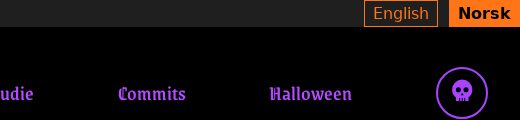

*Logged in: the account button in the header.*

---

# K6: News in a grey box, four in a row
`🍫 chocolate` · `🎨 restyle` · Feature

**Reward:** 2 🪙 + 2 🏆 · **Time:** about 10 min  
**Good to know first:** basic CSS (colours, CSS grid)

### What to do
Under "Siste nyheter" on the home page, the news cards sit in a big white box. Make the box grey like the message board, and show the cards four in a row, so more news fits.

### Files to change (only these)
- `ifiplatform/static/css/07_halloween/news_cards.css` (empty, already loaded on every page)

### What you get
The box around the cards is `.newsbar-layout`, inside `.suggestions-row`. The site's own CSS already lays out the cards with CSS grid. To win over it, your selectors need to be at least as specific, so start from this one:
```css
.home-layout .maincontent .suggestions-row .newsbar-layout {
}
```
Each card inside is an `.articlecard`, with its title in an `h3`.

### Design to build
The look: **the same grey as the message board, no frames**. You don't have to come up with a design: build this one. Rather design your own? Go ahead, see "Make it yours".
- **The box** (`.newsbar-layout`): grey `#b4b4b8`, corners rounded `6px`, and no shadow (`box-shadow: none`). No border: the news box stays without one.
- **The cards:** exactly four columns of the same width: `grid-template-columns: repeat(4, minmax(0, 1fr))`. The cards themselves get no border.
- **The titles** (`.articlecard h3`, with the same start as above): a bit smaller, `0.95rem`.
- **On a phone** (`@media (max-width: 45rem)`): two columns instead of four.

### Your part
Build the design above in `news_cards.css`. Check it at full width, and with the window made narrow.

The dev database may have only two news articles. Then two cards fill the first two of the four columns: that's right.

### Make it yours
- Three in a row instead of four.
- A spooky hover: tilt a card a little with `rotate: -1deg` on `.articlecard:hover`.

### Done when
- The news sits in a grey box without a frame, four cards in a row on a wide window and two on a narrow one, and the titles are easy to read.

### How to work on it
Set up the project on your own computer first (see **Get started** in the README). Then:

1. **Claim this issue** on the site: https://halloween.ifiplattform.no/commits/issues/
2. In the VS Code terminal:
   ```bash
   ifi fix-issue {number}
   ```
3. Make the change, and check it at http://localhost:8000. Reload with **Ctrl+Shift+R** (Mac: **Cmd+Shift+R**): a normal reload may show the old look, because the browser keeps old copies of CSS files and pictures. Still old? Try a private window.
4. Then:
   ```bash
   ifi test
   git add .
   git commit -m "Short description of what you changed"
   ifi pull-request
   ```

**Only change the files listed above.** Then your pull request can't clash with anyone else's. After the merge it can take a few minutes before it shows on the live site. Stuck? Ask a helper, or type `ifi help`.

#### What it looks like when it's done


---

# K7: Style the "Open now?" box and its badges
`🍫 chocolate` · `🎨 restyle` · Feature

**Reward:** 2 🪙 + 2 🏆 · **Time:** about 10 min  
**Good to know first:** basic CSS (selectors, colours, borders)

### What to do
At the top of the right column on the home page, the "Open now?" box lists a few places at Ifi with today's opening hours and an **Open** or **Closed** badge. Right now it's plain. Give it the Halloween look.

### Files to change (only these)
- `ifiplatform/static/css/07_halloween/opening_hours.css` (empty, already loaded on every page)

### What you get
The HTML of the box (you don't need to change it), so you know the classes:
```html
<section class="side-box hours-box">
    <h2>Open now?</h2>
    <div class="hours-place">
        <p class="hours-name">Informatikkbiblioteket</p>
        <p class="hours-today">
            Today 10:00–14:00
            <span class="hours-status hours-status--open">Open</span>
        </p>
    </div>
    ...one .hours-place per place...
</section>
```
A closed place has `hours-status--closed` instead of `hours-status--open`.

### Design to build
The look: **a grey tombstone list with traffic-light badges**. You don't have to come up with a design: build this one. Rather design your own? Go ahead, see "Make it yours".
- **The box** (`.hours-box`): grey `#b4b4b8`, a black border `2px solid #000`, corners rounded `6px`.
- **Each place** (`.hours-place`): a thin black line above it (`border-top: 1px solid #000`), a little space above and below, text a bit smaller (`0.85rem`). The first place has no line and no space above it (`.hours-place:first-of-type`).
- **The paragraphs** (`.hours-place p`): no margin.
- **The place's name** (`.hours-name`): bold.
- **The badges** (`.hours-status`): a small pill. `display: inline-block`, rounded all the way (`border-radius: 999px`), white bold text at `0.75rem`, some padding, and a little space to the left.
- **Open** (`.hours-status--open`): dark green `#0f6b30`. **Closed** (`.hours-status--closed`): dark red `#b3261e`.

### Your part
Build the design above in `opening_hours.css`.

### Make it yours
- Glowing badges: `box-shadow: 0 0 8px` in the badge's colour.
- An emoji in front of the name with `.hours-name::before { content: "🕯️ "; }`.
- Keep the white text on the badges readable: a light green or red background with white text is hard to read.

### Done when
- The box is grey with a black border, the places are separated by lines, and the Open and Closed badges are green and red pills that are easy to read.

### How to work on it
Set up the project on your own computer first (see **Get started** in the README). Then:

1. **Claim this issue** on the site: https://halloween.ifiplattform.no/commits/issues/
2. In the VS Code terminal:
   ```bash
   ifi fix-issue {number}
   ```
3. Make the change, and check it at http://localhost:8000. Reload with **Ctrl+Shift+R** (Mac: **Cmd+Shift+R**): a normal reload may show the old look, because the browser keeps old copies of CSS files and pictures. Still old? Try a private window.
4. Then:
   ```bash
   ifi test
   git add .
   git commit -m "Short description of what you changed"
   ifi pull-request
   ```

**Only change the files listed above.** Then your pull request can't clash with anyone else's. After the merge it can take a few minutes before it shows on the live site. Stuck? Ask a helper, or type `ifi help`.

#### What it looks like when it's done
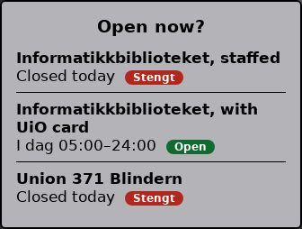

---

# K8: Fill in the real opening hours
`🍫 chocolate` · `🧪 python` · Task

**Reward:** 2 🪙 + 2 🏆 · **Time:** about 11 min  
**Good to know first:** basic Python (lists, tuples, dictionaries)

### What to do
The "Open now?" box at the top of the right column on the home page shows opening hours, but they're made up. Find the real ones and put them in.

### Files to change (only these)
- `ifiplatform/apps/ifi_home_app/opening_hours_data.py`

### What you get
The file has a list `PLACES`, with one dictionary per place:
```python
{
    "name": "Kantina, Ole-Johan Dahls hus",
    "hours": [("10:00", "15:00")] * 5 + [None, None],
},
```
- `"name"` is what the box shows.
- `"hours"` has seven entries, **Monday first**. Each is a pair `("opens", "closes")`, or `None` for closed all day.
- `[("10:00", "15:00")] * 5` is Python for "the same pair five times" (Monday to Friday), and `+ [None, None]` adds Saturday and Sunday, closed.

### Your part
1. **Find the real hours** for at least 3 places Ifi students use. Good places to look:
   - The informatics library: https://www.ub.uio.no/bibliotekene/index.html (find "Informatikk"). It has staffed hours, and longer hours with your UiO card.
   - SiO's cafés and canteens at Blindern: https://sio.no/mat-og-drikke
   - Any other place you know: a student union's room, the reading room, a café.
2. **Replace the made-up places** in `PLACES` with your places and their real hours. Keep exactly seven entries in every `"hours"` list. Days with different hours? Write all seven out: `[("08:00", "16:00"), ("08:00", "16:00"), ...]`.
3. **Say where the hours come from:** in the text at the top of the file, write the date you checked and the web pages, so the next person can check again.

### Done when
- The box on the home page shows at least 3 real places with their real hours for today.
- The top of the file says where the hours come from, and when you checked.

### How to work on it
Set up the project on your own computer first (see **Get started** in the README). Then:

1. **Claim this issue** on the site: https://halloween.ifiplattform.no/commits/issues/
2. In the VS Code terminal:
   ```bash
   ifi fix-issue {number}
   ```
3. Make the change, and check it at http://localhost:8000. Reload with **Ctrl+Shift+R** (Mac: **Cmd+Shift+R**): a normal reload may show the old look, because the browser keeps old copies of CSS files and pictures. Still old? Try a private window.
4. Then:
   ```bash
   ifi test
   git add .
   git commit -m "Short description of what you changed"
   ifi pull-request
   ```

**Only change the files listed above.** Then your pull request can't clash with anyone else's. After the merge it can take a few minutes before it shows on the live site. Stuck? Ask a helper, or type `ifi help`.

#### What it looks like when it's done


*Real hours, checked on 18 October 2026. Sunday, so two places are closed today.*

---

# K9: Style the Instagram row
`🍫 chocolate` · `🎨 restyle` · Feature

**Reward:** 2 🪙 + 2 🏆 · **Time:** about 11 min · **Part of the set** SET-right  
**Good to know first:** basic CSS (selectors, CSS grid, position)

### What to do
Under the news on the home page there's an "Ifi on Instagram" row with five pictures. Make it look like a real Instagram strip: five pictures side by side in a grey box, with the caption on top of each picture.

### Files to change (only these)
- `ifiplatform/static/css/07_halloween/instagram.css` (empty, already loaded on every page)

### What you get
The HTML (another issue changes the pictures and captions, not the classes):
```html
<section class="insta-box">
    <h2 class="insta-heading">Ifi on Instagram</h2>
    <div class="insta-row">
        <a class="insta-tile" href="...">
            
            <span class="insta-cap">The caption</span>
        </a>
        ...five tiles...
    </div>
</section>
```
`.insta-row` is already a CSS grid.

### Design to build
The look: **a grey strip of photos with captions on a dark fade**. You don't have to come up with a design: build this one. Rather design your own? Go ahead, see "Make it yours".
- **The box** (`.insta-box`): grey `#b4b4b8`, corners rounded `6px`, some padding (`0.8rem 1rem 1rem`). No border.
- **The heading** (`.insta-heading`): centred, `1.2rem`, no margin except `0.8rem` below.
- **The row** (`.insta-row`): exactly five columns, `repeat(5, minmax(0, 1fr))`. Three on a phone (`@media (max-width: 45rem)`).
- **A tile** (`.insta-tile`): `position: relative` (so the caption can sit on it), `display: block`, `overflow: hidden`, rounded corners `4px`, white text, no underline.
- **The picture** (`.insta-tile img`): taller than wide, `aspect-ratio: 4 / 5`, and `object-fit: cover` so it fills the shape without stretching.
- **The caption** (`.insta-cap`): `position: absolute` along the bottom of the tile (`right: 0; bottom: 0; left: 0`), small (`0.72rem`), on a fade from see-through to dark: `background: linear-gradient(transparent, rgba(0, 0, 0, 0.8))`, with more padding at the top than at the bottom.
- **Hover:** the picture zooms in a little (`scale: 1.06` on `.insta-tile:hover img`), smoothly (`transition: scale 0.2s ease` on the picture).

### Your part
Build the design above in `instagram.css`.

### Make it yours
- Polaroids: a white frame around each picture, a little tilted, the caption under the picture instead of on it.
- Square pictures (`aspect-ratio: 1`), like the old Instagram.

### Done when
- Five pictures side by side in a grey box, each with its caption on a dark fade at the bottom, zooming a little on hover.

### How to work on it
Set up the project on your own computer first (see **Get started** in the README). Then:

1. **Claim this issue** on the site: https://halloween.ifiplattform.no/commits/issues/
2. In the VS Code terminal:
   ```bash
   ifi fix-issue {number}
   ```
3. Make the change, and check it at http://localhost:8000. Reload with **Ctrl+Shift+R** (Mac: **Cmd+Shift+R**): a normal reload may show the old look, because the browser keeps old copies of CSS files and pictures. Still old? Try a private window.
4. Then:
   ```bash
   ifi test
   git add .
   git commit -m "Short description of what you changed"
   ifi pull-request
   ```

**Only change the files listed above.** Then your pull request can't clash with anyone else's. After the merge it can take a few minutes before it shows on the live site. Stuck? Ask a helper, or type `ifi help`.

#### What it looks like when it's done
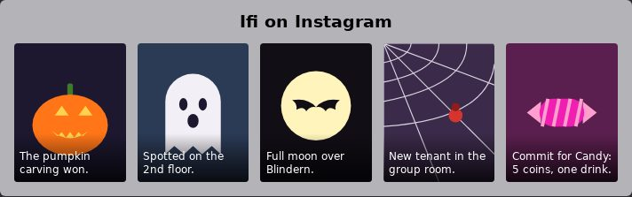

---

# P1: Make the header bar black
`🍬 candy` · `🎨 restyle` · Feature

**Reward:** 1 🪙 · **Time:** about 5 min  
**Good to know first:** nothing, everything is explained

### What to do
Give the header bar at the top of every page a black background, like in the Figma.

### Files to change (only these)
- `ifiplatform/static/css/07_halloween/header_bar.css` (it's empty, and already loaded on every page)

### Solution to start from
Paste this into the file:
```css
.header-bar {
    background: #000000;
}
```

#### Explanation (optional)
- `.header-bar` picks the header. Everything inside `{ }` styles it.
- `background` is the colour behind it. `#000000` is black.

### Make it yours
- Try a different dark colour: `#1a0d2e` is a dark purple, `#0b1d0b` a dark green.
- Or a spooky fade: `background: linear-gradient(#000000, #1a0d2e);`
- **Pick your own colour:** in VS Code, every colour code in a `.css` file has a small coloured square in front of it. Click the square to get a colour picker; the code changes as you pick. Or search "color picker" on Google, choose a colour, and copy the **HEX** code (the one that starts with `#`, like `#ff7518`).

### Done when
- The header bar is dark on every page.

### How to work on it
Set up the project on your own computer first (see **Get started** in the README). Then:

1. **Claim this issue** on the site: https://halloween.ifiplattform.no/commits/issues/
2. In the VS Code terminal:
   ```bash
   ifi fix-issue {number}
   ```
3. Make the change, and check it at http://localhost:8000. Reload with **Ctrl+Shift+R** (Mac: **Cmd+Shift+R**): a normal reload may show the old look, because the browser keeps old copies of CSS files and pictures. Still old? Try a private window.
4. Then:
   ```bash
   ifi test
   git add .
   git commit -m "Short description of what you changed"
   ifi pull-request
   ```

**Only change the files listed above.** Then your pull request can't clash with anyone else's. After the merge it can take a few minutes before it shows on the live site. Stuck? Ask a helper, or type `ifi help`.

#### What it looks like when it's done
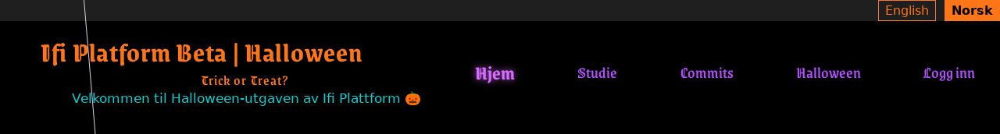

---

# P10a: The moon: a big pale circle
`🍬 candy` · `🎨 restyle` · Feature

**Reward:** 1 🪙 · **Time:** about 6 min · **Part of the set** SET-moon  
**Good to know first:** nothing, everything is explained

### What to do
Turn the empty `.moon` element into a big pale circle in the top right corner, behind the page content.

### Files to change (only these)
- `ifiplatform/static/css/07_halloween/moon.css` (empty, already loaded)

**Only set the moon's size, colour, shape and position.** The craters and the glow are other people's issues, in other files.

### Solution to start from
```css
.moon {
    position: fixed;
    top: 5rem;
    right: 4rem;
    width: 22rem;
    aspect-ratio: 1;
    border-radius: 50%;
    background: #cfe3ff;
    z-index: -1;
}
```

#### Explanation (optional)
- `position: fixed` with `top` and `right` pins it to the corner of the window, even when you scroll.
- `width` with `aspect-ratio: 1` makes it as tall as it is wide.
- `border-radius: 50%` turns the square into a circle.
- `z-index: -1` puts it behind everything else.

### Make it yours
- A bigger or smaller moon (`width`), or another spot (`top`, `right`).
- Another colour: `#fff5bc` is a yellow harvest moon, `#ffb15c` an orange one.
- **Pick your own colour:** in VS Code, every colour code in a `.css` file has a small coloured square in front of it. Click the square to get a colour picker; the code changes as you pick. Or search "color picker" on Google, choose a colour, and copy the **HEX** code (the one that starts with `#`, like `#ff7518`).

### Done when
- A big pale circle sits in the corner, stays there when you scroll, and never covers anything you can click.

### How to work on it
Set up the project on your own computer first (see **Get started** in the README). Then:

1. **Claim this issue** on the site: https://halloween.ifiplattform.no/commits/issues/
2. In the VS Code terminal:
   ```bash
   ifi fix-issue {number}
   ```
3. Make the change, and check it at http://localhost:8000. Reload with **Ctrl+Shift+R** (Mac: **Cmd+Shift+R**): a normal reload may show the old look, because the browser keeps old copies of CSS files and pictures. Still old? Try a private window.
4. Then:
   ```bash
   ifi test
   git add .
   git commit -m "Short description of what you changed"
   ifi pull-request
   ```

**Only change the files listed above.** Then your pull request can't clash with anyone else's. After the merge it can take a few minutes before it shows on the live site. Stuck? Ask a helper, or type `ifi help`.

#### What it looks like when it's done
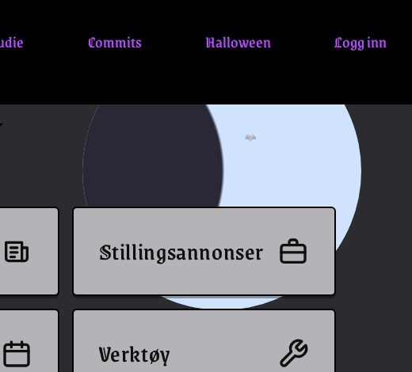

*Only this step: the moon without craters or glow.*

---

# P10b: The moon: craters
`🍬 candy` · `🖼️ art` · Feature

**Reward:** 1 🪙 · **Time:** about 7 min · **Part of the set** SET-moon  
**Good to know first:** nothing, everything is explained

### What to do
Cover the moon in craters: lots of round, slightly darker spots.

### Files to change (only these)
- `ifiplatform/static/css/07_halloween/moon_craters.css` (empty, already loaded)

**Only use `.moon::before` and `.moon::after`.** The moon itself (P10a) and its glow (P10c) are other people's issues, in other files.

### Solution to start from
```css
.moon::before,
.moon::after {
    content: "";
    position: absolute;
    border-radius: 50%;
    background: #b4c8e6;
}

.moon::before {
    width: 2rem;
    height: 2rem;
    top: 3rem;
    left: 4rem;
    box-shadow:
        3rem 9rem 0 1rem #b4c8e6,
        10rem 11.5rem 0 0.6rem #b4c8e6,
        5rem 3rem 0 0.3rem #b4c8e6,
        -0.5rem 6rem 0 0.4rem #b4c8e6,
        7rem 14.5rem 0 0.2rem #b4c8e6,
        13rem 6rem 0 0.3rem #b4c8e6,
        2rem 4.5rem 0 -0.5rem #b4c8e6,
        7.5rem 6.5rem 0 -0.45rem #b4c8e6,
        12rem 9.5rem 0 -0.5rem #b4c8e6,
        0.5rem 11.5rem 0 -0.45rem #b4c8e6,
        6rem -1rem 0 -0.5rem #b4c8e6,
        11.5rem 4.5rem 0 -0.45rem #b4c8e6,
        4rem 13rem 0 -0.5rem #b4c8e6;
}

.moon::after {
    width: 5rem;
    height: 5rem;
    top: 3.5rem;
    left: 12rem;
}
```

#### Explanation (optional)
- `::before` and `::after` are two extra, invisible boxes inside the moon. `content: ""` makes them show up, and `border-radius: 50%` makes them round.
- `#b4c8e6` is a solid blue-grey, a bit darker than the moon. It's solid (not see-through), so craters that overlap don't get darker where they meet.
- `::after` is the biggest crater, at the top right.
- **The trick for many craters:** each line in `box-shadow` draws one more copy of the `::before` crater. The four values are: how far right, how far down, blur (`0` keeps it sharp), and how much bigger (`1rem`) or smaller (`-0.5rem`) than the original. That's how you get large, medium and tiny ones from the same crater.

### Make it yours
- Add a crater: copy a `box-shadow` line, change the first two numbers to move it, and the last number to make it bigger or smaller. Every line ends with a comma except the last.
- If P10a's moon got another colour, pick a crater colour a little darker than it, and use it in all the lines.
- **Pick your own colour:** in VS Code, every colour code in a `.css` file has a small coloured square in front of it. Click the square to get a colour picker; the code changes as you pick. Or search "color picker" on Google, choose a colour, and copy the **HEX** code (the one that starts with `#`, like `#ff7518`).

### Testing before P10a is merged
Until the moon itself is merged there's nothing to see. To test, add this at the top of your file, and **delete it again before you commit**:
```css
.moon { position: fixed; top: 5rem; right: 4rem; width: 22rem; aspect-ratio: 1; border-radius: 50%; background: #cfe3ff; z-index: -1; }
```

### Done when
- The moon has tiny, medium and large craters, and none of them stick out past its edge.

### How to work on it
Set up the project on your own computer first (see **Get started** in the README). Then:

1. **Claim this issue** on the site: https://halloween.ifiplattform.no/commits/issues/
2. In the VS Code terminal:
   ```bash
   ifi fix-issue {number}
   ```
3. Make the change, and check it at http://localhost:8000. Reload with **Ctrl+Shift+R** (Mac: **Cmd+Shift+R**): a normal reload may show the old look, because the browser keeps old copies of CSS files and pictures. Still old? Try a private window.
4. Then:
   ```bash
   ifi test
   git add .
   git commit -m "Short description of what you changed"
   ifi pull-request
   ```

**Only change the files listed above.** Then your pull request can't clash with anyone else's. After the merge it can take a few minutes before it shows on the live site. Stuck? Ask a helper, or type `ifi help`.

#### What it looks like when it's done


*The moon with craters, without the glow (that's P10c).*

---

# P10c: The moon: glow
`🍬 candy` · `🎨 restyle` · Feature

**Reward:** 1 🪙 · **Time:** about 5 min · **Part of the set** SET-moon  
**Good to know first:** nothing, everything is explained

### What to do
Give the moon a soft glow, as if it lights up the sky.

### Files to change (only these)
- `ifiplatform/static/css/07_halloween/moon_glow.css` (empty, already loaded)

**Only set `box-shadow` on `.moon`.** The moon itself (P10a) and its craters (P10b) are other people's issues, in other files.

### Solution to start from
```css
.moon {
    box-shadow: 0 0 4rem 1rem rgba(207, 227, 255, 0.5);
}
```

#### Explanation (optional)
- `box-shadow` draws a shadow around the moon. The four numbers are: across, down, how blurry, and how far it spreads.
- `rgba(207, 227, 255, 0.5)` is the moon's pale blue at half strength, so the shadow looks like light.

### Make it yours
- More blur (`6rem`) or more spread (`2rem`) for a bigger glow.
- Another colour: a warm `rgba(255, 177, 92, 0.5)` glow for an orange moon.

### Testing before P10a is merged
Same as P10b: add the temporary `.moon { ... }` line from P10b at the top of your file, and **delete it before you commit**.

### Done when
- There's a soft light around the moon.

### How to work on it
Set up the project on your own computer first (see **Get started** in the README). Then:

1. **Claim this issue** on the site: https://halloween.ifiplattform.no/commits/issues/
2. In the VS Code terminal:
   ```bash
   ifi fix-issue {number}
   ```
3. Make the change, and check it at http://localhost:8000. Reload with **Ctrl+Shift+R** (Mac: **Cmd+Shift+R**): a normal reload may show the old look, because the browser keeps old copies of CSS files and pictures. Still old? Try a private window.
4. Then:
   ```bash
   ifi test
   git add .
   git commit -m "Short description of what you changed"
   ifi pull-request
   ```

**Only change the files listed above.** Then your pull request can't clash with anyone else's. After the merge it can take a few minutes before it shows on the live site. Stuck? Ask a helper, or type `ifi help`.

#### What it looks like when it's done
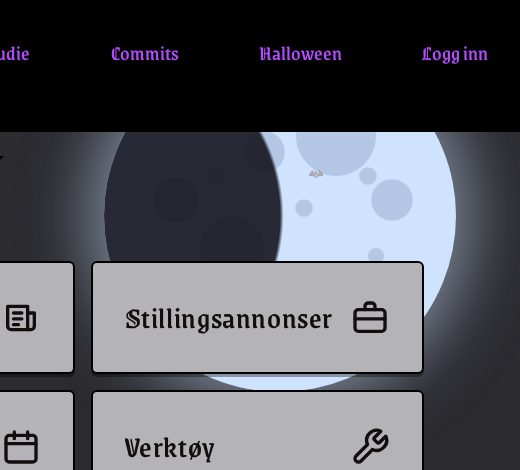

---

# P2: Bat cursor
`🍬 candy` · `🦇 silly feature` · Feature

**Reward:** 1 🪙 · **Time:** about 6 min  
**Good to know first:** nothing, everything is explained

### What to do
Make the mouse pointer a small bat on the whole site.

### Files to change (only these)
- `ifiplatform/static/css/07_halloween/bat_cursor.css` (empty, already loaded)
- new: `ifiplatform/static/images/halloween/bat.svg`

### Solution to start from
1. Make the folder `ifiplatform/static/images/halloween/` and a file `bat.svg` in it, with this inside:
   ```html
   <svg xmlns="http://www.w3.org/2000/svg" viewBox="0 0 32 32">
     <path d="M16 12c-2-3-6-4-9-3 2 1 2 3 1 4-3-1-6 0-8 2 4 0 6 2 7 5 1-2 3-3 5-2 1 2 3 3 4 3s3-1 4-3c2-1 4 0 5 2 1-3 3-5 7-5-2-2-5-3-8-2-1-1-1-3 1-4-3-1-7 0-9 3z" fill="#120e0e"/>
   </svg>
   ```
2. Paste this into `bat_cursor.css`:
   ```css
   body {
       cursor: url("../../images/halloween/bat.svg") 16 16, auto;
   }
   ```

#### Explanation (optional)
- `body` is the whole page.
- `cursor: url(...)` uses your picture as the mouse pointer. The path goes two folders up from the CSS file, then into `images/halloween/`.
- `16 16` is the point in the picture that does the clicking: the middle.
- `auto` is the normal pointer, used if the picture can't load.

### Make it yours
- Change `fill="#120e0e"` to another colour, such as `#aa43ff` for a purple bat.
- Draw your own bat, or find a free bat SVG online (check the licence). Keep it about 32×32.
- **Pick your own colour:** search "color picker" on Google, choose a colour, and copy the **HEX** code (the one that starts with `#`, like `#ff7518`). Paste it between the quotes, for example `fill="#ff7518"`.

### Done when
- The pointer is a bat everywhere on the site, and you can still click everything.

### How to work on it
Set up the project on your own computer first (see **Get started** in the README). Then:

1. **Claim this issue** on the site: https://halloween.ifiplattform.no/commits/issues/
2. In the VS Code terminal:
   ```bash
   ifi fix-issue {number}
   ```
3. Make the change, and check it at http://localhost:8000. Reload with **Ctrl+Shift+R** (Mac: **Cmd+Shift+R**): a normal reload may show the old look, because the browser keeps old copies of CSS files and pictures. Still old? Try a private window.
4. Then:
   ```bash
   ifi test
   git add .
   git commit -m "Short description of what you changed"
   ifi pull-request
   ```

**Only change the files listed above.** Then your pull request can't clash with anyone else's. After the merge it can take a few minutes before it shows on the live site. Stuck? Ask a helper, or type `ifi help`.

#### What it looks like when it's done


*Mock-up: a screenshot can't show the mouse pointer, so the bat is drawn in where the pointer would be.*

---

# P3: Show 8 news articles on the home page, not 12
`🍬 candy` · `🧪 python` · Feature

**Reward:** 1 🪙 · **Time:** about 5 min  
**Good to know first:** nothing, everything is explained

### What to do
The Figma shows 8 news cards (2 rows of 4) on the home page. Today it shows up to 12. Change the number in the view.

### Files to change (only these)
- `ifiplatform/apps/ifi_home_app/views/home_views.py`

### Solution to start from
Find this line in `main_view`:
```python
        .order_by("-published_date")[:12]
```
and change `12` to `8`:
```python
        .order_by("-published_date")[:8]
```

#### Explanation (optional)
- `.order_by("-published_date")` sorts the newest first. The `-` means "highest first".
- `[:8]` means "only the first 8", like slicing a Python list.

### Make it yours
- Not much to change here. But it's real Python in a real Django view: have a look at the lines above to see where the articles come from.

### Done when
- The home page shows at most 8 news articles.
- `ifi test` passes.

### How to work on it
Set up the project on your own computer first (see **Get started** in the README). Then:

1. **Claim this issue** on the site: https://halloween.ifiplattform.no/commits/issues/
2. In the VS Code terminal:
   ```bash
   ifi fix-issue {number}
   ```
3. Make the change, and check it at http://localhost:8000. Reload with **Ctrl+Shift+R** (Mac: **Cmd+Shift+R**): a normal reload may show the old look, because the browser keeps old copies of CSS files and pictures. Still old? Try a private window.
4. Then:
   ```bash
   ifi test
   git add .
   git commit -m "Short description of what you changed"
   ifi pull-request
   ```

**Only change the files listed above.** Then your pull request can't clash with anyone else's. After the merge it can take a few minutes before it shows on the live site. Stuck? Ask a helper, or type `ifi help`.

#### What it looks like when it's done
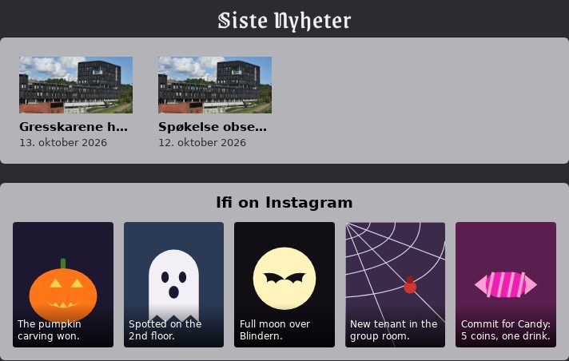

*The dev database has only 2 news articles, so the limit of 8 doesn't change anything you can see here.*

---

# P4: Pin an obituary on the haunted notice board
`🍬 candy` · `✍️ content` · Task

**Reward:** 1 🪙 · **Time:** about 5 min  
**Good to know first:** nothing, everything is explained

### What to do
Something at Ifi has died. Write its obituary. Pin an obituary on the haunted notice board at http://localhost:8000/halloween/board/. One to three sentences is plenty: funny beats long.

### Files to change (only these)
- new: `ifiplatform/apps/halloween_app/board_notes/obituary_01.txt`

### Solution to start from
Make the file `ifiplatform/apps/halloween_app/board_notes/obituary_01.txt` with this inside, then change it to your own:
```
Here lies the 2nd-floor coffee machine
It gave everything it had, which was mostly lukewarm water. It will be missed at 8:15 on Mondays.
-- Everyone in IN2010
```

#### Explanation (optional)
The board turns your file into a note like this:
- **First line** → the heading of the note, in bold at the top.
- **The lines after it** → the text on the note.
- **A last line starting with `--`** → who signed it, at the bottom right. You can leave it out.

### Make it yours
Write your own! Some ideas:
- "Here lies the coffee machine on the 2nd floor. It gave everything, mostly lukewarm water."
- "RIP my sleep schedule, 2005–the start of IN1000."
- "In memory of the last free socket in the library."

Keep it kind: no real people.

### Done when
- Your note shows up on http://localhost:8000/halloween/board/.

### How to work on it
Set up the project on your own computer first (see **Get started** in the README). Then:

1. **Claim this issue** on the site: https://halloween.ifiplattform.no/commits/issues/
2. In the VS Code terminal:
   ```bash
   ifi fix-issue {number}
   ```
3. Make the change, and check it at http://localhost:8000. Reload with **Ctrl+Shift+R** (Mac: **Cmd+Shift+R**): a normal reload may show the old look, because the browser keeps old copies of CSS files and pictures. Still old? Try a private window.
4. Then:
   ```bash
   ifi test
   git add .
   git commit -m "Short description of what you changed"
   ifi pull-request
   ```

**Only change the files listed above.** Then your pull request can't clash with anyone else's. After the merge it can take a few minutes before it shows on the live site. Stuck? Ask a helper, or type `ifi help`.

#### What it looks like when it's done
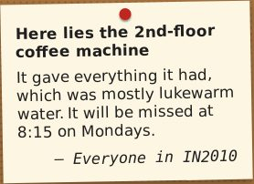

---

# P5: Turn "GitHub opening soon..." into a real link
`🍬 candy` · `🔤 text` · Feature

**Reward:** 1 🪙 · **Time:** about 5 min  
**Good to know first:** nothing, everything is explained

### What to do
The footer still says "GitHub opening soon...", but the repo is open now. Replace that text with a link to the repo.

### Files to change (only these)
- `ifiplatform/templates/partials/footer.html`

### Solution to start from
Find this line:
```html
        <p> </p>
```
and replace it with:
```html
        <a href="https://github.com/Creators-Guild/ifiplattform_halloween"></a>
```

#### Explanation (optional)
- `<a href="...">` is a link. `href` says where it goes.
- `` is Django's way of marking text that can be translated. Keep it around the visible text.

### Make it yours
- Change the link text, for example ``.
- Don't run `makemessages`: the organisers do that after the event.

### Done when
- The footer shows a link to the GitHub repo, and "opening soon..." is gone.

### How to work on it
Set up the project on your own computer first (see **Get started** in the README). Then:

1. **Claim this issue** on the site: https://halloween.ifiplattform.no/commits/issues/
2. In the VS Code terminal:
   ```bash
   ifi fix-issue {number}
   ```
3. Make the change, and check it at http://localhost:8000. Reload with **Ctrl+Shift+R** (Mac: **Cmd+Shift+R**): a normal reload may show the old look, because the browser keeps old copies of CSS files and pictures. Still old? Try a private window.
4. Then:
   ```bash
   ifi test
   git add .
   git commit -m "Short description of what you changed"
   ifi pull-request
   ```

**Only change the files listed above.** Then your pull request can't clash with anyone else's. After the merge it can take a few minutes before it shows on the live site. Stuck? Ask a helper, or type `ifi help`.

#### What it looks like when it's done
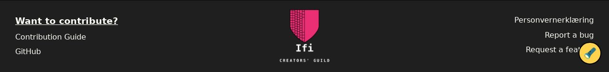

---

# P6: Pumpkin favicon
`🍬 candy` · `🖼️ art` · Feature

**Reward:** 1 🪙 · **Time:** about 6 min  
**Good to know first:** nothing, everything is explained

### What to do
Replace the browser-tab icon (the orange "Ifi" text) with a jack-o'-lantern.

### Files to change (only these)
- `ifiplatform/static/images/favicon.svg`

### Solution to start from
Replace everything in the file with:
```html
<svg xmlns="http://www.w3.org/2000/svg" viewBox="0 0 512 512">
  <rect x="240" y="40" width="32" height="90" rx="10" fill="#3b7a2a"/>
  <ellipse cx="256" cy="300" rx="220" ry="180" fill="#ff7518"/>
  <path d="M170 250l40 40h-80zM342 250l40 40h-80z" fill="#1f1f1f"/>
  <path d="M150 360q106 70 212 0l-30 10-20-20-20 20-30-20-30 20-20-20-20 20z" fill="#1f1f1f"/>
</svg>
```

#### Explanation (optional)
- `viewBox="0 0 512 512"` is the drawing area: 512 by 512 dots.
- `<rect>` is the green stem. `<ellipse>` is the orange pumpkin: `cx` and `cy` are its middle, `rx` and `ry` how wide and tall.
- The first `<path>` draws the two triangle eyes, and the second the zigzag mouth.

### Make it yours
- Change the colours (`fill="..."`): a green pumpkin, or purple eyes?
- Change `rx` and `ry` for a rounder or flatter pumpkin.
- **Pick your own colour:** search "color picker" on Google, choose a colour, and copy the **HEX** code (the one that starts with `#`, like `#ff7518`). Paste it between the quotes, for example `fill="#ff7518"`.

### Done when
- The browser tab shows a pumpkin. Browsers keep old icons, so reload with Ctrl+Shift+R (Mac: Cmd+Shift+R).

### How to work on it
Set up the project on your own computer first (see **Get started** in the README). Then:

1. **Claim this issue** on the site: https://halloween.ifiplattform.no/commits/issues/
2. In the VS Code terminal:
   ```bash
   ifi fix-issue {number}
   ```
3. Make the change, and check it at http://localhost:8000. Reload with **Ctrl+Shift+R** (Mac: **Cmd+Shift+R**): a normal reload may show the old look, because the browser keeps old copies of CSS files and pictures. Still old? Try a private window.
4. Then:
   ```bash
   ifi test
   git add .
   git commit -m "Short description of what you changed"
   ifi pull-request
   ```

**Only change the files listed above.** Then your pull request can't clash with anyone else's. After the merge it can take a few minutes before it shows on the live site. Stuck? Ask a helper, or type `ifi help`.

#### What it looks like when it's done
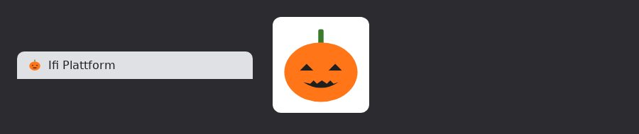

*Mock-up: the new icon in a browser tab, and large.*

---

# P7: Explain the Halloween CSS folder
`🍬 candy` · `📚 docs` · Task

**Reward:** 1 🪙 · **Time:** about 6 min  
**Good to know first:** nothing, everything is explained

### What to do
There's a new folder, `ifiplatform/static/css/07_halloween/`, but the CSS README doesn't mention it yet. Add a short section about it at the end.

### Files to change (only these)
- `ifiplatform/static/css/README.md`

### Solution to start from
Add this at the end of the file:
```markdown
## The Halloween layer (`07_halloween/`)

One CSS file per Commit for Candy issue, linked from
`templates/css_links/halloween.html`. It's loaded after all the other CSS
(see `templates/global_base.html`), so its rules win without `!important`.
Each issue fills in only its own file.
```

#### Explanation (optional)
- `##` makes a heading. Text between backticks (`` ` ``) shows as code.

### Make it yours
- Say it in your own words. Add a sentence on how to add a new file to the folder: make the file, then add a `<link>` line to `halloween.html`.

### Done when
- The README explains what the folder is for, where it's linked, and why its rules win.

### How to work on it
Set up the project on your own computer first (see **Get started** in the README). Then:

1. **Claim this issue** on the site: https://halloween.ifiplattform.no/commits/issues/
2. In the VS Code terminal:
   ```bash
   ifi fix-issue {number}
   ```
3. Make the change, and check it at http://localhost:8000. Reload with **Ctrl+Shift+R** (Mac: **Cmd+Shift+R**): a normal reload may show the old look, because the browser keeps old copies of CSS files and pictures. Still old? Try a private window.
4. Then:
   ```bash
   ifi test
   git add .
   git commit -m "Short description of what you changed"
   ifi pull-request
   ```

**Only change the files listed above.** Then your pull request can't clash with anyone else's. After the merge it can take a few minutes before it shows on the live site. Stuck? Ask a helper, or type `ifi help`.

#### What it looks like when it's done
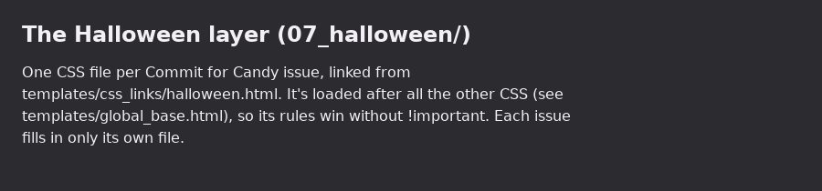

*The new section of the CSS README.*

---

# P8: 👻 The message board shows the wrong date
`🍬 candy` · `👻 haunted bug` · Bug

**Reward:** 1 🪙 · **Time:** about 5 min  
**Good to know first:** nothing, everything is explained

### What's wrong
The message board on the home page shows dates with the month first (10/31/2026), but in Norway we write the day first (31/10/2026). Something haunted changed it…

### Files to change (only these)
- `ifiplatform/apps/ifi_home_app/templates/home/partials/messageboard/slide.html`

### Solution to start from
Find this line:
```html
    <p class="messageboard-date">{{ msg.date|date:"m/d/Y" }}</p>
```
and swap `m` and `d`:
```html
    <p class="messageboard-date">{{ msg.date|date:"d/m/Y" }}</p>
```

#### Explanation (optional)
- `{{ msg.date }}` shows the message's date. `|date:"..."` says how to write it: `d` is the day, `m` the month, `Y` the year with 4 digits.

### Make it yours
- Try other formats from [Django's date letters](https://docs.djangoproject.com/en/stable/ref/templates/builtins/#date). For example `"j. F Y"` gives "31. October 2026". Keep the day first.

### Done when
- The message board shows the day first.

### How to work on it
Set up the project on your own computer first (see **Get started** in the README). Then:

1. **Claim this issue** on the site: https://halloween.ifiplattform.no/commits/issues/
2. In the VS Code terminal:
   ```bash
   ifi fix-issue {number}
   ```
3. Make the change, and check it at http://localhost:8000. Reload with **Ctrl+Shift+R** (Mac: **Cmd+Shift+R**): a normal reload may show the old look, because the browser keeps old copies of CSS files and pictures. Still old? Try a private window.
4. Then:
   ```bash
   ifi test
   git add .
   git commit -m "Short description of what you changed"
   ifi pull-request
   ```

**Only change the files listed above.** Then your pull request can't clash with anyone else's. After the merge it can take a few minutes before it shows on the live site. Stuck? Ask a helper, or type `ifi help`.

#### What it looks like when it's done


---

# P9: Show where the keyboard is on the shortcuts
`🍬 candy` · `♿ a11y` · Feature

**Reward:** 1 🪙 · **Time:** about 6 min  
**Good to know first:** nothing, everything is explained

### What to do
People who use the keyboard move around the page with Tab. On the home page shortcuts (Info, Nyheter, Jobber, …) it's hard to see which one is selected. Add a clear outline when a shortcut has keyboard focus.

### Files to change (only these)
- `ifiplatform/static/css/07_halloween/shortcut_focus.css` (empty, already loaded)

### Solution to start from
Paste this into the file:
```css
#home-shortcuts a:focus-visible,
#home-shortcuts .shortcut-toggle:focus-visible {
    outline: 3px solid var(--color-accent);
    outline-offset: 3px;
}
```

#### Explanation (optional)
- `#home-shortcuts` is the box with all the shortcuts. `a` is a link inside it, and `.shortcut-toggle` the buttons.
- `:focus-visible` means "selected with the keyboard". Mouse clicks don't trigger it.
- `outline-offset` moves the line a little away from the edge, so it's easier to see.

### Make it yours
- Use another colour, such as `#ff7518` (pumpkin orange).
- Make it thicker, or `dashed`.
- Test it: click in the address bar, then press Tab until you reach the shortcuts.
- **Pick your own colour:** in VS Code, every colour code in a `.css` file has a small coloured square in front of it. Click the square to get a colour picker; the code changes as you pick. Or search "color picker" on Google, choose a colour, and copy the **HEX** code (the one that starts with `#`, like `#ff7518`).

### Done when
- Pressing Tab on the home page shows a clear outline around the shortcut you're on.

### How to work on it
Set up the project on your own computer first (see **Get started** in the README). Then:

1. **Claim this issue** on the site: https://halloween.ifiplattform.no/commits/issues/
2. In the VS Code terminal:
   ```bash
   ifi fix-issue {number}
   ```
3. Make the change, and check it at http://localhost:8000. Reload with **Ctrl+Shift+R** (Mac: **Cmd+Shift+R**): a normal reload may show the old look, because the browser keeps old copies of CSS files and pictures. Still old? Try a private window.
4. Then:
   ```bash
   ifi test
   git add .
   git commit -m "Short description of what you changed"
   ifi pull-request
   ```

**Only change the files listed above.** Then your pull request can't clash with anyone else's. After the merge it can take a few minutes before it shows on the live site. Stuck? Ask a helper, or type `ifi help`.

#### What it looks like when it's done


*After pressing Tab: the focused shortcut (Info) has an outline.*

---

# Q1: Fortune teller: finish the crystal ball
`🎃 pumpkin` · `🧪 python` · Feature

**Reward:** 3 🪙 + 3 🏆 · **Time:** about 16 min · **Part of the set** SET-fortune  
**Good to know first:** Python basics (lists, functions, `%`), basic CSS. The tests are mostly written for you

### What to do
The fortune teller at http://localhost:8000/halloween/fortune/ is half built: you can type your name, but the crystal ball stays cloudy. Make it give a fortune, and the **same** fortune every time for the same name.

### Files to change (only these)
- `ifiplatform/apps/halloween_app/views/fortune.py`
- `ifiplatform/apps/halloween_app/static/css/halloween_pages/fortune.css` (empty, already loaded on the page)
- new: `ifiplatform/apps/halloween_app/tests/test_fortune.py`

### What's already there
`views/fortune.py` has a list `FORTUNES` and a function `pick_fortune(name)` that returns `None`, with two `TODO`s. The page and the form already work, and `clean_name(name)` (from `fortune_names.py`, don't change that file) turns a name into lowercase letters.

### Design to build
The look: **a glowing crystal ball**. You don't have to come up with a design: build this one. Rather design your own? Go ahead, see "Make it yours".
- **The form** (`.fortune-form`): the label, field and button on one row (`display: flex; gap: 0.6rem; align-items: center`).
- **The fortune** (`.fortune-result`): a round crystal ball, 18rem wide (`aspect-ratio: 1; border-radius: 50%`), centred with `margin: 2rem auto`. Purple glass: `background: radial-gradient(circle at 35% 30%, #e9d8ff, #6b2fb3 60%, #24093f)`, a purple glow: `box-shadow: 0 0 40px rgba(170, 67, 255, 0.6)`. The text pale yellow `#fff5bc`, italic, centred in the middle (`display: grid; place-items: center`).

### Your part
1. **TODO 1:** add at least 7 more spooky fortunes to `FORTUNES`.
2. **TODO 2:** in `pick_fortune`, turn `clean_name(name)` into a number, and use `%` to pick a fortune:
   ```python
   number = sum(ord(letter) for letter in clean_name(name))
   ```
   `ord("a")` is 97, so every name gets its own number. What do you do with `number` and `len(FORTUNES)`?
3. **Tests:** make `ifiplatform/apps/halloween_app/tests/test_fortune.py`, and fill in the last test:
   ```python
   # pylint: disable=C0114,C0115,C0116
   from django.test import SimpleTestCase

   from halloween_app.views.fortune import FORTUNES, pick_fortune


   class FortuneTests(SimpleTestCase):
       def test_gives_a_fortune(self):
           self.assertIn(pick_fortune("Kari"), FORTUNES)

       def test_same_name_same_fortune(self):
           self.assertEqual(pick_fortune("Kari"), pick_fortune("  KARI "))

       def test_enough_fortunes(self):
           # TODO: check that there are at least 8 fortunes
           pass
   ```
   Run them with `ifi test`.
4. **Style:** build the design above in `fortune.css`.

### Done when
- Your name always gives the same fortune, and different names give different ones (mostly).
- `ifi test` passes, including your new tests.

Names with æ, ø or å crash the page: that's a separate 👻 bug with its own issue. Leave it for that issue, and test with names like Kari or Ola.

### How to work on it
Set up the project on your own computer first (see **Get started** in the README). Then:

1. **Claim this issue** on the site: https://halloween.ifiplattform.no/commits/issues/
2. In the VS Code terminal:
   ```bash
   ifi fix-issue {number}
   ```
3. Make the change, and check it at http://localhost:8000. Reload with **Ctrl+Shift+R** (Mac: **Cmd+Shift+R**): a normal reload may show the old look, because the browser keeps old copies of CSS files and pictures. Still old? Try a private window.
4. Then:
   ```bash
   ifi test
   git add .
   git commit -m "Short description of what you changed"
   ifi pull-request
   ```

**Only change the files listed above.** Then your pull request can't clash with anyone else's. After the merge it can take a few minutes before it shows on the live site. Stuck? Ask a helper, or type `ifi help`.

#### What it looks like when it's done
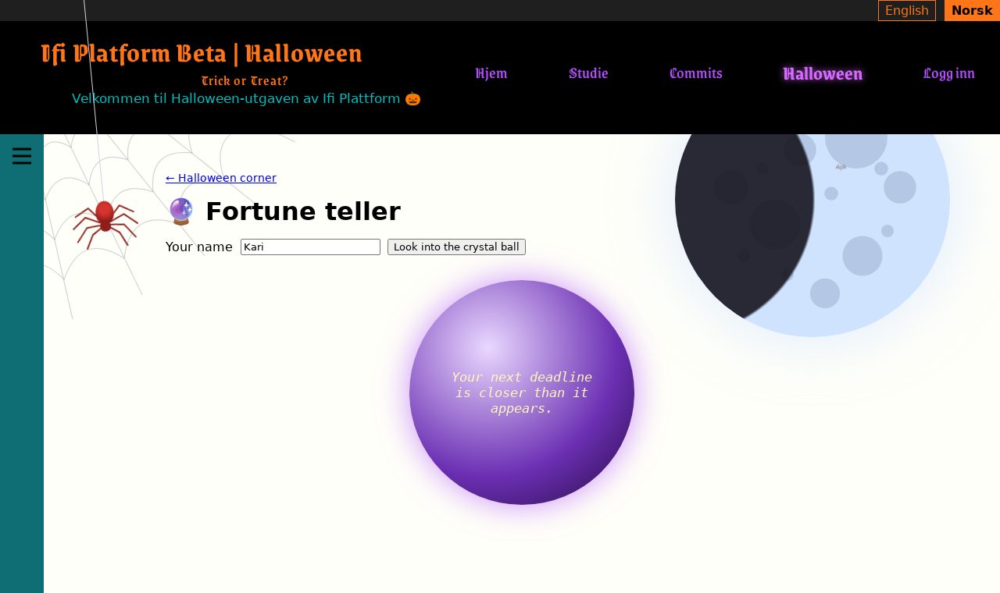

---

# Q10: The Ifi Halloween quiz
`🎃 pumpkin` · `🧪 python` · Feature

**Reward:** 3 🪙 + 3 🏆 · **Time:** about 18 min  
**Good to know first:** Python basics (lists, dictionaries, loops), basic CSS. Some tests are written for you

### What to do
The quiz at http://localhost:8000/halloween/quiz/ has only two questions, and every answer scores 0. Make it a real quiz: ten questions about Ifi, programming and Halloween, a score, and a verdict.

### Files to change (only these)
- `ifiplatform/apps/halloween_app/views/quiz.py`
- `ifiplatform/apps/halloween_app/static/css/halloween_pages/quiz.css` (empty, already loaded on the page)
- new: `ifiplatform/apps/halloween_app/tests/test_quiz.py`

### What's already there
`views/quiz.py` has the list `QUESTIONS`, with two questions. Each is a dictionary with a `key` (`"q1"`), the `question`, its `options`, and the right `answer`. Two functions are left as `TODO`s: `score(answers)` and `verdict(points, total)`. The page already shows every question as radio buttons, and the score and verdict after **Check my answers**.

### Design to build
The look: **haunted exam papers**. You don't have to come up with a design: build this one. Rather design your own? Go ahead, see "Make it yours".
- **The form** (`.quiz-form`): a grid with `gap: 1rem`, at most `40rem` wide.
- **Each question** (`.quiz-question`): dark purple `#2b1f3a` with light text `#f2eff6`, a black border `2px solid #000`, rounded corners `6px`, padding `1rem 1.2rem`. Its `legend` in bold.
- **Each option** (`.quiz-option`) on its own line. The picked one (`.quiz-option:has(input:checked)`) turns lantern orange `#ffb15c` and bold.
- **The button:** a pumpkin-orange pill (`#ff7518`, black border, `border-radius: 999px`, bold).
- **The result** (`.quiz-result`): an orange box with a black border above the questions, the score (`.quiz-result__score`) huge (`3rem`, extra bold), the verdict (`.quiz-result__verdict`) in italics.

### Your part
1. **TODO 1:** add 8 more questions (10 in all). Every `key` must be different, and the `answer` must be one of the `options`, written exactly the same.
2. **TODO 2:** `score(answers)` counts the right answers. `answers` is a dictionary from each question's key to the option the visitor picked (or `None` if they skipped it).
3. **TODO 3:** `verdict(points, total)` returns a different sentence for a full score, a middle score and a low score.
4. **Tests:** make `ifiplatform/apps/halloween_app/tests/test_quiz.py`, and fill in the last test:
   ```python
   # pylint: disable=C0114,C0115,C0116
   from django.test import SimpleTestCase

   from halloween_app.views.quiz import QUESTIONS, score


   class QuizTests(SimpleTestCase):
       def test_ten_questions_with_different_keys(self):
           self.assertEqual(len(QUESTIONS), 10)
           self.assertEqual(len({question["key"] for question in QUESTIONS}), 10)

       def test_all_right(self):
           answers = {question["key"]: question["answer"] for question in QUESTIONS}
           self.assertEqual(score(answers), 10)

       def test_every_answer_is_an_option(self):
           # TODO: check that every question's answer is one of its options
           pass
   ```
   Run them with `ifi test`.
5. **Style:** build the design above in `quiz.css`.

### Make it yours
- Show which answers were wrong. That needs the template too, which isn't in this issue's files: put the information in the verdict instead, like "You missed question 3 and 7".

### Done when
- The quiz has 10 questions, gives the right score, and a different verdict for low, middle and full scores.
- `ifi test` passes, including your new tests.

### How to work on it
Set up the project on your own computer first (see **Get started** in the README). Then:

1. **Claim this issue** on the site: https://halloween.ifiplattform.no/commits/issues/
2. In the VS Code terminal:
   ```bash
   ifi fix-issue {number}
   ```
3. Make the change, and check it at http://localhost:8000. Reload with **Ctrl+Shift+R** (Mac: **Cmd+Shift+R**): a normal reload may show the old look, because the browser keeps old copies of CSS files and pictures. Still old? Try a private window.
4. Then:
   ```bash
   ifi test
   git add .
   git commit -m "Short description of what you changed"
   ifi pull-request
   ```

**Only change the files listed above.** Then your pull request can't clash with anyone else's. After the merge it can take a few minutes before it shows on the live site. Stuck? Ask a helper, or type `ifi help`.

#### What it looks like when it's done
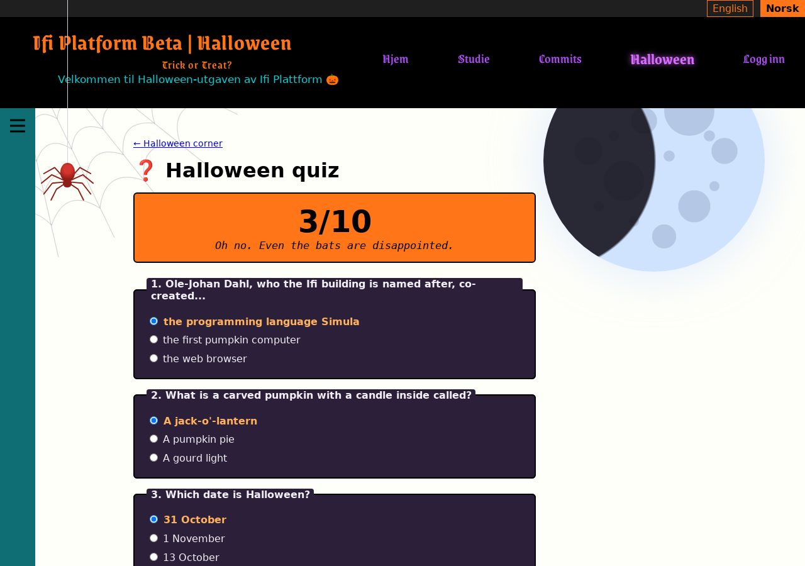

*After checking the answers, with three right.*

---

# Q11: The graveyard of retired features
`🎃 pumpkin` · `🦇 silly feature` · Feature

**Reward:** 3 🪙 + 3 🏆 · **Time:** about 16 min  
**Good to know first:** Git (log), Python basics (lists, dictionaries), CSS

### What to do
The Halloween corner has a graveyard (http://localhost:8000/halloween/graveyard/) for features this site used to have, but only one grave is dug. Dig into the project's Git history, find features that were removed, give each one a tombstone, and make the graveyard look like a graveyard.

### Files to change (only these)
- `ifiplatform/apps/halloween_app/views/graveyard.py`
- `ifiplatform/apps/halloween_app/static/css/halloween_pages/graveyard.css` (empty, already loaded on the page)

### What's already there
`views/graveyard.py` has the list `GRAVES`, with one grave: a dictionary with the feature's `name`, when it was `born` and `died`, and an `epitaph` (the line on the tombstone). The page already shows every grave in the list, as an `<li class="grave">` with `.grave__rip`, `.grave__name`, `.grave__dates` and `.grave__epitaph` inside, all in `<ul class="graveyard">`.

### How to find the dead
In the VS Code terminal:
```bash
git log --diff-filter=D --name-only --format="--- %ad %s" --date=short
```
That lists every commit that **deleted** files: the date, the commit message, and the files. Some deleted files are features that were removed or renamed: an app, a page, a workflow, a template. `git log --format=%ad --date=short -- <path>` shows when a file was there.

### Design to build
The look: **a moonlit graveyard**. You don't have to come up with a design: build this one. Rather design your own? Go ahead, see "Make it yours".
- **The graveyard** (`.graveyard`): no bullets, a grid of graves (`repeat(auto-fill, minmax(13rem, 1fr))`, gap `2.5rem 1.5rem`), padding `2rem 1.5rem 0`, rounded corners, and a night sky over grass: `background: linear-gradient(#1d1830 70%, #2f4a2a 70%)`.
- **A tombstone** (`.grave`): rounded on top, square at the bottom (`border-radius: 6rem 6rem 0.4rem 0.4rem`), stone grey `linear-gradient(160deg, #a7a7ad, #6f6f78)`, a black border `2px solid #000`, dark text, centred, padding.
- **Crooked stones:** odd graves tilt `-2deg`, even ones `1.5deg` (`:nth-child(odd)` / `(even)` with `rotate`).
- **R.I.P.** (`.grave__rip`) in the spooky font (`var(--font-spooky)`), big, spaced out. The dates small, the epitaph in italics.
- **Hover:** a wilted rose 🥀 appears at the foot of the stone (`.grave:hover::after` with `content: "🥀"`, `position: absolute`).

### Your part
1. **Fill the graveyard:** at least 5 more graves, for features that really were removed. Use the dates from Git, and write a funny epitaph for each.
2. **Style:** build the design above in `graveyard.css`.

### Make it yours
- A ghost 👻 rising from a grave on hover, with a `@keyframes` (and no movement with `prefers-reduced-motion: reduce`).
- Fog: a white, see-through gradient along the bottom of the graveyard.

### Done when
- The graveyard has at least 6 tombstones, all for features that really were removed, and looks like a moonlit graveyard.

### How to work on it
Set up the project on your own computer first (see **Get started** in the README). Then:

1. **Claim this issue** on the site: https://halloween.ifiplattform.no/commits/issues/
2. In the VS Code terminal:
   ```bash
   ifi fix-issue {number}
   ```
3. Make the change, and check it at http://localhost:8000. Reload with **Ctrl+Shift+R** (Mac: **Cmd+Shift+R**): a normal reload may show the old look, because the browser keeps old copies of CSS files and pictures. Still old? Try a private window.
4. Then:
   ```bash
   ifi test
   git add .
   git commit -m "Short description of what you changed"
   ifi pull-request
   ```

**Only change the files listed above.** Then your pull request can't clash with anyone else's. After the merge it can take a few minutes before it shows on the live site. Stuck? Ask a helper, or type `ifi help`.

#### What it looks like when it's done


---

# Q12: A live countdown to Halloween
`🎃 pumpkin` · `🧪 python` · Feature

**Reward:** 3 🪙 + 3 🏆 · **Time:** about 17 min  
**Good to know first:** Python (dates), JavaScript (dates, setInterval), basic CSS. Some tests are written for you

### What to do
The countdown page at http://localhost:8000/halloween/countdown/ says "the clock isn't ticking yet". Make it count down to the next Halloween, live, in days, hours, minutes and seconds.

### Files to change (only these)
- `ifiplatform/apps/halloween_app/views/countdown.py`
- `ifiplatform/apps/halloween_app/static/js/halloween_pages/countdown.js`
- `ifiplatform/apps/halloween_app/static/css/halloween_pages/countdown.css` (empty, already loaded on the page)
- new: `ifiplatform/apps/halloween_app/tests/test_countdown.py`

### What's already there
- `views/countdown.py`: a function `next_halloween(today)` that returns `None` (TODO 1). The view already passes its answer to the template, which puts it on the page as `data-target="2026-10-31"` and shows "It's Halloween!" on the day itself.
- `countdown.js`: finds `#countdown`, reads the date into `target` (midnight at the start of that day), and calls `tick()` every second. `tick()` is the TODO. The four numbers are in `parts.days`, `parts.hours`, `parts.minutes` and `parts.seconds`.

### Design to build
The look: **four glowing clock tiles**. You don't have to come up with a design: build this one. Rather design your own? Go ahead, see "Make it yours".
- **The row** (`.countdown`): the four parts side by side (`display: flex; flex-wrap: wrap; gap: 1rem`), with space above.
- **Each part** (`.countdown__part`): a tile at least `7rem` wide, almost black `#15121c`, a black border `2px solid #000`, rounded corners `6px`, padding `1rem`, the number above the unit (`display: grid; justify-items: center`).
- **The number** (`.countdown__number`): huge (`3rem`), extra bold, pumpkin orange `#ff7518`, with an orange glow (`text-shadow: 0 0 18px rgba(255, 117, 24, 0.6)`). Add `font-variant-numeric: tabular-nums`, so the digits don't jump around as they change.
- **The unit** (`.countdown__unit`): light `#f2eff6`, small, in capitals, spaced out.

### Your part
1. **TODO 1, Python:** `next_halloween(today)` returns this year's 31 October (`date(today.year, 10, 31)`), or next year's if this year's is already over. On Halloween itself, it returns today.
2. **TODO 2, JavaScript:** in `tick()`, work out how many seconds are left: `Math.floor((target - new Date()) / 1000)` (subtracting dates gives milliseconds). Turn that into days, hours, minutes and seconds with `Math.floor` and `%`, and show them. Never show negative numbers.
3. **Tests:** make `ifiplatform/apps/halloween_app/tests/test_countdown.py`, and fill in the last test:
   ```python
   # pylint: disable=C0114,C0115,C0116
   from datetime import date

   from django.test import SimpleTestCase

   from halloween_app.views.countdown import next_halloween


   class NextHalloweenTests(SimpleTestCase):
       def test_before_halloween(self):
           self.assertEqual(next_halloween(date(2026, 10, 19)), date(2026, 10, 31))

       def test_on_halloween(self):
           self.assertEqual(next_halloween(date(2026, 10, 31)), date(2026, 10, 31))

       def test_after_halloween(self):
           # TODO: 1 November 2026 gives 31 October 2027
           pass
   ```
   Run them with `ifi test`.
4. **Style:** build the design above in `countdown.css`.

### Make it yours
- The seconds always with two digits (`String(n).padStart(2, "0")`).
- Turn the tiles red in the last 24 hours.

### Done when
- The page counts down every second to the next 31 October, and `ifi test` passes, including your new tests.

### How to work on it
Set up the project on your own computer first (see **Get started** in the README). Then:

1. **Claim this issue** on the site: https://halloween.ifiplattform.no/commits/issues/
2. In the VS Code terminal:
   ```bash
   ifi fix-issue {number}
   ```
3. Make the change, and check it at http://localhost:8000. Reload with **Ctrl+Shift+R** (Mac: **Cmd+Shift+R**): a normal reload may show the old look, because the browser keeps old copies of CSS files and pictures. Still old? Try a private window.
4. Then:
   ```bash
   ifi test
   git add .
   git commit -m "Short description of what you changed"
   ifi pull-request
   ```

**Only change the files listed above.** Then your pull request can't clash with anyone else's. After the merge it can take a few minutes before it shows on the live site. Stuck? Ask a helper, or type `ifi help`.

#### What it looks like when it's done


---

# Q13: The pumpkin carver
`🎃 pumpkin` · `🦇 silly feature` · Feature

**Reward:** 3 🪙 + 3 🏆 · **Time:** about 17 min  
**Good to know first:** JavaScript basics (click events, classes, the page's HTML from JS), CSS (grid, border-radius)

### What to do
The pumpkin carver at http://localhost:8000/halloween/pumpkin-carver/ should let you carve your own jack-o'-lantern: click squares on a pumpkin to cut them out, then light the candle so the face glows. There's a grid of squares, but it's invisible and does nothing. Make it work.

### Files to change (only these)
- `ifiplatform/apps/halloween_app/static/js/halloween_pages/pumpkin_carver.js`
- `ifiplatform/apps/halloween_app/static/css/halloween_pages/pumpkin_carver.css` (empty, already loaded on the page)

### What's already there
`pumpkin_carver.js` fills `#carver-pumpkin` with 14 × 11 `<button class="carver-cell">`, each with `aria-pressed="false"`. The page also has two buttons, **Light the candle** (`#carver-light`) and **Start over** (`#carver-clear`), and a row of example faces under "Need ideas?" (`.carver-ideas`). Three `TODO`s are left in the script.

### Design to build
The look: **a big orange pumpkin**. You don't have to come up with a design: build this one. Rather design your own? Go ahead, see "Make it yours".
- **The buttons** (`.carver-buttons`): side by side with a little gap.
- **The pumpkin** (`.carver-pumpkin`): a grid of 14 equal columns, at most `28rem` wide, `aspect-ratio: 14 / 11`, pumpkin orange `#ff7518` with a darker shade on one side (`box-shadow: inset -1.5rem -1rem 2rem rgba(120, 40, 0, 0.45)`), a black border `2px solid #000`, round (`border-radius: 45% 45% 40% 40%`, with `overflow: hidden`), space above and below.
- **A square** (`.carver-cell`): no border, see-through, `cursor: crosshair`. A little darker on hover (`rgba(0, 0, 0, 0.15)`), and a black outline for keyboard focus.
- **Carved** (`.carver-cell--carved`): dark brown `#2b1406`, the inside of the pumpkin.
- **Lit** (`.carver-pumpkin--lit .carver-cell--carved`): candle yellow `#ffd34d`, glowing (`box-shadow: 0 0 10px #ffb000`).
- **The ideas** (`.carver-ideas`): the faces in a row that wraps, no bullets.

### Your part
1. **TODO 1:** clicking a square carves it (class `carver-cell--carved`, and `aria-pressed` `"true"`), and clicking a carved square fills it in again. One listener on the pumpkin with `event.target.closest(".carver-cell")` is enough for all 154 squares.
2. **TODO 2:** **Light the candle** toggles `carver-pumpkin--lit` on the pumpkin, and changes its own text to **Blow out the candle** and back.
3. **TODO 3:** **Start over** fills in every square again.
4. **Style:** build the design above in `pumpkin_carver.css`.

### Make it yours
- Carve by dragging: hold the mouse down and move over the squares.
- A flickering candle: a `@keyframes` that changes the glow a little (none with `prefers-reduced-motion: reduce`).

### Done when
- You can carve a face, light it so it glows yellow, blow it out, and start over. It also works with the keyboard (Tab to a square, Enter to carve).

### How to work on it
Set up the project on your own computer first (see **Get started** in the README). Then:

1. **Claim this issue** on the site: https://halloween.ifiplattform.no/commits/issues/
2. In the VS Code terminal:
   ```bash
   ifi fix-issue {number}
   ```
3. Make the change, and check it at http://localhost:8000. Reload with **Ctrl+Shift+R** (Mac: **Cmd+Shift+R**): a normal reload may show the old look, because the browser keeps old copies of CSS files and pictures. Still old? Try a private window.
4. Then:
   ```bash
   ifi test
   git add .
   git commit -m "Short description of what you changed"
   ifi pull-request
   ```

**Only change the files listed above.** Then your pull request can't clash with anyone else's. After the merge it can take a few minutes before it shows on the live site. Stuck? Ask a helper, or type `ifi help`.

#### What it looks like when it's done
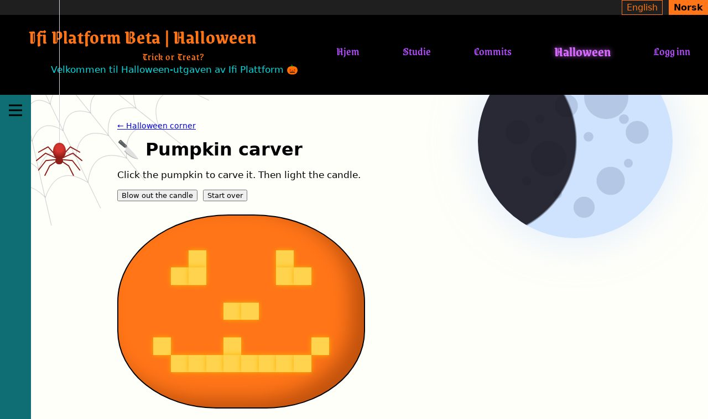

*A carved face, with the candle lit.*

---

# Q15: A spooky "page not found" page
`🎃 pumpkin` · `🎨 restyle` · Feature

**Reward:** 3 🪙 + 3 🏆 · **Time:** about 15 min  
**Good to know first:** HTML and CSS, Django templates basics (``)

### What to do
When someone opens a page that doesn't exist, they see a plain "Page not found". Make it a Halloween 404 page: lost in a haunted house.

### Files to change (only these)
- `ifiplatform/templates/404.html`
- `ifiplatform/static/css/07_halloween/page_404.css` (empty, already loaded on every page)

### How to see it
On your own computer Django shows its own yellow debug page for missing pages, so open the preview at **http://localhost:8000/halloween/404-preview/** instead.

### What's already there
`404.html` extends the normal page layout and shows a heading, a sentence and a link home, inside `<div class="page-404">`.

### Design to build
The look: **lost in a foggy night**. You don't have to come up with a design: build this one. Rather design your own? Go ahead, see "Make it yours".
- **The box** (`.page-404`): everything centred (`display: grid; justify-items: center; text-align: center`), lots of space (`padding: 4rem 1rem`), a foggy dark background: `radial-gradient(ellipse at 50% 30%, #3a3a44, #121216 70%)`, light text `#e6e6ee`.
- **The 404** (`.page-404__code`): huge (`font-size: clamp(5rem, 18vw, 10rem)`), pumpkin orange `#ff7518`, with an orange glow: `text-shadow: 0 0 30px rgba(255, 117, 24, 0.5)`.
- **A ghost** (👻, `font-size: 4rem`) above the 404 that bobs up and down every 3 seconds (`@keyframes` that moves it `-1rem` at 50%), standing still with reduced motion.
- **The link home** (`.page-404 a`): lantern orange `#ffb15c`.

### Your part
1. **Content:** a big "404", a spooky sentence ("This page has been haunted away..."), and keep the link back home. Use `` around every text, like the existing lines.
2. **A picture:** a ghost, a lost pumpkin or a tombstone that says "404", drawn with emoji, CSS or a small inline `<svg>`.
3. **Style:** build the design above in `page_404.css`. Start every rule with `.page-404`: the file loads on every page.
4. **Movement**, for example a ghost that bobs up and down with `@keyframes`, but none when `prefers-reduced-motion: reduce` is on.

### Done when
- http://localhost:8000/halloween/404-preview/ shows your page, the link home works, and nothing else on the site changes.

### How to work on it
Set up the project on your own computer first (see **Get started** in the README). Then:

1. **Claim this issue** on the site: https://halloween.ifiplattform.no/commits/issues/
2. In the VS Code terminal:
   ```bash
   ifi fix-issue {number}
   ```
3. Make the change, and check it at http://localhost:8000. Reload with **Ctrl+Shift+R** (Mac: **Cmd+Shift+R**): a normal reload may show the old look, because the browser keeps old copies of CSS files and pictures. Still old? Try a private window.
4. Then:
   ```bash
   ifi test
   git add .
   git commit -m "Short description of what you changed"
   ifi pull-request
   ```

**Only change the files listed above.** Then your pull request can't clash with anyone else's. After the merge it can take a few minutes before it shows on the live site. Stuck? Ask a helper, or type `ifi help`.

#### What it looks like when it's done


---

# Q16: The real moon phase on the moon
`🎃 pumpkin` · `🧪 python` · Feature

**Reward:** 3 🪙 + 3 🏆 · **Time:** about 18 min  
**Good to know first:** Python (dates, %, functions), Django template tags, CSS gradients. Some tests are written for you

### What to do
The moon at the top right of every page is always full. Make it show the **real** moon phase of today: a thin crescent, a half moon, or full, like the moon outside.

### Files to change (only these)
- new: `ifiplatform/apps/halloween_app/moon_phase.py`
- new: `ifiplatform/apps/halloween_app/templatetags/moon_tags.py`
- new: `ifiplatform/apps/halloween_app/tests/test_moon_phase.py`
- `ifiplatform/templates/partials/halloween_decor.html` (**only the first line**, the moon)
- `ifiplatform/static/css/07_halloween/moon_phase.css` (empty, already loaded on every page)

### How it works
The moon goes from new (dark) to full and back in about 29.53 days. Count the days since a known new moon, take the remainder after dividing by 29.53 (`%`), and you know where in the cycle it is. On the page, a dark circle as big as the moon covers part of it: covering it all for a new moon, sliding off to one side as it grows, gone at full moon, and coming back from the other side.

### What you get
Start `moon_phase.py` with:
```python
"""Where the moon is in its cycle of about 29.5 days, for the moon on every
page."""

from datetime import datetime, timezone

SYNODIC_MONTH = 29.530588853  # days from one new moon to the next
KNOWN_NEW_MOON = datetime(2000, 1, 6, 18, 14, tzinfo=timezone.utc)


def phase(moment):
    """0 is new moon, 0.5 full moon, and just under 1 almost new again.
    moment: a datetime with a time zone."""
    # TODO 1
    return 0.5


def shadow_offset(moon_phase):
    """Where the shadow sits, in % of the moon's width from its middle: 0
    covers the whole moon (new moon), -100 or 100 is clear of it (full
    moon). Seen from Norway the moon grows from the right, so a growing
    moon's shadow moves off to the left."""
    # TODO 2
    return 100
```
And the shadow's CSS, for `moon_phase.css`:
```css
.moon__shadow {
    position: absolute;
    inset: 0;
    z-index: 1;
    border-radius: 50%;
    background: radial-gradient(ellipse 50% 50% at calc(50% + var(--moon-shadow, 100%)) 50%, rgba(18, 15, 26, 0.88) 98%, transparent 100%);
}
```
The gradient is a dark circle exactly as big as the moon, moved sideways by `--moon-shadow`.

### Your part
1. **TODO 1, `phase(moment)`:** the days since `KNOWN_NEW_MOON` (subtract, then `.total_seconds() / 86400`), the remainder after `% SYNODIC_MONTH`, divided by `SYNODIC_MONTH`.
2. **TODO 2, `shadow_offset(moon_phase)`:** from phase 0 to 0.5 the shadow goes from 0 to -100; from 0.5 to 1 it comes back from 100 to 0. Return a whole number (`round`).
3. **The tag:** make `templatetags/moon_tags.py` with a `simple_tag` called `moon_shadow` that returns today's offset with a `%` after it, like `"-37%"`. "Today" is `django.utils.timezone.now()`.
4. **The moon:** in `halloween_decor.html`, change only the first line to load your tag and put the shadow inside the moon:
   ```html
   <div class="moon" aria-hidden="true"><div class="moon__shadow" style="--moon-shadow: "></div></div>
   ```
5. **Tests:** make `tests/test_moon_phase.py`, and fill in the last test:
   ```python
   # pylint: disable=C0114,C0115,C0116
   from datetime import datetime, timezone

   from django.test import SimpleTestCase

   from halloween_app.moon_phase import phase, shadow_offset


   class MoonPhaseTests(SimpleTestCase):
       def test_known_full_moon(self):
           self.assertAlmostEqual(phase(datetime(2026, 10, 26, 4, tzinfo=timezone.utc)), 0.5, delta=0.03)

       def test_shadow(self):
           self.assertEqual(shadow_offset(0), 0)
           self.assertEqual(shadow_offset(0.5), -100)

       def test_waning_moon(self):
           # TODO: at phase 0.75 the shadow is at 50
           pass
   ```
6. Paste the CSS above into `moon_phase.css`.

Restart the server if Django says the tag doesn't exist: new `templatetags` files are only found when it starts.

### Make it yours
- Show the phase's name somewhere for screen readers: "waxing crescent", "full moon"...

### Done when
- The moon on every page has the same shape as the real moon today (check https://www.timeanddate.com/moon/phases/norway/oslo), and `ifi test` passes.

### How to work on it
Set up the project on your own computer first (see **Get started** in the README). Then:

1. **Claim this issue** on the site: https://halloween.ifiplattform.no/commits/issues/
2. In the VS Code terminal:
   ```bash
   ifi fix-issue {number}
   ```
3. Make the change, and check it at http://localhost:8000. Reload with **Ctrl+Shift+R** (Mac: **Cmd+Shift+R**): a normal reload may show the old look, because the browser keeps old copies of CSS files and pictures. Still old? Try a private window.
4. Then:
   ```bash
   ifi test
   git add .
   git commit -m "Short description of what you changed"
   ifi pull-request
   ```

**Only change the files listed above.** Then your pull request can't clash with anyone else's. After the merge it can take a few minutes before it shows on the live site. Stuck? Ask a helper, or type `ifi help`.

#### What it looks like when it's done


*The moon on 18 October 2026: just under half full, growing.*

---

# Q17: 👻 Places open past midnight show as closed
`🎃 pumpkin` · `👻 haunted bug` · Bug

**Reward:** 3 🪙 + 3 🏆 · **Time:** about 15 min  
**Good to know first:** Python (strings, if, the % operator, datetime), tests

### What's wrong
The "Open now?" box on the home page says whether each place is open right now. But a place that's open from 07:00 to 01:00 (until 1 at night) shows **Closed** all day. And just after midnight, when it really is still open from the evening before, it says Closed too. A ghost has been in the clock...

### Files to change (only these)
- `ifiplatform/apps/ifi_home_app/opening_hours.py`
- new: `ifiplatform/apps/ifi_home_app/tests/test_opening_hours.py`

### What's already there
`opening_hours.py` has `is_open(place, now)`, which compares the time as text: `opens <= "14:00" < closes`. A place's hours are a list of seven `("opens", "closes")` pairs, Monday first, or `None` for closed all day (see `ifiplatform/apps/ifi_home_app/opening_hours_data.py`; only read it). A closing time before the opening time means "closes after midnight".

### Your part
1. **Find out why.** With `("07:00", "01:00")` at 14:00: what does `"07:00" <= "14:00" < "01:00"` give?
2. **Fix `is_open`** so it handles closing after midnight:
   - On normal days (opens before closes), it works as before.
   - When closes is at or before opens: open from the opening time until midnight.
   - **After midnight,** look at **yesterday's** hours: if they close after midnight and it's not that time yet, the place is still open. Yesterday's weekday is `(now.weekday() - 1) % 7` (that makes Monday's yesterday Sunday, 6).
3. **Tests:** make `ifiplatform/apps/ifi_home_app/tests/test_opening_hours.py`. Start with this, and add at least three tests of your own for the night: open at 23:30, still open at 01:30 the next morning, closed at 02:00.
   ```python
   # pylint: disable=C0114,C0115,C0116
   from datetime import datetime

   from django.test import SimpleTestCase

   from ifi_home_app.opening_hours import OSLO, is_open

   DAY = {"hours": [("08:00", "16:00")] * 5 + [None, None]}
   NIGHT = {"hours": [("20:00", "02:00")] * 5 + [None, None]}


   def at(day, time):
       """day 19 is a Monday (October 2026)."""
       hour, minute = map(int, time.split(":"))
       return datetime(2026, 10, day, hour, minute, tzinfo=OSLO)


   class IsOpenTests(SimpleTestCase):
       def test_normal_hours(self):
           self.assertTrue(is_open(DAY, at(19, "12:00")))
           self.assertFalse(is_open(DAY, at(19, "16:00")))
   ```
   Run them with `ifi test`.

### Done when
- Your night tests pass, the normal-hours test still passes, and on the home page a place open until after midnight (if the list still has one) shows **Open** during its hours.

### How to work on it
Set up the project on your own computer first (see **Get started** in the README). Then:

1. **Claim this issue** on the site: https://halloween.ifiplattform.no/commits/issues/
2. In the VS Code terminal:
   ```bash
   ifi fix-issue {number}
   ```
3. Make the change, and check it at http://localhost:8000. Reload with **Ctrl+Shift+R** (Mac: **Cmd+Shift+R**): a normal reload may show the old look, because the browser keeps old copies of CSS files and pictures. Still old? Try a private window.
4. Then:
   ```bash
   ifi test
   git add .
   git commit -m "Short description of what you changed"
   ifi pull-request
   ```

**Only change the files listed above.** Then your pull request can't clash with anyone else's. After the merge it can take a few minutes before it shows on the live site. Stuck? Ask a helper, or type `ifi help`.

#### What it looks like when it's done


*The new tests.*

---

# Q18: A little ghost follows the mouse
`🎃 pumpkin` · `🦇 silly feature` · Feature

**Reward:** 3 🪙 + 3 🏆 · **Time:** about 16 min  
**Good to know first:** JavaScript (events, the page's HTML from JS, requestAnimationFrame), CSS (position: fixed)

### What to do
Add a little ghost 👻 that follows the mouse pointer around every page, floating a bit behind it, like it's chasing you.

### Files to change (only these)
- `ifiplatform/static/js/halloween/ghost_follow.js` (empty, already loaded on every page)
- `ifiplatform/static/css/07_halloween/ghost_follow.css` (empty, already loaded on every page)

There's already another ghost on the page (`.ghost`, the one floating across). Leave it alone: make your own.

### Your part
1. **Only with a mouse, and only with animations on.** A ghost chasing your finger on a phone makes no sense, and some people turn animations off because movement makes them dizzy. Stop straight away when either is true:
   ```js
   const hasMouse = window.matchMedia("(hover: hover) and (pointer: fine)").matches;
   const reduceMotion = window.matchMedia("(prefers-reduced-motion: reduce)").matches;
   ```
2. **Make the ghost** in JavaScript: a `<div class="ghost-follower">` with 👻 as text and `aria-hidden="true"` (screen readers should skip it), added to `document.body`.
3. **Remember where the mouse is:** on `pointermove`, save `event.clientX` and `event.clientY` (plus a little, so the ghost sits beside the pointer, not under it).
4. **Float after it:** a function that moves the ghost a small part of the way towards the mouse (say 8% of the distance), sets ``ghost.style.translate = `${x}px ${y}px` ``, and calls itself again with `requestAnimationFrame`. Moving part of the way every frame is what makes it lag behind smoothly.
5. **Hide it when the mouse leaves the window** (`pointerleave` on `document.documentElement`), and show it again when it comes back.
6. **The CSS** in `ghost_follow.css`: `.ghost-follower` is `position: fixed` at `top: 0; left: 0` (the `translate` moves it from there), above the page (`z-index: 50`), never blocking clicks (`pointer-events: none`), about `1.8rem` big. Invisible by default (`opacity: 0`), and a class like `ghost-follower--visible` shows it, see-through (`opacity: 0.75`), fading with a `transition`.

### Make it yours
- The ghost turns to face the way it's moving (`scale: -1 1` when the mouse is to its left).
- It gets scared and flees when you move fast.

### Done when
- On a computer with a mouse, a ghost floats after the pointer on every page, never gets in the way of clicking, and disappears when the mouse leaves the window.
- With animations turned off, or on a phone, there's no ghost.

### How to work on it
Set up the project on your own computer first (see **Get started** in the README). Then:

1. **Claim this issue** on the site: https://halloween.ifiplattform.no/commits/issues/
2. In the VS Code terminal:
   ```bash
   ifi fix-issue {number}
   ```
3. Make the change, and check it at http://localhost:8000. Reload with **Ctrl+Shift+R** (Mac: **Cmd+Shift+R**): a normal reload may show the old look, because the browser keeps old copies of CSS files and pictures. Still old? Try a private window.
4. Then:
   ```bash
   ifi test
   git add .
   git commit -m "Short description of what you changed"
   ifi pull-request
   ```

**Only change the files listed above.** Then your pull request can't clash with anyone else's. After the merge it can take a few minutes before it shows on the live site. Stuck? Ask a helper, or type `ifi help`.

#### What it looks like when it's done
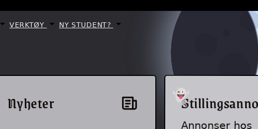

*The ghost following the pointer (the pointer itself doesn't show in a screenshot).*

---

# Q19: The Konami code makes it rain candy
`🎃 pumpkin` · `🦇 silly feature` · Feature

**Reward:** 3 🪙 + 3 🏆 · **Time:** about 16 min  
**Good to know first:** JavaScript (keyboard events, arrays, the page's HTML from JS, element.animate)

### What to do
Hide a famous secret on every page: when someone types the **Konami code**, ↑ ↑ ↓ ↓ ← → ← → B A, it rains candy 🍬🍭🍫 down the screen.

### Files to change (only these)
- `ifiplatform/static/js/halloween/candy_rain.js` (empty, already loaded on every page)

### Your part
1. **Wait for the page:** `document.addEventListener("DOMContentLoaded", () => { ... });`.
2. **Recognise the code:** listen for `keydown` on `document`. `event.key` is `"ArrowUp"`, `"ArrowDown"`, `"ArrowLeft"`, `"ArrowRight"`, `"b"` or `"a"` (use `.toLowerCase()`, so caps lock doesn't matter). Keep the last 10 keys in an array (`.slice(-10)`), and compare it with the code. When it matches, empty the array and make it rain.
3. **The rain:** make about 40 pieces of candy. Each one is a `<span>` with a random candy emoji and `aria-hidden="true"`, `position: fixed` just above the top of the window, at a random distance from the left (`${Math.random() * 100}vw`), a random size, `pointer-events: none` and a high `z-index`. Set these with `piece.style` in JavaScript: this issue has no CSS file.
4. **Make it fall** with `element.animate`, from where it is to below the bottom of the window, spinning as it falls:
   ```js
   const fall = piece.animate(
     [
       { transform: "translateY(0) rotate(0deg)" },
       { transform: "translateY(calc(100vh + 6rem)) rotate(360deg)" },
     ],
     { duration: 3000, delay: Math.random() * 1500, easing: "ease-in" },
   );
   fall.onfinish = () => piece.remove();
   ```
   Give each piece its own duration and spin, so they don't all fall together. `onfinish` removes it from the page afterwards.
5. **Animations off:** some people turn animations off because movement makes them dizzy. If `window.matchMedia("(prefers-reduced-motion: reduce)").matches`, show a message instead, like "🍬 You found the secret candy code!", for a few seconds. Give it `role="status"`, so screen readers read it out.

### Make it yours
- A pumpkin 🎃 that bounces at the bottom.
- Your own secret code, for an extra surprise.

### Done when
- Typing ↑ ↑ ↓ ↓ ← → ← → B A on any page makes candy rain down the screen, and the pieces are removed when they're done.
- With animations turned off, a message shows instead.

### How to work on it
Set up the project on your own computer first (see **Get started** in the README). Then:

1. **Claim this issue** on the site: https://halloween.ifiplattform.no/commits/issues/
2. In the VS Code terminal:
   ```bash
   ifi fix-issue {number}
   ```
3. Make the change, and check it at http://localhost:8000. Reload with **Ctrl+Shift+R** (Mac: **Cmd+Shift+R**): a normal reload may show the old look, because the browser keeps old copies of CSS files and pictures. Still old? Try a private window.
4. Then:
   ```bash
   ifi test
   git add .
   git commit -m "Short description of what you changed"
   ifi pull-request
   ```

**Only change the files listed above.** Then your pull request can't clash with anyone else's. After the merge it can take a few minutes before it shows on the live site. Stuck? Ask a helper, or type `ifi help`.

#### What it looks like when it's done
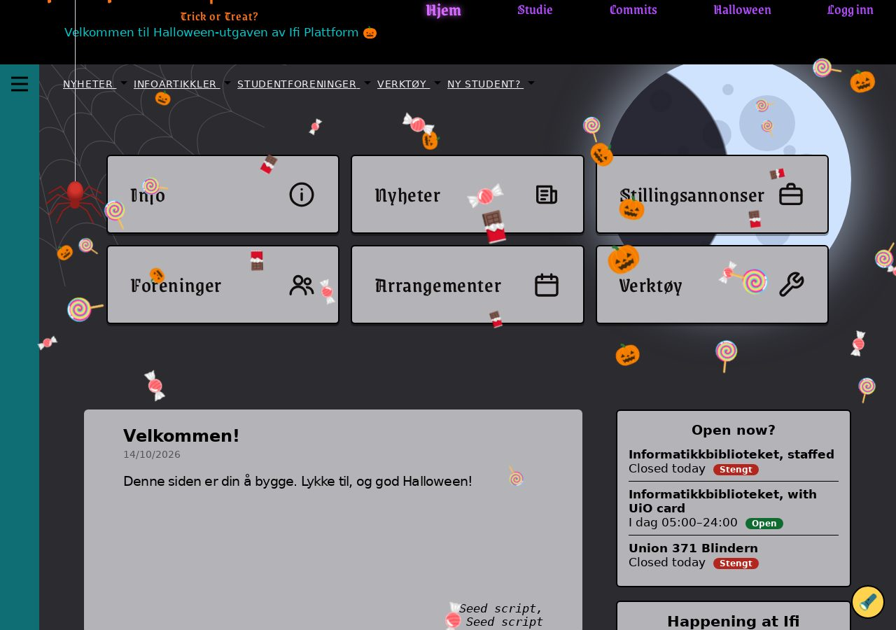

*Two seconds after typing the code.*

---

# Q2: Spooky name generator: find the name
`🎃 pumpkin` · `🧪 python` · Feature

**Reward:** 3 🪙 + 3 🏆 · **Time:** about 15 min · **Part of the set** SET-fortune  
**Good to know first:** Python basics (lists, functions, `%`), basic CSS. The tests are mostly written for you

### What to do
The spooky name generator at http://localhost:8000/halloween/spooky-name/ is half built: the form works, but no name comes out. Make "Kari" turn into something like **"Count Kari of the Crypt"**, and the same name into the same spooky name every time.

### Files to change (only these)
- `ifiplatform/apps/halloween_app/views/spooky_name.py`
- `ifiplatform/apps/halloween_app/static/css/halloween_pages/spooky_name.css` (empty, already loaded on the page)
- new: `ifiplatform/apps/halloween_app/tests/test_spooky_name.py`

### What's already there
`views/spooky_name.py` has two lists, `FIRST_PARTS` and `LAST_PARTS`, with one word each, and `spooky_name(name)` returns `None`. There are three `TODO`s.

### Design to build
The look: **a horror film poster title**. You don't have to come up with a design: build this one. Rather design your own? Go ahead, see "Make it yours".
- **The spooky name** (`.spooky-result`): very big (`font-size: clamp(2rem, 6vw, 3.5rem)`), bold, blood red `#c0261d`, with a red glow and a hard black shadow: `text-shadow: 0 0 12px rgba(192, 38, 29, 0.6), 2px 2px 0 #000`.

### Your part
1. **TODO 1 and 2:** at least 6 words in each list.
2. **TODO 3:** pick a first part and a last part from the name, and put the name in between with an f-string. Two different numbers from the name give more variety, for example `len(name)` for one and `sum(ord(c) for c in name.lower())` for the other. Use `%` to stay inside the lists.
3. **Tests:** make `ifiplatform/apps/halloween_app/tests/test_spooky_name.py`:
   ```python
   # pylint: disable=C0114,C0115,C0116
   from django.test import SimpleTestCase

   from halloween_app.views.spooky_name import FIRST_PARTS, LAST_PARTS, spooky_name


   class SpookyNameTests(SimpleTestCase):
       def test_keeps_the_name(self):
           self.assertIn("Kari", spooky_name("Kari"))

       def test_same_name_same_result(self):
           self.assertEqual(spooky_name("Kari"), spooky_name("Kari"))

       def test_uses_the_lists(self):
           # TODO: check that the result starts with one of FIRST_PARTS
           # and ends with one of LAST_PARTS
           pass
   ```
4. **Style:** build the design above in `spooky_name.css`.

### Done when
- Every name gets a spooky name, always the same one, and `ifi test` passes.

### How to work on it
Set up the project on your own computer first (see **Get started** in the README). Then:

1. **Claim this issue** on the site: https://halloween.ifiplattform.no/commits/issues/
2. In the VS Code terminal:
   ```bash
   ifi fix-issue {number}
   ```
3. Make the change, and check it at http://localhost:8000. Reload with **Ctrl+Shift+R** (Mac: **Cmd+Shift+R**): a normal reload may show the old look, because the browser keeps old copies of CSS files and pictures. Still old? Try a private window.
4. Then:
   ```bash
   ifi test
   git add .
   git commit -m "Short description of what you changed"
   ifi pull-request
   ```

**Only change the files listed above.** Then your pull request can't clash with anyone else's. After the merge it can take a few minutes before it shows on the live site. Stuck? Ask a helper, or type `ifi help`.

#### What it looks like when it's done


---

# Q20: Flashlight mode
`🎃 pumpkin` · `🦇 silly feature` · Feature

**Reward:** 3 🪙 + 3 🏆 · **Time:** about 16 min  
**Good to know first:** JavaScript (events, the page's HTML from JS, CSS custom properties from JS), CSS gradients

### What to do
Add a 🔦 button to the bottom right corner of every page. Pressing it turns the lights off: the whole page goes dark, except a circle of light around the mouse pointer, like searching a haunted house with a flashlight.

### Files to change (only these)
- `ifiplatform/static/js/halloween/flashlight.js` (empty, already loaded on every page)
- `ifiplatform/static/css/07_halloween/flashlight.css` (empty, already loaded on every page)

### What you get
The darkness, in CSS. It's a layer over the whole window that's see-through in a circle around `--x`, `--y` and dark everywhere else:
```css
.flashlight {
    position: fixed;
    inset: 0;
    z-index: 90;
    pointer-events: none;
    background: radial-gradient(circle 9rem at var(--x, 50%) var(--y, 50%), transparent 0 55%, rgba(5, 4, 8, 0.94) 100%);
}

.flashlight[hidden] {
    display: none;
}
```
`pointer-events: none` lets clicks go through the darkness to the page under it.

### Your part
1. **The CSS:** paste the above into `flashlight.css`, and style a `.flashlight-toggle` button: round, `3rem`, fixed at the bottom right (`right: 1rem; bottom: 1rem`) above the darkness (`z-index: 91`), candle yellow `#ffd34d` with a black border `2px solid #000`. Pumpkin orange `#ff7518` while it's on (`.flashlight-toggle[aria-pressed="true"]`).
2. **The button**, made in JavaScript (the templates aren't in this issue): a `<button type="button" class="flashlight-toggle">` with 🔦 as text, `aria-label="Flashlight mode"` (screen readers can't read an emoji's meaning reliably) and `aria-pressed="false"`.
3. **The darkness:** a `<div class="flashlight" hidden aria-hidden="true">`. Add both to `document.body`.
4. **On and off:** clicking the button shows or hides the darkness (`hidden`), and sets `aria-pressed` to `"true"` or `"false"`. **Esc** turns it off too.
5. **Aim:** on `pointermove`, set `--x` and `--y` on the darkness to the pointer's position: ``dark.style.setProperty("--x", `${event.clientX}px`)``. When it's switched on, start in the middle of the window, so keyboard users see something.

### Make it yours
- A flickering flashlight, as if the battery is dying (none with `prefers-reduced-motion: reduce`).
- A bigger circle when you hold the mouse button down.

### Done when
- The 🔦 button turns the lights off and on, the circle of light follows the mouse, you can still click links through the dark, and Esc turns it off.

### How to work on it
Set up the project on your own computer first (see **Get started** in the README). Then:

1. **Claim this issue** on the site: https://halloween.ifiplattform.no/commits/issues/
2. In the VS Code terminal:
   ```bash
   ifi fix-issue {number}
   ```
3. Make the change, and check it at http://localhost:8000. Reload with **Ctrl+Shift+R** (Mac: **Cmd+Shift+R**): a normal reload may show the old look, because the browser keeps old copies of CSS files and pictures. Still old? Try a private window.
4. Then:
   ```bash
   ifi test
   git add .
   git commit -m "Short description of what you changed"
   ifi pull-request
   ```

**Only change the files listed above.** Then your pull request can't clash with anyone else's. After the merge it can take a few minutes before it shows on the live site. Stuck? Ask a helper, or type `ifi help`.

#### What it looks like when it's done
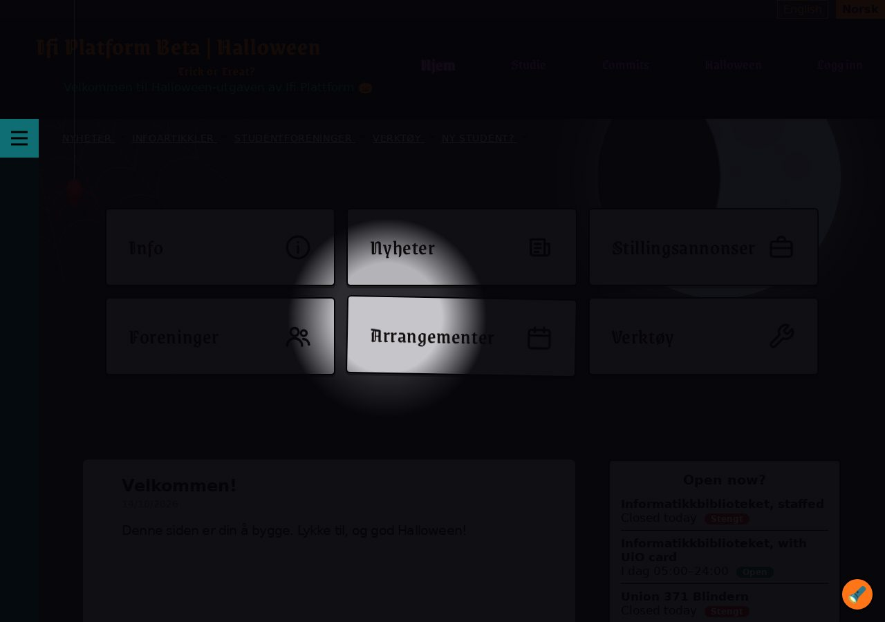

*Flashlight on, pointed at the shortcuts.*

---

# Q21: "Add to calendar" for events
`🎃 pumpkin` · `🧪 python` · Feature

**Reward:** 3 🪙 + 3 🏆 · **Time:** about 18 min  
**Good to know first:** Python (strings, dates), a little Django (views, URLs in templates), tests

### What to do
Give every event page an **📅 Add to calendar** link that downloads an `.ics` file: the format every calendar app (Google Calendar, Outlook, Apple Calendar) can import.

### Files to change (only these)
- `ifiplatform/apps/halloween_app/views/ics.py`
- new: `ifiplatform/apps/halloween_app/tests/test_ics.py`
- `ifiplatform/apps/ifi_home_app/templates/events/partials/add_to_calendar.html` (empty, already shown on every event page, under the sign-up links)

### What's already there
The address is ready: `/halloween/event/<page id>/calendar.ics`, named `halloween_event_ics`, goes to `event_ics_view` in `views/ics.py`, which just says "not built yet" (404).

### What an .ics file looks like
```
BEGIN:VCALENDAR
VERSION:2.0
PRODID:-//Ifi Platform//Halloween corner//EN
BEGIN:VEVENT
UID:event-42@ifiplattform.no
DTSTAMP:20261019T120000Z
DTSTART;TZID=Europe/Oslo:20261030T180000
DTEND;TZID=Europe/Oslo:20261030T213000
SUMMARY:Pumpkin carving
LOCATION:Ole-Johan Dahls hus
END:VEVENT
END:VCALENDAR
```
- Every line ends with `\r\n` (that's the rule for this format).
- `UID` is a unique name for the event, `DTSTAMP` when the file was made (in UTC, with a `Z`).
- Times are `YYYYMMDDTHHMMSS`. `TZID=Europe/Oslo` says they're Norwegian time.
- An event without a time is all day: `DTSTART;VALUE=DATE:20261031` and `DTEND;VALUE=DATE:20261101`, the day **after** the last day.
- In text, `,` `;` and `\` need a `\` in front.

### Your part
1. **`ics_text(uid, title, start_date, start_time=None, end_date=None, end_time=None, location="", url="")`** in `views/ics.py`: returns the file as text. With a start time: `DTSTART`/`DTEND` with `TZID` (no end time? say 2 hours later). Without: all day. Python's f-strings format dates for you: `f"{start:%Y%m%dT%H%M%S}"`.
2. **`event_ics_view(request, page_id)`:** find the live event with `EventPage.objects.live().filter(id=page_id).first()` (from `ifi_home_app.models`), and raise `Http404` if there's none. Its fields: `title`, `event_date`, `event_time`, `end_date`, `event_end_time`, `location`, and `page.get_full_url(request)` for its address. Return an `HttpResponse` with `content_type="text/calendar; charset=utf-8"` and a `Content-Disposition` header `attachment; filename="<the page's slug>.ics"`.
3. **The link** in `add_to_calendar.html`: a link to `` with the `download` attribute and the text `📅 `. Give it the class `event-signup-link`, so it looks like the sign-up links next to it. Remember ``.
4. **Tests** in `tests/test_ics.py` (a `TestCase`): at least a timed event, an all-day event that ends the next day, a title with a comma, and that an unknown id gives 404 (`self.client.get(reverse("halloween_event_ics", args=[999999]))`).

### Done when
- Every event page has an "Add to calendar" link, and the file it downloads opens in a calendar app with the right title, day and time.
- `ifi test` passes, including your new tests.

### How to work on it
Set up the project on your own computer first (see **Get started** in the README). Then:

1. **Claim this issue** on the site: https://halloween.ifiplattform.no/commits/issues/
2. In the VS Code terminal:
   ```bash
   ifi fix-issue {number}
   ```
3. Make the change, and check it at http://localhost:8000. Reload with **Ctrl+Shift+R** (Mac: **Cmd+Shift+R**): a normal reload may show the old look, because the browser keeps old copies of CSS files and pictures. Still old? Try a private window.
4. Then:
   ```bash
   ifi test
   git add .
   git commit -m "Short description of what you changed"
   ifi pull-request
   ```

**Only change the files listed above.** Then your pull request can't clash with anyone else's. After the merge it can take a few minutes before it shows on the live site. Stuck? Ask a helper, or type `ifi help`.

#### What it looks like when it's done


---

# Q22: `python manage.py halloween_stats`
`🎃 pumpkin` · `🧪 python` · Feature

**Reward:** 3 🪙 + 3 🏆 · **Time:** about 16 min  
**Good to know first:** Python (loops, dictionaries), a little Django (getting objects from the database), tests

### What to do
Make a management command that counts how spooky the site's articles are: how often spooky words appear in their titles and intros.
```
$ python manage.py halloween_stats
ghost      4
pumpkin    3
...
Spookiest article: "Spøkelse observert i Ole-Johan Dahls hus" (3 spooky words)
```

### Files to change (only these)
- new: `ifiplatform/apps/halloween_app/management/commands/halloween_stats.py`
- new: `ifiplatform/apps/halloween_app/tests/test_halloween_stats.py`

### What you get
Start the command with:
```python
"""python manage.py halloween_stats: how spooky are the articles?"""

import re
from collections import Counter

from django.core.management.base import BaseCommand
from django.utils.html import strip_tags

from ifi_home_app.models import ArticlePage

SPOOKY_WORDS = ["ghost", "spøkelse", "pumpkin", "gresskar", "bat", "flaggermus", "witch", "heks"]


def spooky_counts(text):
    """How often each spooky word appears in text, as a Counter."""
    words = re.findall(r"\w+", text.lower())
    # TODO: count only the words in SPOOKY_WORDS
    return Counter()


class Command(BaseCommand):
    help = "Counts spooky words in the titles and intros of the live articles."

    def handle(self, *args, **options):
        # TODO: go through ArticlePage.objects.live(), count title + intro
        # (strip_tags(page.intro): the intro is HTML), print the totals, and
        # print the spookiest article.
        pass
```

### Your part
1. **`spooky_counts`:** count only the spooky words. `Counter(w for w in words if ...)` works.
2. **`handle`:** add up the counts of every live article, print every word with its count (most common first: `Counter.most_common()`), then the spookiest article.
3. **Tests:** make `ifiplatform/apps/halloween_app/tests/test_halloween_stats.py`: at least `spooky_counts("Ghost! A ghost and a PUMPKIN")` gives ghost 2 and pumpkin 1. For the command, `call_command("halloween_stats", stdout=io.StringIO())` must run without errors on an empty database.

### Make it yours
- More spooky words, in both languages.
- `--top 3` to print only the top 3 words.

### Done when
- The command prints the counts, and `ifi test` passes with your tests.

### How to work on it
Set up the project on your own computer first (see **Get started** in the README). Then:

1. **Claim this issue** on the site: https://halloween.ifiplattform.no/commits/issues/
2. In the VS Code terminal:
   ```bash
   ifi fix-issue {number}
   ```
3. Make the change, and check it at http://localhost:8000. Reload with **Ctrl+Shift+R** (Mac: **Cmd+Shift+R**): a normal reload may show the old look, because the browser keeps old copies of CSS files and pictures. Still old? Try a private window.
4. Then:
   ```bash
   ifi test
   git add .
   git commit -m "Short description of what you changed"
   ifi pull-request
   ```

**Only change the files listed above.** Then your pull request can't clash with anyone else's. After the merge it can take a few minutes before it shows on the live site. Stuck? Ask a helper, or type `ifi help`.

#### What it looks like when it's done


*Terminal output.*

---

# Q23: Draw the Halloween corner mascot
`🎃 pumpkin` · `🖼️ art` · Feature

**Reward:** 3 🪙 + 3 🏆 · **Time:** about 20 min  
**Good to know first:** drawing: SVG by hand, or a drawing program like Inkscape or Figma

### What to do
The Halloween corner's front page (http://localhost:8000/halloween/) has a spot for a mascot under the heading, but it's empty. Draw one!

### Files to change (only these)
- new: `ifiplatform/static/images/halloween/mascot.svg`
- `ifiplatform/apps/halloween_app/templates/halloween/partials/mascot.html` (empty, already shown on the front page)

### Your part
1. **Draw the mascot as an SVG**, by hand in the file or in a drawing program that exports SVG (Inkscape and Figma both do). A ghost in an Ifi hoodie, a pumpkin with a laptop, a bat that codes: your call. Keep it under about 20 KB.
2. **Show it** in `mascot.html`:
   ```html
   
   
   ```
   Write a real `alt` text that says what's in the picture, for people who can't see it.

### Tips for SVG by hand
- `<svg xmlns="http://www.w3.org/2000/svg" viewBox="0 0 200 200">` gives you a 200×200 canvas.
- `<circle>`, `<ellipse>`, `<rect>` and `<path>` are enough for most characters. Give every shape a `fill`.

### Done when
- The mascot shows on http://localhost:8000/halloween/, with a good alt text.

### How to work on it
Set up the project on your own computer first (see **Get started** in the README). Then:

1. **Claim this issue** on the site: https://halloween.ifiplattform.no/commits/issues/
2. In the VS Code terminal:
   ```bash
   ifi fix-issue {number}
   ```
3. Make the change, and check it at http://localhost:8000. Reload with **Ctrl+Shift+R** (Mac: **Cmd+Shift+R**): a normal reload may show the old look, because the browser keeps old copies of CSS files and pictures. Still old? Try a private window.
4. Then:
   ```bash
   ifi test
   git add .
   git commit -m "Short description of what you changed"
   ifi pull-request
   ```

**Only change the files listed above.** Then your pull request can't clash with anyone else's. After the merge it can take a few minutes before it shows on the live site. Stuck? Ask a helper, or type `ifi help`.

#### What it looks like when it's done


---

# Q24: Draw six pumpkin faces for the carver
`🎃 pumpkin` · `🖼️ art` · Feature

**Reward:** 3 🪙 + 3 🏆 · **Time:** about 18 min  
**Good to know first:** drawing: SVG by hand, or a drawing program like Inkscape or Figma

### What to do
Under the pumpkin carver (http://localhost:8000/halloween/pumpkin-carver/), "Need ideas?" shows six grey placeholders that say "Face 1" to "Face 6". Draw six jack-o'-lantern faces to inspire the carvers: happy, scary, surprised, sleepy, angry, goofy... all different.

### Files to change (only these)
- `ifiplatform/static/images/halloween/faces/face1.svg`
- `ifiplatform/static/images/halloween/faces/face2.svg`
- `ifiplatform/static/images/halloween/faces/face3.svg`
- `ifiplatform/static/images/halloween/faces/face4.svg`
- `ifiplatform/static/images/halloween/faces/face5.svg`
- `ifiplatform/static/images/halloween/faces/face6.svg`

### What you get
A blank pumpkin, 120 × 120, to start each face from:
```html
<svg xmlns="http://www.w3.org/2000/svg" width="120" height="120" viewBox="0 0 120 120">
  <rect x="56" y="10" width="8" height="14" rx="3" fill="#3f7a2a"/>
  <ellipse cx="60" cy="66" rx="52" ry="44" fill="#ff7518"/>
</svg>
```
The `<rect>` is the stem and the `<ellipse>` the pumpkin. Its middle is at 60, 66.

### Your part
1. **Six faces:** replace each placeholder with the blank pumpkin plus a face. Use dark brown `#2b1406` for the carved parts: eyes at about `y="54"`, a nose in the middle, a mouth at about `y="82"`. Useful shapes:
   - triangles and zig-zag teeth with `<path d="M x y l dx dy l dx dy z"/>` (`l` draws a line relative to where the pen is, `z` closes the shape),
   - round eyes with `<circle>`, a smile with a curved `<path>` (`q`) and a thick `stroke`,
   - a gap in a tooth: a small orange `<rect>` on top of the mouth.
2. **All different,** so each one gives the carvers a new idea.
3. **Keep them small:** under about 5 KB each. Exported from Inkscape or Figma? Use "plain SVG", or "optimized SVG".

### Make it yours
- Not every pumpkin has to be round: a tall one (`rx="40" ry="50"`), a squat one, a green one.

### Done when
- "Need ideas?" on the pumpkin carver shows six different jack-o'-lantern faces, with no placeholder left.

### How to work on it
Set up the project on your own computer first (see **Get started** in the README). Then:

1. **Claim this issue** on the site: https://halloween.ifiplattform.no/commits/issues/
2. In the VS Code terminal:
   ```bash
   ifi fix-issue {number}
   ```
3. Make the change, and check it at http://localhost:8000. Reload with **Ctrl+Shift+R** (Mac: **Cmd+Shift+R**): a normal reload may show the old look, because the browser keeps old copies of CSS files and pictures. Still old? Try a private window.
4. Then:
   ```bash
   ifi test
   git add .
   git commit -m "Short description of what you changed"
   ifi pull-request
   ```

**Only change the files listed above.** Then your pull request can't clash with anyone else's. After the merge it can take a few minutes before it shows on the live site. Stuck? Ask a helper, or type `ifi help`.

#### What it looks like when it's done


*The six faces under the carver.*

---

# Q26: Accessibility check of the home page, fixed with CSS
`🎃 pumpkin` · `♿ a11y` · Bug

**Reward:** 3 🪙 + 3 🏆 · **Time:** about 18 min  
**Good to know first:** CSS (selectors, colours, media queries). Running an accessibility check is explained

### What to do
Run an accessibility check on the home page and fix three of the problems it finds, with CSS only. They're real problems for real people: text that people with poor eyesight can't read, a button a screen reader can't name, and a keyboard focus you can't see.

### Files to change (only these)
- `ifiplatform/static/css/07_halloween/a11y_fixes.css` (empty, already loaded on every page, last)

### How to check
- **Chrome:** DevTools (F12) → **Lighthouse** → tick only "Accessibility" → **Analyze page load**. Or install the free **axe DevTools** extension and press "Scan".
- **Keyboard:** click the address bar, then press **Tab** again and again, and watch where the focus goes on the page.

### Your part
Fix these three. For each, find the element with right-click → **Inspect**.
1. **Event badges are hard to read.** In "Happening at Ifi", the small coloured badges (Social, Deadline...) have white text on light colours: white on turquoise is about 1.4 : 1, and text needs at least 4.5 : 1. Fix every type of badge (`.event-type-badge--social`, `--deadline`, `--academic`, `--company`): darker backgrounds, or dark text on the light ones. Measure each one: click the colour square next to `color` in DevTools to see the "Contrast ratio".
2. **The menu button has no name.** The ☰ button at the top of the side menu (`summary.sidemenu-header`) has a hidden "Menu" text in it (`.icon-text`). It's hidden with `display: none`, and screen readers skip `display: none` text, so they just say "button". Hide it in a way that screen readers still read: the "visually hidden" trick:
   ```css
   position: absolute;
   width: 1px;
   height: 1px;
   overflow: hidden;
   clip-path: inset(50%);
   white-space: nowrap;
   ```
   Careful: when the side menu opens, the text must show normally again. Find the rules that show it in `ifiplatform/static/css/06_components/sidemenu.css` (only read that file), and undo the trick for the same cases.
3. **You can't see the focus in the header.** Tab through the header (language buttons, logo, menu links): the browser's focus ring is dark, on a black header. Give everything in the header (`.topheader-content :focus-visible`) a clear orange outline instead: `3px solid #ff7518`, with a little `outline-offset`.

Run the check again afterwards: those problems should be gone. Some of the others it finds need HTML changes: leave them.

### Done when
- Lighthouse or axe no longer reports the badges' contrast or the side menu button's name, and Tab shows a clear orange ring on every header link and button.
- The side menu still shows "Menu" when it opens.

### How to work on it
Set up the project on your own computer first (see **Get started** in the README). Then:

1. **Claim this issue** on the site: https://halloween.ifiplattform.no/commits/issues/
2. In the VS Code terminal:
   ```bash
   ifi fix-issue {number}
   ```
3. Make the change, and check it at http://localhost:8000. Reload with **Ctrl+Shift+R** (Mac: **Cmd+Shift+R**): a normal reload may show the old look, because the browser keeps old copies of CSS files and pictures. Still old? Try a private window.
4. Then:
   ```bash
   ifi test
   git add .
   git commit -m "Short description of what you changed"
   ifi pull-request
   ```

**Only change the files listed above.** Then your pull request can't clash with anyone else's. After the merge it can take a few minutes before it shows on the live site. Stuck? Ask a helper, or type `ifi help`.

#### What it looks like when it's done


*The badges' new colours. Below: the orange focus ring in the header, after pressing Tab.*


---

# Q27: Make the Halloween corner's front page work with a screen reader
`🎃 pumpkin` · `♿ a11y` · Feature

**Reward:** 3 🪙 + 3 🏆 · **Time:** about 16 min  
**Good to know first:** HTML (landmarks, headings), a little ARIA. Using a screen reader is explained

### What to do
People who can't see the screen use a **screen reader**, a program that reads the page out loud. They don't read a page top to bottom: they jump between landmarks (like "navigation"), headings and links. Make the Halloween corner's front page (http://localhost:8000/halloween/) easy to use that way.

### Files to change (only these)
- `ifiplatform/apps/halloween_app/templates/halloween/hub.html`

**Keep the three `` lines and every `class` as they are:** other issues fill in those partials and style those classes.

### How to listen to it
- **Windows:** NVDA (free, nvaccess.org). **Mac:** VoiceOver (Cmd+F5). In both, the **H** key (NVDA) or the rotor (VoiceOver, Ctrl+Option+U) lists the headings and landmarks.
- No screen reader? Chrome DevTools → Elements → the **Accessibility** tab shows what a screen reader gets for the selected element, and Lighthouse (DevTools → Lighthouse → Accessibility) checks the basics.

### Your part
Listen to the page (or read its accessibility tree) first. Then:
1. **A landmark for the pages:** wrap the list of cards in a `<nav>` with a heading above the list, `<h2 id="hc-pages-heading"></h2>`, and connect them: `<nav aria-labelledby="hc-pages-heading">`. Now "All pages navigation" is in the landmarks list.
2. **Short link names:** every card is one link, and a screen reader reads everything in it as the link's name: "Bat snake A bat that grows with every candy it eats." In a list of 15 links that's a lot. Give each link `aria-label="{{ title }}"`, and connect the description with `aria-describedby`: give the description an `id` (like `hc-hub-text-{{ slug }}`), and the link `aria-describedby="hc-hub-text-{{ slug }}"`. The name is short, and the description is read after a pause.
3. **No emoji in the heading's name:** the 🎃 in the `<h1>` is read as "jack-o-lantern Halloween corner". Wrap it in `<span aria-hidden="true">`.
4. **A skip link:** right under the `<h1>`, a link to the pages heading (`href="#hc-pages-heading"`), "Skip to the pages", for keyboard users who don't want to Tab past everything above.

### Done when
- A screen reader (or the accessibility tree) shows an "All pages" navigation landmark and heading, each card's link name is just its title with the description after it, the `<h1>` is read without the emoji, and the skip link jumps to the pages.
- The page looks the same as before, apart from the new heading and skip link, and `ifi test` passes.

### How to work on it
Set up the project on your own computer first (see **Get started** in the README). Then:

1. **Claim this issue** on the site: https://halloween.ifiplattform.no/commits/issues/
2. In the VS Code terminal:
   ```bash
   ifi fix-issue {number}
   ```
3. Make the change, and check it at http://localhost:8000. Reload with **Ctrl+Shift+R** (Mac: **Cmd+Shift+R**): a normal reload may show the old look, because the browser keeps old copies of CSS files and pictures. Still old? Try a private window.
4. Then:
   ```bash
   ifi test
   git add .
   git commit -m "Short description of what you changed"
   ifi pull-request
   ```

**Only change the files listed above.** Then your pull request can't clash with anyone else's. After the merge it can take a few minutes before it shows on the live site. Stuck? Ask a helper, or type `ifi help`.

#### What it looks like when it's done


*The skip link and the "All pages" heading show; the rest is what screen readers hear.*

---

# Q28: 👻 The fortune teller crashes on names with æ, ø or å
`🎃 pumpkin` · `👻 haunted bug` · Bug

**Reward:** 3 🪙 + 3 🏆 · **Time:** about 12 min  
**Good to know first:** Python basics (strings), and reading an error message

### What's wrong
Go to http://localhost:8000/halloween/fortune/ and type **Åse**, **Bjørn** or **Kæthe**. The page crashes with a `UnicodeEncodeError`. Half of Norway can't get a fortune!

### Files to change (only these)
- `ifiplatform/apps/halloween_app/fortune_names.py`
- new: `ifiplatform/apps/halloween_app/tests/test_fortune_names.py`

### Your part
1. **Find out why.** Read the error page: which line breaks, and what does `.encode("ascii")` do with a letter that isn't in ASCII?
2. **Fix `clean_name(name)`** so it never crashes, and gives a sensible name in ASCII letters:
   - first swap `æ` → `ae`, `ø` → `o`, `å` → `a` (`str.replace`),
   - then remove accents from other letters, like é in "René". Python's `unicodedata.normalize("NFKD", name)` splits é into e + an accent, and `.encode("ascii", "ignore")` then drops what isn't ASCII.
3. **Tests:** make `ifiplatform/apps/halloween_app/tests/test_fortune_names.py` with at least three tests: `clean_name("Åse") == "ase"`, `clean_name("  Bjørn ") == "bjorn"`, and one of your own (é? an emoji?).

### Done when
- Åse, Bjørn and René all get a fortune page without crashing, and `ifi test` passes.

If the fortune teller's own issue isn't done yet, the page still says "the crystal ball is cloudy". That's fine: it just mustn't crash.

### How to work on it
Set up the project on your own computer first (see **Get started** in the README). Then:

1. **Claim this issue** on the site: https://halloween.ifiplattform.no/commits/issues/
2. In the VS Code terminal:
   ```bash
   ifi fix-issue {number}
   ```
3. Make the change, and check it at http://localhost:8000. Reload with **Ctrl+Shift+R** (Mac: **Cmd+Shift+R**): a normal reload may show the old look, because the browser keeps old copies of CSS files and pictures. Still old? Try a private window.
4. Then:
   ```bash
   ifi test
   git add .
   git commit -m "Short description of what you changed"
   ifi pull-request
   ```

**Only change the files listed above.** Then your pull request can't clash with anyone else's. After the merge it can take a few minutes before it shows on the live site. Stuck? Ask a helper, or type `ifi help`.

#### What it looks like when it's done


*The fortune teller with the name Åse, which used to crash.*

---

# Q29: Drag the notes around the haunted board
`🎃 pumpkin` · `🦇 silly feature` · Feature

**Reward:** 3 🪙 + 3 🏆 · **Time:** about 18 min  
**Good to know first:** JavaScript (events, the page's HTML from JS, JSON, localStorage)

### What to do
On the haunted notice board (http://localhost:8000/halloween/board/), let people drag notes to a new spot, and have the board remember where they put them, in their own browser.

### Files to change (only these)
- `ifiplatform/apps/halloween_app/static/js/halloween_pages/board_drag.js` (empty, already loaded on the board)

### What's already there
Every note is an `<article class="note">` inside `<div class="board">`. Each note is already tilted a little with `transform: rotate(var(--tilt))`.

### Your part
1. **Dragging:** use `pointerdown`, `pointermove` and `pointerup` on each note (they work for mouse and touch). While dragging, move the note with the CSS `translate` property (`note.style.translate = `${x}px ${y}px``). That's a separate property from `transform`, so the tilt stays.
2. **Remember:** save every note's offset in `localStorage`, keyed by its title, as JSON. On page load, put the notes back where they were.
3. **Be careful:** `localStorage` can fail (private windows), so wrap it in `try`/`catch`. The board must still work without it.
4. **A reset button:** add a "Tidy the board" button that puts all notes back and clears the saved spots. Make the button in JavaScript (`document.createElement`), since the template isn't your file.

### Done when
- You can drag notes, they stay where you drop them after a reload, and "Tidy the board" puts them back.

### How to work on it
Set up the project on your own computer first (see **Get started** in the README). Then:

1. **Claim this issue** on the site: https://halloween.ifiplattform.no/commits/issues/
2. In the VS Code terminal:
   ```bash
   ifi fix-issue {number}
   ```
3. Make the change, and check it at http://localhost:8000. Reload with **Ctrl+Shift+R** (Mac: **Cmd+Shift+R**): a normal reload may show the old look, because the browser keeps old copies of CSS files and pictures. Still old? Try a private window.
4. Then:
   ```bash
   ifi test
   git add .
   git commit -m "Short description of what you changed"
   ifi pull-request
   ```

**Only change the files listed above.** Then your pull request can't clash with anyone else's. After the merge it can take a few minutes before it shows on the live site. Stuck? Ask a helper, or type `ifi help`.

#### What it looks like when it's done
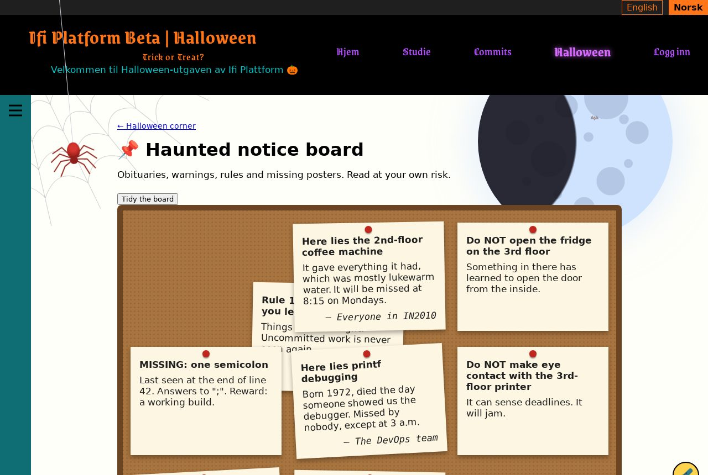

*One note dragged out of place; "Tidy the board" puts it back.*

---

# Q3: Potion mixer: what did you brew?
`🎃 pumpkin` · `🧪 python` · Feature

**Reward:** 3 🪙 + 3 🏆 · **Time:** about 16 min · **Part of the set** SET-fortune  
**Good to know first:** Python basics (lists, sets, `if`), basic CSS

### What to do
The potion mixer at http://localhost:8000/halloween/potion/ is half built: you can tick ingredients and press **Brew**, but the cauldron only bubbles. Decide what each mix does.

### Files to change (only these)
- `ifiplatform/apps/halloween_app/views/potion.py`
- `ifiplatform/apps/halloween_app/static/css/halloween_pages/potion.css` (empty, already loaded on the page)
- new: `ifiplatform/apps/halloween_app/tests/test_potion.py`

### What's already there
`INGREDIENTS` lists the six ingredients as `(key, label)` pairs. `mix(picked)` gets the picked keys as a list, like `["bat_wing", "coffee"]`, and returns `None`. There are three `TODO`s.

### Design to build
The look: **a witch's kitchen: a shelf of jars and a green cauldron**. You don't have to come up with a design: build this one. Rather design your own? Go ahead, see "Make it yours".
- **The shelf** (`.potion-form fieldset`): dark wood `#6b4423` with pale yellow text `#fff5bc`, a 2px solid black border, the ingredients in a grid (`grid-template-columns: repeat(auto-fill, minmax(12rem, 1fr))`).
- **Each jar** (`.potion-form__ingredient`): a see-through light box (`background: rgba(255, 255, 255, 0.12)`), corners rounded 4px.
- **The result** (`.potion-result`): a green cauldron: dark green `#1d4d1d`, rounded at the bottom only (`border-radius: 0 0 50% 50%`), a lighter green rim at the bottom (`box-shadow: 0 -8px 0 #3fa33f inset`), pale green text `#c9ffc9`, centred.

### Your part
1. **TODO 1:** nothing picked → `"Just water. Spooky."`
2. **TODO 2:** at least 4 special combinations, each with its own sentence. Tip: `set(picked) == {"bat_wing", "coffee"}` checks for exactly those two, and `"eyeball" in picked` for one.
3. **TODO 3:** anything else → a general sentence that says how many ingredients went in (`len(picked)`).
4. **Tests:** make `ifiplatform/apps/halloween_app/tests/test_potion.py`:
   ```python
   # pylint: disable=C0114,C0115,C0116
   from django.test import SimpleTestCase

   from halloween_app.views.potion import mix


   class PotionTests(SimpleTestCase):
       def test_nothing_is_water(self):
           self.assertEqual(mix([]), "Just water. Spooky.")

       def test_order_does_not_matter(self):
           self.assertEqual(mix(["coffee", "bat_wing"]), mix(["bat_wing", "coffee"]))

       def test_everything_has_a_result(self):
           # TODO: check that mix() of all six ingredients returns some text
           pass
   ```
5. **Style:** build the design above in `potion.css`.

### Done when
- Every mix gives a sentence, your special combinations give their own, and `ifi test` passes.

### How to work on it
Set up the project on your own computer first (see **Get started** in the README). Then:

1. **Claim this issue** on the site: https://halloween.ifiplattform.no/commits/issues/
2. In the VS Code terminal:
   ```bash
   ifi fix-issue {number}
   ```
3. Make the change, and check it at http://localhost:8000. Reload with **Ctrl+Shift+R** (Mac: **Cmd+Shift+R**): a normal reload may show the old look, because the browser keeps old copies of CSS files and pictures. Still old? Try a private window.
4. Then:
   ```bash
   ifi test
   git add .
   git commit -m "Short description of what you changed"
   ifi pull-request
   ```

**Only change the files listed above.** Then your pull request can't clash with anyone else's. After the merge it can take a few minutes before it shows on the live site. Stuck? Ask a helper, or type `ifi help`.

#### What it looks like when it's done
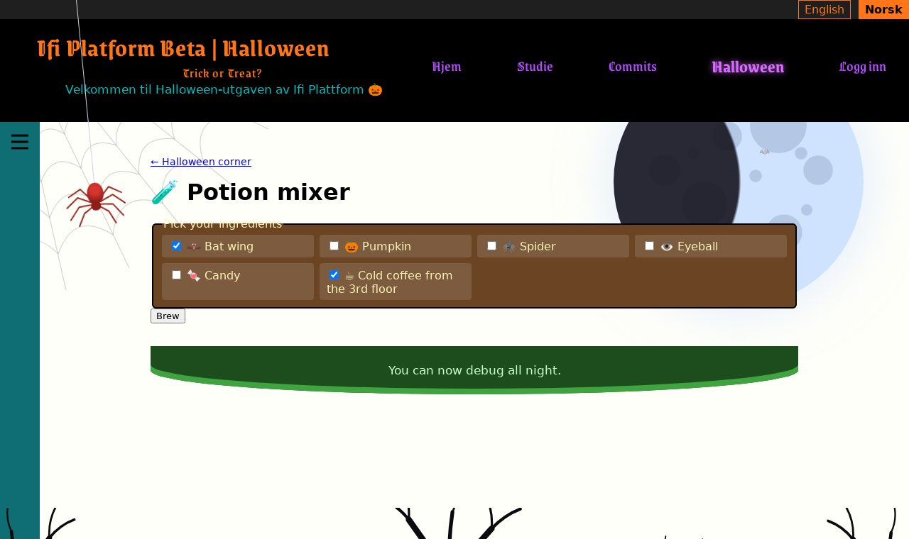

---

# Q30: Design the Halloween corner's front page
`🎃 pumpkin` · `🎨 restyle` · Feature

**Reward:** 3 🪙 + 3 🏆 · **Time:** about 15 min  
**Good to know first:** CSS (selectors, grid, transitions)

### What to do
The Halloween corner's front page (http://localhost:8000/halloween/) is a plain list of cards with black borders. Make it the spooky entrance it deserves.

### Files to change (only these)
- `ifiplatform/apps/halloween_app/static/css/halloween_pages/hub.css` (empty, already loaded on the front page)

### What's already there
The front page's HTML (another issue makes it better for screen readers, but keeps these classes):
- `<h1>` inside `.hc-page`: the heading.
- `ul.hc-hub`: the grid of cards. Each card is `li.hc-hub__card` with one link inside, holding `.hc-hub__emoji`, `.hc-hub__title` and `.hc-hub__text`.
- The first card is always the haunted notice board.

`ifiplatform/apps/halloween_app/static/css/halloween_pages/base.css` already gives the grid and the black borders (only read it). `hub.css` loads after it, so your rules win. It only loads on the front page, so plain selectors are fine.

### Design to build
The look: **a row of haunted doors**. You don't have to come up with a design: build this one. Rather design your own? Go ahead, see "Make it yours".
- **The heading** (`.hc-page h1`): pumpkin orange `#ff7518`, the spooky font (`var(--font-spooky)`), big (`clamp(2.4rem, 6vw, 3.6rem)`), bold, centred.
- **The grid** (`.hc-hub`): `repeat(auto-fill, minmax(13rem, 1fr))`, gap `1.2rem`.
- **A card** (`.hc-hub__card a`): dark purple `#2b1f3a` with light text `#f2eff6`, a hard black shadow under it (`box-shadow: 0 4px 0 #000`), all cards as tall as each other (`height: 100%; box-sizing: border-box`). Keep the black border from `base.css`.
- **Hover and keyboard focus:** the card lifts (`translate: 0 -4px`) and its shadow grows (`0 8px 0 #000`), smoothly (`transition` on `translate` and `box-shadow`, `0.15s`). Keyboard focus also gets an orange outline `3px solid #ff7518` with `outline-offset: 3px`.
- **The board's card** (`.hc-hub__card:first-child a`): dark brown `#3a2a1a`, like old cork.
- **Inside a card:** the emoji bigger (`2.6rem`), the title lantern orange `#ffb15c` at `1.15rem`, the description pale `#d8d2e2` at `0.9rem`.
- **Animations off** (`prefers-reduced-motion: reduce`): no transition.

### Your part
Build the design above in `hub.css`. Check it with a wide and a narrow window, and Tab through the cards.

### Make it yours
- Cards shaped like doors or tombstones (`border-radius` with big top corners).
- A spooky background for the whole page section, like the night sky with a moon in a corner.

### Done when
- The front page has a big spooky heading and dark cards that lift on hover and keyboard focus, and everything is easy to read.

### How to work on it
Set up the project on your own computer first (see **Get started** in the README). Then:

1. **Claim this issue** on the site: https://halloween.ifiplattform.no/commits/issues/
2. In the VS Code terminal:
   ```bash
   ifi fix-issue {number}
   ```
3. Make the change, and check it at http://localhost:8000. Reload with **Ctrl+Shift+R** (Mac: **Cmd+Shift+R**): a normal reload may show the old look, because the browser keeps old copies of CSS files and pictures. Still old? Try a private window.
4. Then:
   ```bash
   ifi test
   git add .
   git commit -m "Short description of what you changed"
   ifi pull-request
   ```

**Only change the files listed above.** Then your pull request can't clash with anyone else's. After the merge it can take a few minutes before it shows on the live site. Stuck? Ask a helper, or type `ifi help`.

#### What it looks like when it's done


---

# Q31: Costume of the day on the Halloween corner
`🎃 pumpkin` · `🧪 python` · Feature

**Reward:** 3 🪙 + 3 🏆 · **Time:** about 16 min  
**Good to know first:** Python (lists, random with a seed, dates), Django template tags, tests

### What to do
Show a **costume of the day** on the Halloween corner's front page (http://localhost:8000/halloween/), under the heading: the same costume for everyone all day, and a new one tomorrow. Like "🧟 A zombie TA, still grading".

### Files to change (only these)
- new: `ifiplatform/apps/halloween_app/costume_of_the_day.py`
- new: `ifiplatform/apps/halloween_app/templatetags/costume_tags.py`
- new: `ifiplatform/apps/halloween_app/tests/test_costume_of_the_day.py`
- `ifiplatform/apps/halloween_app/templates/halloween/partials/costume_of_the_day.html` (empty, already shown on the front page)

### How "the same all day" works
`random.choice` picks something new every time. But `random.Random(seed)` makes a random generator that always gives the same answers for the same seed. Use a number for today's date as the seed (`day.toordinal()`, the number of days since year 1), and every visitor gets the same costume today, and a different one tomorrow.

### Your part
1. **`costume_of_the_day.py`:** a list `COSTUMES` of at least 8 `(emoji, costume)` pairs, and a function `costume_of_the_day(day)` that takes a `date` and returns one of them, the same one for the same date.
2. **The tag** in `templatetags/costume_tags.py`: a `simple_tag` called `costume_of_the_day` that returns today's costume. "Today" is Norwegian today: `datetime.now(ZoneInfo("Europe/Oslo")).date()` (the server's clock runs on UTC). Careful: if the tag function has the same name as the function you import, the names clash. Import it under another name: `from ..costume_of_the_day import costume_of_the_day as pick`.
3. **The partial** `costume_of_the_day.html`:
   ```html
   
   
   <aside class="hc-costume-of-the-day">
       <p class="hc-costume-of-the-day__label"></p>
       <p class="hc-costume-of-the-day__text"><span aria-hidden="true">{{ costume.0 }}</span> {{ costume.1 }}</p>
   </aside>
   ```
   `costume.0` is the emoji and `costume.1` the text. The emoji is hidden from screen readers, because the text already says what it is.
4. **Tests** in `tests/test_costume_of_the_day.py`: at least that the same date gives the same costume, that it's one of `COSTUMES`, and that a month of dates gives more than one costume.

Restart the server if Django says the tag doesn't exist: new `templatetags` files are only found when it starts.

### Make it yours
- More costumes, the spookier the better.
- A special costume on 31 October, whatever the seed says.

### Done when
- The front page shows a costume of the day that stays the same when you reload, and `ifi test` passes, including your new tests.

### How to work on it
Set up the project on your own computer first (see **Get started** in the README). Then:

1. **Claim this issue** on the site: https://halloween.ifiplattform.no/commits/issues/
2. In the VS Code terminal:
   ```bash
   ifi fix-issue {number}
   ```
3. Make the change, and check it at http://localhost:8000. Reload with **Ctrl+Shift+R** (Mac: **Cmd+Shift+R**): a normal reload may show the old look, because the browser keeps old copies of CSS files and pictures. Still old? Try a private window.
4. Then:
   ```bash
   ifi test
   git add .
   git commit -m "Short description of what you changed"
   ifi pull-request
   ```

**Only change the files listed above.** Then your pull request can't clash with anyone else's. After the merge it can take a few minutes before it shows on the live site. Stuck? Ask a helper, or type `ifi help`.

#### What it looks like when it's done


---

# Q32: Another study excuse, without reloading the page
`🎃 pumpkin` · `🧪 python` · Feature

**Reward:** 3 🪙 + 3 🏆 · **Time:** about 18 min  
**Good to know first:** Python and a little Django (views, JSON), JavaScript (fetch, async/await, events), tests

### What to do
"Give me another excuse" on the study page (http://localhost:8000/study/) reloads the whole page. Make it fetch a new excuse from the server and swap it in, without a reload, and never the same excuse twice in a row. For this you build a small **API**: an address that answers with data (JSON) instead of a page.

### Files to change (only these)
- `ifiplatform/apps/study_app/views/excuse_api.py`
- `ifiplatform/apps/study_app/static/js/study_excuse.js` (empty, already loaded on the study page)
- new: `ifiplatform/apps/study_app/test_excuse_api.py`

### What's already there
- The address `/study/api/excuse/` (named `study_excuse_api`) goes to `excuse_api_view` in `views/excuse_api.py`, which answers "Not built yet". Open http://localhost:8000/study/api/excuse/ to see it.
- `all_jokes()` in `ifiplatform/apps/study_app/jokes.py` (only read it) gives every joke: the translated list and the joke files. The translated ones are "lazy" texts: `str(joke)` turns them into normal text.
- On the page: the joke is `<blockquote id="study-joke">`, and the link is `<a id="study-another" data-api="...">`. `data-api` holds the API's address, with the right language prefix (`/nb/` or `/en/`).

### Your part
1. **The API**, in `excuse_api_view`: return `JsonResponse({"joke": ...})` with a random joke (`random.choice`). The page sends the joke it's showing now as `?not=<text>` (`request.GET.get("not", "")`): leave that one out of the choices, so you never get the same one twice. If that leaves nothing, use all of them.
2. **The page**, in `study_excuse.js`: when the link is clicked, stop the normal reload (`event.preventDefault()`), fetch the API with the current joke as `not` (use `encodeURIComponent` on it: jokes have spaces and question marks), and put the answer in the blockquote:
   ```js
   const response = await fetch(url, { headers: { Accept: "application/json" } });
   const data = await response.json();
   ```
   **If anything fails** (the server is down, `response.ok` is false), fall back to the normal link: `window.location.href = link.href`. The page must always work.
3. **Tests** in `test_excuse_api.py` (a `TestCase`): at least that the API answers 200 with a joke from `all_jokes()`, that with `not` set to a joke it never returns that joke (ask 30 times in a loop), and that an unknown `not` is fine. `response.json()` gives the answer as a dictionary.

### Make it yours
- A little fade when the joke changes (none with `prefers-reduced-motion: reduce`).
- Also send `"count"`, how many jokes there are, and show "1 of 22 excuses" somewhere.

### Done when
- Clicking "Give me another excuse" swaps the excuse without reloading (the page doesn't flash, and the address stays the same), never the same one twice in a row.
- With the server stopped, clicking the link still tries to load the page like before.
- `ifi test` passes, including your new tests.

### How to work on it
Set up the project on your own computer first (see **Get started** in the README). Then:

1. **Claim this issue** on the site: https://halloween.ifiplattform.no/commits/issues/
2. In the VS Code terminal:
   ```bash
   ifi fix-issue {number}
   ```
3. Make the change, and check it at http://localhost:8000. Reload with **Ctrl+Shift+R** (Mac: **Cmd+Shift+R**): a normal reload may show the old look, because the browser keeps old copies of CSS files and pictures. Still old? Try a private window.
4. Then:
   ```bash
   ifi test
   git add .
   git commit -m "Short description of what you changed"
   ifi pull-request
   ```

**Only change the files listed above.** Then your pull request can't clash with anyone else's. After the merge it can take a few minutes before it shows on the live site. Stuck? Ask a helper, or type `ifi help`.

#### What it looks like when it's done


*After pressing "Give me another excuse": a new excuse, same page, no reload.*

---

# Q4: Haunted story: fill in the blanks
`🎃 pumpkin` · `🧪 python` · Feature

**Reward:** 3 🪙 + 3 🏆 · **Time:** about 16 min · **Part of the set** SET-fortune  
**Good to know first:** Python basics (strings, dictionaries, f-strings or format), basic CSS. Some tests are written for you

### What to do
The haunted story at http://localhost:8000/halloween/story/ asks for six words (a name, a place at Ifi, a food...), but pressing **Tell me the story** only says pages are missing. Write the story: a spooky tale with the visitor's words in it.

### Files to change (only these)
- `ifiplatform/apps/halloween_app/views/story.py`
- `ifiplatform/apps/halloween_app/static/css/halloween_pages/story.css` (empty, already loaded on the page)
- new: `ifiplatform/apps/halloween_app/tests/test_story.py`

### What's already there
`views/story.py` has the list `FIELDS` (each field's key and label) and a function `tell_story(words)` that returns `None`, with two `TODO`s. `words` is a dictionary from each key to what the visitor typed: `{"name": "Kari", "place": "the 3rd floor", ...}`. The page shows the story when `tell_story` returns a list of paragraphs, and "missing some pages" when it returns `None`.

### Design to build
The look: **an old storybook page**. You don't have to come up with a design: build this one. Rather design your own? Go ahead, see "Make it yours".
- **The form** (`.story-form`): a grid of fields, `repeat(auto-fill, minmax(14rem, 1fr))`, gap `0.8rem 1.2rem`, at most `46rem` wide. Each field (`.story-form__field`) has its label above the input (`display: grid; gap: 0.2rem`), in bold.
- **The inputs:** a black border `2px solid #000`, rounded corners `4px`, some padding.
- **The button:** dark red `#6b1d1d` with parchment text `#f3e7c9`, a black border, `border-radius: 999px`.
- **The story** (`.story`): parchment `#f3e7c9` with dark brown text `#3b2412`, a black border, padding `2rem 2.4rem`, at most `40rem` wide, in `Georgia, serif` at `1.1rem` with `line-height: 1.6`.
- **A drop cap:** the first letter of the story (`.story p:first-child::first-letter`) big (`3.4rem`), blood red `#a3130f`, floating to the left of the first lines (`float: left`).

### Your part
1. **TODO 1:** if any of the words is empty, return `None`. `all(...)` is handy.
2. **TODO 2:** write the story as a list of at least 3 paragraphs (strings), using every word at least once. Tip: write the paragraphs with `{name}`, `{place}`... in them, and fill them in with `paragraph.format(**words)`.
3. **Tests:** make `ifiplatform/apps/halloween_app/tests/test_story.py` and fill in the last test:
   ```python
   # pylint: disable=C0114,C0115,C0116
   from django.test import SimpleTestCase

   from halloween_app.views.story import tell_story

   WORDS = {"name": "Kari", "place": "the 3rd floor", "food": "taco", "number": "13", "creature": "mummy", "sound": "BOO"}


   class StoryTests(SimpleTestCase):
       def test_every_word_is_used(self):
           story = " ".join(tell_story(WORDS))
           for word in WORDS.values():
               self.assertIn(word, story)

       def test_a_missing_word_gives_no_story(self):
           self.assertIsNone(tell_story({**WORDS, "food": ""}))

       def test_at_least_three_paragraphs(self):
           # TODO: check that the story has at least 3 paragraphs
           pass
   ```
   Run them with `ifi test`.
4. **Style:** build the design above in `story.css`.

### Make it yours
- Two or three different stories, picked by the visitor's name, so friends get different ones.
- More fields: add them to `FIELDS` and the template shows them by itself.

### Done when
- Filling in all six words tells a story with every word in it, and leaving one out asks for all of them.
- `ifi test` passes, including your new tests.

### How to work on it
Set up the project on your own computer first (see **Get started** in the README). Then:

1. **Claim this issue** on the site: https://halloween.ifiplattform.no/commits/issues/
2. In the VS Code terminal:
   ```bash
   ifi fix-issue {number}
   ```
3. Make the change, and check it at http://localhost:8000. Reload with **Ctrl+Shift+R** (Mac: **Cmd+Shift+R**): a normal reload may show the old look, because the browser keeps old copies of CSS files and pictures. Still old? Try a private window.
4. Then:
   ```bash
   ifi test
   git add .
   git commit -m "Short description of what you changed"
   ifi pull-request
   ```

**Only change the files listed above.** Then your pull request can't clash with anyone else's. After the merge it can take a few minutes before it shows on the live site. Stuck? Ask a helper, or type `ifi help`.

#### What it looks like when it's done
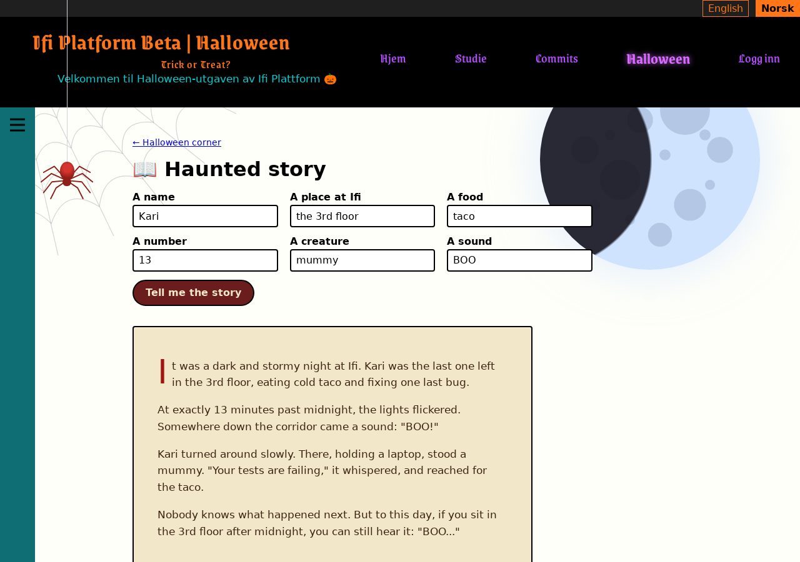

---

# Q5: Whack-a-bat: make the bats appear
`🎃 pumpkin` · `🦇 silly feature` · Feature

**Reward:** 3 🪙 + 3 🏆 · **Time:** about 20 min · **Part of the set** SET-arcade  
**Good to know first:** JavaScript basics (functions, click events, arrays, timers), basic CSS grid

### What to do
Whack-a-bat at http://localhost:8000/halloween/whack-a-bat/ is half built: there's a board with 9 holes, a score, a timer and a **Start** button, but no bats. Make the game work.

### Files to change (only these)
- `ifiplatform/apps/halloween_app/static/js/halloween_pages/whack_a_bat.js`
- `ifiplatform/apps/halloween_app/static/css/halloween_pages/whack_a_bat.css` (empty, already loaded on the page)

### What's already there
`whack_a_bat.js` finds the holes (`holes`), the score and time displays, and the **Start** button, and runs a timer that counts down every second. Three `TODO`s are left.

### Design to build
The look: **dark caves in the ground**. You don't have to come up with a design: build this one. Rather design your own? Go ahead, see "Make it yours".
- **The board** (`.wab-board`): a 3×3 grid, `gap: 1rem`, at most `24rem` wide.
- **Each hole** (`.wab-hole`): a round cave (`aspect-ratio: 1; border-radius: 50%`), no border, black with a brown edge: `background: radial-gradient(circle at 50% 60%, #000 55%, #3a2a1a 70%)`. The bat in it is big: `font-size: 2.6rem`.
- **Keyboard focus** (`.wab-hole:focus-visible`): an orange outline, `3px solid #ff7518`.

### Your part
1. **TODO 1, `showBat()`:** empty every hole, pick a random one (`Math.floor(Math.random() * holes.length)`) and put `"🦇"` in it.
2. **TODO 2, clicking a hole:** if it holds a bat, `score += 1`, show it in `scoreOut` and empty the hole.
3. **TODO 3, the timer:** call `showBat()` every second. At 0, stop the timer (`clearInterval(ticker)`), empty the holes and show "Game over!" somewhere.
4. **Style:** build the design above in `whack_a_bat.css`.

### Make it yours
Your own design instead of the one above, or on top of it. Some ideas:
- Bats that get faster as time runs out.
- A rare golden bat 🌟 worth 5 points.

### Done when
- Start → bats pop up, clicking one scores, and after 30 seconds the game ends.

### How to work on it
Set up the project on your own computer first (see **Get started** in the README). Then:

1. **Claim this issue** on the site: https://halloween.ifiplattform.no/commits/issues/
2. In the VS Code terminal:
   ```bash
   ifi fix-issue {number}
   ```
3. Make the change, and check it at http://localhost:8000. Reload with **Ctrl+Shift+R** (Mac: **Cmd+Shift+R**): a normal reload may show the old look, because the browser keeps old copies of CSS files and pictures. Still old? Try a private window.
4. Then:
   ```bash
   ifi test
   git add .
   git commit -m "Short description of what you changed"
   ifi pull-request
   ```

**Only change the files listed above.** Then your pull request can't clash with anyone else's. After the merge it can take a few minutes before it shows on the live site. Stuck? Ask a helper, or type `ifi help`.

#### What it looks like when it's done
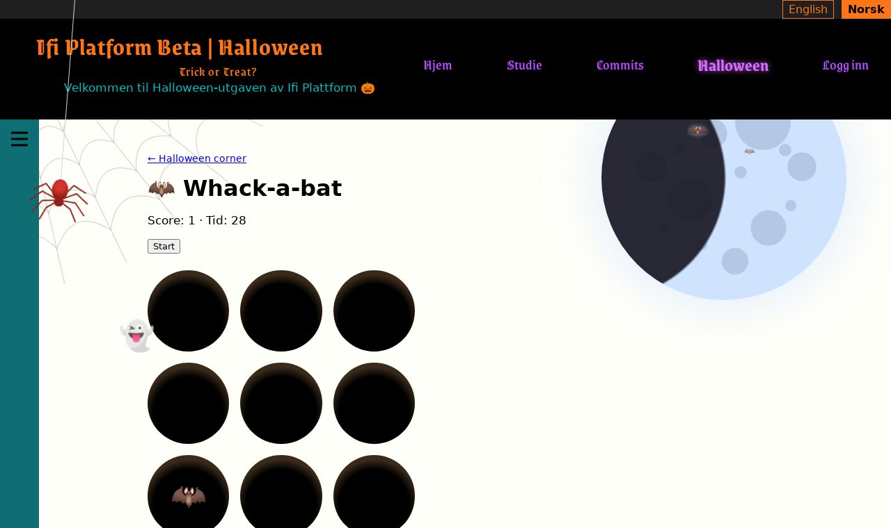

*Mid-game: one bat hit, the next one showing.*

---

# Q6: Zombie typing: make the zombies walk
`🎃 pumpkin` · `🦇 silly feature` · Feature

**Reward:** 3 🪙 + 3 🏆 · **Time:** about 20 min · **Part of the set** SET-arcade  
**Good to know first:** JavaScript basics (arrays, objects, the page's HTML from JS, events, timers), basic CSS

### What to do
Zombie typing at http://localhost:8000/halloween/zombie-typing/ is half built: there's a field, a score, lives, a text box and a **Start** button, but no zombies. Make the game work: zombies carrying words walk in from the right, and typing a zombie's word stops it.

### Files to change (only these)
- `ifiplatform/apps/halloween_app/static/js/halloween_pages/zombie_typing.js`
- `ifiplatform/apps/halloween_app/static/css/halloween_pages/zombie_typing.css` (empty, already loaded on the page)

### What's already there
`zombie_typing.js` has a list of `words`, the list `zombies` (empty), `score` and `lives`, and a game loop: after **Start**, it runs every 100 ms, calls `spawnZombie()` every 2 seconds and `moveZombies()` every time. `gameOver()` is done. Three `TODO`s are left.

### Design to build
The look: **a foggy field at night**. You don't have to come up with a design: build this one. Rather design your own? Go ahead, see "Make it yours".
- **The field** (`.zt-field`): `18rem` high, `position: relative` (the zombies are placed inside it), `overflow: hidden`, a black border `2px solid #000`, rounded corners `6px`, a dark green night with brown ground at the bottom: `background: linear-gradient(#1d2a1d, #0d140d 80%, #3a2a1a 80%)`.
- **A zombie** (`.zt-zombie`): `position: absolute`, a slime-green pill (`#8de9a8`, dark text `#0d140d`, `border-radius: 999px`, some padding), the word in bold `monospace` at `1.1rem`, on one line (`white-space: nowrap`), and a 🧟 in front (`.zt-zombie::before` with `content: "🧟 "`).
- **The text box** (`.zt-typing input`): big `monospace` text (`1.2rem`), a black border.

### Your part
1. **TODO 1, `spawnZombie()`:** make a `<div class="zt-zombie">` with a random word as its text, at a random height (`element.style.top = ...%`), add it to `field`, and remember it in `zombies` as `{ element, word, x: 100 }`.
2. **TODO 2, `moveZombies()`:** lower every zombie's `x` a little (try `0.4`), and move it there: ``element.style.left = `${x}%` ``. A zombie at `x <= 0` has reached you: remove it (`element.remove()` and from `zombies`), lose a life, show it in `livesOut`, and at 0 lives call `gameOver()`.
3. **TODO 3, typing:** when `input.value` is exactly a zombie's word, remove that zombie, add 1 to the score, show it, and empty the text box.
4. **Style:** build the design above in `zombie_typing.css`.

### Make it yours
- Faster zombies as the score goes up.
- Highlight the zombies whose word starts with what you've typed so far.

### Done when
- Start → zombies with words walk in from the right; typing a word stops that zombie and scores; three zombies getting through ends the game.

### How to work on it
Set up the project on your own computer first (see **Get started** in the README). Then:

1. **Claim this issue** on the site: https://halloween.ifiplattform.no/commits/issues/
2. In the VS Code terminal:
   ```bash
   ifi fix-issue {number}
   ```
3. Make the change, and check it at http://localhost:8000. Reload with **Ctrl+Shift+R** (Mac: **Cmd+Shift+R**): a normal reload may show the old look, because the browser keeps old copies of CSS files and pictures. Still old? Try a private window.
4. Then:
   ```bash
   ifi test
   git add .
   git commit -m "Short description of what you changed"
   ifi pull-request
   ```

**Only change the files listed above.** Then your pull request can't clash with anyone else's. After the merge it can take a few minutes before it shows on the live site. Stuck? Ask a helper, or type `ifi help`.

#### What it looks like when it's done
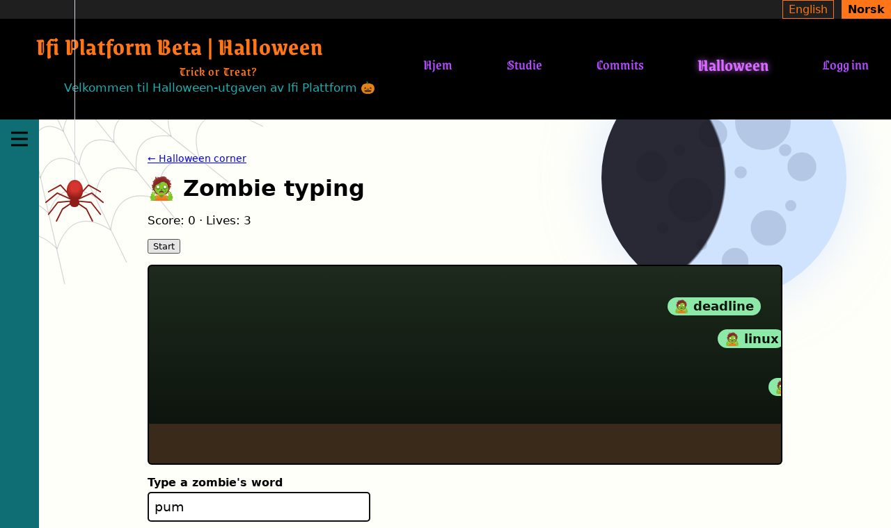

*Mid-game: two zombies walking in, a word half typed.*

---

# Q7: Memory pairs: turn the cards
`🎃 pumpkin` · `🦇 silly feature` · Feature

**Reward:** 3 🪙 + 3 🏆 · **Time:** about 20 min · **Part of the set** SET-arcade  
**Good to know first:** JavaScript basics (functions, click events, arrays, timers), basic CSS grid

### What to do
Memory pairs at http://localhost:8000/halloween/memory/ is half built: 12 cards are dealt, face down (`?`), but clicking does nothing. Make it a real memory game.

### Files to change (only these)
- `ifiplatform/apps/halloween_app/static/js/halloween_pages/memory.js`
- `ifiplatform/apps/halloween_app/static/css/halloween_pages/memory.css` (empty, already loaded on the page)

### What's already there
`memory.js` deals the 12 cards (6 Halloween pairs) as buttons. Each card knows its symbol in `card.dataset.symbol`, and clicking calls `flip(card)`, which is still empty. There are three `TODO`s.

### Design to build
The look: **purple cards with a striped back**. You don't have to come up with a design: build this one. Rather design your own? Go ahead, see "Make it yours".
- **The board** (`.memory-board`): 4 columns, `gap: 0.8rem`, at most `26rem` wide.
- **Each card** (`.memory-card`): playing-card shaped (`aspect-ratio: 3 / 4`), a 2px solid black border, corners rounded 8px, a striped purple back: `background: repeating-linear-gradient(45deg, #3b1b5a 0 8px, #2a1240 8px 16px)`, white symbols at `font-size: 2rem`.
- **A found pair** (`.memory-card--found`): dark green `#1d4d1d` with a green glow: `box-shadow: 0 0 12px rgba(63, 163, 63, 0.8)`.

### Your part
1. **TODO 1:** shuffle the cards before they're dealt.
2. **TODO 2:** turning a card shows its symbol.
3. **TODO 3:** remember which cards are turned. With two up: `tries + 1`. A pair stays open and counts as found. Not a pair? Turn both back after about 800 ms (`setTimeout`). Don't allow a third card while two are showing.
4. **Style:** build the design above in `memory.css`.

### Make it yours
Your own design instead of the one above, or on top of it. Some ideas:
- "You found them all in N tries!" when the last pair is found.
- A flip animation with `transform: rotateY(180deg)`.

### Done when
- You can play a whole game, pairs stay open, and the counters are right.

### How to work on it
Set up the project on your own computer first (see **Get started** in the README). Then:

1. **Claim this issue** on the site: https://halloween.ifiplattform.no/commits/issues/
2. In the VS Code terminal:
   ```bash
   ifi fix-issue {number}
   ```
3. Make the change, and check it at http://localhost:8000. Reload with **Ctrl+Shift+R** (Mac: **Cmd+Shift+R**): a normal reload may show the old look, because the browser keeps old copies of CSS files and pictures. Still old? Try a private window.
4. Then:
   ```bash
   ifi test
   git add .
   git commit -m "Short description of what you changed"
   ifi pull-request
   ```

**Only change the files listed above.** Then your pull request can't clash with anyone else's. After the merge it can take a few minutes before it shows on the live site. Stuck? Ask a helper, or type `ifi help`.

#### What it looks like when it's done
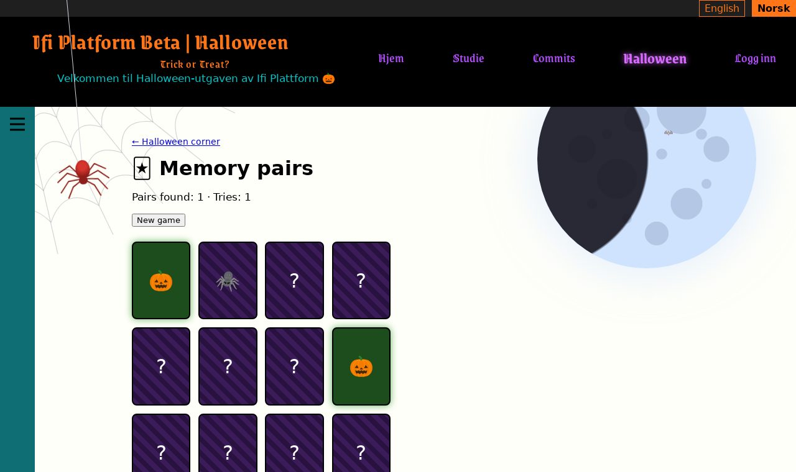

*One pair found (🎃), one card turned over.*

---

# Q8: Moon puzzle: make the pieces slide
`🎃 pumpkin` · `🦇 silly feature` · Feature

**Reward:** 3 🪙 + 3 🏆 · **Time:** about 20 min · **Part of the set** SET-arcade  
**Good to know first:** JavaScript basics (arrays, functions, click events), CSS (grid, backgrounds, custom properties)

### What to do
The moon puzzle at http://localhost:8000/halloween/moon-puzzle/ is a 3 × 3 sliding puzzle: eight pieces of a full moon and one empty spot. The board is drawn, but the pieces can't move and don't show the moon. Make it a real puzzle.

### Files to change (only these)
- `ifiplatform/apps/halloween_app/static/js/halloween_pages/sliding_puzzle.js`
- `ifiplatform/apps/halloween_app/static/css/halloween_pages/sliding_puzzle.css` (empty, already loaded on the page)

### What's already there
`sliding_puzzle.js` keeps the board as a list of 9 numbers, row by row: 1 to 8 are the pieces and `0` is the empty spot. Solved is `[1, 2, 3, 4, 5, 6, 7, 8, 0]`. `draw()` makes a `<button class="sp-tile">` for every spot (the empty one also gets `sp-tile--empty`) and calls `move(spot)` when it's clicked. Each piece also gets `--col` and `--row`: where it belongs in the finished picture (0, 1 or 2). Three `TODO`s are left.

### Design to build
The look: **a full moon in pieces**. You don't have to come up with a design: build this one. Rather design your own? Go ahead, see "Make it yours".
- **The board** (`.sp-board`): a 3 × 3 grid (`repeat(3, 1fr)`), gap `4px`, at most `21rem` wide, padding `4px`, night-black `#15121c`, rounded corners.
- **A piece** (`.sp-tile`): square (`aspect-ratio: 1`), no border, the same night colour, slightly rounded. The picture is one big moon behind all nine pieces, so each piece shows its own part of it:
  ```css
  background-image: radial-gradient(circle at 38% 34%, #8b9bb8 0 9%, transparent 10%),
      radial-gradient(circle at 64% 62%, #8b9bb8 0 6%, transparent 7%),
      radial-gradient(circle at 50% 50%, #cfe3ff 0 44%, #15121c 45%);
  background-size: 300% 300%;
  background-position: calc(var(--col) * 50%) calc(var(--row) * 50%);
  ```
- **The empty spot** (`.sp-tile--empty`): no background at all.
- **Keyboard focus** (`.sp-tile:focus-visible`): an orange outline `3px solid #ff7518`, inside the piece (`outline-offset: -3px`).

### Your part
1. **TODO 1, `isNextToEmpty(spot)`:** true when `spot` is right above, below, left or right of the empty spot (`board.indexOf(0)`). Work with rows (`Math.floor(spot / 3)`) and columns (`spot % 3`): spots 2 and 3 are next to each other in the list, but not on the board.
2. **TODO 2, `move(spot)`:** if the piece is next to the empty spot, swap them, count the move, and `draw()` again. When the board matches `SOLVED`, show a message in `message`.
3. **TODO 3, `shuffle()`:** make about 200 random **allowed** moves. Don't just shuffle the list: half of all random orders can't be solved.
4. **Style:** build the design above in `sliding_puzzle.css`.

#### Explanation (optional)
`background-size: 300%` makes the background three pieces wide and three high. `background-position` then slides it so a piece shows its own part: `0%` is the left part, `50%` the middle, `100%` the right. That's what `--col * 50%` gives.

### Make it yours
- Use the arrow keys to slide pieces.
- A 4 × 4 version.

### Done when
- Shuffle mixes the moon up, clicking a piece next to the gap slides it, and putting the moon back together shows a message.

### How to work on it
Set up the project on your own computer first (see **Get started** in the README). Then:

1. **Claim this issue** on the site: https://halloween.ifiplattform.no/commits/issues/
2. In the VS Code terminal:
   ```bash
   ifi fix-issue {number}
   ```
3. Make the change, and check it at http://localhost:8000. Reload with **Ctrl+Shift+R** (Mac: **Cmd+Shift+R**): a normal reload may show the old look, because the browser keeps old copies of CSS files and pictures. Still old? Try a private window.
4. Then:
   ```bash
   ifi test
   git add .
   git commit -m "Short description of what you changed"
   ifi pull-request
   ```

**Only change the files listed above.** Then your pull request can't clash with anyone else's. After the merge it can take a few minutes before it shows on the live site. Stuck? Ask a helper, or type `ifi help`.

#### What it looks like when it's done


*After Shuffle.*

---

# Q9: Bat snake: make the bat move and eat
`🎃 pumpkin` · `🦇 silly feature` · Feature

**Reward:** 3 🪙 + 3 🏆 · **Time:** about 20 min · **Part of the set** SET-arcade  
**Good to know first:** JavaScript basics (arrays, objects, keyboard events, timers), CSS grid

### What to do
Bat snake at http://localhost:8000/halloween/bat-snake/ is the classic snake game, with a bat 🦇 as the head and candy 🍬 to eat. The board, the arrow keys and the game loop are there, but the bat doesn't move. Make the game work.

### Files to change (only these)
- `ifiplatform/apps/halloween_app/static/js/halloween_pages/bat_snake.js`
- `ifiplatform/apps/halloween_app/static/css/halloween_pages/bat_snake.css` (empty, already loaded on the page)

### What's already there
`bat_snake.js` makes a board of 15 × 15 `<div class="bs-cell">`. A spot on the board is `{ x, y }`, with `{ x: 0, y: 0 }` at the top left. `snake` is a list of spots, head first. `direction` is how the head moves each step (`{ x: 1, y: 0 }` is right), and the arrow keys already change it. `draw()` colours the snake's cells (`bs-cell--snake`), puts 🦇 on the head and 🍬 on the candy. **Start** calls `step()` every 160 ms. Three `TODO`s are left.

### Design to build
The look: **a purple bat trail in the night**. You don't have to come up with a design: build this one. Rather design your own? Go ahead, see "Make it yours".
- **The board** (`.bs-board`): a grid of 15 equal columns (`repeat(15, 1fr)`), at most `30rem` wide, a black border `2px solid #000`, rounded corners `6px` (with `overflow: hidden`), night-black `#15121c`.
- **A cell** (`.bs-cell`): square (`aspect-ratio: 1`), its emoji centred (`display: grid; place-items: center`), `font-size: 1.1rem`, `line-height: 1`.
- **The snake** (`.bs-cell--snake`): poison purple `#6b2fb3`.

### Your part
1. **TODO 1, `placeCandy()`:** put `candy` on a random spot that isn't part of the snake. Try random spots until one is free (a `do ... while` loop works).
2. **TODO 2, `step()`:** make the new head: `snake[0]` moved by `direction`. Put it first in `snake` (`unshift`). On the candy: score + 1 and `placeCandy()`. Otherwise remove the tail (`pop`), so the snake keeps its length.
3. **TODO 3, crashing:** before moving, if the new head is outside the board (below 0, or `SIZE` or more) or on the snake itself, call `gameOver()` instead and stop.
4. **Style:** build the design above in `bat_snake.css`.

### Make it yours
- Don't let the bat turn straight back into itself (pressing ← while flying →).
- Faster with every candy.
- Steer with W A S D too.

### Done when
- Start → the bat flies on its own, the arrow keys steer it, eating candy makes it longer and scores, and hitting a wall or itself ends the game.

### How to work on it
Set up the project on your own computer first (see **Get started** in the README). Then:

1. **Claim this issue** on the site: https://halloween.ifiplattform.no/commits/issues/
2. In the VS Code terminal:
   ```bash
   ifi fix-issue {number}
   ```
3. Make the change, and check it at http://localhost:8000. Reload with **Ctrl+Shift+R** (Mac: **Cmd+Shift+R**): a normal reload may show the old look, because the browser keeps old copies of CSS files and pictures. Still old? Try a private window.
4. Then:
   ```bash
   ifi test
   git add .
   git commit -m "Short description of what you changed"
   ifi pull-request
   ```

**Only change the files listed above.** Then your pull request can't clash with anyone else's. After the merge it can take a few minutes before it shows on the live site. Stuck? Ask a helper, or type `ifi help`.

#### What it looks like when it's done


*Mid-game: the bat flying up, a candy on the right.*

---

# SET-arcade: 🕹️ Set: the Halloween arcade
`🎃 pumpkin` · `🦇 silly feature` · Feature

Five half-built games in the Halloween corner (http://localhost:8000/halloween/): whack-a-bat, memory pairs, zombie typing, the moon puzzle and bat snake. The board and buttons are there; each issue writes the game logic in JavaScript.

**Claim one of the sub-issues, not this one.** You get coins (and points) for the sub-issue you finish. This issue only groups them, and closes when all of them are done.

- [ ] Q5
- [ ] Q7
- [ ] Q6
- [ ] Q8
- [ ] Q9

---

# SET-fortune: 🔮 Set: the fortune booth
`🎃 pumpkin` · `🧪 python` · Feature

Four half-built pages in the Halloween corner (http://localhost:8000/halloween/): the fortune teller, the spooky name generator, the potion mixer and the haunted story. The pages and forms already work; each issue writes the Python behind one of them, with tests.

**Claim one of the sub-issues, not this one.** You get coins (and points) for the sub-issue you finish. This issue only groups them, and closes when all of them are done.

- [ ] Q1
- [ ] Q2
- [ ] Q3
- [ ] Q4

---

# SET-moon: 🌕 Set: the moon
`🍬 candy` · `🖼️ art` · Feature

A big moon in the top right corner of every page, with craters and a glow. The empty `<div class="moon">` is already on every page (`ifiplatform/templates/partials/halloween_decor.html`).

**Claim one of the sub-issues, not this one.** You get coins (and points) for the sub-issue you finish. This issue only groups them, and closes when all of them are done.

- [ ] P10a
- [ ] P10b
- [ ] P10c

---

# SET-pages: 🕸️ Set: pages go Halloween
`🍫 chocolate` · `🎨 restyle` · Feature

Four pages get a Halloween look: articles, events, log in and sign up, and the study page. Each page is its own issue and its own CSS file, so you can do them in any order.

**Claim one of the sub-issues, not this one.** You get coins (and points) for the sub-issue you finish. This issue only groups them, and closes when all of them are done.

- [ ] K14
- [ ] K15
- [ ] K16
- [ ] K17

---

# SET-right: 📸 Set: Instagram and >OUTPUT on the home page
`🍫 chocolate` · `🖼️ art` · Feature

The home page has two new boxes waiting for their Halloween look: a row of Instagram pictures under the news, and the cover of >OUTPUT, Ifi's student magazine, at the bottom of the right column. For now they show grey placeholder pictures. Each issue is its own files, so you can do them in any order.

**Claim one of the sub-issues, not this one.** You get coins (and points) for the sub-issue you finish. This issue only groups them, and closes when all of them are done.

- [ ] K9
- [ ] K10
- [ ] K11

---

# SET-spider: 🕷️ Set: the spider
`🍬 candy` · `🖼️ art` · Feature

A red spider hangs from a thread at the top left of every page, and swings. The empty spider is already on every page (`ifiplatform/templates/partials/halloween_decor.html`): a `<div class="spider">` with a thread, legs and a body inside. Each part is its own issue, in its own CSS file, so you can do them in any order.

**Claim one of the sub-issues, not this one.** You get coins for the sub-issue you finish. This issue only groups them, and closes when all of them are done.

- [ ] C27
- [ ] C28
- [ ] C29
- [ ] C30

---

# SET-study: 📚 Set: the study page
`🍫 chocolate` · `🦇 silly feature` · Feature

The study page (http://localhost:8000/study/) shows a random excuse for not studying. These issues make it better: rate an excuse, copy it to send to a friend, and tests that keep the joke files tidy. Each issue is its own files, so you can do them in any order.

**Claim one of the sub-issues, not this one.** You get coins (and points) for the sub-issue you finish. This issue only groups them, and closes when all of them are done.

- [ ] K36
- [ ] K37
- [ ] K38
