# Commit for Candy: 🎃 pumpkin issues (for review)

The 32 🎃 pumpkin event issues (30 to claim, 2 sets) exactly as they will be posted on GitHub, generated on 2026-10-18. The other sizes are in [event_issues_candy.md](event_issues_candy.md) and [event_issues_chocolate.md](event_issues_chocolate.md). Under each issue is a screenshot of what it looks like when it's done, taken from the site with every issue done. Issues refer to each other by ID (P10a, SET-moon); the creation script turns those into issue numbers. Delete these files and their image folder once the issues are on GitHub.

---

# Q1: Fortune teller: finish the crystal ball
`🎃 pumpkin` · `🧪 python` · Feature

**Reward:** 3 🪙 + 3 🏆 · **Time:** about 16 min · **Part of the set** SET-fortune  
**Good to know first:** Python basics (lists, functions, `%`), basic CSS. The tests are mostly written for you

### What to do
The fortune teller at http://localhost:8000/halloween/fortune/ is half built: you can type your name, but the crystal ball stays cloudy. Make it give a fortune, and the **same** fortune every time for the same name.

### Files to change (only these)
- `ifiplatform/apps/halloween_app/views/fortune.py`
- `ifiplatform/apps/halloween_app/static/css/halloween_pages/fortune.css` (empty, already loaded on the page)
- new: `ifiplatform/apps/halloween_app/tests/test_fortune.py`

### What's already there
`views/fortune.py` has a list `FORTUNES` and a function `pick_fortune(name)` that returns `None`, with two `TODO`s. The page and the form already work, and `clean_name(name)` (from `fortune_names.py`, don't change that file) turns a name into lowercase letters.

### Design to build
The look: **a glowing crystal ball**. You don't have to come up with a design: build this one. Rather design your own? Go ahead, see "Make it yours".
- **The form** (`.fortune-form`): the label, field and button on one row (`display: flex; gap: 0.6rem; align-items: center`).
- **The fortune** (`.fortune-result`): a round crystal ball, 18rem wide (`aspect-ratio: 1; border-radius: 50%`), centred with `margin: 2rem auto`. Purple glass: `background: radial-gradient(circle at 35% 30%, #e9d8ff, #6b2fb3 60%, #24093f)`, a purple glow: `box-shadow: 0 0 40px rgba(170, 67, 255, 0.6)`. The text pale yellow `#fff5bc`, italic, centred in the middle (`display: grid; place-items: center`).

### Your part
1. **TODO 1:** add at least 7 more spooky fortunes to `FORTUNES`.
2. **TODO 2:** in `pick_fortune`, turn `clean_name(name)` into a number, and use `%` to pick a fortune:
   ```python
   number = sum(ord(letter) for letter in clean_name(name))
   ```
   `ord("a")` is 97, so every name gets its own number. What do you do with `number` and `len(FORTUNES)`?
3. **Tests:** make `ifiplatform/apps/halloween_app/tests/test_fortune.py`, and fill in the last test:
   ```python
   # pylint: disable=C0114,C0115,C0116
   from django.test import SimpleTestCase

   from halloween_app.views.fortune import FORTUNES, pick_fortune


   class FortuneTests(SimpleTestCase):
       def test_gives_a_fortune(self):
           self.assertIn(pick_fortune("Kari"), FORTUNES)

       def test_same_name_same_fortune(self):
           self.assertEqual(pick_fortune("Kari"), pick_fortune("  KARI "))

       def test_enough_fortunes(self):
           # TODO: check that there are at least 8 fortunes
           pass
   ```
   Run them with `ifi test`.
4. **Style:** build the design above in `fortune.css`.

### Done when
- Your name always gives the same fortune, and different names give different ones (mostly).
- `ifi test` passes, including your new tests.

Names with æ, ø or å crash the page: that's a separate 👻 bug with its own issue. Leave it for that issue, and test with names like Kari or Ola.

### How to work on it
Set up the project on your own computer first (see **Get started** in the README). Then:

1. **Claim this issue** on the site: https://halloween.ifiplattform.no/commits/issues/
2. In the VS Code terminal:
   ```bash
   ifi fix-issue {number}
   ```
3. Make the change, and check it at http://localhost:8000. Reload with **Ctrl+Shift+R** (Mac: **Cmd+Shift+R**): a normal reload may show the old look, because the browser keeps old copies of CSS files and pictures. Still old? Try a private window.
4. Then:
   ```bash
   ifi test
   git add .
   git commit -m "Short description of what you changed"
   ifi pull-request
   ```

**Only change the files listed above.** Then your pull request can't clash with anyone else's. After the merge it can take a few minutes before it shows on the live site. Stuck? Ask a helper, or type `ifi help`.

#### What it looks like when it's done


---

# Q10: The Ifi Halloween quiz
`🎃 pumpkin` · `🧪 python` · Feature

**Reward:** 3 🪙 + 3 🏆 · **Time:** about 18 min  
**Good to know first:** Python basics (lists, dictionaries, loops), basic CSS. Some tests are written for you

### What to do
The quiz at http://localhost:8000/halloween/quiz/ has only two questions, and every answer scores 0. Make it a real quiz: ten questions about Ifi, programming and Halloween, a score, and a verdict.

### Files to change (only these)
- `ifiplatform/apps/halloween_app/views/quiz.py`
- `ifiplatform/apps/halloween_app/static/css/halloween_pages/quiz.css` (empty, already loaded on the page)
- new: `ifiplatform/apps/halloween_app/tests/test_quiz.py`

### What's already there
`views/quiz.py` has the list `QUESTIONS`, with two questions. Each is a dictionary with a `key` (`"q1"`), the `question`, its `options`, and the right `answer`. Two functions are left as `TODO`s: `score(answers)` and `verdict(points, total)`. The page already shows every question as radio buttons, and the score and verdict after **Check my answers**.

### Design to build
The look: **haunted exam papers**. You don't have to come up with a design: build this one. Rather design your own? Go ahead, see "Make it yours".
- **The form** (`.quiz-form`): a grid with `gap: 1rem`, at most `40rem` wide.
- **Each question** (`.quiz-question`): dark purple `#2b1f3a` with light text `#f2eff6`, a black border `2px solid #000`, rounded corners `6px`, padding `1rem 1.2rem`. Its `legend` in bold.
- **Each option** (`.quiz-option`) on its own line. The picked one (`.quiz-option:has(input:checked)`) turns lantern orange `#ffb15c` and bold.
- **The button:** a pumpkin-orange pill (`#ff7518`, black border, `border-radius: 999px`, bold).
- **The result** (`.quiz-result`): an orange box with a black border above the questions, the score (`.quiz-result__score`) huge (`3rem`, extra bold), the verdict (`.quiz-result__verdict`) in italics.

### Your part
1. **TODO 1:** add 8 more questions (10 in all). Every `key` must be different, and the `answer` must be one of the `options`, written exactly the same.
2. **TODO 2:** `score(answers)` counts the right answers. `answers` is a dictionary from each question's key to the option the visitor picked (or `None` if they skipped it).
3. **TODO 3:** `verdict(points, total)` returns a different sentence for a full score, a middle score and a low score.
4. **Tests:** make `ifiplatform/apps/halloween_app/tests/test_quiz.py`, and fill in the last test:
   ```python
   # pylint: disable=C0114,C0115,C0116
   from django.test import SimpleTestCase

   from halloween_app.views.quiz import QUESTIONS, score


   class QuizTests(SimpleTestCase):
       def test_ten_questions_with_different_keys(self):
           self.assertEqual(len(QUESTIONS), 10)
           self.assertEqual(len({question["key"] for question in QUESTIONS}), 10)

       def test_all_right(self):
           answers = {question["key"]: question["answer"] for question in QUESTIONS}
           self.assertEqual(score(answers), 10)

       def test_every_answer_is_an_option(self):
           # TODO: check that every question's answer is one of its options
           pass
   ```
   Run them with `ifi test`.
5. **Style:** build the design above in `quiz.css`.

### Make it yours
- Show which answers were wrong. That needs the template too, which isn't in this issue's files: put the information in the verdict instead, like "You missed question 3 and 7".

### Done when
- The quiz has 10 questions, gives the right score, and a different verdict for low, middle and full scores.
- `ifi test` passes, including your new tests.

### How to work on it
Set up the project on your own computer first (see **Get started** in the README). Then:

1. **Claim this issue** on the site: https://halloween.ifiplattform.no/commits/issues/
2. In the VS Code terminal:
   ```bash
   ifi fix-issue {number}
   ```
3. Make the change, and check it at http://localhost:8000. Reload with **Ctrl+Shift+R** (Mac: **Cmd+Shift+R**): a normal reload may show the old look, because the browser keeps old copies of CSS files and pictures. Still old? Try a private window.
4. Then:
   ```bash
   ifi test
   git add .
   git commit -m "Short description of what you changed"
   ifi pull-request
   ```

**Only change the files listed above.** Then your pull request can't clash with anyone else's. After the merge it can take a few minutes before it shows on the live site. Stuck? Ask a helper, or type `ifi help`.

#### What it looks like when it's done


*After checking the answers, with three right.*

---

# Q11: The graveyard of retired features
`🎃 pumpkin` · `🦇 silly feature` · Feature

**Reward:** 3 🪙 + 3 🏆 · **Time:** about 16 min  
**Good to know first:** Git (log), Python basics (lists, dictionaries), CSS

### What to do
The Halloween corner has a graveyard (http://localhost:8000/halloween/graveyard/) for features this site used to have, but only one grave is dug. Dig into the project's Git history, find features that were removed, give each one a tombstone, and make the graveyard look like a graveyard.

### Files to change (only these)
- `ifiplatform/apps/halloween_app/views/graveyard.py`
- `ifiplatform/apps/halloween_app/static/css/halloween_pages/graveyard.css` (empty, already loaded on the page)

### What's already there
`views/graveyard.py` has the list `GRAVES`, with one grave: a dictionary with the feature's `name`, when it was `born` and `died`, and an `epitaph` (the line on the tombstone). The page already shows every grave in the list, as an `<li class="grave">` with `.grave__rip`, `.grave__name`, `.grave__dates` and `.grave__epitaph` inside, all in `<ul class="graveyard">`.

### How to find the dead
In the VS Code terminal:
```bash
git log --diff-filter=D --name-only --format="--- %ad %s" --date=short
```
That lists every commit that **deleted** files: the date, the commit message, and the files. Some deleted files are features that were removed or renamed: an app, a page, a workflow, a template. `git log --format=%ad --date=short -- <path>` shows when a file was there.

### Design to build
The look: **a moonlit graveyard**. You don't have to come up with a design: build this one. Rather design your own? Go ahead, see "Make it yours".
- **The graveyard** (`.graveyard`): no bullets, a grid of graves (`repeat(auto-fill, minmax(13rem, 1fr))`, gap `2.5rem 1.5rem`), padding `2rem 1.5rem 0`, rounded corners, and a night sky over grass: `background: linear-gradient(#1d1830 70%, #2f4a2a 70%)`.
- **A tombstone** (`.grave`): rounded on top, square at the bottom (`border-radius: 6rem 6rem 0.4rem 0.4rem`), stone grey `linear-gradient(160deg, #a7a7ad, #6f6f78)` (`deg` means degrees: the direction the gradient goes), a black border `2px solid #000`, dark text, centred, padding.
- **Crooked stones:** odd graves tilt `-2deg`, even ones `1.5deg` (`:nth-child(odd)` / `(even)` with `rotate`).
- **R.I.P.** (`.grave__rip`) in the spooky font (`var(--font-spooky)`), big, spaced out. The dates small, the epitaph in italics.
- **Hover:** a wilted rose 🥀 appears at the foot of the stone (`.grave:hover::after` with `content: "🥀"`, `position: absolute`).

### Your part
1. **Fill the graveyard:** at least 5 more graves, for features that really were removed. Use the dates from Git, and write a funny epitaph for each.
2. **Style:** build the design above in `graveyard.css`.

### Make it yours
- A ghost 👻 rising from a grave on hover, with a `@keyframes` (and no movement with `prefers-reduced-motion: reduce`).
- Fog: a white, see-through gradient along the bottom of the graveyard.

### Done when
- The graveyard has at least 6 tombstones, all for features that really were removed, and looks like a moonlit graveyard.

### How to work on it
Set up the project on your own computer first (see **Get started** in the README). Then:

1. **Claim this issue** on the site: https://halloween.ifiplattform.no/commits/issues/
2. In the VS Code terminal:
   ```bash
   ifi fix-issue {number}
   ```
3. Make the change, and check it at http://localhost:8000. Reload with **Ctrl+Shift+R** (Mac: **Cmd+Shift+R**): a normal reload may show the old look, because the browser keeps old copies of CSS files and pictures. Still old? Try a private window.
4. Then:
   ```bash
   ifi test
   git add .
   git commit -m "Short description of what you changed"
   ifi pull-request
   ```

**Only change the files listed above.** Then your pull request can't clash with anyone else's. After the merge it can take a few minutes before it shows on the live site. Stuck? Ask a helper, or type `ifi help`.

#### What it looks like when it's done
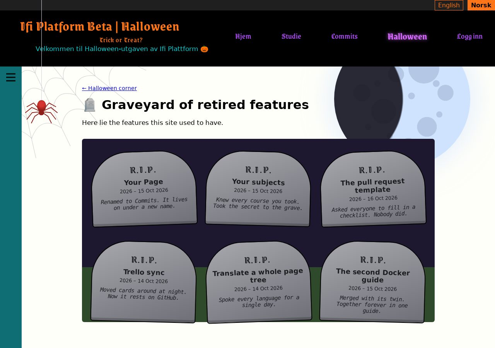

---

# Q12: A live countdown to Halloween
`🎃 pumpkin` · `🧪 python` · Feature

**Reward:** 3 🪙 + 3 🏆 · **Time:** about 17 min  
**Good to know first:** Python (dates), JavaScript (dates, setInterval), basic CSS. Some tests are written for you

### What to do
The countdown page at http://localhost:8000/halloween/countdown/ says "the clock isn't ticking yet". Make it count down to the next Halloween, live, in days, hours, minutes and seconds.

### Files to change (only these)
- `ifiplatform/apps/halloween_app/views/countdown.py`
- `ifiplatform/apps/halloween_app/static/js/halloween_pages/countdown.js`
- `ifiplatform/apps/halloween_app/static/css/halloween_pages/countdown.css` (empty, already loaded on the page)
- new: `ifiplatform/apps/halloween_app/tests/test_countdown.py`

### What's already there
- `views/countdown.py`: a function `next_halloween(today)` that returns `None` (TODO 1). The view already passes its answer to the template, which puts it on the page as `data-target="2026-10-31"` and shows "It's Halloween!" on the day itself.
- `countdown.js`: finds `#countdown`, reads the date into `target` (midnight at the start of that day), and calls `tick()` every second. `tick()` is the TODO. The four numbers are in `parts.days`, `parts.hours`, `parts.minutes` and `parts.seconds`.

### Design to build
The look: **four glowing clock tiles**. You don't have to come up with a design: build this one. Rather design your own? Go ahead, see "Make it yours".
- **The row** (`.countdown`): the four parts side by side (`display: flex; flex-wrap: wrap; gap: 1rem`), with space above.
- **Each part** (`.countdown__part`): a tile at least `7rem` wide, almost black `#15121c`, a black border `2px solid #000`, rounded corners `6px`, padding `1rem`, the number above the unit (`display: grid; justify-items: center`).
- **The number** (`.countdown__number`): huge (`3rem`), extra bold, pumpkin orange `#ff7518`, with an orange glow (`text-shadow: 0 0 18px rgba(255, 117, 24, 0.6)`). Add `font-variant-numeric: tabular-nums`, so the digits don't jump around as they change.
- **The unit** (`.countdown__unit`): light `#f2eff6`, small, in capitals, spaced out.

### Your part
1. **TODO 1, Python:** `next_halloween(today)` returns this year's 31 October (`date(today.year, 10, 31)`), or next year's if this year's is already over. On Halloween itself, it returns today.
2. **TODO 2, JavaScript:** in `tick()`, work out how many seconds are left: `Math.floor((target - new Date()) / 1000)` (subtracting dates gives milliseconds). Turn that into days, hours, minutes and seconds with `Math.floor` and `%`, and show them. Never show negative numbers.
3. **Tests:** make `ifiplatform/apps/halloween_app/tests/test_countdown.py`, and fill in the last test:
   ```python
   # pylint: disable=C0114,C0115,C0116
   from datetime import date

   from django.test import SimpleTestCase

   from halloween_app.views.countdown import next_halloween


   class NextHalloweenTests(SimpleTestCase):
       def test_before_halloween(self):
           self.assertEqual(next_halloween(date(2026, 10, 19)), date(2026, 10, 31))

       def test_on_halloween(self):
           self.assertEqual(next_halloween(date(2026, 10, 31)), date(2026, 10, 31))

       def test_after_halloween(self):
           # TODO: 1 November 2026 gives 31 October 2027
           pass
   ```
   Run them with `ifi test`.
4. **Style:** build the design above in `countdown.css`.

### Make it yours
- The seconds always with two digits (`String(n).padStart(2, "0")`).
- Turn the tiles red in the last 24 hours.

### Done when
- The page counts down every second to the next 31 October, and `ifi test` passes, including your new tests.

### How to work on it
Set up the project on your own computer first (see **Get started** in the README). Then:

1. **Claim this issue** on the site: https://halloween.ifiplattform.no/commits/issues/
2. In the VS Code terminal:
   ```bash
   ifi fix-issue {number}
   ```
3. Make the change, and check it at http://localhost:8000. Reload with **Ctrl+Shift+R** (Mac: **Cmd+Shift+R**): a normal reload may show the old look, because the browser keeps old copies of CSS files and pictures. Still old? Try a private window.
4. Then:
   ```bash
   ifi test
   git add .
   git commit -m "Short description of what you changed"
   ifi pull-request
   ```

**Only change the files listed above.** Then your pull request can't clash with anyone else's. After the merge it can take a few minutes before it shows on the live site. Stuck? Ask a helper, or type `ifi help`.

#### What it looks like when it's done
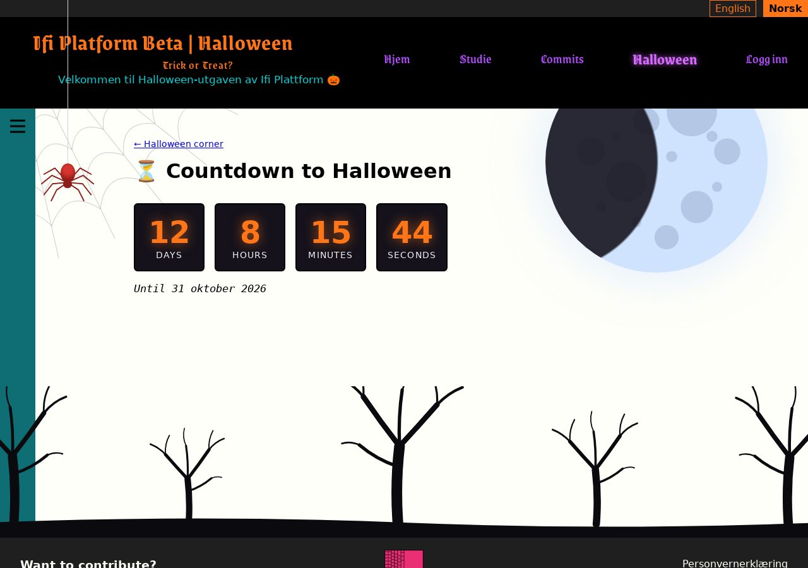

---

# Q13: The pumpkin carver
`🎃 pumpkin` · `🦇 silly feature` · Feature

**Reward:** 3 🪙 + 3 🏆 · **Time:** about 17 min  
**Good to know first:** JavaScript basics (click events, classes, the page's HTML from JS), CSS (grid, border-radius)

### What to do
The pumpkin carver at http://localhost:8000/halloween/pumpkin-carver/ should let you carve your own jack-o'-lantern: click squares on a pumpkin to cut them out, then light the candle so the face glows. There's a grid of squares, but it's invisible and does nothing. Make it work.

### Files to change (only these)
- `ifiplatform/apps/halloween_app/static/js/halloween_pages/pumpkin_carver.js`
- `ifiplatform/apps/halloween_app/static/css/halloween_pages/pumpkin_carver.css` (empty, already loaded on the page)

### What's already there
`pumpkin_carver.js` fills `#carver-pumpkin` with 14 × 11 `<button class="carver-cell">`, each with `aria-pressed="false"`. The page also has two buttons, **Light the candle** (`#carver-light`) and **Start over** (`#carver-clear`), and a row of example faces under "Need ideas?" (`.carver-ideas`). Three `TODO`s are left in the script.

### Design to build
The look: **a big orange pumpkin**. You don't have to come up with a design: build this one. Rather design your own? Go ahead, see "Make it yours".
- **The buttons** (`.carver-buttons`): side by side with a little gap.
- **The pumpkin** (`.carver-pumpkin`): a grid of 14 equal columns, at most `28rem` wide, `aspect-ratio: 14 / 11`, pumpkin orange `#ff7518` with a darker shade on one side (`box-shadow: inset -1.5rem -1rem 2rem rgba(120, 40, 0, 0.45)`), a black border `2px solid #000`, round (`border-radius: 45% 45% 40% 40%`, with `overflow: hidden`), space above and below.
- **A square** (`.carver-cell`): no border, see-through, `cursor: crosshair`. A little darker on hover (`rgba(0, 0, 0, 0.15)`), and a black outline for keyboard focus.
- **Carved** (`.carver-cell--carved`): dark brown `#2b1406`, the inside of the pumpkin.
- **Lit** (`.carver-pumpkin--lit .carver-cell--carved`): candle yellow `#ffd34d`, glowing (`box-shadow: 0 0 10px #ffb000`).
- **The ideas** (`.carver-ideas`): the faces in a row that wraps, no bullets.

### Your part
1. **TODO 1:** clicking a square carves it (class `carver-cell--carved`, and `aria-pressed` `"true"`), and clicking a carved square fills it in again. One listener on the pumpkin with `event.target.closest(".carver-cell")` is enough for all 154 squares.
2. **TODO 2:** **Light the candle** toggles `carver-pumpkin--lit` on the pumpkin, and changes its own text to **Blow out the candle** and back.
3. **TODO 3:** **Start over** fills in every square again.
4. **Style:** build the design above in `pumpkin_carver.css`.

### Make it yours
- Carve by dragging: hold the mouse down and move over the squares.
- A flickering candle: a `@keyframes` that changes the glow a little (none with `prefers-reduced-motion: reduce`).

### Done when
- You can carve a face, light it so it glows yellow, blow it out, and start over. It also works with the keyboard (Tab to a square, Enter to carve).

### How to work on it
Set up the project on your own computer first (see **Get started** in the README). Then:

1. **Claim this issue** on the site: https://halloween.ifiplattform.no/commits/issues/
2. In the VS Code terminal:
   ```bash
   ifi fix-issue {number}
   ```
3. Make the change, and check it at http://localhost:8000. Reload with **Ctrl+Shift+R** (Mac: **Cmd+Shift+R**): a normal reload may show the old look, because the browser keeps old copies of CSS files and pictures. Still old? Try a private window.
4. Then:
   ```bash
   ifi test
   git add .
   git commit -m "Short description of what you changed"
   ifi pull-request
   ```

**Only change the files listed above.** Then your pull request can't clash with anyone else's. After the merge it can take a few minutes before it shows on the live site. Stuck? Ask a helper, or type `ifi help`.

#### What it looks like when it's done


*A carved face, with the candle lit.*

---

# Q15: A spooky "page not found" page
`🎃 pumpkin` · `🎨 restyle` · Feature

**Reward:** 3 🪙 + 3 🏆 · **Time:** about 15 min  
**Good to know first:** HTML and CSS, Django templates basics (``)

### What to do
When someone opens a page that doesn't exist, they see a plain "Page not found". Make it a Halloween 404 page: lost in a haunted house.

### Files to change (only these)
- `ifiplatform/templates/404.html`
- `ifiplatform/static/css/07_halloween/page_404.css` (empty, already loaded on every page)

### How to see it
On your own computer Django shows its own yellow debug page for missing pages, so open the preview at **http://localhost:8000/halloween/404-preview/** instead.

### What's already there
`404.html` extends the normal page layout and shows a heading, a sentence and a link home, inside `<div class="page-404">`.

### Design to build
The look: **lost in a foggy night**. You don't have to come up with a design: build this one. Rather design your own? Go ahead, see "Make it yours".
- **The box** (`.page-404`): everything centred (`display: grid; justify-items: center; text-align: center`), lots of space (`padding: 4rem 1rem`), a foggy dark background: `radial-gradient(ellipse at 50% 30%, #3a3a44, #121216 70%)`, light text `#e6e6ee`.
- **The 404** (`.page-404__code`): huge (`font-size: clamp(5rem, 18vw, 10rem)`), pumpkin orange `#ff7518`, with an orange glow: `text-shadow: 0 0 30px rgba(255, 117, 24, 0.5)`.
- **A ghost** (👻, `font-size: 4rem`) above the 404 that bobs up and down every 3 seconds (`@keyframes` that moves it `-1rem` at 50%), standing still with reduced motion.
- **The link home** (`.page-404 a`): lantern orange `#ffb15c`.

### Your part
1. **Content:** a big "404", a spooky sentence ("This page has been haunted away..."), and keep the link back home. Use `` around every text, like the existing lines.
2. **A picture:** a ghost, a lost pumpkin or a tombstone that says "404", drawn with emoji, CSS or a small inline `<svg>`.
3. **Style:** build the design above in `page_404.css`. Start every rule with `.page-404`: the file loads on every page.
4. **Movement**, for example a ghost that bobs up and down with `@keyframes`, but none when `prefers-reduced-motion: reduce` is on.

### Done when
- http://localhost:8000/halloween/404-preview/ shows your page, the link home works, and nothing else on the site changes.

### How to work on it
Set up the project on your own computer first (see **Get started** in the README). Then:

1. **Claim this issue** on the site: https://halloween.ifiplattform.no/commits/issues/
2. In the VS Code terminal:
   ```bash
   ifi fix-issue {number}
   ```
3. Make the change, and check it at http://localhost:8000. Reload with **Ctrl+Shift+R** (Mac: **Cmd+Shift+R**): a normal reload may show the old look, because the browser keeps old copies of CSS files and pictures. Still old? Try a private window.
4. Then:
   ```bash
   ifi test
   git add .
   git commit -m "Short description of what you changed"
   ifi pull-request
   ```

**Only change the files listed above.** Then your pull request can't clash with anyone else's. After the merge it can take a few minutes before it shows on the live site. Stuck? Ask a helper, or type `ifi help`.

#### What it looks like when it's done
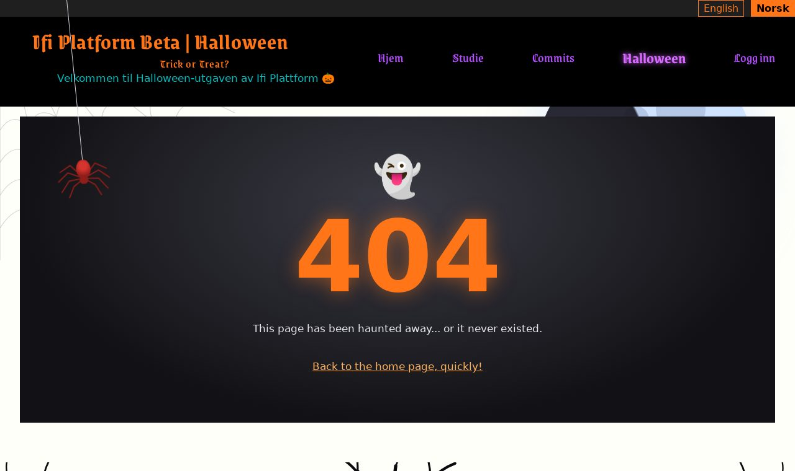

---

# Q16: The real moon phase on the moon
`🎃 pumpkin` · `🧪 python` · Feature

**Reward:** 3 🪙 + 3 🏆 · **Time:** about 18 min  
**Good to know first:** Python (dates, %, functions), Django template tags, CSS gradients. Some tests are written for you

### What to do
The moon at the top right of every page is always full. Make it show the **real** moon phase of today: a thin crescent, a half moon, or full, like the moon outside.

### Files to change (only these)
- new: `ifiplatform/apps/halloween_app/moon_phase.py`
- new: `ifiplatform/apps/halloween_app/templatetags/moon_tags.py`
- new: `ifiplatform/apps/halloween_app/tests/test_moon_phase.py`
- `ifiplatform/templates/partials/halloween_decor.html` (**only the first line**, the moon)
- `ifiplatform/static/css/07_halloween/moon_phase.css` (empty, already loaded on every page)

### How it works
The moon goes from new (dark) to full and back in about 29.53 days. Count the days since a known new moon, take the remainder after dividing by 29.53 (`%`), and you know where in the cycle it is. On the page, a dark circle as big as the moon covers part of it: covering it all for a new moon, sliding off to one side as it grows, gone at full moon, and coming back from the other side.

### What you get
Start `moon_phase.py` with:
```python
"""Where the moon is in its cycle of about 29.5 days, for the moon on every
page."""

from datetime import datetime, timezone

SYNODIC_MONTH = 29.530588853  # days from one new moon to the next
KNOWN_NEW_MOON = datetime(2000, 1, 6, 18, 14, tzinfo=timezone.utc)


def phase(moment):
    """0 is new moon, 0.5 full moon, and just under 1 almost new again.
    moment: a datetime with a time zone."""
    # TODO 1
    return 0.5


def shadow_offset(moon_phase):
    """Where the shadow sits, in % of the moon's width from its middle: 0
    covers the whole moon (new moon), -100 or 100 is clear of it (full
    moon). Seen from Norway the moon grows from the right, so a growing
    moon's shadow moves off to the left."""
    # TODO 2
    return 100
```
And the shadow's CSS, for `moon_phase.css`:
```css
.moon__shadow {
    position: absolute;
    inset: 0;
    z-index: 1;
    border-radius: 50%;
    background: radial-gradient(ellipse 50% 50% at calc(50% + var(--moon-shadow, 100%)) 50%, rgba(18, 15, 26, 0.88) 98%, transparent 100%);
}
```
The gradient is a dark circle exactly as big as the moon, moved sideways by `--moon-shadow`.

### Your part
1. **TODO 1, `phase(moment)`:** the days since `KNOWN_NEW_MOON` (subtract, then `.total_seconds() / 86400`), the remainder after `% SYNODIC_MONTH`, divided by `SYNODIC_MONTH`.
2. **TODO 2, `shadow_offset(moon_phase)`:** from phase 0 to 0.5 the shadow goes from 0 to -100; from 0.5 to 1 it comes back from 100 to 0. Return a whole number (`round`).
3. **The tag:** make `templatetags/moon_tags.py` with a `simple_tag` called `moon_shadow` that returns today's offset with a `%` after it, like `"-37%"`. "Today" is `django.utils.timezone.now()`.
4. **The moon:** in `halloween_decor.html`, change only the first line to load your tag and put the shadow inside the moon:
   ```html
   <div class="moon" aria-hidden="true"><div class="moon__shadow" style="--moon-shadow: "></div></div>
   ```
5. **Tests:** make `tests/test_moon_phase.py`, and fill in the last test:
   ```python
   # pylint: disable=C0114,C0115,C0116
   from datetime import datetime, timezone

   from django.test import SimpleTestCase

   from halloween_app.moon_phase import phase, shadow_offset


   class MoonPhaseTests(SimpleTestCase):
       def test_known_full_moon(self):
           self.assertAlmostEqual(phase(datetime(2026, 10, 26, 4, tzinfo=timezone.utc)), 0.5, delta=0.03)

       def test_shadow(self):
           self.assertEqual(shadow_offset(0), 0)
           self.assertEqual(shadow_offset(0.5), -100)

       def test_waning_moon(self):
           # TODO: at phase 0.75 the shadow is at 50
           pass
   ```
6. Paste the CSS above into `moon_phase.css`.

Restart the server if Django says the tag doesn't exist: new `templatetags` files are only found when it starts.

### Make it yours
- Show the phase's name somewhere for screen readers: "waxing crescent", "full moon"...

### Done when
- The moon on every page has the same shape as the real moon today (check https://www.timeanddate.com/moon/phases/norway/oslo), and `ifi test` passes.

### How to work on it
Set up the project on your own computer first (see **Get started** in the README). Then:

1. **Claim this issue** on the site: https://halloween.ifiplattform.no/commits/issues/
2. In the VS Code terminal:
   ```bash
   ifi fix-issue {number}
   ```
3. Make the change, and check it at http://localhost:8000. Reload with **Ctrl+Shift+R** (Mac: **Cmd+Shift+R**): a normal reload may show the old look, because the browser keeps old copies of CSS files and pictures. Still old? Try a private window.
4. Then:
   ```bash
   ifi test
   git add .
   git commit -m "Short description of what you changed"
   ifi pull-request
   ```

**Only change the files listed above.** Then your pull request can't clash with anyone else's. After the merge it can take a few minutes before it shows on the live site. Stuck? Ask a helper, or type `ifi help`.

#### What it looks like when it's done
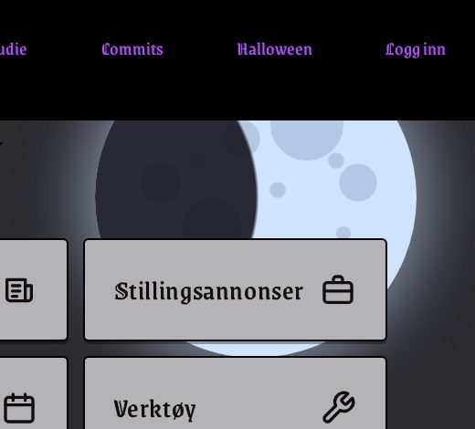

*The moon on 18 October 2026: just under half full, growing.*

---

# Q17: 👻 Places open past midnight show as closed
`🎃 pumpkin` · `👻 haunted bug` · Bug

**Reward:** 3 🪙 + 3 🏆 · **Time:** about 15 min  
**Good to know first:** Python (strings, if, the % operator, datetime), tests

### What's wrong
The "Open now?" box on the home page says whether each place is open right now. But a place that's open from 07:00 to 01:00 (until 1 at night) shows **Closed** all day. And just after midnight, when it really is still open from the evening before, it says Closed too. A ghost has been in the clock...

### Files to change (only these)
- `ifiplatform/apps/ifi_home_app/opening_hours.py`
- new: `ifiplatform/apps/ifi_home_app/tests/test_opening_hours.py`

### What's already there
`opening_hours.py` has `is_open(place, now)`, which compares the time as text: `opens <= "14:00" < closes`. A place's hours are a list of seven `("opens", "closes")` pairs, Monday first, or `None` for closed all day (see `ifiplatform/apps/ifi_home_app/opening_hours_data.py`; only read it). A closing time before the opening time means "closes after midnight".

### Your part
1. **Find out why.** With `("07:00", "01:00")` at 14:00: what does `"07:00" <= "14:00" < "01:00"` give?
2. **Fix `is_open`** so it handles closing after midnight:
   - On normal days (opens before closes), it works as before.
   - When closes is at or before opens: open from the opening time until midnight.
   - **After midnight,** look at **yesterday's** hours: if they close after midnight and it's not that time yet, the place is still open. Yesterday's weekday is `(now.weekday() - 1) % 7` (that makes Monday's yesterday Sunday, 6).
3. **Tests:** make `ifiplatform/apps/ifi_home_app/tests/test_opening_hours.py`. Start with this, and add at least three tests of your own for the night: open at 23:30, still open at 01:30 the next morning, closed at 02:00.
   ```python
   # pylint: disable=C0114,C0115,C0116
   from datetime import datetime

   from django.test import SimpleTestCase

   from ifi_home_app.opening_hours import OSLO, is_open

   DAY = {"hours": [("08:00", "16:00")] * 5 + [None, None]}
   NIGHT = {"hours": [("20:00", "02:00")] * 5 + [None, None]}


   def at(day, time):
       """day 19 is a Monday (October 2026)."""
       hour, minute = map(int, time.split(":"))
       return datetime(2026, 10, day, hour, minute, tzinfo=OSLO)


   class IsOpenTests(SimpleTestCase):
       def test_normal_hours(self):
           self.assertTrue(is_open(DAY, at(19, "12:00")))
           self.assertFalse(is_open(DAY, at(19, "16:00")))
   ```
   Run them with `ifi test`.

### Done when
- Your night tests pass, the normal-hours test still passes, and on the home page a place open until after midnight (if the list still has one) shows **Open** during its hours.

### How to work on it
Set up the project on your own computer first (see **Get started** in the README). Then:

1. **Claim this issue** on the site: https://halloween.ifiplattform.no/commits/issues/
2. In the VS Code terminal:
   ```bash
   ifi fix-issue {number}
   ```
3. Make the change, and check it at http://localhost:8000. Reload with **Ctrl+Shift+R** (Mac: **Cmd+Shift+R**): a normal reload may show the old look, because the browser keeps old copies of CSS files and pictures. Still old? Try a private window.
4. Then:
   ```bash
   ifi test
   git add .
   git commit -m "Short description of what you changed"
   ifi pull-request
   ```

**Only change the files listed above.** Then your pull request can't clash with anyone else's. After the merge it can take a few minutes before it shows on the live site. Stuck? Ask a helper, or type `ifi help`.

#### What it looks like when it's done
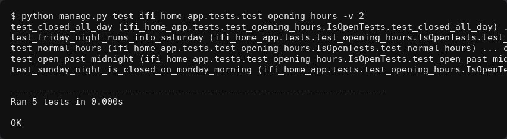

*The new tests.*

---

# Q18: A little ghost follows the mouse
`🎃 pumpkin` · `🦇 silly feature` · Feature

**Reward:** 3 🪙 + 3 🏆 · **Time:** about 16 min  
**Good to know first:** JavaScript (events, the page's HTML from JS, requestAnimationFrame), CSS (position: fixed)

### What to do
Add a little ghost 👻 that follows the mouse pointer around every page, floating a bit behind it, like it's chasing you.

### Files to change (only these)
- `ifiplatform/static/js/halloween/ghost_follow.js` (empty, already loaded on every page)
- `ifiplatform/static/css/07_halloween/ghost_follow.css` (empty, already loaded on every page)

There's already another ghost on the page (`.ghost`, the one floating across). Leave it alone: make your own.

### Your part
1. **Only with a mouse, and only with animations on.** A ghost chasing your finger on a phone makes no sense, and some people turn animations off because movement makes them dizzy. Stop straight away when either is true:
   ```js
   const hasMouse = window.matchMedia("(hover: hover) and (pointer: fine)").matches;
   const reduceMotion = window.matchMedia("(prefers-reduced-motion: reduce)").matches;
   ```
2. **Make the ghost** in JavaScript: a `<div class="ghost-follower">` with 👻 as text and `aria-hidden="true"` (screen readers should skip it), added to `document.body`.
3. **Remember where the mouse is:** on `pointermove`, save `event.clientX` and `event.clientY` (plus a little, so the ghost sits beside the pointer, not under it).
4. **Float after it:** a function that moves the ghost a small part of the way towards the mouse (say 8% of the distance), sets ``ghost.style.translate = `${x}px ${y}px` ``, and calls itself again with `requestAnimationFrame`. Moving part of the way every frame is what makes it lag behind smoothly.
5. **Hide it when the mouse leaves the window** (`pointerleave` on `document.documentElement`), and show it again when it comes back.
6. **The CSS** in `ghost_follow.css`: `.ghost-follower` is `position: fixed` at `top: 0; left: 0` (the `translate` moves it from there), above the page (`z-index: 50`), never blocking clicks (`pointer-events: none`), about `1.8rem` big. Invisible by default (`opacity: 0`), and a class like `ghost-follower--visible` shows it, see-through (`opacity: 0.75`), fading with a `transition`.

### Make it yours
- The ghost turns to face the way it's moving (`scale: -1 1` when the mouse is to its left).
- It gets scared and flees when you move fast.

### Done when
- On a computer with a mouse, a ghost floats after the pointer on every page, never gets in the way of clicking, and disappears when the mouse leaves the window.
- With animations turned off, or on a phone, there's no ghost.

### How to work on it
Set up the project on your own computer first (see **Get started** in the README). Then:

1. **Claim this issue** on the site: https://halloween.ifiplattform.no/commits/issues/
2. In the VS Code terminal:
   ```bash
   ifi fix-issue {number}
   ```
3. Make the change, and check it at http://localhost:8000. Reload with **Ctrl+Shift+R** (Mac: **Cmd+Shift+R**): a normal reload may show the old look, because the browser keeps old copies of CSS files and pictures. Still old? Try a private window.
4. Then:
   ```bash
   ifi test
   git add .
   git commit -m "Short description of what you changed"
   ifi pull-request
   ```

**Only change the files listed above.** Then your pull request can't clash with anyone else's. After the merge it can take a few minutes before it shows on the live site. Stuck? Ask a helper, or type `ifi help`.

#### What it looks like when it's done


*The ghost following the pointer (the pointer itself doesn't show in a screenshot).*

---

# Q19: The Konami code makes it rain candy
`🎃 pumpkin` · `🦇 silly feature` · Feature

**Reward:** 3 🪙 + 3 🏆 · **Time:** about 16 min  
**Good to know first:** JavaScript (keyboard events, arrays, the page's HTML from JS, element.animate)

### What to do
Hide a famous secret on every page: when someone types the **Konami code**, ↑ ↑ ↓ ↓ ← → ← → B A, it rains candy 🍬🍭🍫 down the screen.

### Files to change (only these)
- `ifiplatform/static/js/halloween/candy_rain.js` (empty, already loaded on every page)

### Your part
1. **Wait for the page:** `document.addEventListener("DOMContentLoaded", () => { ... });`.
2. **Recognise the code:** listen for `keydown` on `document`. `event.key` is `"ArrowUp"`, `"ArrowDown"`, `"ArrowLeft"`, `"ArrowRight"`, `"b"` or `"a"` (use `.toLowerCase()`, so caps lock doesn't matter). Keep the last 10 keys in an array (`.slice(-10)`), and compare it with the code. When it matches, empty the array and make it rain.
3. **The rain:** make about 40 pieces of candy. Each one is a `<span>` with a random candy emoji and `aria-hidden="true"`, `position: fixed` just above the top of the window, at a random distance from the left (`${Math.random() * 100}vw`), a random size, `pointer-events: none` and a high `z-index`. Set these with `piece.style` in JavaScript: this issue has no CSS file.
4. **Make it fall** with `element.animate`, from where it is to below the bottom of the window, spinning as it falls:
   ```js
   const fall = piece.animate(
     [
       { transform: "translateY(0) rotate(0deg)" },
       { transform: "translateY(calc(100vh + 6rem)) rotate(360deg)" },
     ],
     { duration: 3000, delay: Math.random() * 1500, easing: "ease-in" },
   );
   fall.onfinish = () => piece.remove();
   ```
   `deg` means degrees: `360deg` is one full turn. Give each piece its own duration and spin, so they don't all fall together. `onfinish` removes it from the page afterwards.
5. **Animations off:** some people turn animations off because movement makes them dizzy. If `window.matchMedia("(prefers-reduced-motion: reduce)").matches`, show a message instead, like "🍬 You found the secret candy code!", for a few seconds. Give it `role="status"`, so screen readers read it out.

### Make it yours
- A pumpkin 🎃 that bounces at the bottom.
- Your own secret code, for an extra surprise.

### Done when
- Typing ↑ ↑ ↓ ↓ ← → ← → B A on any page makes candy rain down the screen, and the pieces are removed when they're done.
- With animations turned off, a message shows instead.

### How to work on it
Set up the project on your own computer first (see **Get started** in the README). Then:

1. **Claim this issue** on the site: https://halloween.ifiplattform.no/commits/issues/
2. In the VS Code terminal:
   ```bash
   ifi fix-issue {number}
   ```
3. Make the change, and check it at http://localhost:8000. Reload with **Ctrl+Shift+R** (Mac: **Cmd+Shift+R**): a normal reload may show the old look, because the browser keeps old copies of CSS files and pictures. Still old? Try a private window.
4. Then:
   ```bash
   ifi test
   git add .
   git commit -m "Short description of what you changed"
   ifi pull-request
   ```

**Only change the files listed above.** Then your pull request can't clash with anyone else's. After the merge it can take a few minutes before it shows on the live site. Stuck? Ask a helper, or type `ifi help`.

#### What it looks like when it's done


*Two seconds after typing the code.*

---

# Q2: Spooky name generator: find the name
`🎃 pumpkin` · `🧪 python` · Feature

**Reward:** 3 🪙 + 3 🏆 · **Time:** about 15 min · **Part of the set** SET-fortune  
**Good to know first:** Python basics (lists, functions, `%`), basic CSS. The tests are mostly written for you

### What to do
The spooky name generator at http://localhost:8000/halloween/spooky-name/ is half built: the form works, but no name comes out. Make "Kari" turn into something like **"Count Kari of the Crypt"**, and the same name into the same spooky name every time.

### Files to change (only these)
- `ifiplatform/apps/halloween_app/views/spooky_name.py`
- `ifiplatform/apps/halloween_app/static/css/halloween_pages/spooky_name.css` (empty, already loaded on the page)
- new: `ifiplatform/apps/halloween_app/tests/test_spooky_name.py`

### What's already there
`views/spooky_name.py` has two lists, `FIRST_PARTS` and `LAST_PARTS`, with one word each, and `spooky_name(name)` returns `None`. There are three `TODO`s.

### Design to build
The look: **a horror film poster title**. You don't have to come up with a design: build this one. Rather design your own? Go ahead, see "Make it yours".
- **The spooky name** (`.spooky-result`): very big (`font-size: clamp(2rem, 6vw, 3.5rem)`), bold, blood red `#c0261d`, with a red glow and a hard black shadow: `text-shadow: 0 0 12px rgba(192, 38, 29, 0.6), 2px 2px 0 #000`.

### Your part
1. **TODO 1 and 2:** at least 6 words in each list.
2. **TODO 3:** pick a first part and a last part from the name, and put the name in between with an f-string. Two different numbers from the name give more variety, for example `len(name)` for one and `sum(ord(c) for c in name.lower())` for the other. Use `%` to stay inside the lists.
3. **Tests:** make `ifiplatform/apps/halloween_app/tests/test_spooky_name.py`:
   ```python
   # pylint: disable=C0114,C0115,C0116
   from django.test import SimpleTestCase

   from halloween_app.views.spooky_name import FIRST_PARTS, LAST_PARTS, spooky_name


   class SpookyNameTests(SimpleTestCase):
       def test_keeps_the_name(self):
           self.assertIn("Kari", spooky_name("Kari"))

       def test_same_name_same_result(self):
           self.assertEqual(spooky_name("Kari"), spooky_name("Kari"))

       def test_uses_the_lists(self):
           # TODO: check that the result starts with one of FIRST_PARTS
           # and ends with one of LAST_PARTS
           pass
   ```
4. **Style:** build the design above in `spooky_name.css`.

### Done when
- Every name gets a spooky name, always the same one, and `ifi test` passes.

### How to work on it
Set up the project on your own computer first (see **Get started** in the README). Then:

1. **Claim this issue** on the site: https://halloween.ifiplattform.no/commits/issues/
2. In the VS Code terminal:
   ```bash
   ifi fix-issue {number}
   ```
3. Make the change, and check it at http://localhost:8000. Reload with **Ctrl+Shift+R** (Mac: **Cmd+Shift+R**): a normal reload may show the old look, because the browser keeps old copies of CSS files and pictures. Still old? Try a private window.
4. Then:
   ```bash
   ifi test
   git add .
   git commit -m "Short description of what you changed"
   ifi pull-request
   ```

**Only change the files listed above.** Then your pull request can't clash with anyone else's. After the merge it can take a few minutes before it shows on the live site. Stuck? Ask a helper, or type `ifi help`.

#### What it looks like when it's done
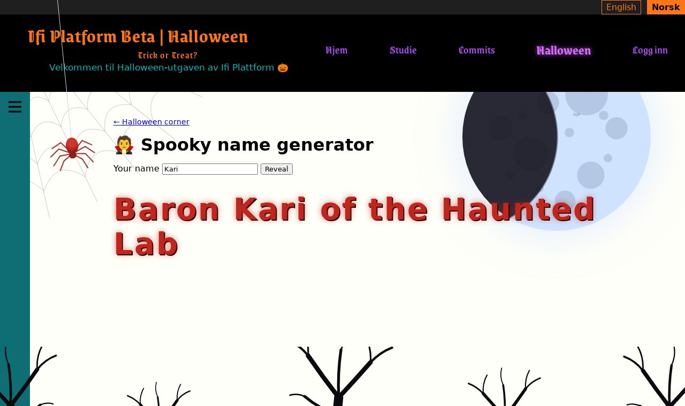

---

# Q20: Flashlight mode
`🎃 pumpkin` · `🦇 silly feature` · Feature

**Reward:** 3 🪙 + 3 🏆 · **Time:** about 16 min  
**Good to know first:** JavaScript (events, the page's HTML from JS, CSS custom properties from JS), CSS gradients

### What to do
Add a 🔦 button to the bottom right corner of every page. Pressing it turns the lights off: the whole page goes dark, except a circle of light around the mouse pointer, like searching a haunted house with a flashlight.

### Files to change (only these)
- `ifiplatform/static/js/halloween/flashlight.js` (empty, already loaded on every page)
- `ifiplatform/static/css/07_halloween/flashlight.css` (empty, already loaded on every page)

### What you get
The darkness, in CSS. It's a layer over the whole window that's see-through in a circle around `--x`, `--y` and dark everywhere else:
```css
.flashlight {
    position: fixed;
    inset: 0;
    z-index: 90;
    pointer-events: none;
    background: radial-gradient(circle 9rem at var(--x, 50%) var(--y, 50%), transparent 0 55%, rgba(5, 4, 8, 0.94) 100%);
}

.flashlight[hidden] {
    display: none;
}
```
`pointer-events: none` lets clicks go through the darkness to the page under it.

### Your part
1. **The CSS:** paste the above into `flashlight.css`, and style a `.flashlight-toggle` button: round, `3rem`, fixed at the bottom right (`right: 1rem; bottom: 1rem`) above the darkness (`z-index: 91`), candle yellow `#ffd34d` with a black border `2px solid #000`. Pumpkin orange `#ff7518` while it's on (`.flashlight-toggle[aria-pressed="true"]`).
2. **The button**, made in JavaScript (the templates aren't in this issue): a `<button type="button" class="flashlight-toggle">` with 🔦 as text, `aria-label="Flashlight mode"` (screen readers can't read an emoji's meaning reliably) and `aria-pressed="false"`.
3. **The darkness:** a `<div class="flashlight" hidden aria-hidden="true">`. Add both to `document.body`.
4. **On and off:** clicking the button shows or hides the darkness (`hidden`), and sets `aria-pressed` to `"true"` or `"false"`. **Esc** turns it off too.
5. **Aim:** on `pointermove`, set `--x` and `--y` on the darkness to the pointer's position: ``dark.style.setProperty("--x", `${event.clientX}px`)``. When it's switched on, start in the middle of the window, so keyboard users see something.

### Make it yours
- A flickering flashlight, as if the battery is dying (none with `prefers-reduced-motion: reduce`).
- A bigger circle when you hold the mouse button down.

### Done when
- The 🔦 button turns the lights off and on, the circle of light follows the mouse, you can still click links through the dark, and Esc turns it off.

### How to work on it
Set up the project on your own computer first (see **Get started** in the README). Then:

1. **Claim this issue** on the site: https://halloween.ifiplattform.no/commits/issues/
2. In the VS Code terminal:
   ```bash
   ifi fix-issue {number}
   ```
3. Make the change, and check it at http://localhost:8000. Reload with **Ctrl+Shift+R** (Mac: **Cmd+Shift+R**): a normal reload may show the old look, because the browser keeps old copies of CSS files and pictures. Still old? Try a private window.
4. Then:
   ```bash
   ifi test
   git add .
   git commit -m "Short description of what you changed"
   ifi pull-request
   ```

**Only change the files listed above.** Then your pull request can't clash with anyone else's. After the merge it can take a few minutes before it shows on the live site. Stuck? Ask a helper, or type `ifi help`.

#### What it looks like when it's done


*Flashlight on, pointed at the shortcuts.*

---

# Q21: "Add to calendar" for events
`🎃 pumpkin` · `🧪 python` · Feature

**Reward:** 3 🪙 + 3 🏆 · **Time:** about 18 min  
**Good to know first:** Python (strings, dates), a little Django (views, URLs in templates), tests

### What to do
Give every event page an **📅 Add to calendar** link that downloads an `.ics` file: the format every calendar app (Google Calendar, Outlook, Apple Calendar) can import.

### Files to change (only these)
- `ifiplatform/apps/halloween_app/views/ics.py`
- new: `ifiplatform/apps/halloween_app/tests/test_ics.py`
- `ifiplatform/apps/ifi_home_app/templates/events/partials/add_to_calendar.html` (empty, already shown on every event page, under the sign-up links)

### What's already there
The address is ready: `/halloween/event/<page id>/calendar.ics`, named `halloween_event_ics`, goes to `event_ics_view` in `views/ics.py`, which just says "not built yet" (404).

### What an .ics file looks like
```
BEGIN:VCALENDAR
VERSION:2.0
PRODID:-//Ifi Platform//Halloween corner//EN
BEGIN:VEVENT
UID:event-42@ifiplattform.no
DTSTAMP:20261019T120000Z
DTSTART;TZID=Europe/Oslo:20261030T180000
DTEND;TZID=Europe/Oslo:20261030T213000
SUMMARY:Pumpkin carving
LOCATION:Ole-Johan Dahls hus
END:VEVENT
END:VCALENDAR
```
- Every line ends with `\r\n` (that's the rule for this format).
- `UID` is a unique name for the event, `DTSTAMP` when the file was made (in UTC, with a `Z`).
- Times are `YYYYMMDDTHHMMSS`. `TZID=Europe/Oslo` says they're Norwegian time.
- An event without a time is all day: `DTSTART;VALUE=DATE:20261031` and `DTEND;VALUE=DATE:20261101`, the day **after** the last day.
- In text, `,` `;` and `\` need a `\` in front.

### Your part
1. **`ics_text(uid, title, start_date, start_time=None, end_date=None, end_time=None, location="", url="")`** in `views/ics.py`: returns the file as text. With a start time: `DTSTART`/`DTEND` with `TZID` (no end time? say 2 hours later). Without: all day. Python's f-strings format dates for you: `f"{start:%Y%m%dT%H%M%S}"`.
2. **`event_ics_view(request, page_id)`:** find the live event with `EventPage.objects.live().filter(id=page_id).first()` (from `ifi_home_app.models`), and raise `Http404` if there's none. Its fields: `title`, `event_date`, `event_time`, `end_date`, `event_end_time`, `location`, and `page.get_full_url(request)` for its address. Return an `HttpResponse` with `content_type="text/calendar; charset=utf-8"` and a `Content-Disposition` header `attachment; filename="<the page's slug>.ics"`.
3. **The link** in `add_to_calendar.html`: a link to `` with the `download` attribute and the text `📅 `. Give it the class `event-signup-link`, so it looks like the sign-up links next to it. Remember ``.
4. **Tests** in `tests/test_ics.py` (a `TestCase`): at least a timed event, an all-day event that ends the next day, a title with a comma, and that an unknown id gives 404 (`self.client.get(reverse("halloween_event_ics", args=[999999]))`).

### Done when
- Every event page has an "Add to calendar" link, and the file it downloads opens in a calendar app with the right title, day and time.
- `ifi test` passes, including your new tests.

### How to work on it
Set up the project on your own computer first (see **Get started** in the README). Then:

1. **Claim this issue** on the site: https://halloween.ifiplattform.no/commits/issues/
2. In the VS Code terminal:
   ```bash
   ifi fix-issue {number}
   ```
3. Make the change, and check it at http://localhost:8000. Reload with **Ctrl+Shift+R** (Mac: **Cmd+Shift+R**): a normal reload may show the old look, because the browser keeps old copies of CSS files and pictures. Still old? Try a private window.
4. Then:
   ```bash
   ifi test
   git add .
   git commit -m "Short description of what you changed"
   ifi pull-request
   ```

**Only change the files listed above.** Then your pull request can't clash with anyone else's. After the merge it can take a few minutes before it shows on the live site. Stuck? Ask a helper, or type `ifi help`.

#### What it looks like when it's done


---

# Q22: `python manage.py halloween_stats`
`🎃 pumpkin` · `🧪 python` · Feature

**Reward:** 3 🪙 + 3 🏆 · **Time:** about 16 min  
**Good to know first:** Python (loops, dictionaries), a little Django (getting objects from the database), tests

### What to do
Make a management command that counts how spooky the site's articles are: how often spooky words appear in their titles and intros.
```
$ python manage.py halloween_stats
ghost      4
pumpkin    3
...
Spookiest article: "Spøkelse observert i Ole-Johan Dahls hus" (3 spooky words)
```

### Files to change (only these)
- new: `ifiplatform/apps/halloween_app/management/commands/halloween_stats.py`
- new: `ifiplatform/apps/halloween_app/tests/test_halloween_stats.py`

### What you get
Start the command with:
```python
"""python manage.py halloween_stats: how spooky are the articles?"""

import re
from collections import Counter

from django.core.management.base import BaseCommand
from django.utils.html import strip_tags

from ifi_home_app.models import ArticlePage

SPOOKY_WORDS = ["ghost", "spøkelse", "pumpkin", "gresskar", "bat", "flaggermus", "witch", "heks"]


def spooky_counts(text):
    """How often each spooky word appears in text, as a Counter."""
    words = re.findall(r"\w+", text.lower())
    # TODO: count only the words in SPOOKY_WORDS
    return Counter()


class Command(BaseCommand):
    help = "Counts spooky words in the titles and intros of the live articles."

    def handle(self, *args, **options):
        # TODO: go through ArticlePage.objects.live(), count title + intro
        # (strip_tags(page.intro): the intro is HTML), print the totals, and
        # print the spookiest article.
        pass
```

### Your part
1. **`spooky_counts`:** count only the spooky words. `Counter(w for w in words if ...)` works.
2. **`handle`:** add up the counts of every live article, print every word with its count (most common first: `Counter.most_common()`), then the spookiest article.
3. **Tests:** make `ifiplatform/apps/halloween_app/tests/test_halloween_stats.py`: at least `spooky_counts("Ghost! A ghost and a PUMPKIN")` gives ghost 2 and pumpkin 1. For the command, `call_command("halloween_stats", stdout=io.StringIO())` must run without errors on an empty database.

### Make it yours
- More spooky words, in both languages.
- `--top 3` to print only the top 3 words.

### Done when
- The command prints the counts, and `ifi test` passes with your tests.

### How to work on it
Set up the project on your own computer first (see **Get started** in the README). Then:

1. **Claim this issue** on the site: https://halloween.ifiplattform.no/commits/issues/
2. In the VS Code terminal:
   ```bash
   ifi fix-issue {number}
   ```
3. Make the change, and check it at http://localhost:8000. Reload with **Ctrl+Shift+R** (Mac: **Cmd+Shift+R**): a normal reload may show the old look, because the browser keeps old copies of CSS files and pictures. Still old? Try a private window.
4. Then:
   ```bash
   ifi test
   git add .
   git commit -m "Short description of what you changed"
   ifi pull-request
   ```

**Only change the files listed above.** Then your pull request can't clash with anyone else's. After the merge it can take a few minutes before it shows on the live site. Stuck? Ask a helper, or type `ifi help`.

#### What it looks like when it's done
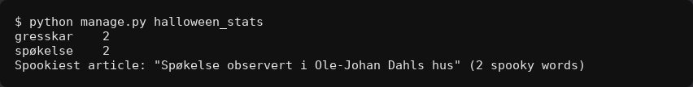

*Terminal output.*

---

# Q23: Draw the Halloween corner mascot
`🎃 pumpkin` · `🖼️ art` · Feature

**Reward:** 3 🪙 + 3 🏆 · **Time:** about 20 min  
**Good to know first:** drawing: SVG by hand, or a drawing program like Inkscape or Figma

### What to do
The Halloween corner's front page (http://localhost:8000/halloween/) has a spot for a mascot under the heading, but it's empty. Draw one!

### Files to change (only these)
- new: `ifiplatform/static/images/halloween/mascot.svg`
- `ifiplatform/apps/halloween_app/templates/halloween/partials/mascot.html` (empty, already shown on the front page)

### Your part
1. **Draw the mascot as an SVG**, by hand in the file or in a drawing program that exports SVG (Inkscape and Figma both do). A ghost in an Ifi hoodie, a pumpkin with a laptop, a bat that codes: your call. Keep it under about 20 KB.
2. **Show it** in `mascot.html`:
   ```html
   
   
   ```
   Write a real `alt` text that says what's in the picture, for people who can't see it.

### Tips for SVG by hand
- `<svg xmlns="http://www.w3.org/2000/svg" viewBox="0 0 200 200">` gives you a 200×200 canvas.
- `<circle>`, `<ellipse>`, `<rect>` and `<path>` are enough for most characters. Give every shape a `fill`.

### Done when
- The mascot shows on http://localhost:8000/halloween/, with a good alt text.

### How to work on it
Set up the project on your own computer first (see **Get started** in the README). Then:

1. **Claim this issue** on the site: https://halloween.ifiplattform.no/commits/issues/
2. In the VS Code terminal:
   ```bash
   ifi fix-issue {number}
   ```
3. Make the change, and check it at http://localhost:8000. Reload with **Ctrl+Shift+R** (Mac: **Cmd+Shift+R**): a normal reload may show the old look, because the browser keeps old copies of CSS files and pictures. Still old? Try a private window.
4. Then:
   ```bash
   ifi test
   git add .
   git commit -m "Short description of what you changed"
   ifi pull-request
   ```

**Only change the files listed above.** Then your pull request can't clash with anyone else's. After the merge it can take a few minutes before it shows on the live site. Stuck? Ask a helper, or type `ifi help`.

#### What it looks like when it's done
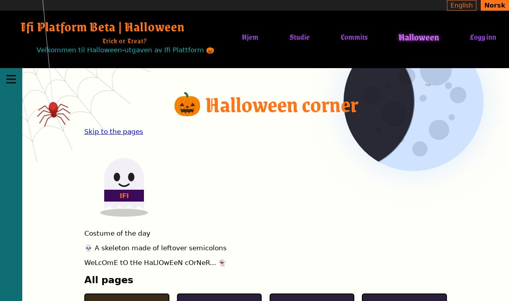

---

# Q24: Draw six pumpkin faces for the carver
`🎃 pumpkin` · `🖼️ art` · Feature

**Reward:** 3 🪙 + 3 🏆 · **Time:** about 18 min  
**Good to know first:** drawing: SVG by hand, or a drawing program like Inkscape or Figma

### What to do
Under the pumpkin carver (http://localhost:8000/halloween/pumpkin-carver/), "Need ideas?" shows six grey placeholders that say "Face 1" to "Face 6". Draw six jack-o'-lantern faces to inspire the carvers: happy, scary, surprised, sleepy, angry, goofy... all different.

### Files to change (only these)
- `ifiplatform/static/images/halloween/faces/face1.svg`
- `ifiplatform/static/images/halloween/faces/face2.svg`
- `ifiplatform/static/images/halloween/faces/face3.svg`
- `ifiplatform/static/images/halloween/faces/face4.svg`
- `ifiplatform/static/images/halloween/faces/face5.svg`
- `ifiplatform/static/images/halloween/faces/face6.svg`

### What you get
A blank pumpkin, 120 × 120, to start each face from:
```html
<svg xmlns="http://www.w3.org/2000/svg" width="120" height="120" viewBox="0 0 120 120">
  <rect x="56" y="10" width="8" height="14" rx="3" fill="#3f7a2a"/>
  <ellipse cx="60" cy="66" rx="52" ry="44" fill="#ff7518"/>
</svg>
```
The `<rect>` is the stem and the `<ellipse>` the pumpkin. Its middle is at 60, 66.

### Your part
1. **Six faces:** replace each placeholder with the blank pumpkin plus a face. Use dark brown `#2b1406` for the carved parts: eyes at about `y="54"`, a nose in the middle, a mouth at about `y="82"`. Useful shapes:
   - triangles and zig-zag teeth with `<path d="M x y l dx dy l dx dy z"/>` (`l` draws a line relative to where the pen is, `z` closes the shape),
   - round eyes with `<circle>`, a smile with a curved `<path>` (`q`) and a thick `stroke`,
   - a gap in a tooth: a small orange `<rect>` on top of the mouth.
2. **All different,** so each one gives the carvers a new idea.
3. **Keep them small:** under about 5 KB each. Exported from Inkscape or Figma? Use "plain SVG", or "optimized SVG".

### Make it yours
- Not every pumpkin has to be round: a tall one (`rx="40" ry="50"`), a squat one, a green one.

### Done when
- "Need ideas?" on the pumpkin carver shows six different jack-o'-lantern faces, with no placeholder left.

### How to work on it
Set up the project on your own computer first (see **Get started** in the README). Then:

1. **Claim this issue** on the site: https://halloween.ifiplattform.no/commits/issues/
2. In the VS Code terminal:
   ```bash
   ifi fix-issue {number}
   ```
3. Make the change, and check it at http://localhost:8000. Reload with **Ctrl+Shift+R** (Mac: **Cmd+Shift+R**): a normal reload may show the old look, because the browser keeps old copies of CSS files and pictures. Still old? Try a private window.
4. Then:
   ```bash
   ifi test
   git add .
   git commit -m "Short description of what you changed"
   ifi pull-request
   ```

**Only change the files listed above.** Then your pull request can't clash with anyone else's. After the merge it can take a few minutes before it shows on the live site. Stuck? Ask a helper, or type `ifi help`.

#### What it looks like when it's done


*The six faces under the carver.*

---

# Q26: Accessibility check of the home page, fixed with CSS
`🎃 pumpkin` · `♿ a11y` · Bug

**Reward:** 3 🪙 + 3 🏆 · **Time:** about 18 min  
**Good to know first:** CSS (selectors, colours, media queries). Running an accessibility check is explained

### What to do
Run an accessibility check on the home page and fix three of the problems it finds, with CSS only. They're real problems for real people: text that people with poor eyesight can't read, a button a screen reader can't name, and a keyboard focus you can't see.

### Files to change (only these)
- `ifiplatform/static/css/07_halloween/a11y_fixes.css` (empty, already loaded on every page, last)

### How to check
- **Chrome:** DevTools (F12) → **Lighthouse** → tick only "Accessibility" → **Analyze page load**. Or install the free **axe DevTools** extension and press "Scan".
- **Keyboard:** click the address bar, then press **Tab** again and again, and watch where the focus goes on the page.

### Your part
Fix these three. For each, find the element with right-click → **Inspect**.
1. **Event badges are hard to read.** In "Happening at Ifi", the small coloured badges (Social, Deadline...) have white text on light colours: white on turquoise is about 1.4 : 1, and text needs at least 4.5 : 1. Fix every type of badge (`.event-type-badge--social`, `--deadline`, `--academic`, `--company`): darker backgrounds, or dark text on the light ones. Measure each one: click the colour square next to `color` in DevTools to see the "Contrast ratio".
2. **The menu button has no name.** The ☰ button at the top of the side menu (`summary.sidemenu-header`) has a hidden "Menu" text in it (`.icon-text`). It's hidden with `display: none`, and screen readers skip `display: none` text, so they just say "button". Hide it in a way that screen readers still read: the "visually hidden" trick:
   ```css
   position: absolute;
   width: 1px;
   height: 1px;
   overflow: hidden;
   clip-path: inset(50%);
   white-space: nowrap;
   ```
   Careful: when the side menu opens, the text must show normally again. Find the rules that show it in `ifiplatform/static/css/06_components/sidemenu.css` (only read that file), and undo the trick for the same cases.
3. **You can't see the focus in the header.** Tab through the header (language buttons, logo, menu links): the browser's focus ring is dark, on a black header. Give everything in the header (`.topheader-content :focus-visible`) a clear orange outline instead: `3px solid #ff7518`, with a little `outline-offset`.

Run the check again afterwards: those problems should be gone. Some of the others it finds need HTML changes: leave them.

### Done when
- Lighthouse or axe no longer reports the badges' contrast or the side menu button's name, and Tab shows a clear orange ring on every header link and button.
- The side menu still shows "Menu" when it opens.

### How to work on it
Set up the project on your own computer first (see **Get started** in the README). Then:

1. **Claim this issue** on the site: https://halloween.ifiplattform.no/commits/issues/
2. In the VS Code terminal:
   ```bash
   ifi fix-issue {number}
   ```
3. Make the change, and check it at http://localhost:8000. Reload with **Ctrl+Shift+R** (Mac: **Cmd+Shift+R**): a normal reload may show the old look, because the browser keeps old copies of CSS files and pictures. Still old? Try a private window.
4. Then:
   ```bash
   ifi test
   git add .
   git commit -m "Short description of what you changed"
   ifi pull-request
   ```

**Only change the files listed above.** Then your pull request can't clash with anyone else's. After the merge it can take a few minutes before it shows on the live site. Stuck? Ask a helper, or type `ifi help`.

#### What it looks like when it's done


*The badges' new colours. Below: the orange focus ring in the header, after pressing Tab.*

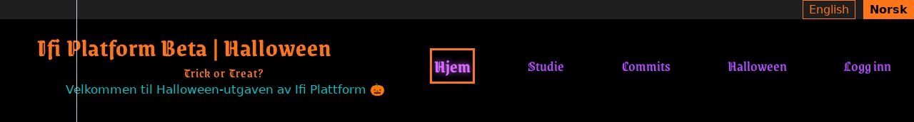

---

# Q27: Make the Halloween corner's front page work with a screen reader
`🎃 pumpkin` · `♿ a11y` · Feature

**Reward:** 3 🪙 + 3 🏆 · **Time:** about 16 min  
**Good to know first:** HTML (landmarks, headings), a little ARIA. Using a screen reader is explained

### What to do
People who can't see the screen use a **screen reader**, a program that reads the page out loud. They don't read a page top to bottom: they jump between landmarks (like "navigation"), headings and links. Make the Halloween corner's front page (http://localhost:8000/halloween/) easy to use that way.

### Files to change (only these)
- `ifiplatform/apps/halloween_app/templates/halloween/hub.html`

**Keep the three `` lines and every `class` as they are:** other issues fill in those partials and style those classes.

### How to listen to it
- **Windows:** NVDA (free, nvaccess.org). **Mac:** VoiceOver (Cmd+F5). In both, the **H** key (NVDA) or the rotor (VoiceOver, Ctrl+Option+U) lists the headings and landmarks.
- No screen reader? Chrome DevTools → Elements → the **Accessibility** tab shows what a screen reader gets for the selected element, and Lighthouse (DevTools → Lighthouse → Accessibility) checks the basics.

### Your part
Listen to the page (or read its accessibility tree) first. Then:
1. **A landmark for the pages:** wrap the list of cards in a `<nav>` with a heading above the list, `<h2 id="hc-pages-heading"></h2>`, and connect them: `<nav aria-labelledby="hc-pages-heading">`. Now "All pages navigation" is in the landmarks list.
2. **Short link names:** every card is one link, and a screen reader reads everything in it as the link's name: "Bat snake A bat that grows with every candy it eats." In a list of 15 links that's a lot. Give each link `aria-label="{{ title }}"`, and connect the description with `aria-describedby`: give the description an `id` (like `hc-hub-text-{{ slug }}`), and the link `aria-describedby="hc-hub-text-{{ slug }}"`. The name is short, and the description is read after a pause.
3. **No emoji in the heading's name:** the 🎃 in the `<h1>` is read as "jack-o-lantern Halloween corner". Wrap it in `<span aria-hidden="true">`.
4. **A skip link:** right under the `<h1>`, a link to the pages heading (`href="#hc-pages-heading"`), "Skip to the pages", for keyboard users who don't want to Tab past everything above.

### Done when
- A screen reader (or the accessibility tree) shows an "All pages" navigation landmark and heading, each card's link name is just its title with the description after it, the `<h1>` is read without the emoji, and the skip link jumps to the pages.
- The page looks the same as before, apart from the new heading and skip link, and `ifi test` passes.

### How to work on it
Set up the project on your own computer first (see **Get started** in the README). Then:

1. **Claim this issue** on the site: https://halloween.ifiplattform.no/commits/issues/
2. In the VS Code terminal:
   ```bash
   ifi fix-issue {number}
   ```
3. Make the change, and check it at http://localhost:8000. Reload with **Ctrl+Shift+R** (Mac: **Cmd+Shift+R**): a normal reload may show the old look, because the browser keeps old copies of CSS files and pictures. Still old? Try a private window.
4. Then:
   ```bash
   ifi test
   git add .
   git commit -m "Short description of what you changed"
   ifi pull-request
   ```

**Only change the files listed above.** Then your pull request can't clash with anyone else's. After the merge it can take a few minutes before it shows on the live site. Stuck? Ask a helper, or type `ifi help`.

#### What it looks like when it's done
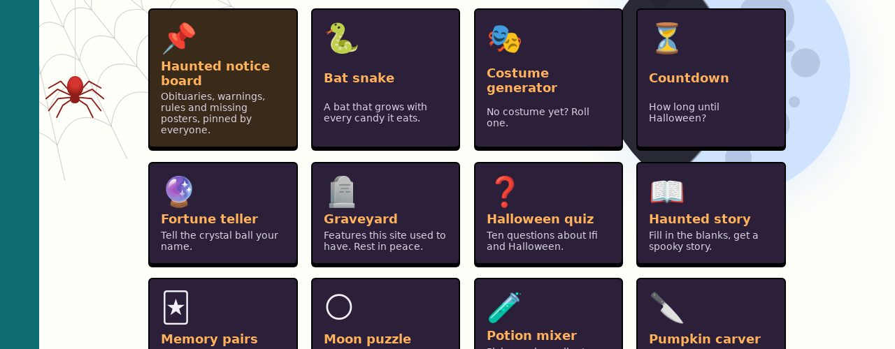

*The skip link and the "All pages" heading show; the rest is what screen readers hear.*

---

# Q28: 👻 The fortune teller crashes on names with æ, ø or å
`🎃 pumpkin` · `👻 haunted bug` · Bug

**Reward:** 3 🪙 + 3 🏆 · **Time:** about 12 min  
**Good to know first:** Python basics (strings), and reading an error message

### What's wrong
Go to http://localhost:8000/halloween/fortune/ and type **Åse**, **Bjørn** or **Kæthe**. The page crashes with a `UnicodeEncodeError`. Half of Norway can't get a fortune!

### Files to change (only these)
- `ifiplatform/apps/halloween_app/fortune_names.py`
- new: `ifiplatform/apps/halloween_app/tests/test_fortune_names.py`

### Your part
1. **Find out why.** Read the error page: which line breaks, and what does `.encode("ascii")` do with a letter that isn't in ASCII?
2. **Fix `clean_name(name)`** so it never crashes, and gives a sensible name in ASCII letters:
   - first swap `æ` → `ae`, `ø` → `o`, `å` → `a` (`str.replace`),
   - then remove accents from other letters, like é in "René". Python's `unicodedata.normalize("NFKD", name)` splits é into e + an accent, and `.encode("ascii", "ignore")` then drops what isn't ASCII.
3. **Tests:** make `ifiplatform/apps/halloween_app/tests/test_fortune_names.py` with at least three tests: `clean_name("Åse") == "ase"`, `clean_name("  Bjørn ") == "bjorn"`, and one of your own (é? an emoji?).

### Done when
- Åse, Bjørn and René all get a fortune page without crashing, and `ifi test` passes.

If the fortune teller's own issue isn't done yet, the page still says "the crystal ball is cloudy". That's fine: it just mustn't crash.

### How to work on it
Set up the project on your own computer first (see **Get started** in the README). Then:

1. **Claim this issue** on the site: https://halloween.ifiplattform.no/commits/issues/
2. In the VS Code terminal:
   ```bash
   ifi fix-issue {number}
   ```
3. Make the change, and check it at http://localhost:8000. Reload with **Ctrl+Shift+R** (Mac: **Cmd+Shift+R**): a normal reload may show the old look, because the browser keeps old copies of CSS files and pictures. Still old? Try a private window.
4. Then:
   ```bash
   ifi test
   git add .
   git commit -m "Short description of what you changed"
   ifi pull-request
   ```

**Only change the files listed above.** Then your pull request can't clash with anyone else's. After the merge it can take a few minutes before it shows on the live site. Stuck? Ask a helper, or type `ifi help`.

#### What it looks like when it's done


*The fortune teller with the name Åse, which used to crash.*

---

# Q29: Drag the notes around the haunted board
`🎃 pumpkin` · `🦇 silly feature` · Feature

**Reward:** 3 🪙 + 3 🏆 · **Time:** about 18 min  
**Good to know first:** JavaScript (events, the page's HTML from JS, JSON, localStorage)

### What to do
On the haunted notice board (http://localhost:8000/halloween/board/), let people drag notes to a new spot, and have the board remember where they put them, in their own browser.

### Files to change (only these)
- `ifiplatform/apps/halloween_app/static/js/halloween_pages/board_drag.js` (empty, already loaded on the board)

### What's already there
Every note is an `<article class="note">` inside `<div class="board">`. Each note is already tilted a little with `transform: rotate(var(--tilt))`.

### Your part
1. **Dragging:** use `pointerdown`, `pointermove` and `pointerup` on each note (they work for mouse and touch). While dragging, move the note with the CSS `translate` property (`note.style.translate = `${x}px ${y}px``). That's a separate property from `transform`, so the tilt stays.
2. **Remember:** save every note's offset in `localStorage`, keyed by its title, as JSON. On page load, put the notes back where they were.
3. **Be careful:** `localStorage` can fail (private windows), so wrap it in `try`/`catch`. The board must still work without it.
4. **A reset button:** add a "Tidy the board" button that puts all notes back and clears the saved spots. Make the button in JavaScript (`document.createElement`), since the template isn't your file.

### Done when
- You can drag notes, they stay where you drop them after a reload, and "Tidy the board" puts them back.

### How to work on it
Set up the project on your own computer first (see **Get started** in the README). Then:

1. **Claim this issue** on the site: https://halloween.ifiplattform.no/commits/issues/
2. In the VS Code terminal:
   ```bash
   ifi fix-issue {number}
   ```
3. Make the change, and check it at http://localhost:8000. Reload with **Ctrl+Shift+R** (Mac: **Cmd+Shift+R**): a normal reload may show the old look, because the browser keeps old copies of CSS files and pictures. Still old? Try a private window.
4. Then:
   ```bash
   ifi test
   git add .
   git commit -m "Short description of what you changed"
   ifi pull-request
   ```

**Only change the files listed above.** Then your pull request can't clash with anyone else's. After the merge it can take a few minutes before it shows on the live site. Stuck? Ask a helper, or type `ifi help`.

#### What it looks like when it's done


*One note dragged out of place; "Tidy the board" puts it back.*

---

# Q3: Potion mixer: what did you brew?
`🎃 pumpkin` · `🧪 python` · Feature

**Reward:** 3 🪙 + 3 🏆 · **Time:** about 16 min · **Part of the set** SET-fortune  
**Good to know first:** Python basics (lists, sets, `if`), basic CSS

### What to do
The potion mixer at http://localhost:8000/halloween/potion/ is half built: you can tick ingredients and press **Brew**, but the cauldron only bubbles. Decide what each mix does.

### Files to change (only these)
- `ifiplatform/apps/halloween_app/views/potion.py`
- `ifiplatform/apps/halloween_app/static/css/halloween_pages/potion.css` (empty, already loaded on the page)
- new: `ifiplatform/apps/halloween_app/tests/test_potion.py`

### What's already there
`INGREDIENTS` lists the six ingredients as `(key, label)` pairs. `mix(picked)` gets the picked keys as a list, like `["bat_wing", "coffee"]`, and returns `None`. There are three `TODO`s.

### Design to build
The look: **a witch's kitchen: a shelf of jars and a green cauldron**. You don't have to come up with a design: build this one. Rather design your own? Go ahead, see "Make it yours".
- **The shelf** (`.potion-form fieldset`): dark wood `#6b4423` with pale yellow text `#fff5bc`, a 2px solid black border, the ingredients in a grid (`grid-template-columns: repeat(auto-fill, minmax(12rem, 1fr))`).
- **Each jar** (`.potion-form__ingredient`): a see-through light box (`background: rgba(255, 255, 255, 0.12)`), corners rounded 4px.
- **The result** (`.potion-result`): a green cauldron: dark green `#1d4d1d`, rounded at the bottom only (`border-radius: 0 0 50% 50%`), a lighter green rim at the bottom (`box-shadow: 0 -8px 0 #3fa33f inset`), pale green text `#c9ffc9`, centred.

### Your part
1. **TODO 1:** nothing picked → `"Just water. Spooky."`
2. **TODO 2:** at least 4 special combinations, each with its own sentence. Tip: `set(picked) == {"bat_wing", "coffee"}` checks for exactly those two, and `"eyeball" in picked` for one.
3. **TODO 3:** anything else → a general sentence that says how many ingredients went in (`len(picked)`).
4. **Tests:** make `ifiplatform/apps/halloween_app/tests/test_potion.py`:
   ```python
   # pylint: disable=C0114,C0115,C0116
   from django.test import SimpleTestCase

   from halloween_app.views.potion import mix


   class PotionTests(SimpleTestCase):
       def test_nothing_is_water(self):
           self.assertEqual(mix([]), "Just water. Spooky.")

       def test_order_does_not_matter(self):
           self.assertEqual(mix(["coffee", "bat_wing"]), mix(["bat_wing", "coffee"]))

       def test_everything_has_a_result(self):
           # TODO: check that mix() of all six ingredients returns some text
           pass
   ```
5. **Style:** build the design above in `potion.css`.

### Done when
- Every mix gives a sentence, your special combinations give their own, and `ifi test` passes.

### How to work on it
Set up the project on your own computer first (see **Get started** in the README). Then:

1. **Claim this issue** on the site: https://halloween.ifiplattform.no/commits/issues/
2. In the VS Code terminal:
   ```bash
   ifi fix-issue {number}
   ```
3. Make the change, and check it at http://localhost:8000. Reload with **Ctrl+Shift+R** (Mac: **Cmd+Shift+R**): a normal reload may show the old look, because the browser keeps old copies of CSS files and pictures. Still old? Try a private window.
4. Then:
   ```bash
   ifi test
   git add .
   git commit -m "Short description of what you changed"
   ifi pull-request
   ```

**Only change the files listed above.** Then your pull request can't clash with anyone else's. After the merge it can take a few minutes before it shows on the live site. Stuck? Ask a helper, or type `ifi help`.

#### What it looks like when it's done


---

# Q30: Design the Halloween corner's front page
`🎃 pumpkin` · `🎨 restyle` · Feature

**Reward:** 3 🪙 + 3 🏆 · **Time:** about 15 min  
**Good to know first:** CSS (selectors, grid, transitions)

### What to do
The Halloween corner's front page (http://localhost:8000/halloween/) is a plain list of cards with black borders. Make it the spooky entrance it deserves.

### Files to change (only these)
- `ifiplatform/apps/halloween_app/static/css/halloween_pages/hub.css` (empty, already loaded on the front page)

### What's already there
The front page's HTML (another issue makes it better for screen readers, but keeps these classes):
- `<h1>` inside `.hc-page`: the heading.
- `ul.hc-hub`: the grid of cards. Each card is `li.hc-hub__card` with one link inside, holding `.hc-hub__emoji`, `.hc-hub__title` and `.hc-hub__text`.
- The first card is always the haunted notice board.

`ifiplatform/apps/halloween_app/static/css/halloween_pages/base.css` already gives the grid and the black borders (only read it). `hub.css` loads after it, so your rules win. It only loads on the front page, so plain selectors are fine.

### Design to build
The look: **a row of haunted doors**. You don't have to come up with a design: build this one. Rather design your own? Go ahead, see "Make it yours".
- **The heading** (`.hc-page h1`): pumpkin orange `#ff7518`, the spooky font (`var(--font-spooky)`), big (`clamp(2.4rem, 6vw, 3.6rem)`), bold, centred.
- **The grid** (`.hc-hub`): `repeat(auto-fill, minmax(13rem, 1fr))`, gap `1.2rem`.
- **A card** (`.hc-hub__card a`): dark purple `#2b1f3a` with light text `#f2eff6`, a hard black shadow under it (`box-shadow: 0 4px 0 #000`), all cards as tall as each other (`height: 100%; box-sizing: border-box`). Keep the black border from `base.css`.
- **Hover and keyboard focus:** the card lifts (`translate: 0 -4px`) and its shadow grows (`0 8px 0 #000`), smoothly (`transition` on `translate` and `box-shadow`, `0.15s`). Keyboard focus also gets an orange outline `3px solid #ff7518` with `outline-offset: 3px`.
- **The board's card** (`.hc-hub__card:first-child a`): dark brown `#3a2a1a`, like old cork.
- **Inside a card:** the emoji bigger (`2.6rem`), the title lantern orange `#ffb15c` at `1.15rem`, the description pale `#d8d2e2` at `0.9rem`.
- **Animations off** (`prefers-reduced-motion: reduce`): no transition.

### Your part
Build the design above in `hub.css`. Check it with a wide and a narrow window, and Tab through the cards.

### Make it yours
- Cards shaped like doors or tombstones (`border-radius` with big top corners).
- A spooky background for the whole page section, like the night sky with a moon in a corner.

### Done when
- The front page has a big spooky heading and dark cards that lift on hover and keyboard focus, and everything is easy to read.

### How to work on it
Set up the project on your own computer first (see **Get started** in the README). Then:

1. **Claim this issue** on the site: https://halloween.ifiplattform.no/commits/issues/
2. In the VS Code terminal:
   ```bash
   ifi fix-issue {number}
   ```
3. Make the change, and check it at http://localhost:8000. Reload with **Ctrl+Shift+R** (Mac: **Cmd+Shift+R**): a normal reload may show the old look, because the browser keeps old copies of CSS files and pictures. Still old? Try a private window.
4. Then:
   ```bash
   ifi test
   git add .
   git commit -m "Short description of what you changed"
   ifi pull-request
   ```

**Only change the files listed above.** Then your pull request can't clash with anyone else's. After the merge it can take a few minutes before it shows on the live site. Stuck? Ask a helper, or type `ifi help`.

#### What it looks like when it's done
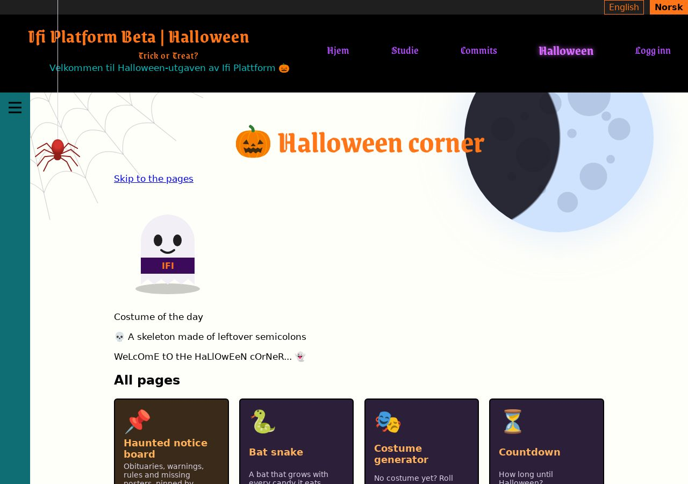

---

# Q31: Costume of the day on the Halloween corner
`🎃 pumpkin` · `🧪 python` · Feature

**Reward:** 3 🪙 + 3 🏆 · **Time:** about 16 min  
**Good to know first:** Python (lists, random with a seed, dates), Django template tags, tests

### What to do
Show a **costume of the day** on the Halloween corner's front page (http://localhost:8000/halloween/), under the heading: the same costume for everyone all day, and a new one tomorrow. Like "🧟 A zombie TA, still grading".

### Files to change (only these)
- new: `ifiplatform/apps/halloween_app/costume_of_the_day.py`
- new: `ifiplatform/apps/halloween_app/templatetags/costume_tags.py`
- new: `ifiplatform/apps/halloween_app/tests/test_costume_of_the_day.py`
- `ifiplatform/apps/halloween_app/templates/halloween/partials/costume_of_the_day.html` (empty, already shown on the front page)

### How "the same all day" works
`random.choice` picks something new every time. But `random.Random(seed)` makes a random generator that always gives the same answers for the same seed. Use a number for today's date as the seed (`day.toordinal()`, the number of days since year 1), and every visitor gets the same costume today, and a different one tomorrow.

### Your part
1. **`costume_of_the_day.py`:** a list `COSTUMES` of at least 8 `(emoji, costume)` pairs, and a function `costume_of_the_day(day)` that takes a `date` and returns one of them, the same one for the same date.
2. **The tag** in `templatetags/costume_tags.py`: a `simple_tag` called `costume_of_the_day` that returns today's costume. "Today" is Norwegian today: `datetime.now(ZoneInfo("Europe/Oslo")).date()` (the server's clock runs on UTC). Careful: if the tag function has the same name as the function you import, the names clash. Import it under another name: `from ..costume_of_the_day import costume_of_the_day as pick`.
3. **The partial** `costume_of_the_day.html`:
   ```html
   
   
   <aside class="hc-costume-of-the-day">
       <p class="hc-costume-of-the-day__label"></p>
       <p class="hc-costume-of-the-day__text"><span aria-hidden="true">{{ costume.0 }}</span> {{ costume.1 }}</p>
   </aside>
   ```
   `costume.0` is the emoji and `costume.1` the text. The emoji is hidden from screen readers, because the text already says what it is.
4. **Tests** in `tests/test_costume_of_the_day.py`: at least that the same date gives the same costume, that it's one of `COSTUMES`, and that a month of dates gives more than one costume.

Restart the server if Django says the tag doesn't exist: new `templatetags` files are only found when it starts.

### Make it yours
- More costumes, the spookier the better.
- A special costume on 31 October, whatever the seed says.

### Done when
- The front page shows a costume of the day that stays the same when you reload, and `ifi test` passes, including your new tests.

### How to work on it
Set up the project on your own computer first (see **Get started** in the README). Then:

1. **Claim this issue** on the site: https://halloween.ifiplattform.no/commits/issues/
2. In the VS Code terminal:
   ```bash
   ifi fix-issue {number}
   ```
3. Make the change, and check it at http://localhost:8000. Reload with **Ctrl+Shift+R** (Mac: **Cmd+Shift+R**): a normal reload may show the old look, because the browser keeps old copies of CSS files and pictures. Still old? Try a private window.
4. Then:
   ```bash
   ifi test
   git add .
   git commit -m "Short description of what you changed"
   ifi pull-request
   ```

**Only change the files listed above.** Then your pull request can't clash with anyone else's. After the merge it can take a few minutes before it shows on the live site. Stuck? Ask a helper, or type `ifi help`.

#### What it looks like when it's done


---

# Q32: Another study excuse, without reloading the page
`🎃 pumpkin` · `🧪 python` · Feature

**Reward:** 3 🪙 + 3 🏆 · **Time:** about 18 min  
**Good to know first:** Python and a little Django (views, JSON), JavaScript (fetch, async/await, events), tests

### What to do
"Give me another excuse" on the study page (http://localhost:8000/study/) reloads the whole page. Make it fetch a new excuse from the server and swap it in, without a reload, and never the same excuse twice in a row. For this you build a small **API**: an address that answers with data (JSON) instead of a page.

### Files to change (only these)
- `ifiplatform/apps/study_app/views/excuse_api.py`
- `ifiplatform/apps/study_app/static/js/study_excuse.js` (empty, already loaded on the study page)
- new: `ifiplatform/apps/study_app/test_excuse_api.py`

### What's already there
- The address `/study/api/excuse/` (named `study_excuse_api`) goes to `excuse_api_view` in `views/excuse_api.py`, which answers "Not built yet". Open http://localhost:8000/study/api/excuse/ to see it.
- `all_jokes()` in `ifiplatform/apps/study_app/jokes.py` (only read it) gives every joke: the translated list and the joke files. The translated ones are "lazy" texts: `str(joke)` turns them into normal text.
- On the page: the joke is `<blockquote id="study-joke">`, and the link is `<a id="study-another" data-api="...">`. `data-api` holds the API's address, with the right language prefix (`/nb/` or `/en/`).

### Your part
1. **The API**, in `excuse_api_view`: return `JsonResponse({"joke": ...})` with a random joke (`random.choice`). The page sends the joke it's showing now as `?not=<text>` (`request.GET.get("not", "")`): leave that one out of the choices, so you never get the same one twice. If that leaves nothing, use all of them.
2. **The page**, in `study_excuse.js`: when the link is clicked, stop the normal reload (`event.preventDefault()`), fetch the API with the current joke as `not` (use `encodeURIComponent` on it: jokes have spaces and question marks), and put the answer in the blockquote:
   ```js
   const response = await fetch(url, { headers: { Accept: "application/json" } });
   const data = await response.json();
   ```
   **If anything fails** (the server is down, `response.ok` is false), fall back to the normal link: `window.location.href = link.href`. The page must always work.
3. **Tests** in `test_excuse_api.py` (a `TestCase`): at least that the API answers 200 with a joke from `all_jokes()`, that with `not` set to a joke it never returns that joke (ask 30 times in a loop), and that an unknown `not` is fine. `response.json()` gives the answer as a dictionary.

### Make it yours
- A little fade when the joke changes (none with `prefers-reduced-motion: reduce`).
- Also send `"count"`, how many jokes there are, and show "1 of 22 excuses" somewhere.

### Done when
- Clicking "Give me another excuse" swaps the excuse without reloading (the page doesn't flash, and the address stays the same), never the same one twice in a row.
- With the server stopped, clicking the link still tries to load the page like before.
- `ifi test` passes, including your new tests.

### How to work on it
Set up the project on your own computer first (see **Get started** in the README). Then:

1. **Claim this issue** on the site: https://halloween.ifiplattform.no/commits/issues/
2. In the VS Code terminal:
   ```bash
   ifi fix-issue {number}
   ```
3. Make the change, and check it at http://localhost:8000. Reload with **Ctrl+Shift+R** (Mac: **Cmd+Shift+R**): a normal reload may show the old look, because the browser keeps old copies of CSS files and pictures. Still old? Try a private window.
4. Then:
   ```bash
   ifi test
   git add .
   git commit -m "Short description of what you changed"
   ifi pull-request
   ```

**Only change the files listed above.** Then your pull request can't clash with anyone else's. After the merge it can take a few minutes before it shows on the live site. Stuck? Ask a helper, or type `ifi help`.

#### What it looks like when it's done
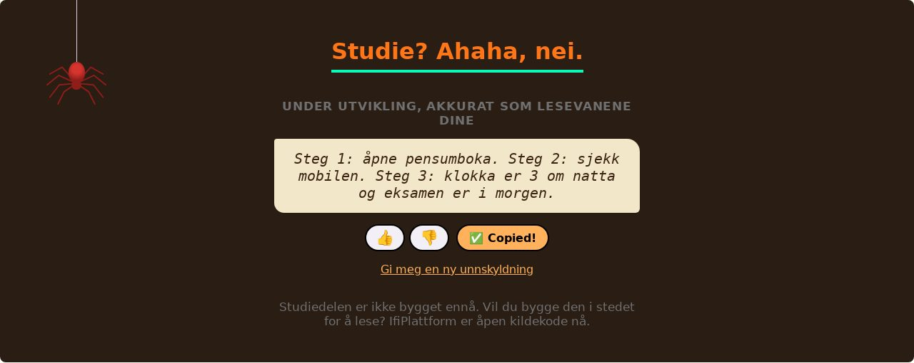

*After pressing "Give me another excuse": a new excuse, same page, no reload.*

---

# Q4: Haunted story: fill in the blanks
`🎃 pumpkin` · `🧪 python` · Feature

**Reward:** 3 🪙 + 3 🏆 · **Time:** about 16 min · **Part of the set** SET-fortune  
**Good to know first:** Python basics (strings, dictionaries, f-strings or format), basic CSS. Some tests are written for you

### What to do
The haunted story at http://localhost:8000/halloween/story/ asks for six words (a name, a place at Ifi, a food...), but pressing **Tell me the story** only says pages are missing. Write the story: a spooky tale with the visitor's words in it.

### Files to change (only these)
- `ifiplatform/apps/halloween_app/views/story.py`
- `ifiplatform/apps/halloween_app/static/css/halloween_pages/story.css` (empty, already loaded on the page)
- new: `ifiplatform/apps/halloween_app/tests/test_story.py`

### What's already there
`views/story.py` has the list `FIELDS` (each field's key and label) and a function `tell_story(words)` that returns `None`, with two `TODO`s. `words` is a dictionary from each key to what the visitor typed: `{"name": "Kari", "place": "the 3rd floor", ...}`. The page shows the story when `tell_story` returns a list of paragraphs, and "missing some pages" when it returns `None`.

### Design to build
The look: **an old storybook page**. You don't have to come up with a design: build this one. Rather design your own? Go ahead, see "Make it yours".
- **The form** (`.story-form`): a grid of fields, `repeat(auto-fill, minmax(14rem, 1fr))`, gap `0.8rem 1.2rem`, at most `46rem` wide. Each field (`.story-form__field`) has its label above the input (`display: grid; gap: 0.2rem`), in bold.
- **The inputs:** a black border `2px solid #000`, rounded corners `4px`, some padding.
- **The button:** dark red `#6b1d1d` with parchment text `#f3e7c9`, a black border, `border-radius: 999px`.
- **The story** (`.story`): parchment `#f3e7c9` with dark brown text `#3b2412`, a black border, padding `2rem 2.4rem`, at most `40rem` wide, in `Georgia, serif` at `1.1rem` with `line-height: 1.6`.
- **A drop cap:** the first letter of the story (`.story p:first-child::first-letter`) big (`3.4rem`), blood red `#a3130f`, floating to the left of the first lines (`float: left`).

### Your part
1. **TODO 1:** if any of the words is empty, return `None`. `all(...)` is handy.
2. **TODO 2:** write the story as a list of at least 3 paragraphs (strings), using every word at least once. Tip: write the paragraphs with `{name}`, `{place}`... in them, and fill them in with `paragraph.format(**words)`.
3. **Tests:** make `ifiplatform/apps/halloween_app/tests/test_story.py` and fill in the last test:
   ```python
   # pylint: disable=C0114,C0115,C0116
   from django.test import SimpleTestCase

   from halloween_app.views.story import tell_story

   WORDS = {"name": "Kari", "place": "the 3rd floor", "food": "taco", "number": "13", "creature": "mummy", "sound": "BOO"}


   class StoryTests(SimpleTestCase):
       def test_every_word_is_used(self):
           story = " ".join(tell_story(WORDS))
           for word in WORDS.values():
               self.assertIn(word, story)

       def test_a_missing_word_gives_no_story(self):
           self.assertIsNone(tell_story({**WORDS, "food": ""}))

       def test_at_least_three_paragraphs(self):
           # TODO: check that the story has at least 3 paragraphs
           pass
   ```
   Run them with `ifi test`.
4. **Style:** build the design above in `story.css`.

### Make it yours
- Two or three different stories, picked by the visitor's name, so friends get different ones.
- More fields: add them to `FIELDS` and the template shows them by itself.

### Done when
- Filling in all six words tells a story with every word in it, and leaving one out asks for all of them.
- `ifi test` passes, including your new tests.

### How to work on it
Set up the project on your own computer first (see **Get started** in the README). Then:

1. **Claim this issue** on the site: https://halloween.ifiplattform.no/commits/issues/
2. In the VS Code terminal:
   ```bash
   ifi fix-issue {number}
   ```
3. Make the change, and check it at http://localhost:8000. Reload with **Ctrl+Shift+R** (Mac: **Cmd+Shift+R**): a normal reload may show the old look, because the browser keeps old copies of CSS files and pictures. Still old? Try a private window.
4. Then:
   ```bash
   ifi test
   git add .
   git commit -m "Short description of what you changed"
   ifi pull-request
   ```

**Only change the files listed above.** Then your pull request can't clash with anyone else's. After the merge it can take a few minutes before it shows on the live site. Stuck? Ask a helper, or type `ifi help`.

#### What it looks like when it's done


---

# Q5: Whack-a-bat: make the bats appear
`🎃 pumpkin` · `🦇 silly feature` · Feature

**Reward:** 3 🪙 + 3 🏆 · **Time:** about 20 min · **Part of the set** SET-arcade  
**Good to know first:** JavaScript basics (functions, click events, arrays, timers), basic CSS grid

### What to do
Whack-a-bat at http://localhost:8000/halloween/whack-a-bat/ is half built: there's a board with 9 holes, a score, a timer and a **Start** button, but no bats. Make the game work.

### Files to change (only these)
- `ifiplatform/apps/halloween_app/static/js/halloween_pages/whack_a_bat.js`
- `ifiplatform/apps/halloween_app/static/css/halloween_pages/whack_a_bat.css` (empty, already loaded on the page)

### What's already there
`whack_a_bat.js` finds the holes (`holes`), the score and time displays, and the **Start** button, and runs a timer that counts down every second. Three `TODO`s are left.

### Design to build
The look: **dark caves in the ground**. You don't have to come up with a design: build this one. Rather design your own? Go ahead, see "Make it yours".
- **The board** (`.wab-board`): a 3×3 grid, `gap: 1rem`, at most `24rem` wide.
- **Each hole** (`.wab-hole`): a round cave (`aspect-ratio: 1; border-radius: 50%`), no border, black with a brown edge: `background: radial-gradient(circle at 50% 60%, #000 55%, #3a2a1a 70%)`. The bat in it is big: `font-size: 2.6rem`.
- **Keyboard focus** (`.wab-hole:focus-visible`): an orange outline, `3px solid #ff7518`.

### Your part
1. **TODO 1, `showBat()`:** empty every hole, pick a random one (`Math.floor(Math.random() * holes.length)`) and put `"🦇"` in it.
2. **TODO 2, clicking a hole:** if it holds a bat, `score += 1`, show it in `scoreOut` and empty the hole.
3. **TODO 3, the timer:** call `showBat()` every second. At 0, stop the timer (`clearInterval(ticker)`), empty the holes and show "Game over!" somewhere.
4. **Style:** build the design above in `whack_a_bat.css`.

### Make it yours
Your own design instead of the one above, or on top of it. Some ideas:
- Bats that get faster as time runs out.
- A rare golden bat 🌟 worth 5 points.

### Done when
- Start → bats pop up, clicking one scores, and after 30 seconds the game ends.

### How to work on it
Set up the project on your own computer first (see **Get started** in the README). Then:

1. **Claim this issue** on the site: https://halloween.ifiplattform.no/commits/issues/
2. In the VS Code terminal:
   ```bash
   ifi fix-issue {number}
   ```
3. Make the change, and check it at http://localhost:8000. Reload with **Ctrl+Shift+R** (Mac: **Cmd+Shift+R**): a normal reload may show the old look, because the browser keeps old copies of CSS files and pictures. Still old? Try a private window.
4. Then:
   ```bash
   ifi test
   git add .
   git commit -m "Short description of what you changed"
   ifi pull-request
   ```

**Only change the files listed above.** Then your pull request can't clash with anyone else's. After the merge it can take a few minutes before it shows on the live site. Stuck? Ask a helper, or type `ifi help`.

#### What it looks like when it's done


*Mid-game: one bat hit, the next one showing.*

---

# Q6: Zombie typing: make the zombies walk
`🎃 pumpkin` · `🦇 silly feature` · Feature

**Reward:** 3 🪙 + 3 🏆 · **Time:** about 20 min · **Part of the set** SET-arcade  
**Good to know first:** JavaScript basics (arrays, objects, the page's HTML from JS, events, timers), basic CSS

### What to do
Zombie typing at http://localhost:8000/halloween/zombie-typing/ is half built: there's a field, a score, lives, a text box and a **Start** button, but no zombies. Make the game work: zombies carrying words walk in from the right, and typing a zombie's word stops it.

### Files to change (only these)
- `ifiplatform/apps/halloween_app/static/js/halloween_pages/zombie_typing.js`
- `ifiplatform/apps/halloween_app/static/css/halloween_pages/zombie_typing.css` (empty, already loaded on the page)

### What's already there
`zombie_typing.js` has a list of `words`, the list `zombies` (empty), `score` and `lives`, and a game loop: after **Start**, it runs every 100 ms, calls `spawnZombie()` every 2 seconds and `moveZombies()` every time. `gameOver()` is done. Three `TODO`s are left.

### Design to build
The look: **a foggy field at night**. You don't have to come up with a design: build this one. Rather design your own? Go ahead, see "Make it yours".
- **The field** (`.zt-field`): `18rem` high, `position: relative` (the zombies are placed inside it), `overflow: hidden`, a black border `2px solid #000`, rounded corners `6px`, a dark green night with brown ground at the bottom: `background: linear-gradient(#1d2a1d, #0d140d 80%, #3a2a1a 80%)`.
- **A zombie** (`.zt-zombie`): `position: absolute`, a slime-green pill (`#8de9a8`, dark text `#0d140d`, `border-radius: 999px`, some padding), the word in bold `monospace` at `1.1rem`, on one line (`white-space: nowrap`), and a 🧟 in front (`.zt-zombie::before` with `content: "🧟 "`).
- **The text box** (`.zt-typing input`): big `monospace` text (`1.2rem`), a black border.

### Your part
1. **TODO 1, `spawnZombie()`:** make a `<div class="zt-zombie">` with a random word as its text, at a random height (`element.style.top = ...%`), add it to `field`, and remember it in `zombies` as `{ element, word, x: 100 }`.
2. **TODO 2, `moveZombies()`:** lower every zombie's `x` a little (try `0.4`), and move it there: ``element.style.left = `${x}%` ``. A zombie at `x <= 0` has reached you: remove it (`element.remove()` and from `zombies`), lose a life, show it in `livesOut`, and at 0 lives call `gameOver()`.
3. **TODO 3, typing:** when `input.value` is exactly a zombie's word, remove that zombie, add 1 to the score, show it, and empty the text box.
4. **Style:** build the design above in `zombie_typing.css`.

### Make it yours
- Faster zombies as the score goes up.
- Highlight the zombies whose word starts with what you've typed so far.

### Done when
- Start → zombies with words walk in from the right; typing a word stops that zombie and scores; three zombies getting through ends the game.

### How to work on it
Set up the project on your own computer first (see **Get started** in the README). Then:

1. **Claim this issue** on the site: https://halloween.ifiplattform.no/commits/issues/
2. In the VS Code terminal:
   ```bash
   ifi fix-issue {number}
   ```
3. Make the change, and check it at http://localhost:8000. Reload with **Ctrl+Shift+R** (Mac: **Cmd+Shift+R**): a normal reload may show the old look, because the browser keeps old copies of CSS files and pictures. Still old? Try a private window.
4. Then:
   ```bash
   ifi test
   git add .
   git commit -m "Short description of what you changed"
   ifi pull-request
   ```

**Only change the files listed above.** Then your pull request can't clash with anyone else's. After the merge it can take a few minutes before it shows on the live site. Stuck? Ask a helper, or type `ifi help`.

#### What it looks like when it's done


*Mid-game: two zombies walking in, a word half typed.*

---

# Q7: Memory pairs: turn the cards
`🎃 pumpkin` · `🦇 silly feature` · Feature

**Reward:** 3 🪙 + 3 🏆 · **Time:** about 20 min · **Part of the set** SET-arcade  
**Good to know first:** JavaScript basics (functions, click events, arrays, timers), basic CSS grid

### What to do
Memory pairs at http://localhost:8000/halloween/memory/ is half built: 12 cards are dealt, face down (`?`), but clicking does nothing. Make it a real memory game.

### Files to change (only these)
- `ifiplatform/apps/halloween_app/static/js/halloween_pages/memory.js`
- `ifiplatform/apps/halloween_app/static/css/halloween_pages/memory.css` (empty, already loaded on the page)

### What's already there
`memory.js` deals the 12 cards (6 Halloween pairs) as buttons. Each card knows its symbol in `card.dataset.symbol`, and clicking calls `flip(card)`, which is still empty. There are three `TODO`s.

### Design to build
The look: **purple cards with a striped back**. You don't have to come up with a design: build this one. Rather design your own? Go ahead, see "Make it yours".
- **The board** (`.memory-board`): 4 columns, `gap: 0.8rem`, at most `26rem` wide.
- **Each card** (`.memory-card`): playing-card shaped (`aspect-ratio: 3 / 4`), a 2px solid black border, corners rounded 8px, a striped purple back: `background: repeating-linear-gradient(45deg, #3b1b5a 0 8px, #2a1240 8px 16px)` (`45deg` means 45 degrees: diagonal stripes), white symbols at `font-size: 2rem`.
- **A found pair** (`.memory-card--found`): dark green `#1d4d1d` with a green glow: `box-shadow: 0 0 12px rgba(63, 163, 63, 0.8)`.

### Your part
1. **TODO 1:** shuffle the cards before they're dealt.
2. **TODO 2:** turning a card shows its symbol.
3. **TODO 3:** remember which cards are turned. With two up: `tries + 1`. A pair stays open and counts as found. Not a pair? Turn both back after about 800 ms (`setTimeout`). Don't allow a third card while two are showing.
4. **Style:** build the design above in `memory.css`.

### Make it yours
Your own design instead of the one above, or on top of it. Some ideas:
- "You found them all in N tries!" when the last pair is found.
- A flip animation with `transform: rotateY(180deg)`.

### Done when
- You can play a whole game, pairs stay open, and the counters are right.

### How to work on it
Set up the project on your own computer first (see **Get started** in the README). Then:

1. **Claim this issue** on the site: https://halloween.ifiplattform.no/commits/issues/
2. In the VS Code terminal:
   ```bash
   ifi fix-issue {number}
   ```
3. Make the change, and check it at http://localhost:8000. Reload with **Ctrl+Shift+R** (Mac: **Cmd+Shift+R**): a normal reload may show the old look, because the browser keeps old copies of CSS files and pictures. Still old? Try a private window.
4. Then:
   ```bash
   ifi test
   git add .
   git commit -m "Short description of what you changed"
   ifi pull-request
   ```

**Only change the files listed above.** Then your pull request can't clash with anyone else's. After the merge it can take a few minutes before it shows on the live site. Stuck? Ask a helper, or type `ifi help`.

#### What it looks like when it's done


*One pair found (🎃), one card turned over.*

---

# Q8: Moon puzzle: make the pieces slide
`🎃 pumpkin` · `🦇 silly feature` · Feature

**Reward:** 3 🪙 + 3 🏆 · **Time:** about 20 min · **Part of the set** SET-arcade  
**Good to know first:** JavaScript basics (arrays, functions, click events), CSS (grid, backgrounds, custom properties)

### What to do
The moon puzzle at http://localhost:8000/halloween/moon-puzzle/ is a 3 × 3 sliding puzzle: eight pieces of a full moon and one empty spot. The board is drawn, but the pieces can't move and don't show the moon. Make it a real puzzle.

### Files to change (only these)
- `ifiplatform/apps/halloween_app/static/js/halloween_pages/sliding_puzzle.js`
- `ifiplatform/apps/halloween_app/static/css/halloween_pages/sliding_puzzle.css` (empty, already loaded on the page)

### What's already there
`sliding_puzzle.js` keeps the board as a list of 9 numbers, row by row: 1 to 8 are the pieces and `0` is the empty spot. Solved is `[1, 2, 3, 4, 5, 6, 7, 8, 0]`. `draw()` makes a `<button class="sp-tile">` for every spot (the empty one also gets `sp-tile--empty`) and calls `move(spot)` when it's clicked. Each piece also gets `--col` and `--row`: where it belongs in the finished picture (0, 1 or 2). Three `TODO`s are left.

### Design to build
The look: **a full moon in pieces**. You don't have to come up with a design: build this one. Rather design your own? Go ahead, see "Make it yours".
- **The board** (`.sp-board`): a 3 × 3 grid (`repeat(3, 1fr)`), gap `4px`, at most `21rem` wide, padding `4px`, night-black `#15121c`, rounded corners.
- **A piece** (`.sp-tile`): square (`aspect-ratio: 1`), no border, the same night colour, slightly rounded. The picture is one big moon behind all nine pieces, so each piece shows its own part of it:
  ```css
  background-image: radial-gradient(circle at 38% 34%, #8b9bb8 0 9%, transparent 10%),
      radial-gradient(circle at 64% 62%, #8b9bb8 0 6%, transparent 7%),
      radial-gradient(circle at 50% 50%, #cfe3ff 0 44%, #15121c 45%);
  background-size: 300% 300%;
  background-position: calc(var(--col) * 50%) calc(var(--row) * 50%);
  ```
- **The empty spot** (`.sp-tile--empty`): no background at all.
- **Keyboard focus** (`.sp-tile:focus-visible`): an orange outline `3px solid #ff7518`, inside the piece (`outline-offset: -3px`).

### Your part
1. **TODO 1, `isNextToEmpty(spot)`:** true when `spot` is right above, below, left or right of the empty spot (`board.indexOf(0)`). Work with rows (`Math.floor(spot / 3)`) and columns (`spot % 3`): spots 2 and 3 are next to each other in the list, but not on the board.
2. **TODO 2, `move(spot)`:** if the piece is next to the empty spot, swap them, count the move, and `draw()` again. When the board matches `SOLVED`, show a message in `message`.
3. **TODO 3, `shuffle()`:** make about 200 random **allowed** moves. Don't just shuffle the list: half of all random orders can't be solved.
4. **Style:** build the design above in `sliding_puzzle.css`.

#### Explanation (optional)
`background-size: 300%` makes the background three pieces wide and three high. `background-position` then slides it so a piece shows its own part: `0%` is the left part, `50%` the middle, `100%` the right. That's what `--col * 50%` gives.

### Make it yours
- Use the arrow keys to slide pieces.
- A 4 × 4 version.

### Done when
- Shuffle mixes the moon up, clicking a piece next to the gap slides it, and putting the moon back together shows a message.

### How to work on it
Set up the project on your own computer first (see **Get started** in the README). Then:

1. **Claim this issue** on the site: https://halloween.ifiplattform.no/commits/issues/
2. In the VS Code terminal:
   ```bash
   ifi fix-issue {number}
   ```
3. Make the change, and check it at http://localhost:8000. Reload with **Ctrl+Shift+R** (Mac: **Cmd+Shift+R**): a normal reload may show the old look, because the browser keeps old copies of CSS files and pictures. Still old? Try a private window.
4. Then:
   ```bash
   ifi test
   git add .
   git commit -m "Short description of what you changed"
   ifi pull-request
   ```

**Only change the files listed above.** Then your pull request can't clash with anyone else's. After the merge it can take a few minutes before it shows on the live site. Stuck? Ask a helper, or type `ifi help`.

#### What it looks like when it's done
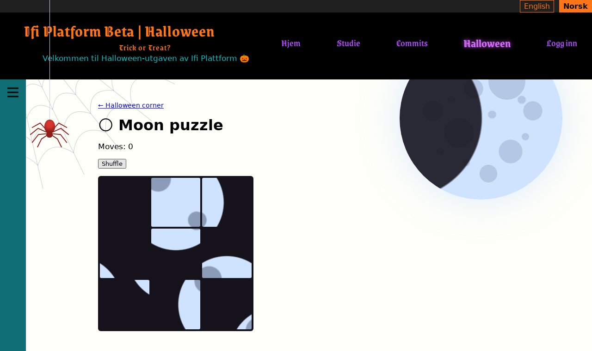

*After Shuffle.*

---

# Q9: Bat snake: make the bat move and eat
`🎃 pumpkin` · `🦇 silly feature` · Feature

**Reward:** 3 🪙 + 3 🏆 · **Time:** about 20 min · **Part of the set** SET-arcade  
**Good to know first:** JavaScript basics (arrays, objects, keyboard events, timers), CSS grid

### What to do
Bat snake at http://localhost:8000/halloween/bat-snake/ is the classic snake game, with a bat 🦇 as the head and candy 🍬 to eat. The board, the arrow keys and the game loop are there, but the bat doesn't move. Make the game work.

### Files to change (only these)
- `ifiplatform/apps/halloween_app/static/js/halloween_pages/bat_snake.js`
- `ifiplatform/apps/halloween_app/static/css/halloween_pages/bat_snake.css` (empty, already loaded on the page)

### What's already there
`bat_snake.js` makes a board of 15 × 15 `<div class="bs-cell">`. A spot on the board is `{ x, y }`, with `{ x: 0, y: 0 }` at the top left. `snake` is a list of spots, head first. `direction` is how the head moves each step (`{ x: 1, y: 0 }` is right), and the arrow keys already change it. `draw()` colours the snake's cells (`bs-cell--snake`), puts 🦇 on the head and 🍬 on the candy. **Start** calls `step()` every 160 ms. Three `TODO`s are left.

### Design to build
The look: **a purple bat trail in the night**. You don't have to come up with a design: build this one. Rather design your own? Go ahead, see "Make it yours".
- **The board** (`.bs-board`): a grid of 15 equal columns (`repeat(15, 1fr)`), at most `30rem` wide, a black border `2px solid #000`, rounded corners `6px` (with `overflow: hidden`), night-black `#15121c`.
- **A cell** (`.bs-cell`): square (`aspect-ratio: 1`), its emoji centred (`display: grid; place-items: center`), `font-size: 1.1rem`, `line-height: 1`.
- **The snake** (`.bs-cell--snake`): poison purple `#6b2fb3`.

### Your part
1. **TODO 1, `placeCandy()`:** put `candy` on a random spot that isn't part of the snake. Try random spots until one is free (a `do ... while` loop works).
2. **TODO 2, `step()`:** make the new head: `snake[0]` moved by `direction`. Put it first in `snake` (`unshift`). On the candy: score + 1 and `placeCandy()`. Otherwise remove the tail (`pop`), so the snake keeps its length.
3. **TODO 3, crashing:** before moving, if the new head is outside the board (below 0, or `SIZE` or more) or on the snake itself, call `gameOver()` instead and stop.
4. **Style:** build the design above in `bat_snake.css`.

### Make it yours
- Don't let the bat turn straight back into itself (pressing ← while flying →).
- Faster with every candy.
- Steer with W A S D too.

### Done when
- Start → the bat flies on its own, the arrow keys steer it, eating candy makes it longer and scores, and hitting a wall or itself ends the game.

### How to work on it
Set up the project on your own computer first (see **Get started** in the README). Then:

1. **Claim this issue** on the site: https://halloween.ifiplattform.no/commits/issues/
2. In the VS Code terminal:
   ```bash
   ifi fix-issue {number}
   ```
3. Make the change, and check it at http://localhost:8000. Reload with **Ctrl+Shift+R** (Mac: **Cmd+Shift+R**): a normal reload may show the old look, because the browser keeps old copies of CSS files and pictures. Still old? Try a private window.
4. Then:
   ```bash
   ifi test
   git add .
   git commit -m "Short description of what you changed"
   ifi pull-request
   ```

**Only change the files listed above.** Then your pull request can't clash with anyone else's. After the merge it can take a few minutes before it shows on the live site. Stuck? Ask a helper, or type `ifi help`.

#### What it looks like when it's done
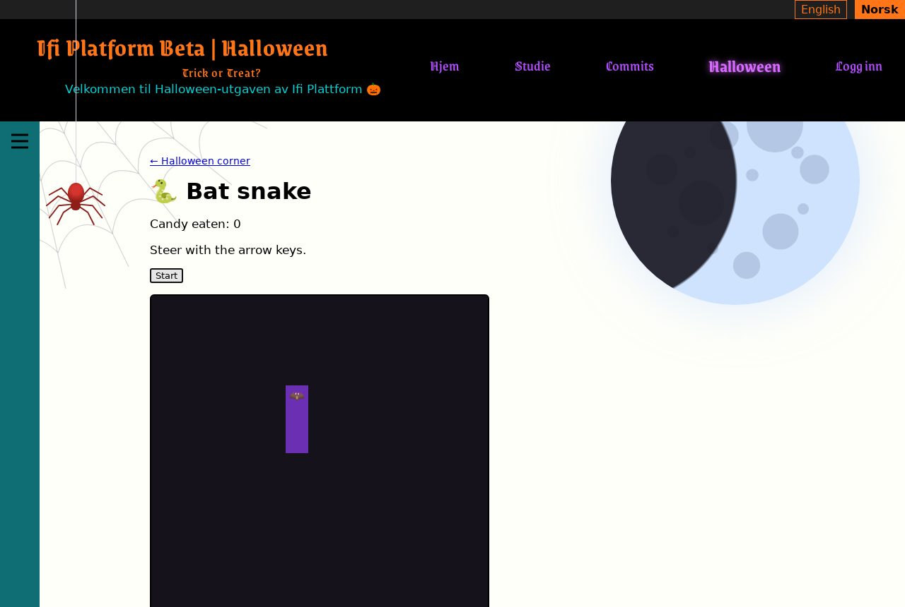

*Mid-game: the bat flying up, a candy on the right.*

---

# SET-arcade: 🕹️ Set: the Halloween arcade
`🎃 pumpkin` · `🦇 silly feature` · Feature

Five half-built games in the Halloween corner (http://localhost:8000/halloween/): whack-a-bat, memory pairs, zombie typing, the moon puzzle and bat snake. The board and buttons are there; each issue writes the game logic in JavaScript.

**Claim one of the sub-issues, not this one.** You get coins (and points) for the sub-issue you finish. This issue only groups them, and closes when all of them are done.

- [ ] Q5
- [ ] Q7
- [ ] Q6
- [ ] Q8
- [ ] Q9

---

# SET-fortune: 🔮 Set: the fortune booth
`🎃 pumpkin` · `🧪 python` · Feature

Four half-built pages in the Halloween corner (http://localhost:8000/halloween/): the fortune teller, the spooky name generator, the potion mixer and the haunted story. The pages and forms already work; each issue writes the Python behind one of them, with tests.

**Claim one of the sub-issues, not this one.** You get coins (and points) for the sub-issue you finish. This issue only groups them, and closes when all of them are done.

- [ ] Q1
- [ ] Q2
- [ ] Q3
- [ ] Q4
