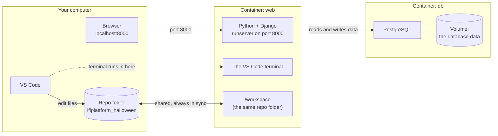
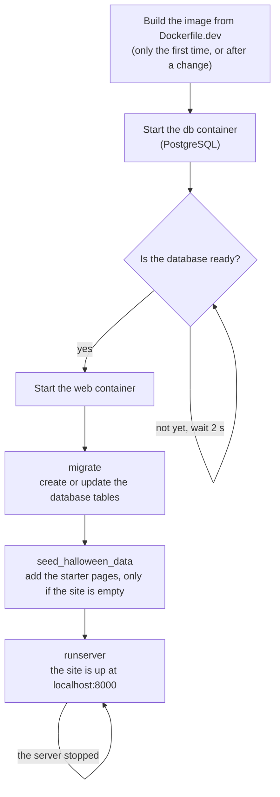

# Docker, explained simply

Last updated: 2026-10-15

You don't need to understand Docker to work on this project. Follow
[Setup with Docker](setup_with_docker.md) and it just works. This page is
for when you wonder *what* is going on, or something looks strange.

## Why we use Docker

To run this website you need Python, about fifty Python packages in the
right versions, and a PostgreSQL database. Installing all of that by hand
is different on Windows, macOS and Linux, and it often goes wrong in a
different way on every laptop ("but it works on my machine!").

Docker packs all of it into a ready-made box. Everyone runs the same box,
so everyone gets the same setup, with one click.

## The words, in plain language

| Word | What it means | In this project |
| --- | --- | --- |
| **Image** | A recipe for the box: which operating system, which programs, which packages. | `Dockerfile.dev` |
| **Container** | A running box made from an image. Think of it as a small computer inside your computer. | `web` (the website) and `db` (the database) |
| **Volume** | A storage space for a container that survives restarts. | Where the database keeps its data |
| **Docker Compose** | A tool that starts several containers together and connects them. | `docker-compose.yml` |
| **Dev Container** | A VS Code feature that opens your project *inside* a container, so the editor's terminal and tools run there. | `.devcontainer/devcontainer.json` |

## What runs where

Three things to remember:

- **Your files live on your own computer.** The container sees the same
  folder at `/workspace`. When you save a file in VS Code, the container
  sees the change at once, and the site reloads.
- **The VS Code terminal runs *inside* the `web` container.** That's why
  `python manage.py ...` works there without installing Python yourself.
- **http://localhost:8000 reaches the container.** Docker forwards the
  port, so your browser can open the site as if it ran on your computer.

## What happens when you click "Reopen in Container"

- The first start is slow because Docker downloads Python and PostgreSQL.
  Later starts take seconds.
- If the server stops (for example after a code error), it starts again
  by itself after 2 seconds.
- `seed_halloween_data` only adds pages to an empty database, so the
  pages you make yourself are kept.

## Inside or outside the container?

| Command | Where to run it |
| --- | --- |
| `python manage.py ...` | **Inside**: the VS Code terminal, when the project is open in the container |
| `git ...` or GitHub Desktop | Either. Both see the same folder |
| `docker compose ...` | **Outside**: a terminal on your own computer, in the repo folder |
| `restart-server` | **Inside** |

Not sure where you are? In the container, VS Code shows
**"Dev Container: IfiPlatform Halloween"** in the bottom left corner.

## Common "huh?" moments

- **"My changes to the database are gone."** Someone (maybe you) ran
  `docker compose down -v`, which deletes the database volume. The next
  start gives you a fresh database with new starter content. See
  [Stopping and resetting](docker.md#stopping-and-resetting).
- **"The site doesn't load any more."** The server probably stopped on an
  error. Read the error, fix it, and run `restart-server`. See
  [If something goes wrong](docker.md#if-something-goes-wrong).
- **"`ModuleNotFoundError` after I pulled the latest code."** Someone added
  a package, and your image doesn't have it yet. Run
  `Dev Containers: Rebuild Container` from the Command Palette.
- **"Where is the `.env` file?"** You don't need one. `docker-compose.yml`
  sets everything the site needs. See [Keys and tokens](docker.md#keys-and-tokens-env)
  for the optional extras.

## More
- First-time setup: [setup_with_docker.md](setup_with_docker.md)
- Day-to-day use and fixing problems: [docker.md](docker.md)
- How the setup is built and why (for the curious):
  [architecture/docker_setup.md](../architecture/docker_setup.md)
- Docker's own beginner guide: see the Docker section in
  [TUTORIALS.md](../../TUTORIALS.md#docker-and-dev-containers)
