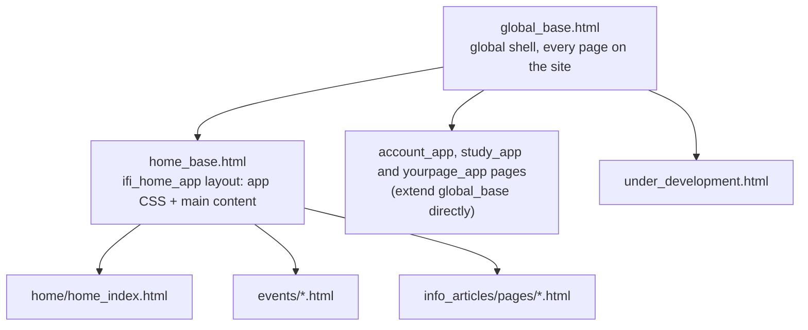
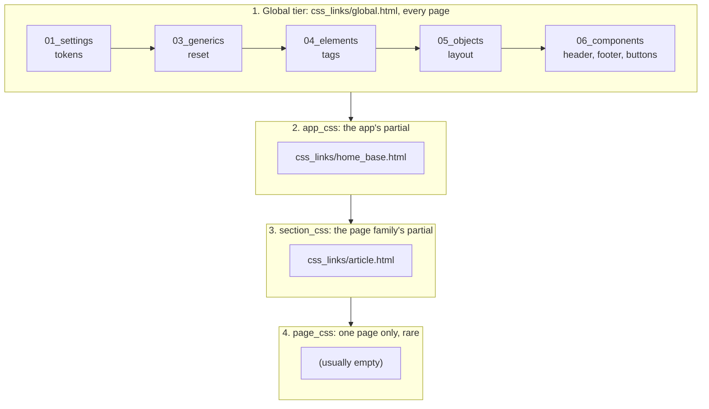

# Frontend architecture

Last updated: 2026-10-20

The sitewide rules for how HTML templates and CSS are organized, loaded
and written. The global `templates/` folder and each `static/css/` folder
also have a short `README.md` that only covers what is specific to that
folder, and points back here.

## HTML templates

### Where templates live

- One global template folder, `ifiplatform/templates/`, for the site shell
  and the pieces every page shares.
- One per-app template folder, `ifiplatform/apps/<app>/templates/`, for
  that app's own pages and partials.

Django merges all of these folders into one namespace, so a template name
must be unique across every folder. That is why the app base is called
`home_base.html` and not just `base.html`.

### Base templates: each layer builds on the one above

Pages don't repeat the `<html>`, `<head>`, header and footer. They extend
a base template and only fill in the parts that are theirs:



- **`global_base.html`** (global) renders what every page has: the `<head>`
  with favicons and the CSS tiers, the deploy and beta notices, the
  Wagtail user bar, the top header with language select, and the bottom
  header. The page's own content goes in between, in `<main>`.
- **`<app>_base.html`** (per app) extends `global_base.html` and adds the
  layout shared by that app's pages, plus the app's CSS partial. Only
  `ifi_home_app` has one so far (`home_base.html`). The other apps' pages
  extend `global_base.html` directly for now.
- **Pages** extend their app's base and fill in its blocks.
- **The side menu** is a global partial, `templates/partials/sidemenu/`, so
  any app can use it. `global_base.html` has an empty `sidemenu` block in
  `<aside>`. Each page that wants the menu fills that block with
  ``. The app base doesn't.
  Only the `ifi_home_app` pages use it so far. Its CSS,
  `static/css/06_components/sidemenu.css`, is global too, but each app
  links it itself (`ifi_home_app` in `css_links/home_base.html`).

A new app with more than one page should get its own `<app>_base.html`
rather than having every page extend `global_base.html` and repeat the same
layout.

### Blocks

Blocks defined in `global_base.html`:

| Block | Filled by | For |
|---|---|---|
| `title` | pages | The browser tab title |
| `app_css` | the app base | The app's CSS partial (see [How stylesheets reach a page](#how-stylesheets-reach-a-page-one-block-per-tier)) |
| `section_css` | pages | The page family's CSS partial |
| `page_css` | pages, rarely | CSS for one page only |
| `extra_head` | pages | Anything else for `<head>`: meta, preloads, JS |
| `sidemenu` | pages | The left side menu, in `<aside>` next to `<main>` |
| `content` | the app base, or pages without one | Everything inside `<main>` |

Blocks added by `home_base.html`, inside its `content`:

| Block | For |
|---|---|
| `maincontent` | The page's main content |
| `maincontent_style` | Inline style on the main content wrapper, for pages that need to style it (e.g. `article_page.html`'s background) |

### Partials

A partial is a piece of a page, pulled in with ``. It is
never rendered on its own.

- Partials live in a `partials/` folder next to the templates that use
  them: `templates/partials/` for global ones (headers, notices), and
  e.g. `info_articles/partials/` or `events/partials/` inside an app.
- `css_links/` folders are a special kind of partial that only hold
  `<link>` tags. See [How stylesheets reach a page](#how-stylesheets-reach-a-page-one-block-per-tier).
- A name starting with `_` (e.g. `_block_box_style.html`) is a fragment
  that gets included into the middle of a tag, such as inside a `style="..."`
  attribute, rather than a standalone piece of markup.

## Where CSS lives

- One global static folder, `ifiplatform/static/css/`, for CSS shared
  sitewide.
- One per-app static folder, `ifiplatform/apps/<app>/static/css/`, for
  that app's own CSS.
- Try to avoid long files with lots of scrolling. Instead separate into
  new, more specific files.

The READMEs in these folders are for the repo only. `collectstatic` skips
them, so they are not served on the live site (see `ignore_patterns` in
`ifiplatform/core_app/apps.py`).

## Structure of files: ITCSS (Inverted Triangle CSS)

Folders are ordered by cascade/specificity, so load order follows the
numbering. The numbers are the canonical ITCSS layer positions, so a
number means the same layer in the global tree and in every app's own tree:

```
01_settings/    # Variables, tokens (colors, spacing, fonts)
                # 02 = Tools (mixins/functions) -- N/A, no preprocessor
03_generics/    # Reset, normalize, box-sizing
04_elements/    # Bare HTML tags (h1, a, p)
05_objects/     # Layout patterns (container, grid)
06_components/  # UI components (card, nav, button)
                # 07 = Utilities/overrides -- none written yet
```

None should share the same number. The gaps at 02 and 07 are deliberate:
they hold those layers' canonical positions open, so adding a utilities
layer later means creating `07_utilities/` rather than renumbering
everything below it.

A per-app tree only has files in some of these layers (usually just
objects and components) -- it keeps these same numbers and simply has no
folder for the layers it doesn't need.

### Objects vs components

- **Objects (`05_objects/`) only place things:** flex/grid, widths, gaps,
  alignment, breakpoints. No colours, borders, shadows or font styling.
  Object files are named `<area>_layout.css`, so a layout file always has
  `layout` in its name.
- **Components (`06_components/`) are styled pieces:** a badge, a header, a
  list, a button. Name the file after the piece (`event_badges.css`), not
  after the page it happens to be on.
- **Don't make one file per page.** A page's CSS is split into its layout
  object plus the components on it. The subfolder (`event/`, `union/`)
  already says which page or area the files belong to.

## How stylesheets reach a page: one block per tier

`global_base.html` declares an empty block per tier, in cascade order. A
template fills only its own tier, so it can never drop the tier above it:

```html
        {# global, every page #}
      {# one partial per app #}
  {# one per page family #}
     {# one page only, rare #}
   {# non-CSS: meta, preloads, JS #}
```

The whole cascade on an article page, top to bottom:



Later files win when two rules are equally specific, so each tier can
build on the ones above it.

Each tier includes exactly one **template partial** holding the `<link>`
tags for that tier, in cascade order. The global one is
`templates/css_links/global.html`; per-app ones live in that app's
`templates/css_links/` (see `apps/ifi_home_app/` for worked
examples). Partial names are namespaced by app directory because Django
merges every template directory into one namespace, so a bare
`css/article.html` would collide the moment a second app added one.

Three rules:

- **Never use `@import`.** A partial lists `<link>` tags instead. The
  browser's preload scanner races ahead through the HTML and starts
  downloading every `<link href>` it can see, but it cannot see inside a
  `.css` file -- so an `@import` is only discovered after the importing
  file has downloaded and parsed. That costs an extra round trip, and it
  delays the stylesheet past the point where scripts start measuring the
  page, which is what produces a flash of unstyled content.
  `account_app`'s `account_base.css` and `study_app`'s `study_base.css`
  still use `@import`. They should move to `css_links/` partials when
  those apps start using the tier blocks.
- **Never put a `<link>` in a partial that renders in the body.** These
  CSS partials are included in `<head>`, which is the whole point. A
  stylesheet reached in the body isn't render-blocking -- the browser
  paints everything above it unstyled, then restyles when the sheet
  lands. Images are the obvious tell, flashing at full natural size.
- **A partial lists leaf files only, never another partial.** Nesting
  them would put the tiers' load order back out of one place.

Load order within a tier is the `<link>` order in that partial, so an
ordering constraint between two files gets written down once there
instead of being a trap in every template that loads both.

There's no bundler or manifest here -- paths are hardcoded, so moving,
renaming or splitting a file means updating every `<link>` that
references its old path. If the number of requests ever becomes a real
problem, the answer is concatenation (e.g. `django-compressor`), not
`@import`.

### Scripts that measure the page

`DOMContentLoaded` does not wait for stylesheets. A script that measures
layout at startup (for example with `getBoundingClientRect()`) can run
before the CSS has applied. It then measures the unstyled page, and
Firefox warns *"Layout was forced before the page was fully loaded"*.
Such a script should first wait until every `link[rel="stylesheet"]` has
loaded, listening for `error` as well as `load`, so one missing file can't
block it forever.

### Favicon version number

The favicon `<link>` tags in `global_base.html` end in `?v=6`. Browsers
cache favicons very hard and only fetch them again when the URL changes.
When the favicon image changes, bump the number on all four links at the
same time (`?v=6` → `?v=7`). Don't remove it as cleanup.

## Structure within files: BEM (Block Element Modifier)

Example:

```css
/* Block */
.card { }

/* Element */
.card__title { }
.card__image { }

/* Modifier */
.card--featured { }
.card__title--large { }
```
