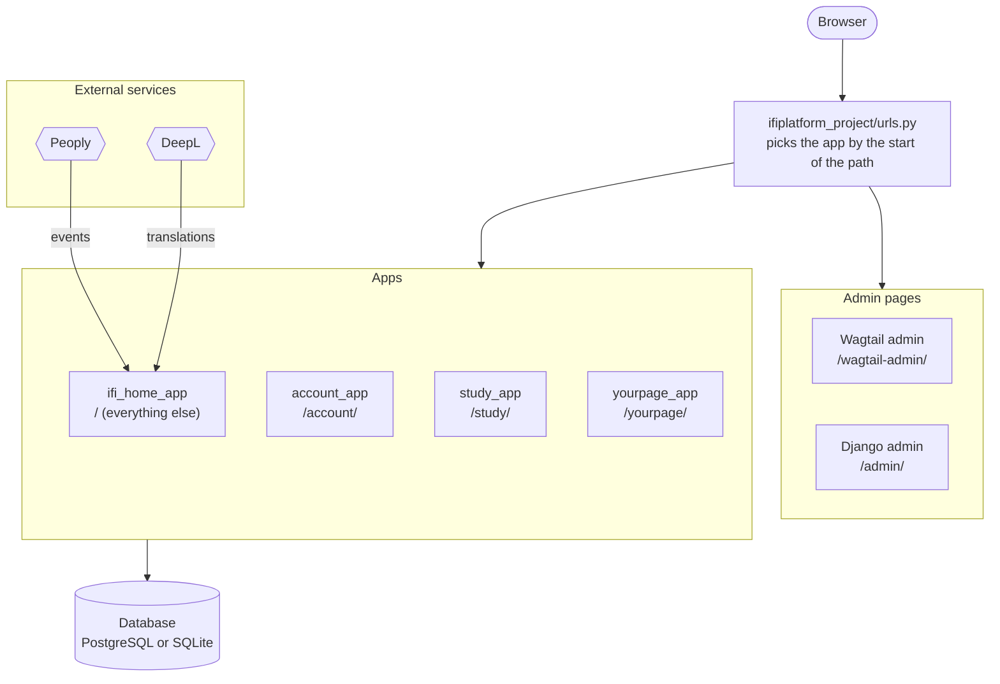
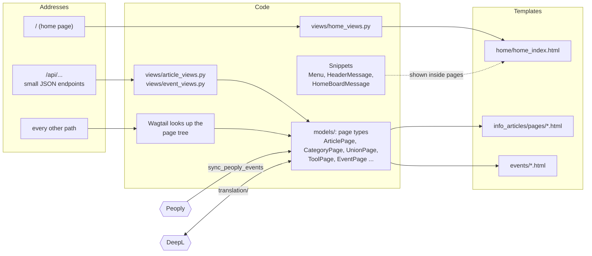
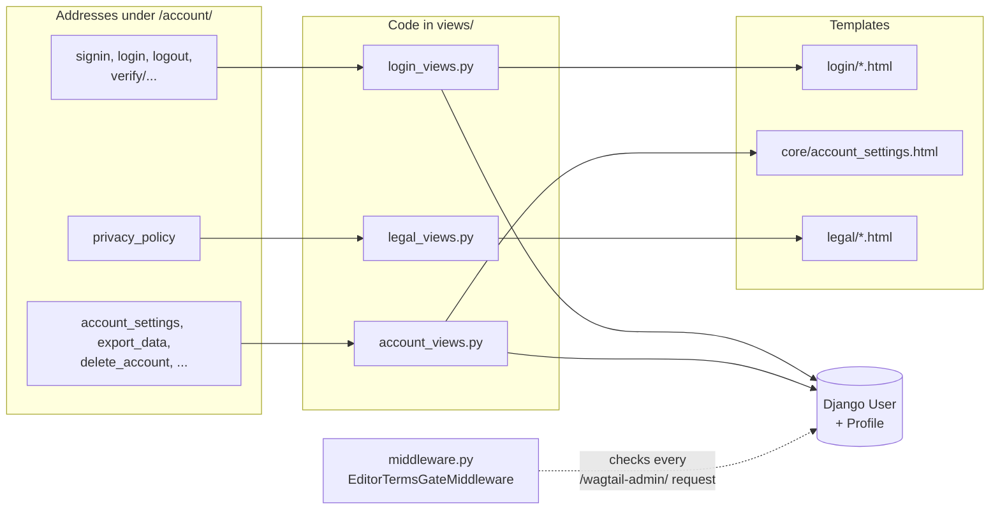
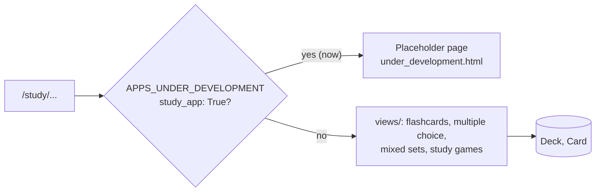
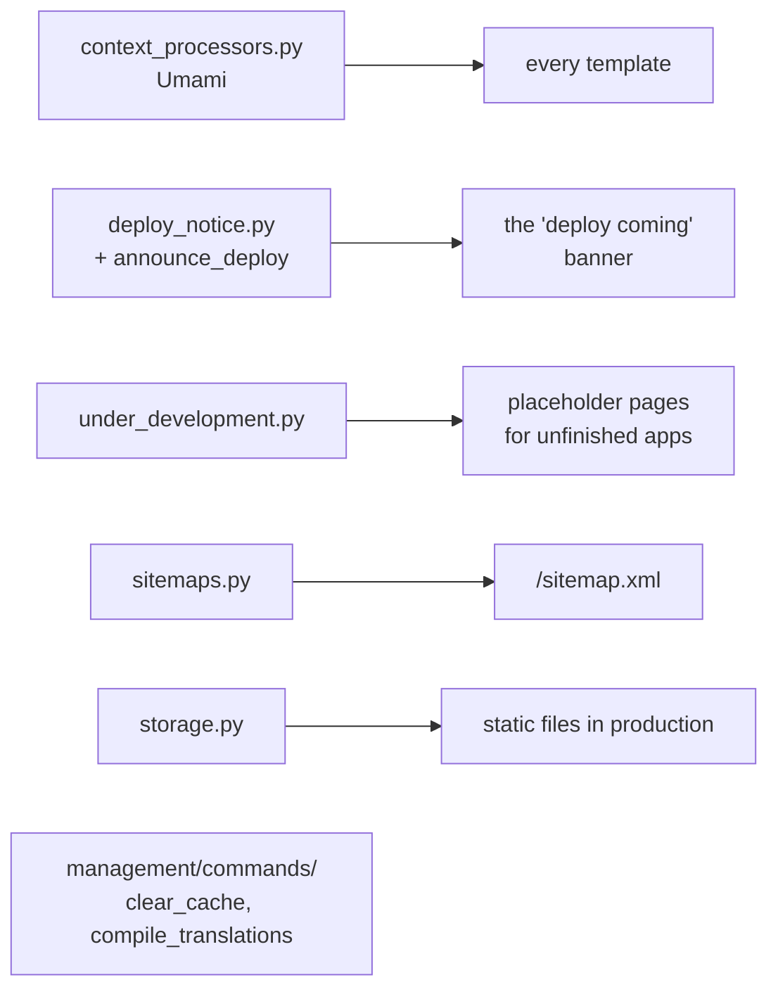
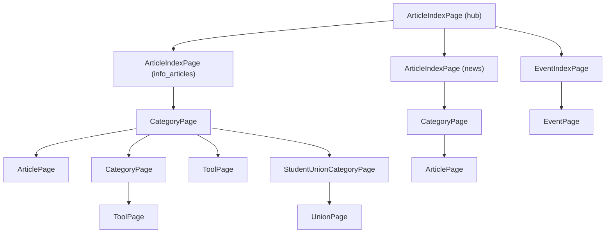

# Architecture overview

Last updated: 2026-10-26

A map of how IfiPlatform fits together: which app does what, how pages are
organized, and what happens between a browser request and the HTML that
comes back. Read this first, then follow the links for the details.

- What each tool and service is: [tech_stack.md](tech_stack.md)
- How templates and CSS are organized: [frontend.md](frontend.md)
- The feature concept map (a diagram of the planned features):
  [eraser_links.md](eraser_links.md), or the image
  [featureconceptmap_v1.png](featureconceptmap_v1.png)

## What the site is

IfiPlatform is a student-run website for students at IFI. It collects
information articles, news, student unions, useful tools and events in one
place, in Norwegian and English. Study tools (flashcards and more) are
planned, but not open to users yet.

## Words used in this project

| Word | Meaning |
| --- | --- |
| **IFI** | Institutt for informatikk, the Department of Informatics at the University of Oslo |
| **Student union** | A *linjeforening* or other student organization at IFI. Each one has a `UnionPage` |
| **Peoply** | The event platform student unions use. Our events are copied from it |
| **nb / en** | Norwegian Bokmål and English, the two languages of the site. `nb` is the main one |
| **Wagtail** | The CMS that editors use to write and publish pages |
| **Wagtail admin** | The editor interface at `/<lang>/wagtail-admin/`, for pages, menus and messages |
| **Django admin** | The technical admin at `/<lang>/admin/`, for users and raw database records |

## Apps at a glance

The Django project lives in `ifiplatform/`. Settings and the root URLs are
in `ifiplatform/ifiplatform_project/`. `core_app` sits directly in
`ifiplatform/`, and the other apps are grouped in `ifiplatform/apps/`.

| App | Built with | URL prefix | Main models | Status |
| --- | --- | --- | --- | --- |
| `core_app` | plain Django | none (shared helpers) | none | in use |
| `ifi_home_app` | Wagtail + Django | `/` (everything not claimed below) | the page types below, `MenuGroup`, `Menu`, `HeaderMessage`, `HomeBoardMessage`, `ArticleStyle`, `ArticleBlockStyle`, `PeoplySyncLog` | in use |
| `account_app` | plain Django | `/account/` | `Profile` | in use |
| `study_app` | plain Django | `/study/` | `Deck`, `Card` | under development |
| `yourpage_app` | plain Django | `/yourpage/` | none yet | under development |

- **`core_app`** holds things every app needs: the "deploy coming" banner,
  the sitemap, static file storage, the "under development" placeholder
  and a few project-wide management commands.
- **`ifi_home_app`** is the main site: the home page, articles and news,
  student unions, tools, events (synced from Peoply), menus and the
  translation tools in the Wagtail admin.
- **`account_app`** handles sign-up, login, email verification, the privacy
  policy, exporting and deleting your data, and the terms editors must
  accept before using the Wagtail admin.
- **`study_app`** and **`yourpage_app`** show a placeholder page for now.
  This is switched by `APPS_UNDER_DEVELOPMENT` in `settings.py`.

### How the apps fit together

Every request first goes through the root `urls.py`, which hands it to
one app by the start of the path. `ifi_home_app` takes everything the
others don't. (The diagrams render on GitHub, and in VS Code's Markdown
preview with the Markdown Preview Mermaid Support extension.)



Not drawn, to keep it readable:
- **`core_app`** has no pages of its own. It holds helpers every app uses.
- **`account_app`** also guards the Wagtail admin: editors must accept the
  terms first.
- Every address starts with `/nb/` or `/en/`, which picks the language.

### Each app on its own

Each diagram reads left to right: the addresses the app answers, the
code that handles them, and the data and templates it uses.

#### `ifi_home_app`: the main site



- The `/api/...` endpoints are for buttons on the site: the article
  editor's style and publish buttons, and "Sync Peoply now".
- Translation code is in `translation/`, and the Peoply client in
  `integrations/peoply_api.py`.
- Details: [articles](ifi_home_app/articles.md),
  [unions and tools](ifi_home_app/unions_and_tools.md),
  [events](ifi_home_app/events.md), [menus](ifi_home_app/menus.md) and
  [translations](shared/translations.md).

#### `account_app`: sign-up, login and your data



#### `study_app`: study tools (not open yet)



#### `core_app`: shared helpers



## Two kinds of pages

The site has two kinds of pages, and it is worth knowing which one you are
working on.

### Wagtail pages

- Written by **editors** in the Wagtail admin.
- Each page is a row in the database with a place in the
  [page tree](#the-wagtail-page-tree).
- The page model (for example `ArticlePage`) decides which fields the
  editor fills in and which template shows the page.
- Examples: articles, categories, student unions, tools and events.

**The URL** is not set in a `urls.py`. It is built from the page's own
**slug** (a URL-friendly name set in the admin) and the slugs of the pages
above it:

```
informasjonsartikkler → sosialt → testartikkel
= /nb/informasjonsartikkler/sosialt/testartikkel/
```

Changing a slug or moving a page changes its URL, and the URLs of every
page below it.

### Django views

- Written by **developers** in code.
- A fixed URL in the app's `urls.py`, and a view function that builds the
  page.
- Examples: the home page, all of `account_app`, `study_app` and
  `yourpage_app`, and the small JSON endpoints under `/api/`.

### Snippets

A third thing editors change. Snippets are edited in the Wagtail admin,
but have no URL of their own and are shown inside other pages.

- Examples: menus, the header message and the home page message board.

### Which one to choose for a new page

- **Wagtail page** when it is *content*: editors should be able to create
  it, write it, translate it and move it around without a developer.
- **Django view** when the page is part of the *application*: developers
  decide that it exists and where it lives, and its content comes from
  code or data rather than from an editor.
- **Django view + snippet** when a Django page needs a bit of editable
  text, like the home page's message board.

## The Wagtail page tree

Every Wagtail page has a parent. Each page type lists which types it may
have as children (`subpage_types`) and, sometimes, which it may sit under
(`parent_page_types`). That is what keeps the tree below in shape. All page
types are in `apps/ifi_home_app/models/`.



- **(hub), (info_articles), (news)** are the index page's `section` field.
- **The hub** is the site's root page. There is one, in Norwegian; English
  is shown on the same pages (see [shared/translations.md](shared/translations.md)).
- **CategoryPage** examples: "Sosialt", "Praktisk", and "Siste nytt"
  under news. Categories can be nested.
- **EventPage** can hold sub-events (more `EventPage`s).

This is how the site is set up (the `seed_dev_data` command builds the same
shape locally). The rules allow a bit more. For example, an `ArticlePage`
may sit directly under an info or news index, but never directly under
the hub. The `section` field on `ArticleIndexPage`
tells the site which part an index is: the home page finds the news index
by it, and breadcrumbs leave out the hub. Menus don't use it, since editors
pick every menu link by hand (see [ifi_home_app/menus.md](ifi_home_app/menus.md)).

A guide to Wagtail itself in this project (pages vs snippets, StreamField
and how to add a new page type) is planned as
`wagtail.md`.

## From request to page

Every request goes through four steps:

1. **Language:** the `/nb/` or `/en/` prefix sets the language.
2. **App:** the path is matched against the app prefixes (`account/`,
   `study/` and so on), top to bottom. `ifi_home_app` is the catch-all.
3. **Page:** `ifi_home_app` sends the home URL to a Django view, and
   everything else to Wagtail, which looks it up in the page tree.
4. **View and template:** the page is built and rendered.

How Django matches URLs in general is in the
[Django docs](https://docs.djangoproject.com/en/6.0/topics/http/urls/).

## Settings and environment

There is one settings file: `ifiplatform/ifiplatform_project/settings.py`.
Anything that differs between your machine and production comes from the
`.env` file in `ifiplatform/`. The setup steps are in
[contributing/setup_with_docker.md](../contributing/setup_with_docker.md) and
[contributing/setup_without_docker.md](../contributing/setup_without_docker.md),
and the production keys are in
[operations/prod_server.md](../operations/prod_server.md#environment-variables).

| | Local development | Production |
| --- | --- | --- |
| `DEBUG` | `True` | `False` |
| Database | SQLite (`ifiplatform/db.sqlite3`), or PostgreSQL with `USE_POSTGRES=True` | PostgreSQL |
| Static files | served straight from each `static/` folder | collected into `ifiplatform/staticfiles/`, with hashed names |
| Uploaded files (images, documents) | `ifiplatform/media/` (Docker: the `media` volume) | `ifiplatform/media/` |
| Cache | `ifiplatform/django_cache/` (Docker: a table in the database; tests use memory) | `ifiplatform/django_cache/` |
| Email | printed to the console | sent through SMTP |

## Languages

The site is bilingual. `nb` is the main language: there is one page tree,
written in Norwegian. On `/en/` the same pages show English text, which
DeepL fills in after publishing and editors can correct.
Texts in templates and Python code are translated with Django's own
`` / `_()` and the files in `ifiplatform/locale/`.
[contributing/everyday_commands.md](../contributing/everyday_commands.md#translations)
shows the commands. Both are explained in
[shared/translations.md](shared/translations.md).

## External services

| Service | What it does here | Where in the code |
| --- | --- | --- |
| **Peoply** | Events are copied from Peoply into `EventPage`s. Peoply is the source of truth for the synced fields | `ifi_home_app/integrations/peoply_api.py`, the `sync_peoply_events` command |
| **DeepL** | Machine translation nb → en, with a glossary of fixed terms | `ifi_home_app/translation/`, the `sync_deepl_glossary` command |
| **Umami** | Page analytics | `core_app/context_processors.py` |

More about each one is in [tech_stack.md](tech_stack.md#external-services),
and the commands are in
[operations/management_commands.md](../operations/management_commands.md).
A guide to the jobs that run outside a web request, such as the Peoply
sync timer on the server, is planned as `shared/background_jobs.md`.

## Where to look next

| If you want to… | Look at |
| --- | --- |
| Change how a page looks | [frontend.md](frontend.md), then the page's template |
| Change an article, category or index page | [ifi_home_app/articles.md](ifi_home_app/articles.md) |
| Change student union or tool pages | [ifi_home_app/unions_and_tools.md](ifi_home_app/unions_and_tools.md) |
| Change events or the Peoply sync | [ifi_home_app/events.md](ifi_home_app/events.md) |
| Change menus | [ifi_home_app/menus.md](ifi_home_app/menus.md) |
| Change the home page | `apps/ifi_home_app/views/home_views.py`, `templates/home/` in the same app |
| Change sign-up or login | `apps/account_app/` |
| Run or write a management command | [operations/management_commands.md](../operations/management_commands.md) |
| Know how production runs | [operations/prod_server.md](../operations/prod_server.md) |
