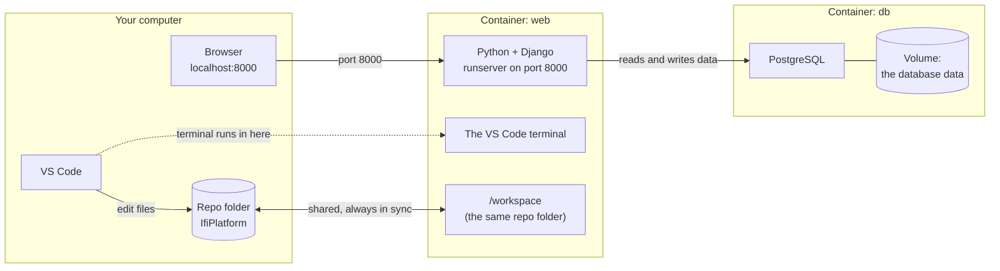
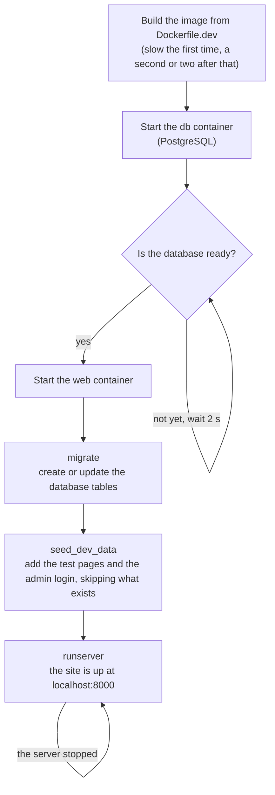

# Docker guide

Last updated: 2026-10-26

Everything about the Docker setup after the first start: how it works, when
to restart or rebuild, everyday tasks, and fixing problems. Starting for the
first time? Follow [Setup with Docker](setup_with_docker.md). You don't need
to read this page to get going.

**On this page:** [How it works](#how-it-works) · [Restart, reopen, rebuild or reset?](#restart-reopen-rebuild-or-reset) · [Everyday tasks](#everyday-tasks) · [If something goes wrong](#if-something-goes-wrong)

## How it works

### Why we use Docker

To run this website you need Python, about fifty Python packages in the
right versions, and a PostgreSQL database. Installing all of that by hand
is different on Windows, macOS and Linux, and it often goes wrong in a
different way on every laptop ("but it works on my machine!").

Docker packs all of it into a ready-made box. Everyone runs the same box,
so everyone gets the same setup, with one click.

### The words, in plain language

| Word | What it means | In this project |
| --- | --- | --- |
| **Image** | A recipe for the box: which operating system, which programs, which packages. | `Dockerfile.dev` |
| **Container** | A running box made from an image. Think of it as a small computer inside your computer. | `web` (the website) and `db` (the database) |
| **Volume** | A storage space for a container that survives restarts. | Where the database keeps its data |
| **Docker Compose** | A tool that starts several containers together and connects them. | `docker-compose.yml` |
| **Dev Container** | A VS Code feature that opens your project *inside* a container, so the editor's terminal and tools run there. | `.devcontainer/devcontainer.json` |

### What runs where



Three things to remember:

- **Your files live on your own computer.** The container sees the same
  folder at `/workspace`. When you save a file in VS Code, the container
  sees the change at once, and the site reloads.
- **The VS Code terminal runs *inside* the `web` container.** That's why
  `python manage.py ...` works there without installing Python yourself.
- **http://localhost:8000 reaches the container.** Docker forwards the
  port, so your browser can open the site as if it ran on your computer.

### What happens when you click "Reopen in Container"



- The first start is slow because Docker downloads Python and PostgreSQL.
  Later starts take seconds.
- If the server stops (for example after a code error), it starts again
  by itself after 2 seconds.
- `seed_dev_data` skips what already exists, so it's safe on every start
  and the pages you make yourself are kept.

### Inside or outside the container?

| Command | Where to run it |
| --- | --- |
| `python manage.py ...` | **Inside**: the VS Code terminal, when the project is open in the container |
| `ifi ...` (`ifi help`, `ifi restart-server`, ...) | **Inside** |
| `git ...` or GitHub Desktop | Either. Both see the same folder |
| `docker compose ...` | **Outside**: a terminal on your own computer, in the repo folder |

Not sure where you are? In the container, VS Code shows
**"Dev Container: IfiPlatform"** in the bottom left corner.

## Restart, reopen, rebuild or reset?

Four ways to "start again", from smallest to biggest. Pick the smallest one
that fixes your problem.

| | What it does | When | You lose |
| --- | --- | --- | --- |
| **Restart the server**<br>`ifi restart-server` in the container terminal | Starts Django again. The container keeps running | A new `templatetags` file, a changed `.env`, or the site stopped after an error | Nothing |
| **Close and reopen**<br>close the VS Code window, then **Reopen in Container** | Closing stops the containers. Reopening starts them again | End of the day, after restarting your computer | Nothing |
| **Rebuild**<br>Command Palette → `Dev Containers: Rebuild Container` (`ifi rebuild-docker` shows the steps) | Builds the image again and makes a new `web` container | `requirements.txt` or the Docker files changed, `ModuleNotFoundError`, or the docs say "your container is older than…" | Extensions and packages you installed by hand inside the container |
| **Reset**<br>`ifi reset-database` in the container terminal, or `docker compose down -v` outside it and then reopen | Deletes **the database** and fills it again with the test content. `docker compose down -v` also deletes the containers | You want a fresh site with new test content | Everything you made on your local site (pages, logins). `docker compose down -v` also deletes your Claude Code login |

**Your code is always safe.** It lives on your own computer, not in the
container, so none of these touch your files or your Git branches.

**Rebuild from scratch.** "Rebuild Container **Without Cache**" in VS Code
doesn't build the image from scratch here, because the image is built by our
own build step. For a truly clean build, run this outside the container, in
the repo folder, and then rebuild in VS Code:
```bash
docker build --no-cache -f Dockerfile.dev -t ifiplatform-web:dev .
```

The same things from a terminal on your own computer, in the repo folder:
```bash
docker compose down             # stop everything, keep the database
docker compose down -v          # stop everything and DELETE the database
docker compose up -d --build    # build and start again
```

## Everyday tasks

### Adding your own VS Code extensions
The container comes with the extensions this project needs (Python, Black, Pylint, Django templates, and Mermaid diagrams in the Markdown preview). Themes and keyboard shortcuts you already have keep working. Other extensions (for example Claude Code or GitHub Copilot) have to be installed inside the container, and ones you install by hand disappear when the container is rebuilt.

To get them in every container automatically, add them to your own VS Code settings (Command Palette → `Preferences: Open User Settings (JSON)`):
```json
"dev.containers.defaultExtensions": ["anthropic.claude-code"]
```
Each extension's ID is shown as "Identifier" on its page in the Extensions view. Claude Code stays logged in when the container is rebuilt.

### Your Claude Code login
The login and your chat history are saved in the `claude-config` Docker volume on your computer, so you stay logged in after restarts and rebuilds. The website itself can't read the login. Commands you run yourself in the container can, so be careful when you try someone else's branch.

**On a shared or borrowed computer:** run `/logout` in Claude Code when you're done. That removes only the login: your chat history is kept for the next time you log in. If the laptop is lost, your computer's disk encryption protects the volume (BitLocker on Windows, FileVault on a Mac, LUKS on Linux).

### Keys and tokens (.env)
The site runs without a `.env` file, because `docker-compose.yml` sets everything it needs. You only need one for extra features, like the DeepL key for the translation tools. Copy the example and fill in what you need from its first part:
```bash
cp .env.example .env
```
Part 2 of the file ("Only without Docker") does nothing in the container, because `docker-compose.yml` already sets those settings. You can leave it or delete it. After changing `.env`, run `ifi restart-server`.

### Another GitHub account in the container
VS Code shares the GitHub login from your own computer with the container, so the container pushes as your computer's usual account. To push as another account (for example a test account):
```bash
ifi account switch <username>
```
It first checks that your computer can log in as that account, and only switches if it can. If not, nothing changes, and it tells you what to do. What happens depends on how your computer logs in to GitHub:

| Your computer | What happens |
| --- | --- |
| Windows (Git for Windows), or a Mac with Git Credential Manager | A login window opens on your computer. Log in as that account, and the computer remembers it. |
| Logs in with the GitHub CLI (`gh`), on any system | gh only uses the account selected in it. On your computer, not in the container: `gh auth login` (the first time) and `gh auth switch --user <username>`. Then run `ifi account switch <username>` again. gh's selected account counts for all your repos. |
| A Mac or Linux with neither | There's nothing to open a login window. Install the [GitHub CLI](https://cli.github.com), run `gh auth login` and answer **Yes** to "Authenticate Git", then do as in the row above. |

The login stays on your computer, so it survives restarts and rebuilds. To go back to your usual account:
```bash
ifi account switch
```
Two settings say who you are, and they are separate: the **login** (who pushes) and the **name and email on commits**. `ifi account switch` sets both, so commits don't keep the old account's name. `ifi account` shows both, and `ifi check` shows them on separate lines. Both are saved for this repo only, in the `.git` folder, which your computer shares: pushing from outside the container uses the same account.

There's no GitHub CLI (`gh`) in the container on purpose. Its login would be saved in the container as a password in plain text, and any code that runs there could read it. That includes code from a branch you check out to try someone's pull request.

### Without VS Code
Run these from the repo root in any terminal:
```bash
docker compose up -d
```
Builds and starts everything in the background. The site is ready at http://localhost:8000 after a minute.
```bash
docker compose exec -u dev web bash
```
Opens a terminal inside the container. From there, every `python manage.py ...` command and `ifi` work as normal. Type `exit` to leave.

**`ifi` from your own terminal.** You can also stay outside the container: use the launcher in the repo root, `./ifi check` (Mac, Linux, Git Bash) or `.\ifi check` (Windows PowerShell; it needs Git Bash, which comes with Git for Windows). `ifi test`, `migrate`, `restart-server` and `reset-database` then run inside the container by themselves. Git commands (`save`, `pull-request`, ...) run on your own computer, where your GitHub login is: inside a container started this way there's no GitHub login. `./ifi install` makes `ifi` work from any folder (Mac, Linux, Git Bash).

To stop everything: `docker compose down` (your database is kept).

### Looking at the database
The Docker database is also reachable from your own computer at `localhost:5433`, for example from a database tool (user `ifiplatform_user`, password `devpassword`).

## If something goes wrong

**The container won't start**
- **"An error occurred setting up the container":** find the real error first. Click **More Actions…** in the popup, or open **View → Output** and pick **Dev Containers**, or run `docker build -f Dockerfile.dev -t ifiplatform-web:dev .` in a terminal on your own computer, in the repo folder. The error is near the end.
- **The error says `additional privileges requested` or `failed to execute bake`:** your copy of the repo is older than the fix for newer Docker versions (common on Windows). Get the latest code (`ifi update`, or `git fetch upstream` and rebase), then try again. Stuck on an old branch? Build the image yourself in a terminal on your own computer, in the repo folder, then Reopen in Container: `docker build -f Dockerfile.dev -t ifiplatform-web:dev .` The same error with `docker compose up --build` outside VS Code has the same cure: run that `docker build` first, then `docker compose up -d`.
- **The log says `Could not connect to WSL`, `Read-only file system` or `No space left on device` right after "Installing VS Code Server" (Windows):** you can ignore those lines. VS Code tries something in Docker Desktop's own WSL, fails, and carries on. Look further down for the real error.
- **"Port 8000 is already in use":** another `runserver` is running on your computer. Stop it (Ctrl+C in its terminal) and try again.
- **Docker Desktop won't start (Windows):** it needs WSL2 and virtualization. Run `wsl --install` in PowerShell as administrator and restart. If Docker still complains, turn on virtualization in your computer's BIOS/UEFI settings (called "Intel VT-x", "AMD-V" or "SVM"). Docker Desktop's error message usually says which one is missing.

**The site doesn't work**
- **The site stopped or won't load after a code error:** the error is in the log (`docker compose logs web`, or follow it live with `docker compose logs -f web`). Fix it and the server comes back by itself within a few seconds; if it doesn't, run `ifi restart-server`. If start-up failed (for example a broken migration), `ifi restart-server` runs `migrate` and starts the server in your terminal. The container keeps running while the server is stopped, so the terminal still works.
- **A change doesn't show up:** some things are only read when the server starts: a new `templatetags` file ("is not a registered tag library"), or a new setting in `.env`. Run `ifi restart-server`. Settings that `docker-compose.yml` sets can't be changed in `.env` at all.
- **`ModuleNotFoundError` after pulling or switching branches:** someone added a package to `requirements.txt`, and your container doesn't have it yet. [Rebuild](#restart-reopen-rebuild-or-reset).
- **My pages and logins on my local site are gone:** the database was reset, with `docker compose down -v`. The next start gives you a fresh database with new test content. See [Restart, reopen, rebuild or reset?](#restart-reopen-rebuild-or-reset)

**The terminal or editor is odd**
- **Tab doesn't complete, or the arrow keys print `^[[A`:** your container is older than the fix that gives the terminal bash instead of sh. [Rebuild](#restart-reopen-rebuild-or-reset). Your database is kept.
- **`ifi` isn't found:** first check that you're inside the container: its prompt starts with **(container)**. Without it you're on your own computer, for example because you opened a subfolder with File → Open Folder (open the repo's top folder and Reopen in Container), or used a terminal outside VS Code. There, use the launcher in the repo root: `./ifi` (`.\ifi` in PowerShell), see [Without VS Code](#without-vs-code). Inside the container and still not found? Your container is older than this command. [Rebuild](#restart-reopen-rebuild-or-reset).
- **Something else is wrong and you don't know what:** run `ifi check`. It checks your setup (Git name, remotes, GitHub login, branch, the site) and says how to fix each ❌.

**It's slow, or Docker won't work at all**
- **Everything is slow (Windows):** projects cloned to a Windows drive like `C:\` are slow in Docker. Clone inside WSL instead, see [Get the code](get_the_code.md).
- **Docker is too slow or won't install:** use the [setup without Docker](setup_without_docker.md) instead.

## More
- First-time setup: [setup_with_docker.md](setup_with_docker.md)
- How the setup is built and why (for maintainers):
  [architecture/docker_setup.md](../architecture/docker_setup.md)
- Docker's own beginner guides: the Docker section in
  [TUTORIALS.md](../../TUTORIALS.md#docker-and-dev-containers)
