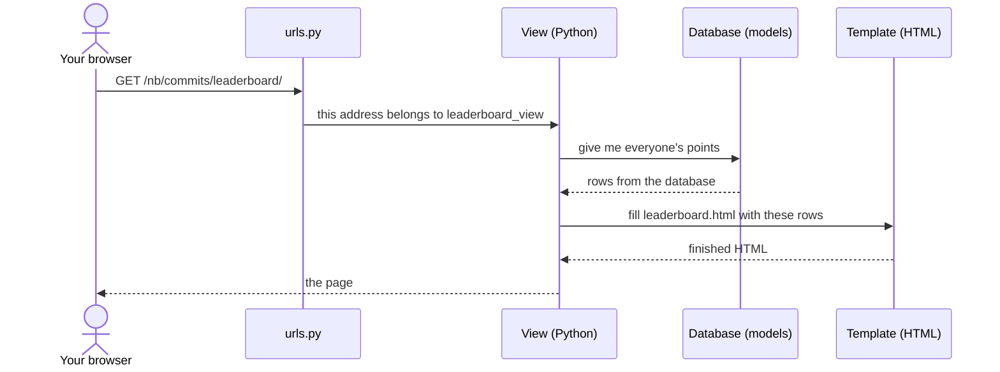
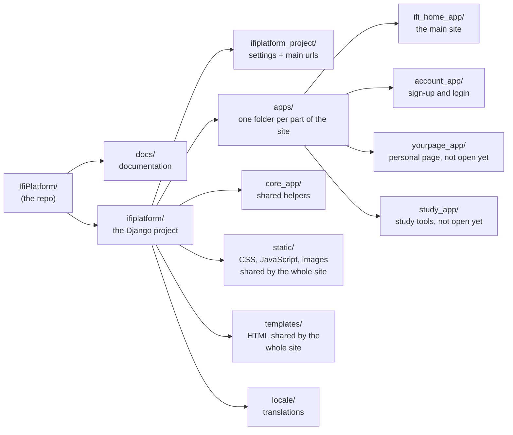
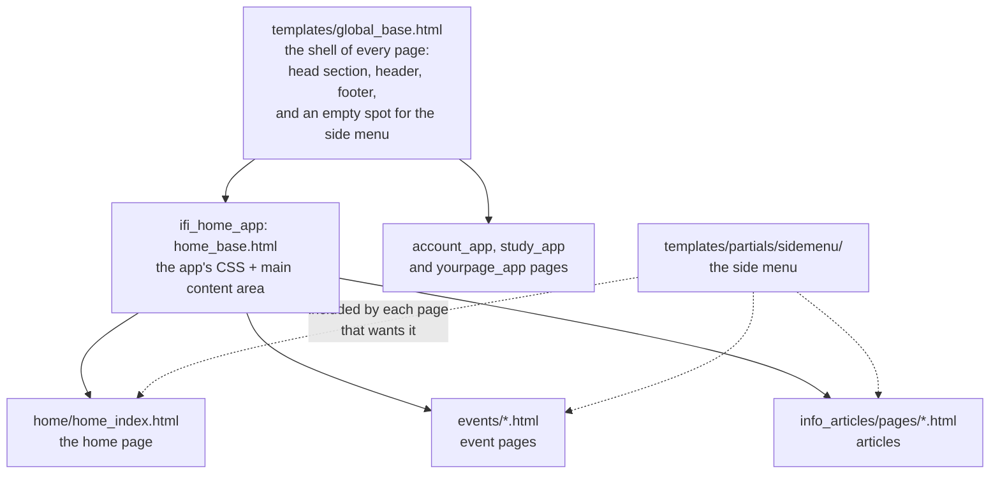

# How this project works (for beginners)

Last updated: 2026-10-26

This is a big project, but you only need a small part of it to fix an
issue. This page tells you where things are and explains the words
you'll see. It doesn't ask you to understand everything. Reading it takes
about 10 minutes.

All paths below start in the `ifiplatform/` folder, where `manage.py` is,
unless they say otherwise.


## Django in plain words

A website is a program that answers one question again and again: *"Give
me the page at this address."* Django is a Python framework that does
the boring parts of answering it for us.

It is sort into a **project folder** and **apps**. HTML are placed in **`/templates`** while CSS har placed in **`/static`**. There exists /templates and /static **globally** that affect the whole site or **per-app** which only affect the respective app. The most important file is **`manage.py`** which is explain below.

You fill in four pieces:

| Piece | File | What it does |
| --- | --- | --- |
| **URL** | `urls.py` | Matches the address (like `/commits/leaderboard/`) to a view |
| **View** | `views/` | Python code that collects what the page needs |
| **Model** | `models.py` or `models/` | Describes a database table, like `EventPage`. Django reads and writes the database for you |
| **Template** | `templates/` | HTML with holes in it. The view fills in the holes |

Here is what happens when you open the leaderboard:



Two more words you'll see:

- **Migration:** when a model changes (a new field, for example), Django
  writes a small file in `migrations/` that changes the database to match.
  Think of the folder as the history of the database. Never edit these
  files by hand. `python manage.py makemigrations` makes them for you.
- **`manage.py`:** the remote control for the project. Every command
  starts with `python manage.py`: `test`, `migrate`, `createsuperuser`
  and so on. See [everyday_commands.md](everyday_commands.md).

## Wagtail in one paragraph

Wagtail sits on top of Django and adds an editor at `/wagtail-admin`.
There, people write pages without touching code: articles, news,
student unions and events are written this way. So there are two kinds
of pages. **Wagtail pages** are written in the editor, and their text is
in the database, not in the code. **Django pages** (the home page,
sign-in, Your page) are built in code. If you search the code
for a sentence and can't find it, it's probably Wagtail content. More in
[Two kinds of pages](../architecture/overview.md#two-kinds-of-pages).

## A tour of the folders



**In `ifiplatform/`:**

| Folder or file | What's in it |
| --- | --- |
| `manage.py` | The command tool (see above) |
| `ifiplatform_project/` | `settings.py` and the main `urls.py`. You rarely need to touch this |
| `apps/` | The parts of the site. Each app is its own small Django project |
| `core_app/` | Small helpers every app uses |
| `static/` | Files sent to the browser as they are: CSS, JavaScript, images. "Static" means they don't change per visitor |
| `templates/` | HTML templates shared by every page: the base page, header and footer |
| `locale/` | Translations of the texts in templates and code (`nb` and `en`) |
| `media/` | Pictures uploaded in the editor. Not in git. With Docker they're kept in a Docker volume instead |

**Inside an app** (for example `apps/account_app/`):

| Folder or file | What's in it |
| --- | --- |
| `urls.py` | The addresses this app answers |
| `views/` (or `views.py`) | The Python code behind each page |
| `models.py` (or `models/`) | The database tables of this app |
| `templates/` | This app's HTML |
| `static/` | This app's CSS, JavaScript and images |
| `migrations/` | Database history. Don't edit by hand |
| `tests.py` (or `tests/`) | Automatic tests |
| `management/commands/` | The app's own `manage.py` commands |
| `admin.py` | What shows up in the Django admin |

**Files you can ignore** (they're for servers and automation):
`deploy/`, `compose.prod.yml`, `Dockerfile`, `.github/workflows/`,
`ifiplatform/django_cache/`. The `docs/claude_*` folders are notes for AI
tools, not for people.

## Where do I change…?

| I want to change… | Look in | Example |
| --- | --- | --- |
| A colour used across the site | `static/css/01_settings/tokens.css` | `--color-accent: var(--color-turq);` |
| How something looks (spacing, size, font, colour of one thing) | A `.css` file in `static/css/` or `apps/<app>/static/css/` | `static/css/06_components/header.css` |
| Text that is the same on every visit (buttons, headings, labels) | A template (`.html`) in `templates/` or `apps/<app>/templates/` | `templates/partials/footer.html` |
| The header or footer | `templates/partials/` | `header.html`, `footer.html` |
| How the side menu looks | `templates/partials/sidemenu/` and `static/css/06_components/sidemenu.css` | |
| The links in a menu | Not the code: menus are edited at http://localhost:8000/wagtail-admin | |
| The text of an article, news post or event | Not the code: edit it on the site at http://localhost:8000/wagtail-admin | |
| A picture or icon | `static/images/` or `apps/<app>/static/images/` | `static/images/icons/` |
| The home page | `apps/ifi_home_app/templates/home/` | `home_index.html` |
| The sign-in and account pages | `apps/account_app/templates/` | `login/signin.html` |

**The fastest trick:** find a piece of text you can see on the page and
search for it in VS Code with **Ctrl+Shift+F** (Cmd+Shift+F on macOS).
The search finds the template that shows it. For a CSS class, right-click
the element in the browser, choose **Inspect**, copy the class name and
search for that.

> **Text in two languages.** Templates are written in English, inside
> ``. The Norwegian version lives in
> `locale/nb/LC_MESSAGES/django.po`. For example, ``
> shows "Personvernerklæring" on the Norwegian site. If you change the
> English text, the Norwegian one must be updated too. See
> [Translations](everyday_commands.md#translations).

## The CSS folders and their numbers

The CSS folders are numbered so that they load in the right order. Lower
numbers load first, and later files can override earlier ones:

| Folder | What goes there |
| --- | --- |
| `01_settings/` | Variables: colours, spacing, fonts (`tokens.css`) |
| `03_generics/` | A reset, so every browser starts the same |
| `04_elements/` | Plain HTML tags: `h1`, `a`, `p` |
| `05_objects/` | Layout only: where things sit (grid, columns, gaps) |
| `06_components/` | Styled pieces: a button, a card, the header |

02 is skipped on purpose. You don't need to know why.

**Example: change the site's accent colour.** Open
`static/css/01_settings/tokens.css` and find:
```css
--color-accent: var(--color-turq);
```
Point it at another colour from the list at the top of the file, like
`var(--color-purple)`, or a new one like `#ff8800`.
Save, refresh the browser, and everything that uses the accent colour
changes. Using a variable like this beats writing the colour into one
component file.

Full details: [frontend.md](../architecture/frontend.md).

## Templates build on each other

A page doesn't repeat the whole HTML document. It **extends** a base
template and only fills in its own parts:



Three template tags do most of the work:

- ``: "start from this base template".
- ` ... `: "put this in the hole called
  `maincontent` in the base".
- ``: "paste this small piece here".

**The side menu is an example of all three.** `global_base.html` leaves an
empty `sidemenu` block, and each page that wants the menu fills it with
``. The menu is in the global
`templates/partials/` folder so that any app can use it. Today only the
`ifi_home_app` pages do.

Anything inside `{{ ... }}` is a value the view filled in, like
`{{ page.title }}`.

## Next
- Make your first change: [Make a change, step by step](../../CONTRIBUTING.md#2-make-a-change-step-by-step)
- Learn more Django, HTML or CSS: [TUTORIALS.md](../../TUTORIALS.md)
- The full map of the system, with a diagram of each app:
  [architecture/overview.md](../architecture/overview.md)
